# CAREER_DECISION_MAP

**Purpose.** The one document to open before a major career decision. Every statement below is traced to a table in `outputs/tables/` (T/JB/D/Q ids) via `docs/market-guide.md`; robustness labels follow the rule in `docs/limitations.md` (robust = holds on n ≥ 200, in both the AMS and the LinkedIn/karriere side, with confidence interval clear of the comparison; tentative otherwise). **All Styrian figures are tentative (n = <!--m:styria_core_flag-->68<!--/m-->) and are given as counts.**

<!-- BQ29_styria_sample_sizes:start (figure generated by src/analysis/make_visual_layer.py - do not edit by hand) -->
**Q. Which of my Styrian conclusions are actually too small to carry a decision?**

All of them, by the project's own rule: the largest Styrian family cell is 28 postings against a robustness threshold of 30, and three families sit at five or fewer - so Styrian findings are read as counts and directions, never as percentages.

[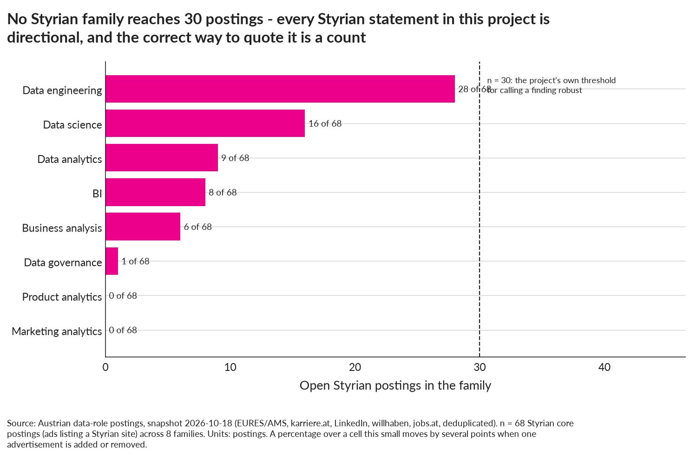](outputs/figures/BQ29_styria_sample_sizes.png)

**Figure BQ29** · comparison across categories shown as `horizontal_bar` (bivariate-simple) · built from `T02_role_family_counts.csv` · units: postings. **Read with:** The official yearly series (JB05) puts Styria at 13.6 % of the national flow against 8.9% here (by primary state; 9.7% counting every ad with a Styrian site), so this snapshot may also understate Styrian volume, not only measure it imprecisely.
<!-- BQ29_styria_sample_sizes:end -->

**Data vintage.** Snapshot of open postings collected <!--m:_meta.demand_vintage-->2026-10-18<!--/m--> (<!--m:raw_rows_n-->11,997<!--/m--> raw rows from EURES/AMS, karriere.at, LinkedIn, willhaben, jobs.at → <!--m:core_n-->699<!--/m--> deduplicated core data-role postings after the 2026-09-16 taxonomy audit, <!--m:styria_core_flag-->68<!--/m--> in Styria incl. multi-site ads, <!--m:styria_core_primary_state-->62<!--/m--> by primary state); AMS JobBarometer yearly series <!--m:jobbarometer_year_first-->2020<!--/m-->–<!--m:jobbarometer_year_last-->2025<!--/m-->. Re-run before relying on this after ~<!--m:_meta.stale_after_demand:ym-->2027-01<!--/m--> (see collection restrictions in AGENT_CONTEXT §21).

**Reading rules.** "Share" = share of ads that *mention* something. A one-day snapshot is a stock of open ads, not yearly demand, not vacancies, not hires. Nothing here measures hiring outcomes; every "lever" below is an observed requirement pattern, not a causal effect on getting hired.

---

## WHERE IS THE MARKET?

* **Vienna: <!--m:vienna_share_core-->45 %<!--/m--> of open core data postings (<!--m:vienna_core_primary_state-->315<!--/m--> of <!--m:core_n-->699<!--/m-->). Upper Austria <!--m:upper_austria_share_core-->17 %<!--/m-->. Styria <!--m:styria_share_primary_state:pct1-->8.9 %<!--/m--> (<!--m:styria_core_primary_state-->62<!--/m-->; <!--m:styria_core_flag-->68<!--/m--> incl. multi-site ads).** Robust for the ranking; the Styrian share is tentative (official yearly data puts it at <!--m:jb_data_scientist_styria_share_of_austria:pct1-->13.6 %<!--/m-->, JB05).

<!-- BQ01_reachable_market:start (figure generated by src/analysis/make_visual_layer.py - do not edit by hand) -->
**Q. If I do not move from Graz, how much of the Austrian data market am I actually applying to?**

By primary state, Styria holds 62 of 699 open core postings (8.9%); 54 of them are inside the Graz commuting area, against 315 in Vienna (45%).

[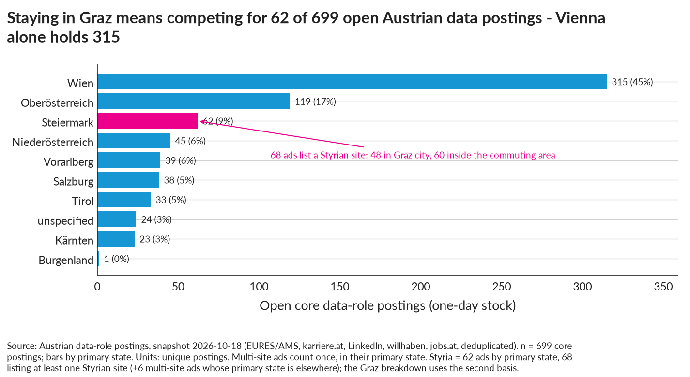](outputs/figures/BQ01_reachable_market.png)

**Figure BQ01** · comparison across categories shown as `horizontal_bar` (bivariate-simple) · built from `T03a_state_counts.csv`, `T03c_styria_cities.csv` · units: unique postings. **Read with:** One-day stock of open advertisements, not yearly demand. The official yearly series (JB05) puts Styria higher, at 13.6 % of the national flow. Counting every ad that lists a Styrian site (the location-flag basis of T02/T04a/T07e) Styria has 68 postings, 60 of them in the Graz commuting area, and Vienna 321.
<!-- BQ01_reachable_market:end -->

* Styria = Graz: <!--m:graz_city_n-->50<!--/m--> of <!--m:styria_core_flag-->68<!--/m--> Styrian postings are in Graz city, <!--m:graz_area_core_flag-->60<!--/m--> in the commuting area; the rest are single ads in Weiz, Leoben, Liezen (T03c).
* On the official flow measure, Austria's "Data Scientist"-class ads fell from <!--m:jb_data_scientist_peak__austria-->5,032<!--/m--> (<!--m:jb_data_scientist_peak_year__austria-->2022<!--/m-->) to <!--m:jb_data_scientist_ads_latest__austria-->2,207<!--/m--> (<!--m:jobbarometer_year_last-->2025<!--/m-->), <!--m:jb_data_scientist_change__austria-->−28 %<!--/m--> vs 2020; **Large regions above their <!--m:jobbarometer_year_first-->2020<!--/m--> level: <!--m:jb_growing_regions-->Styria (+34 %) and Vienna (+15 %)<!--/m--> (Styria <!--m:jb_data_scientist_ads_first__styria-->224<!--/m--> → <!--m:jb_data_scientist_ads_latest__styria-->300<!--/m-->, <!--m:jb_data_scientist_change__styria-->+34 %<!--/m-->)**; Vienna <!--m:jb_data_scientist_change_from_peak__vienna-->−48 %<!--/m--> from its peak (JB01). AMS rates the 2026–28 outlook "positiv" in every Bundesland. Robust as an official series; it counts a coarse occupation class, not our titles.

<!-- BQ02_regional_trend:start (figure generated by src/analysis/make_visual_layer.py - do not edit by hand) -->
**Q. Is the Graz market growing or shrinking while I spend a year preparing?**

On the official yearly series Styria is +34% against 2020 (224 → 300 ads) while Austria is -28% and Vienna is -48% off its 2022 peak; large regions above their 2020 level: Styria (+34%) and Vienna (+15%).

[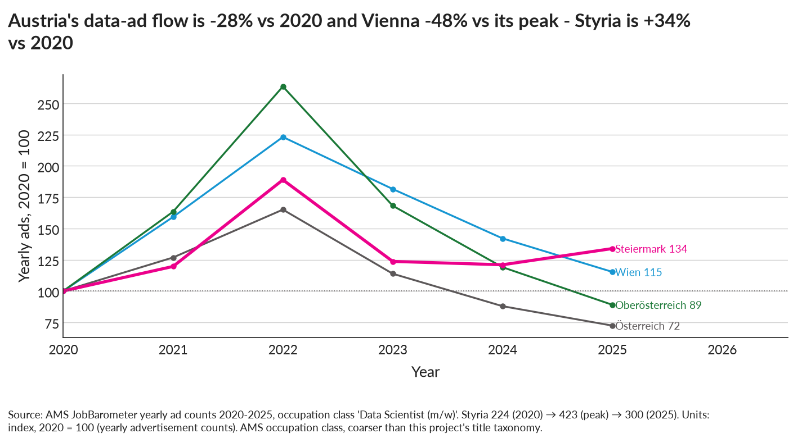](outputs/figures/BQ02_regional_trend.png)

**Figure BQ02** · trend over time shown as `multi_line` (bivariate-dual) · built from `JB01_yearly_counts_long.csv` · units: index, 2020 = 100. **Read with:** A coarse AMS occupation class ('Data Scientist (m/w)'), not this project's title taxonomy; counts advertisements, not hires.
<!-- BQ02_regional_trend:end -->

## WHAT ROLES EXIST?

Ranked by open postings (T02): data engineering <!--m:family_share__data_engineering-->20 %<!--/m--> (Data Engineer <!--m:title_n__data_engineer-->101<!--/m-->) · data science <!--m:family_share__data_science-->25 %<!--/m--> (Data Scientist <!--m:title_n__data_scientist-->85<!--/m-->, ML/AI Engineer <!--m:title_n__machine_learning_ai_engineer-->91<!--/m-->) · business analysis <!--m:family_share__business_analysis-->15 %<!--/m--> · data analytics <!--m:family_share__data_analytics-->15 %<!--/m--> (Data Analyst <!--m:title_n__data_analyst-->79<!--/m-->, data-heavy finance/risk analysts <!--m:title_n__financial_risk_controlling_analyst_data_heavy-->28<!--/m-->) · BI <!--m:family_share__bi-->13 %<!--/m--> (developer <!--m:title_n__bi_developer_bi_engineer-->40<!--/m-->, analyst <!--m:title_n__bi_analyst-->30<!--/m-->, consultant <!--m:title_n__bi_consultant_analytics_consultant-->22<!--/m-->) · data governance <!--m:family_share__data_governance-->9 %<!--/m--> (of which <!--m:title_n__master_product_data_management_operational-->27<!--/m--> are operational master-data roles) · **marketing analytics <!--m:family_share__marketing_analytics-->3 %<!--/m--> (<!--m:family_n__marketing_analytics-->18<!--/m--> postings, <!--m:family_styria_n__marketing_analytics-->0<!--/m--> in Styria) · product analytics <!--m:family_n__product_analytics-->3<!--/m--> posting**. Robust for the ranking. Plus <!--m:adjacent_n__ai_software_engineering-->299<!--/m--> AI-software-engineering titles (software roles, excluded) and <!--m:adjacent_n__other_data-->234<!--/m--> unclassifiable data-ish titles. Title precision measured at <!--m:title_precision_strict_after-->83 %<!--/m--> strict / <!--m:title_precision_lenient_after-->95 %<!--/m--> lenient (Q03c).

<!-- BQ06_styria_vs_austria_mix:start (figure generated by src/analysis/make_visual_layer.py - do not edit by hand) -->
**Q. Does Graz want a different kind of data person than Austria as a whole?**

Yes: data engineering is 41% of the 68 postings that list a Styrian site against 20% nationally, business analysis falls from 15% to 9%, and marketing and product analytics are absent from Styria entirely.

[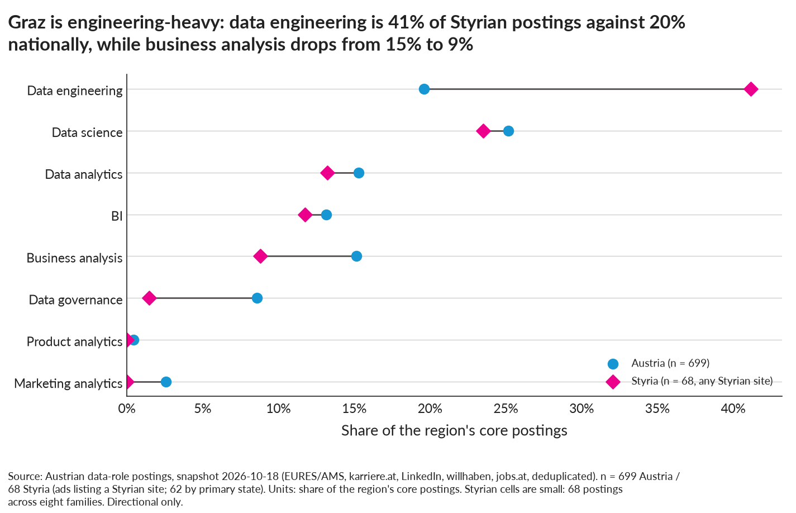](outputs/figures/BQ06_styria_vs_austria_mix.png)

**Figure BQ06** · ranking shown as `dumbbell` (categorical-multi) · built from `T02_role_family_counts.csv` · units: share of postings. **Read with:** n = 68 for Styria (ads listing a Styrian site; 62 by primary state); every family cell is below 30, so differences are directional.
<!-- BQ06_styria_vs_austria_mix:end -->

## WHERE ARE THEY? (Styria specifically)

Styria's <!--m:styria_core_flag-->68<!--/m-->: data engineering <!--m:family_styria_n__data_engineering-->28<!--/m-->, data science <!--m:family_styria_n__data_science-->16<!--/m-->, data analytics <!--m:family_styria_n__data_analytics-->9<!--/m-->, BI <!--m:family_styria_n__bi-->8<!--/m-->, governance <!--m:family_styria_n__data_governance-->1<!--/m-->, business analysis <!--m:family_styria_n__business_analysis-->6<!--/m-->, marketing/product <!--m:family_styria_n__marketing_analytics-->0<!--/m--> (T02). Named employers (<!--m:employers_styria_n-->32<!--/m-->; <!--m:employer__styria_postings_without_named_employer-->12<!--/m--> postings unnamed): KNAPP <!--m:employer_styria_postings__knapp-->5<!--/m-->, adesso <!--m:employer_styria_postings__adesso-->4<!--/m-->, Tieto <!--m:employer_styria_postings__tieto-->3<!--/m-->, CANCOM, niceshops, Anton Paar, Mercedes-Benz G, Magna <!--m:employer_styria_postings__cancom-->2<!--/m--> each, then Netconomy, KERN, ÖGK, ams OSRAM, Kapsch, Merkur, Easelink and others with one (T04a). Tentative (small n), but the industrial/consultancy pattern matches the JobBarometer picture.

<!-- BQ04_styria_employers:start (figure generated by src/analysis/make_visual_layer.py - do not edit by hand) -->
**Q. Which Styrian employers actually advertise data roles - who is on my realistic target list?**

32 named employers carry 56 of the 68 ads that list a Styrian site; Magna International leads with 5, and 11 of the largest 14 advertise analytics, BI or business-analysis roles rather than only engineering.

[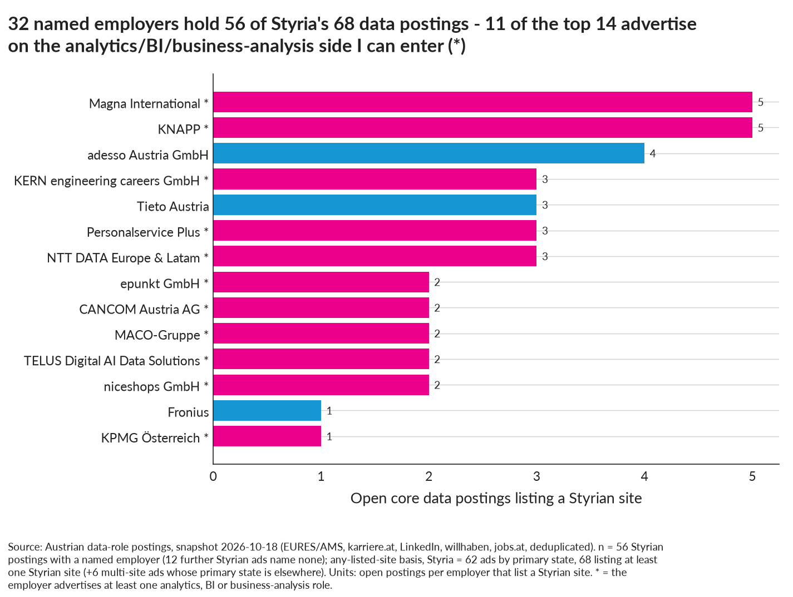](outputs/figures/BQ04_styria_employers.png)

**Figure BQ04** · ranking shown as `horizontal_bar` (bivariate-simple) · built from `T04a_employers_styria.csv` · units: open postings. **Read with:** A one-day stock: an employer absent here is not an employer that does not hire. 12 Styrian ads (AMS/EURES) name no employer at all. Counts are on the any-listed-site basis (68), not the primary-state count (62).
<!-- BQ04_styria_employers:end -->

## WHAT DO THEY REQUIRE?

Mention shares among <!--m:core_n_text_basis-->699<!--/m--> core ads (T05): SQL <!--m:sql_share-->40 %<!--/m-->, dashboards/visualisation <!--m:visualisation_share-->36 %<!--/m-->, Python <!--m:python_share-->39 %<!--/m-->, data-quality/governance wording <!--m:data_quality_share-->31 %<!--/m-->, cloud <!--m:cloud_share-->32 %<!--/m-->, ETL <!--m:etl_share-->20 %<!--/m-->, Azure <!--m:azure_share-->19 %<!--/m-->, Power BI <!--m:power_bi_share-->17 %<!--/m-->, Excel <!--m:excel_share-->14 %<!--/m-->, data modelling <!--m:data_modelling_share-->17 %<!--/m-->, ML <!--m:ml_share-->18 %<!--/m-->, GenAI/LLM <!--m:genai_share-->18 %<!--/m-->, CI/CD <!--m:ci_cd_share-->15 %<!--/m-->, statistics <!--m:statistics_share-->16 %<!--/m-->. Robust for the ranking and levels of the top ten.
Per family (T14): analysts (n <!--m:family_desc_n__data_analytics-->107<!--/m-->) = visualisation <!--m:skill_family_share__data_analytics__data_visualization-->55 %<!--/m-->, Excel <!--m:skill_family_share__data_analytics__excel-->39 %<!--/m-->, SQL <!--m:skill_family_share__data_analytics__sql-->36 %<!--/m-->, Power BI <!--m:skill_family_share__data_analytics__power_bi-->30 %<!--/m-->, Python <!--m:skill_family_share__data_analytics__python-->33 %<!--/m-->; BI (<!--m:family_desc_n__bi-->92<!--/m-->) = visualisation <!--m:skill_family_share__bi__data_visualization-->87 %<!--/m-->, SQL <!--m:skill_family_share__bi__sql-->49 %<!--/m-->, Power BI <!--m:skill_family_share__bi__power_bi-->43 %<!--/m-->, data modelling <!--m:skill_family_share__bi__data_modeling-->34 %<!--/m-->, SAP BW <!--m:skill_family_share__bi__sap_bw_bo-->37 %<!--/m-->; data scientists (<!--m:family_desc_n__data_science-->176<!--/m-->) = Python <!--m:skill_family_share__data_science__python-->76 %<!--/m-->, ML <!--m:skill_family_share__data_science__machine_learning-->60 %<!--/m-->, GenAI <!--m:skill_family_share__data_science__generative_ai_llm-->60 %<!--/m-->, cloud <!--m:skill_family_share__data_science__cloud_generic-->49 %<!--/m-->, SQL <!--m:skill_family_share__data_science__sql-->34 %<!--/m-->, Azure <!--m:skill_family_share__data_science__azure-->27 %<!--/m-->, statistics <!--m:skill_family_share__data_science__statistics_general-->31 %<!--/m-->; data engineers (<!--m:family_desc_n__data_engineering-->137<!--/m-->) = SQL <!--m:skill_family_share__data_engineering__sql-->72 %<!--/m-->, ETL <!--m:skill_family_share__data_engineering__etl_elt-->53 %<!--/m-->, Python <!--m:skill_family_share__data_engineering__python-->61 %<!--/m-->, cloud <!--m:skill_family_share__data_engineering__cloud_generic-->52 %<!--/m-->, Azure <!--m:skill_family_share__data_engineering__azure-->46 %<!--/m-->, modelling <!--m:skill_family_share__data_engineering__data_modeling-->36 %<!--/m-->, CI/CD <!--m:skill_family_share__data_engineering__ci_cd-->37 %<!--/m-->, Databricks <!--m:skill_family_share__data_engineering__databricks-->31 %<!--/m-->.
Soft/business wording (indicative): stakeholder/business-partner <!--m:skill_share__stakeholder_management-->54 %<!--/m-->, communication <!--m:skill_share__communication-->60 %<!--/m-->, analytical thinking <!--m:skill_share__analytical_thinking-->52 %<!--/m-->; consulting context <!--m:skill_share__consulting-->32 %<!--/m-->, finance/controlling <!--m:skill_share__finance_controlling-->24 %<!--/m-->, marketing <!--m:skill_share__marketing-->9 %<!--/m-->.

<!-- BQ08_demanded_skills:start (figure generated by src/analysis/make_visual_layer.py - do not edit by hand) -->
**Q. Which tools do Austrian employers actually name - and how much of that list do I already hold?**

AI (generic) (43%) and Python lead the list, and 9 of the 10 most-mentioned items are already in my have-or-developing profile; the intervals separate the top tier cleanly from everything under 10 %.

[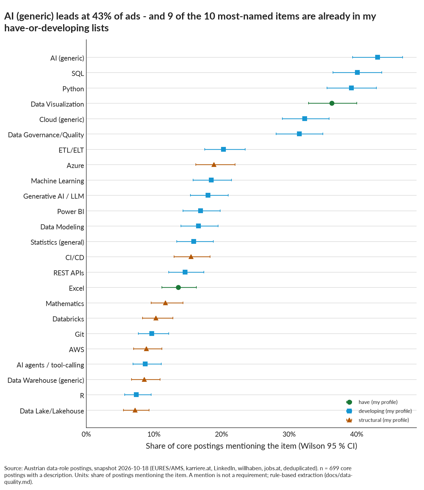](outputs/figures/BQ08_demanded_skills.png)

**Figure BQ08** · ranking shown as `error_bars` (interval-range) · built from `T05_skills_all_tech.csv`, `config/profile.json` · units: share of postings. **Read with:** Shares count ads that *mention* an item, never ads that require it; the profile status is self-declared, not demonstrated.
<!-- BQ08_demanded_skills:end -->

## WHAT LANGUAGES DO THEY REQUIRE?

* **<!--m:german_stated_share-->42 %<!--/m--> of ads state a German requirement (<!--m:german_required_explicit_share:pct1-->10.2 %<!--/m--> explicit, <!--m:german_level_stated_share-->32 %<!--/m--> by level); when a level is stated it is wording we bucket as C1-equivalent in <!--m:german_c1_bucket_share-->41 %<!--/m--> of all ads (mostly "sehr gut", an assumption) and B2 in <!--m:german_b2_share-->13 %<!--/m-->.** <!--m:german_not_mentioned_share-->37 %<!--/m--> are silent (and German-written silence usually implies German). <!--m:english_posting_share-->26 %<!--/m--> of ads are written in English; **in those, German is still required/level-stated in <!--m:english_ads_german_stated_share-->20 %<!--/m--> and preferred in <!--m:english_ads_german_preferred_share-->19 %<!--/m-->** (T07, T07d). Robust.
* By family: BI <!--m:german_stated_share__bi-->52 %<!--/m--> German required/level-stated, business analysis <!--m:german_stated_share__business_analysis-->43 %<!--/m-->, data analytics <!--m:german_stated_share__data_analytics-->40 %<!--/m-->, governance <!--m:german_stated_share__data_governance-->47 %<!--/m-->, data engineering <!--m:german_stated_share__data_engineering-->42 %<!--/m-->, **data science <!--m:german_stated_share__data_science-->36 %<!--/m--> and <!--m:posting_language_family_share__data_science__en-->41 %<!--/m--> English-written**. Robust for the ordering.

<!-- BQ13_language_by_family:start (figure generated by src/analysis/make_visual_layer.py - do not edit by hand) -->
**Q. Which role family gives my English the most room and my German the least resistance?**

Data science: 41% of its ads are written in English and 36% state a German requirement, against BI at 13% English and 52% German - the language dimension moves more between families than the skill lists do.

[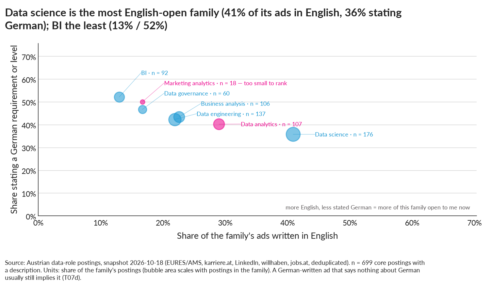](outputs/figures/BQ13_language_by_family.png)

**Figure BQ13** · correlation shown as `bubble` (trivariate) · built from `T07c_posting_language_by_family.csv`, `T07_german_requirement_by_role_family.csv` · units: share of postings. **Read with:** Marketing analytics (n = 18) and product analytics (n = 3) carry cells too small to separate.
<!-- BQ13_language_by_family:end -->

* **Styria: <!--m:german_stated_n_styria-->33<!--/m--> of <!--m:styria_n_text_basis-->68<!--/m--> state a German requirement (<!--m:german_stated_share_styria-->49 %<!--/m-->) vs <!--m:german_stated_share_elsewhere-->42 %<!--/m--> elsewhere; <!--m:english_posting_n_styria-->12<!--/m--> of <!--m:styria_n_text_basis-->68<!--/m--> are English-written** (tentative).
* Addressable-set scenarios (T07e), three readings that bracket rather than pin the truth: English-written *and* no stated German requirement — <!--m:english_no_german_n_national-->147<!--/m--> of <!--m:addressable_scope_n_national-->699<!--/m--> nationally (<!--m:english_no_german_share_national-->21 %<!--/m-->), **<!--m:english_no_german_n_styria-->8<!--/m--> of <!--m:addressable_scope_n_styria-->68<!--/m--> in Styria**, <!--m:english_no_german_n_vienna-->78<!--/m--> of <!--m:addressable_scope_n_vienna-->321<!--/m--> in Vienna; no explicit German requirement (silence included) — <!--m:no_explicit_german_n_national-->404<!--/m--> nationally, <!--m:no_explicit_german_n_styria-->35<!--/m--> of <!--m:addressable_scope_n_styria-->68<!--/m--> in Styria; German not required at C1-equivalent — <!--m:not_c1_n_national-->488<!--/m--> nationally, <!--m:not_c1_n_styria-->42<!--/m--> of <!--m:addressable_scope_n_styria-->68<!--/m--> in Styria. "English-written, no stated requirement" is not "English-only": German may still be preferred or expected.

<!-- BQ12_german_addressable_market:start (figure generated by src/analysis/make_visual_layer.py - do not edit by hand) -->
**Q. With German at A2-B1, how many Graz jobs can I honestly apply to today?**

Between 8 and 42 of the 68 open ads that list a Styrian site, depending on which reading you take; the strictest reading (English-written and silent on German) leaves 8 in Styria and 6 in the Graz area.

[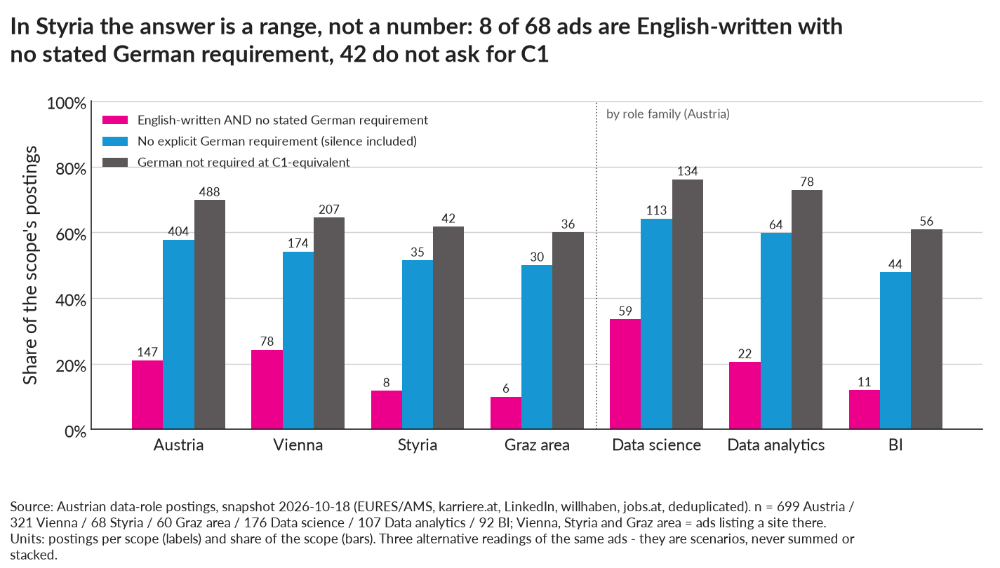](outputs/figures/BQ12_german_addressable_market.png)

**Figure BQ12** · comparison across categories shown as `grouped_bar` (bivariate-dual) · built from `T07e_addressable_market_scenarios.csv` · units: postings / share of scope. **Read with:** 'English-written and silent on German' is not 'English-only': German may still be expected. Whether a stated requirement is negotiable is not measured anywhere in this project.
<!-- BQ12_german_addressable_market:end -->

## WHAT TECHNOLOGIES DO THEY REQUIRE?

Microsoft-centred stack: Azure <!--m:azure_share-->19 %<!--/m--> vs AWS <!--m:aws_share-->9 %<!--/m--> vs GCP <!--m:gcp_share-->5 %<!--/m-->; Power BI <!--m:power_bi_share-->17 %<!--/m--> vs Tableau <!--m:tableau_share-->3 %<!--/m-->; Databricks <!--m:databricks_share-->10 %<!--/m-->, Fabric <!--m:fabric_share-->5 %<!--/m-->, Snowflake <!--m:snowflake_share-->6 %<!--/m--> (T05). Stacks: ETL+Python+SQL <!--m:stack_share__etl_elt_plus_python_plus_sql-->10 %<!--/m-->, Cloud+Python+SQL <!--m:stack_share__cloud_generic_plus_python_plus_sql-->12 %<!--/m-->, AI+GenAI+Python <!--m:stack_share__ai_generic_plus_generative_ai_llm_plus_python-->14 %<!--/m-->, Visualisation+Power BI+SQL <!--m:stack_share__data_visualization_plus_power_bi_plus_sql-->10 %<!--/m-->, Azure+Python+SQL <!--m:stack_share__azure_plus_python_plus_sql-->9 %<!--/m--> (T06b). SQL and Python co-occur in <!--m:cooc_share__sql__python-->25 %<!--/m--> of ads; <!--m:cooc_b_given_a__sql__python-->63 %<!--/m--> of SQL ads also mention Python; <!--m:cooc_a_given_b__sql__power_bi-->70 %<!--/m--> of Power BI ads mention SQL; <!--m:cooc_a_given_b__azure__databricks-->79 %<!--/m--> of Databricks ads are Azure ads; DAX is named in only 15 % of Power BI ads; dbt in <!--m:dbt_n-->23<!--/m--> ads (T06). Python libraries are almost never named (pandas <!--m:pandas_share-->3 %<!--/m-->, scikit-learn <!--m:scikit_learn_share:tpct0-->3 %<!--/m-->). **Styrian ads lean engineering: Python <!--m:python_n_styria-->30<!--/m--> of <!--m:styria_n_text_basis-->68<!--/m-->, Azure <!--m:azure_n_styria-->27<!--/m-->, cloud <!--m:cloud_n_styria-->44<!--/m-->, ETL <!--m:etl_n_styria-->28<!--/m-->, Databricks <!--m:databricks_n_styria-->20<!--/m--> (<!--m:python_share_styria:pctn0-->44<!--/m-->/<!--m:azure_share_styria:pctn0-->40<!--/m-->/<!--m:cloud_share_styria:pctn0-->65<!--/m-->/<!--m:etl_share_styria:pctn0-->41<!--/m-->/<!--m:databricks_share_styria:pctn0-->29<!--/m--> % vs <!--m:python_share_rest:pctn0-->39<!--/m-->/<!--m:azure_share_rest:pctn0-->17<!--/m-->/<!--m:cloud_share_rest:pctn0-->29<!--/m-->/<!--m:etl_share_rest:pctn0-->18<!--/m-->/<!--m:databricks_share_rest:pctn0-->8<!--/m--> % elsewhere); Excel and Power BI lower** (tentative). Robust nationally.

<!-- BQ10_skill_cooccurrence:start (figure generated by src/analysis/make_visual_layer.py - do not edit by hand) -->
**Q. What is the minimum credible stack - which skills do employers ask for together?**

SQL is the hub: 62% of SQL ads also name Python and 64% of Python ads name SQL, while Power BI's strongest partner is reporting wording rather than Python - a SQL + Python + dashboard combination covers the densest part of the matrix.

[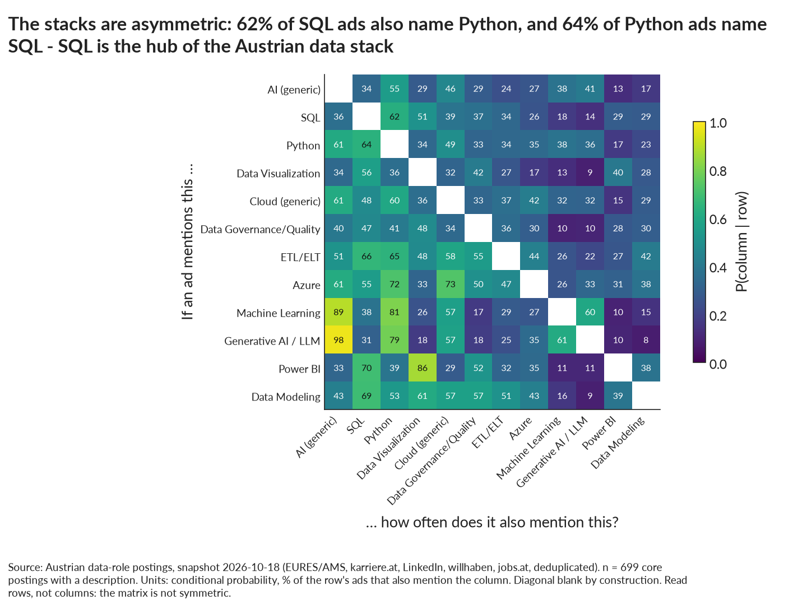](outputs/figures/BQ10_skill_cooccurrence.png)

**Figure BQ10** · correlation shown as `heatmap` (trivariate) · built from `T06_cooccurrence_pairs.csv`, `T05_skills_all_tech.csv` · units: conditional probability. **Read with:** Co-mention in an advertisement, not a statement about how the tools are used together in the job.
<!-- BQ10_skill_cooccurrence:end -->

## WHAT EDUCATION DO THEY REQUIRE?

Degree wording is *required* in <!--m:degree_required_share-->30 %<!--/m--> of ads, *preferred* in <!--m:degree_preferred_share:pct1-->2.4 %<!--/m-->, merely mentioned in <!--m:degree_mentioned_only_share-->30 %<!--/m-->, absent in <!--m:degree_none_share-->37 %<!--/m--> (T11e); "or equivalent experience" in <!--m:degree_or_equivalent_share-->31 %<!--/m-->; fields named: informatics <!--m:degree_field_share__computer_science_informatics-->36 %<!--/m-->, engineering <!--m:degree_field_share__engineering_physics-->35 %<!--/m-->, business/economics <!--m:degree_field_share__economics_business-->28 %<!--/m-->, data science <!--m:degree_field_share__data_science:pct1-->19.3 %<!--/m-->, statistics/mathematics <!--m:degree_field_share__statistics_mathematics:pct1-->13.6 %<!--/m-->; **Master <!--m:degree_level_share__master-->13 %<!--/m-->, PhD <!--m:degree_level_share__phd-->3 %<!--/m-->**. **Certifications: any wording <!--m:cert_any_share-->13 %<!--/m-->, specific ones ≤ <!--m:cert_max_share-->2 %<!--/m--> each** even after adding exam codes (IREB/IIBA <!--m:cert_share__requirements_ba_cert_ireb_iiba_cbap-->2 %<!--/m--> — in business-analysis ads; Azure <!--m:cert_share__azure_cert:pct1-->0.3 %<!--/m-->; Google <!--m:cert_share__google_cert:pct1-->0.1 %<!--/m-->; Tableau/Databricks/Power BI/AWS 0) (T11). Robust.

<!-- BQ14_degree_requirement:start (figure generated by src/analysis/make_visual_layer.py - do not edit by hand) -->
**Q. Does not holding a data/informatics degree close the door?**

It narrows it rather than closing it: 28%-36% of ads state a degree as a condition depending on the family, 27%-42% never mention education at all, and a third of the conditional ads add 'or equivalent experience'.

[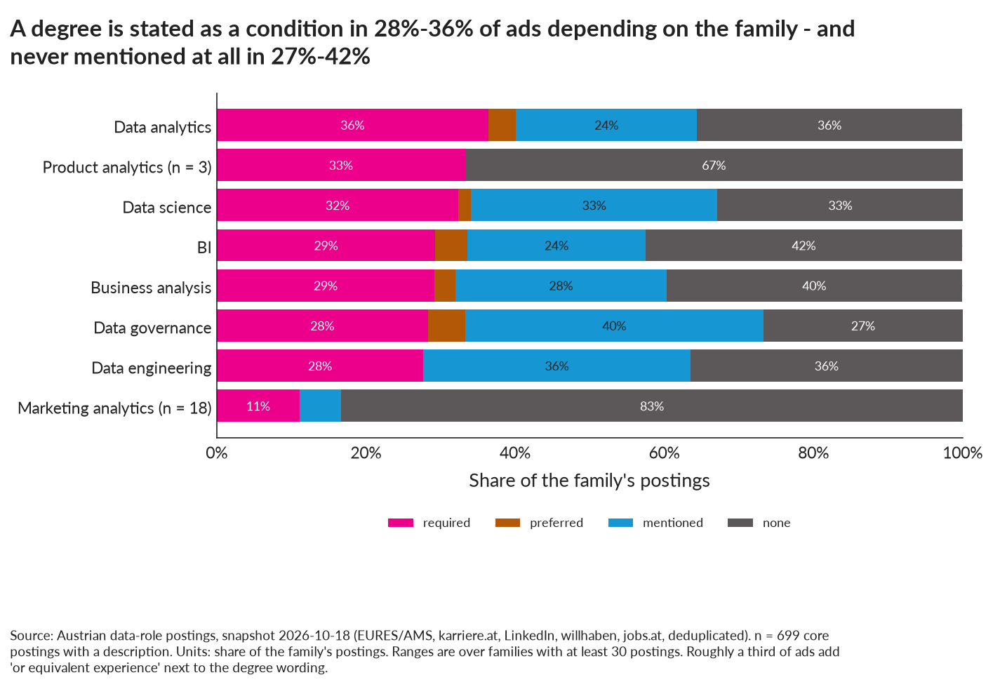](outputs/figures/BQ14_degree_requirement.png)

**Figure BQ14** · part to whole shown as `stacked_bar` (categorical-multi) · built from `T11e_degree_requirement_strength_by_family.csv` · units: share of postings. **Read with:** Wording strength, not hiring practice: no evidence here on how degree wording is applied in screening.
<!-- BQ14_degree_requirement:end -->

## WHAT DO THEY PAY? (advertised minimums, annual gross, monthly × 14)

<!--m:salary_with_salary_figure_share-->75 %<!--/m--> of ads state a figure, but <!--m:salary_minimum_only_share_of_parsed-->80 %<!--/m--> of those figures are a single collective-agreement minimum; only <!--m:salary_with_range_share-->15 %<!--/m--> state a range; <!--m:salary_overpay_mention_share-->54 %<!--/m--> say they pay above the minimum; 10 % are "all-in" (T09). Median advertised minimum: data engineering <!--m:floor_data_engineering_eur-->€55.0k<!--/m--> (n <!--m:floor_data_engineering_n-->111<!--/m-->), data science <!--m:floor_data_science_eur-->€55.4k<!--/m--> (<!--m:floor_data_science_n-->124<!--/m-->), business analysis <!--m:floor_business_analysis_eur-->€55.0k<!--/m--> (<!--m:floor_business_analysis_n-->85<!--/m-->), BI <!--m:floor_bi_eur-->€56.0k<!--/m--> (<!--m:floor_bi_n-->67<!--/m-->), **data analytics <!--m:floor_analytics_eur-->€50.0k<!--/m--> (<!--m:floor_analytics_n-->82<!--/m-->)**, data governance <!--m:floor_governance_eur-->€47.6k<!--/m--> (<!--m:floor_governance_n-->43<!--/m-->), marketing analytics <!--m:floor_marketing_analytics_eur-->€44.9k<!--/m--> (<!--m:floor_marketing_analytics_n-->13<!--/m-->). Seniority: junior <!--m:floor_junior_eur-->€45.7k<!--/m-->, unlabelled <!--m:floor_unlabelled_eur-->€53.0k<!--/m-->, senior <!--m:floor_senior_eur-->€61.0k<!--/m-->, lead <!--m:floor_lead_eur-->€56.0k<!--/m--> (upper ends of stated ranges reach €75–95k). Styria <!--m:floor_styria_eur-->€55.4k<!--/m--> (<!--m:floor_styria_n-->52<!--/m-->) vs Vienna <!--m:floor_vienna_eur-->€56.0k<!--/m--> (<!--m:floor_vienna_n-->242<!--/m-->). Ads mentioning Databricks <!--m:salary_skill_floor_median_eur__databricks:eur_k0-->€57k<!--/m-->, GenAI <!--m:salary_skill_floor_median_eur__generative_ai_llm:eur_k0-->€57k<!--/m-->, Power BI <!--m:salary_skill_floor_median_eur__power_bi-->€55.0k<!--/m-->, Excel <!--m:salary_skill_floor_median_eur__excel-->€49.0k<!--/m-->. **These are legal floors, not offers; actual compensation cannot be estimated from ads**; third-party context in docs/salary-context.md (AMS entry range for Data Scientist €39–61k). Robust as floors.

<!-- BQ15_salary_by_family:start (figure generated by src/analysis/make_visual_layer.py - do not edit by hand) -->
**Q. What do the families advertise as a floor, and what does entering through analytics cost me?**

Data analytics advertises a median minimum of €50.0k against data engineering's €55.0k - a €5.0k difference at the entry door, with overlapping interquartile ranges.

[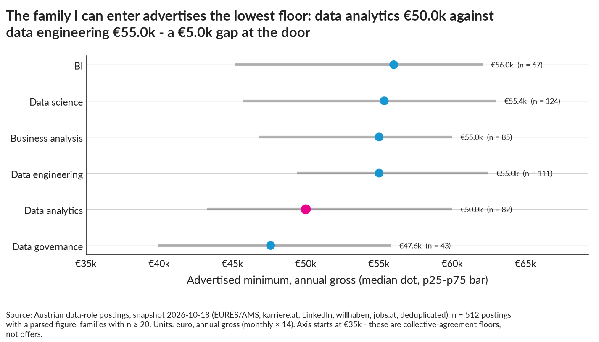](outputs/figures/BQ15_salary_by_family.png)

**Figure BQ15** · ranking shown as `dot_plot` (categorical-value) · built from `T09b_salary_by_role_family.csv` · units: EUR, annual gross. **Read with:** 80 % of parsed figures are a single collective-agreement minimum; 54 % of ads say they pay above it. These are legal floors, not offers and not pay.
<!-- BQ15_salary_by_family:end -->

## WHAT WORK MODE DO THEY OFFER?

Hybrid or home-office mentioned in <!--m:remote_hybrid_any_share-->55 %<!--/m--> (explicit hybrid pattern <!--m:remote_hybrid_explicit_share-->28 %<!--/m-->), on-site <!--m:remote_onsite_share-->4 %<!--/m-->, **fully remote <!--m:remote_full_share-->2 %<!--/m-->**, <!--m:remote_silent_share-->39 %<!--/m--> silent (T10). Data engineering <!--m:remote_hybrid_any_share__data_engineering:epct0-->59 %<!--/m-->, data science <!--m:remote_hybrid_any_share__data_science-->61 %<!--/m-->, analysts 43 %, marketing analytics 80 % (n <!--m:family_desc_n__marketing_analytics-->18<!--/m-->). Styria <!--m:remote_hybrid_any_n_styria-->42<!--/m--> of <!--m:styria_core_flag-->68<!--/m-->. Days per week almost never stated (<!--m:home_office_days_stated_n-->4<!--/m--> ads). Robust for "hybrid is the norm, remote is rare".

<!-- BQ18_work_model:start (figure generated by src/analysis/make_visual_layer.py - do not edit by hand) -->
**Q. Is hybrid real, and is chasing fully-remote roles from Graz a trap?**

Fully remote is 2% of ads (15 postings) - a trap as a strategy; hybrid or home-office wording covers about half the market, and Styria matches the national pattern, so commuting distance to Graz stays the binding constraint.

[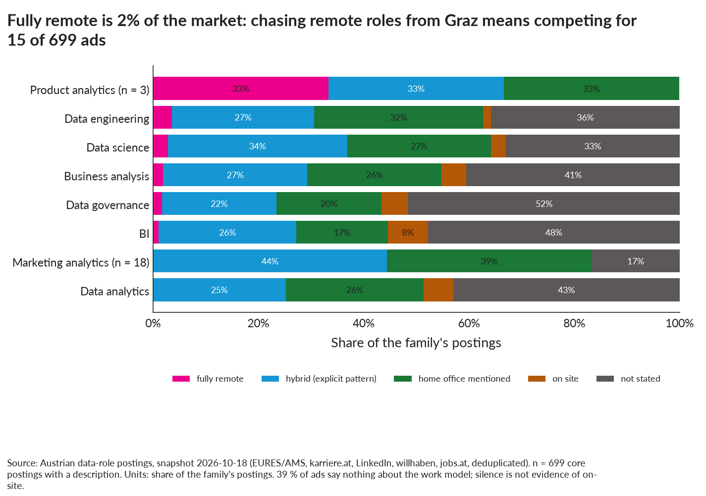](outputs/figures/BQ18_work_model.png)

**Figure BQ18** · part to whole shown as `stacked_bar` (categorical-multi) · built from `T10_remote_by_family.csv`, `T10_remote_overall.csv` · units: share of postings. **Read with:** Wording in the advertisement, not the arrangement actually offered; 39 % of ads are silent.
<!-- BQ18_work_model:end -->

## WHEN IN THE YEAR SHOULD I APPLY, AND WHEN IS IT QUIET?

Answered from Eurostat's Austrian Job Vacancy Statistics (quarterly, <!--m:eurostat_year_first-->2009<!--/m-->–<!--m:eurostat_year_last-->2025<!--/m-->, <!--m:season_n_years_max-->17<!--/m--> years), **not** from our snapshot: a one-day snapshot cannot measure seasonality, and `docs/seasonality.md` §1 shows why (<!--m:snapshot_first_published_in_collection_month_share-->44 %<!--/m--> of the <!--m:core_n-->699<!--/m--> core ads were first published in the collection month; <!--m:snapshot_age_share_within_90d-->89 %<!--/m--> within 90 days — that is survival decay, not a calendar).

* **Q4 (Oct–Dec) is the reliably thinnest quarter**, in all four sector aggregates, under both estimation methods and in every sub-sample: index <!--m:season_q4_index_min-->0.93<!--/m-->–<!--m:season_q4_index_max-->0.98<!--/m--> against an average quarter, and the weakest quarter in <!--m:season_q4_weakest_years_min-->8<!--/m-->–<!--m:season_q4_weakest_years_max-->10<!--/m--> of the <!--m:season_n_years_min-->16<!--/m-->–<!--m:season_n_years_max-->17<!--/m--> years (S01, S02). Robust as a direction.
* **Q1 (Jan–Mar) is most often the strongest single quarter** — <!--m:season_peak_years__b_f__q1-->9<!--/m--> of <!--m:season_n_years__b_f-->17<!--/m--> years in industry & construction (index <!--m:season_index__b_f__q1-->1.072<!--/m-->), <!--m:season_peak_years__b_s__q1-->7<!--/m--> of <!--m:season_n_years__b_s-->16<!--/m--> in the total economy. That is the aggregate Styria's industrial employers sit in.
* **The Q3 peak in market services (<!--m:season_index__g_n__q3-->1.038<!--/m-->) must not be read as data-job demand:** the NACE G-N aggregate also contains accommodation, food service and retail, and Austria does not report ICT separately here. Summer is, however, clearly not a dead period (Q3 above average in <!--m:season_years_above_avg__g_n__q3-->12<!--/m--> of <!--m:season_n_years__g_n-->17<!--/m--> years).
* **Amplitude is small and the cycle dominates:** best-vs-worst quarter is <!--m:season_spread_pct_min-->5<!--/m-->–<!--m:season_spread_pct_max-->14<!--/m--> %, best-vs-worst *year* is <!--m:cycle_spread_pct_min-->255<!--/m-->–<!--m:cycle_spread_pct_max-->567<!--/m--> % — a factor of <!--m:cycle_ratio_min-->19<!--/m-->–<!--m:cycle_ratio_max-->49<!--/m--> (S06). Market-services vacancies ran at ~<!--m:eurostat_year_mean_min__g_n:int100-->33,700<!--/m--> per quarter in 2009, peaked at ~<!--m:eurostat_year_mean_max__g_n:int100-->137,700<!--/m--> in 2022 and were ~<!--m:eurostat_year_mean_latest__g_n:int100-->82,200<!--/m--> in 2025.
* **Practical reading:** do not time applications by month; use **Oct–Dec as the build/study block** and be **application-ready in January**; keep applying continuously, because <!--m:snapshot_age_share_within_14d-->40 %<!--/m--> of the open ads in the snapshot were under 14 days old (median <!--m:posting_age_median_days__karriere-->32<!--/m--> days on karriere.at). No occupation or regional grain, so nothing here is Styria- or data-role-specific (docs/seasonality.md §7).

<!-- BQ03_seasonality:start (figure generated by src/analysis/make_visual_layer.py - do not edit by hand) -->
**Q. Should I time my applications by season, or does the cycle swamp the calendar?**

Q4 runs 2%-7% below an average quarter in every sector and Q1 is usually the strongest, but between-year swings are 19-49× the seasonal swing - use Oct-Dec to build and be ready in January, do not wait for a month.

[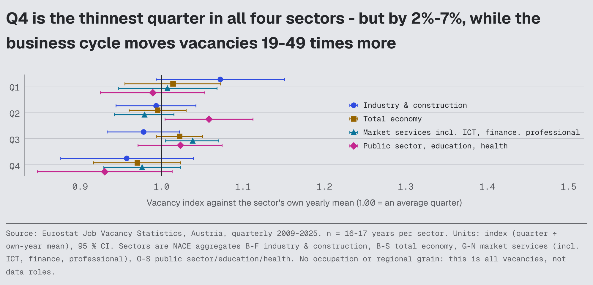](outputs/figures/BQ03_seasonality.png)

**Figure BQ03** · deviation from target shown as `error_bars` (interval-range) · built from `S01_seasonal_index.csv`, `S06_season_vs_cycle.csv` · units: index (1.00 = average quarter). **Read with:** Eurostat's Austrian vacancy series has no occupation or regional breakdown; market services (G-N) includes retail, accommodation and food service, so its Q3 peak is not data-job demand.
<!-- BQ03_seasonality:end -->

## WHAT DO I ALREADY HAVE?

Stakeholder/business/communication wording is the most universal requirement (<!--m:skill_share__stakeholder_management:pctn0-->54<!--/m-->–<!--m:skill_share__communication-->60 %<!--/m-->); finance/controlling, sales, consulting and marketing contexts frame most analyst ads; Excel and dashboards remain the analyst baseline (<!--m:skill_family_share__data_analytics__excel-->39 %<!--/m--> / <!--m:skill_family_share__data_analytics__data_visualization-->55 %<!--/m-->); seniority is expected (<!--m:seniority_share__unspecified:pct1-->57.4 %<!--/m--> unlabelled ads, "senior" ≈ <!--m:experience_years_median__senior-->5<!--/m--> years); experimentation is a rare, credible edge (A/B testing <!--m:ab_testing_share-->4 %<!--/m--> overall, <!--m:skill_family_n__marketing_analytics__a_b_testing_experimentation-->2<!--/m--> of <!--m:family_desc_n__marketing_analytics-->18<!--/m--> marketing-analytics ads) (career-map §1).

## WHAT SKILLS AM I MISSING?

Demonstrable SQL and Python at professional level (<!--m:sql_share-->40 %<!--/m--> / <!--m:python_share-->39 %<!--/m--> of ads; <!--m:skill_family_share__data_engineering__sql-->72 %<!--/m--> / <!--m:skill_family_share__data_engineering__python-->61 %<!--/m--> of data-engineering ads; <!--m:skill_family_share__data_science__python-->76 %<!--/m--> Python in data science); Power BI with data modelling (<!--m:power_bi_share-->17 %<!--/m-->; <!--m:skill_family_share__data_analytics__power_bi:pctn0-->30<!--/m-->–<!--m:skill_family_share__bi__power_bi-->43 %<!--/m--> in analyst/BI ads); data-quality/ETL practice (<!--m:data_quality_share-->31 %<!--/m--> / <!--m:etl_share-->20 %<!--/m-->); applied GenAI wording (<!--m:genai_share-->18 %<!--/m-->); statistics made explicit in projects (<!--m:statistics_share-->16 %<!--/m-->, but <!--m:skill_family_share__data_science__statistics_general-->31 %<!--/m--> in data science) (D03, D04).

## WHICH GAPS ARE SMALL?

SQL, Python-for-analysis, data-quality/ETL practice, Power BI/data modelling, Git, applied GenAI: all already "developing", each ≥ 10 % of ads, each unlocking several families (D04 "NOW"/"NEXT").

## WHICH GAPS ARE STRUCTURAL?

**German at a demonstrable B2/C1.** Observed pattern: only <!--m:english_no_german_n_styria-->8<!--/m--> of <!--m:addressable_scope_n_styria-->68<!--/m--> Styrian ads are English-written without a stated German requirement; <!--m:no_explicit_german_n_styria-->35<!--/m--> of <!--m:addressable_scope_n_styria-->68<!--/m--> state no requirement; <!--m:not_c1_n_styria-->42<!--/m--> of <!--m:addressable_scope_n_styria-->68<!--/m--> do not state C1-equivalent (T07e). Whether stated requirements are negotiable, and whether German proficiency changes hiring outcomes, is not measured — the data shows that German appears to be the most frequently stated non-technical barrier in Styrian ads, larger than any single tool. Also structural: Azure/Databricks/CI-CD platform engineering (<!--m:structural_gap_n_of15__data_engineering-->7<!--/m--> of the 15 top data-engineering skills are structural for this profile); ML-engineering depth (Docker/Kubernetes/MLOps/PyTorch, 4–6 % each); informatics/engineering degree wording (<!--m:degree_field_share__computer_science_informatics-->36 %<!--/m--> / <!--m:degree_field_share__engineering_physics-->35 %<!--/m-->; softened by "or equivalent" <!--m:degree_or_equivalent_share-->31 %<!--/m-->); industrial domain knowledge for Styrian manufacturing employers (D03, career-map §3).

<!-- BQ34_german_level_demanded:start (figure generated by src/analysis/make_visual_layer.py - do not edit by hand) -->
**Q. When an advertisement names a German level, which level is it - and is my A2-B1 ever stated as enough?**

Essentially never: C1-equivalent wording appears in 41% of core ads (285 postings) and B2/good in 13%, while B1 or below is named as sufficient in 6 advertisements in the whole corpus - so the realistic route is the 37% of ads that state no level at all, not the ones that state a low one.

[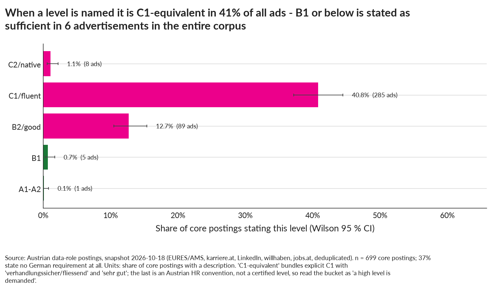](outputs/figures/BQ34_german_level_demanded.png)

**Figure BQ34** · ranking shown as `horizontal_bar` (bivariate-simple) · built from `T07a_german_level_overall.csv`, `T07_german_requirement_by_overall.csv` · units: share of postings. **Read with:** Wording-derived buckets: mapping 'sehr gut' to C1 is an assumption, and silence in a German-written ad usually still implies German (T07d). Whether a stated level is negotiable is not measured.
<!-- BQ34_german_level_demanded:end -->

## WHAT CAREER PATHS ARE SUPPORTED BY THE EVIDENCE?

1. **Data / business analytics (entry family).** <!--m:family_n__data_analytics-->107<!--/m--> AT, <!--m:family_styria_n__data_analytics-->9<!--/m--> Styria; highest profile overlap (<!--m:profile_overlap_n_of15__data_analytics-->13<!--/m--> of the 15 most-mentioned skills are in the self-declared have/developing lists), smallest structural gap (<!--m:structural_gap_n_of15__data_analytics-->2<!--/m--> of 15); German <!--m:german_stated_share__data_analytics-->40 %<!--/m-->; floors lowest (<!--m:floor_analytics_eur-->€50.0k<!--/m-->). Decision-matrix rank <!--m:decision_rank_default__data_analytics-->3<!--/m--> under all four weightings (D02).
2. **Applied data science (second step).** <!--m:family_n__data_science-->176<!--/m--> AT, <!--m:family_styria_n__data_science-->16<!--/m--> Styria; most English-friendly (<!--m:posting_language_family_share__data_science__en-->41 %<!--/m--> English ads; <!--m:english_no_german_n__family_data_science-->59<!--/m--> of <!--m:addressable_scope_n__family_data_science-->176<!--/m--> English without stated German requirement); rank 1–2 under all weightings; but 8 of its 15 top skills are structural and <!--m:degree_strength_family_share__data_science__required-->32 %<!--/m--> carry degree-required wording — realistic as an applied/business data scientist, not ML engineer.
3. **BI (tool angle).** <!--m:family_n__bi-->92<!--/m--> AT, <!--m:family_styria_n__bi-->8<!--/m--> Styria; Power BI + SQL + modelling; **highest German requirement (<!--m:german_stated_share__bi-->52 %<!--/m-->)**, lowest English share (<!--m:posting_language_family_share__bi__en-->13 %<!--/m-->); consultancies (adesso, CANCOM) recruit in Graz.
4. **Marketing/CRM/web analytics (domain angle).** Best domain fit (<!--m:profile_overlap_n_of15__marketing_analytics-->13<!--/m--> of 15 top skills), but <!--m:family_n__marketing_analytics-->18<!--/m--> postings nationally, <!--m:family_styria_n__marketing_analytics-->0<!--/m--> in Styria, 80 % hybrid; pursue as the analytics side of marketing titles and remote/hybrid Vienna roles, not as a local title.

<!-- BQ26_marketing_x_data:start (figure generated by src/analysis/make_visual_layer.py - do not edit by hand) -->
**Q. My 20 years are in marketing - does the marketing × data intersection actually exist as a space I can own?**

It exists in projects, not in titles: 197 of 1,818 observed candidates have a marketing-themed project, 64 pair it with Python and SQL and only 23 add experimentation or causal work - but demand is only 18 marketing-analytics ads nationally and 0 in Styria, so it is a differentiator inside analyst applications, not a local job title.

[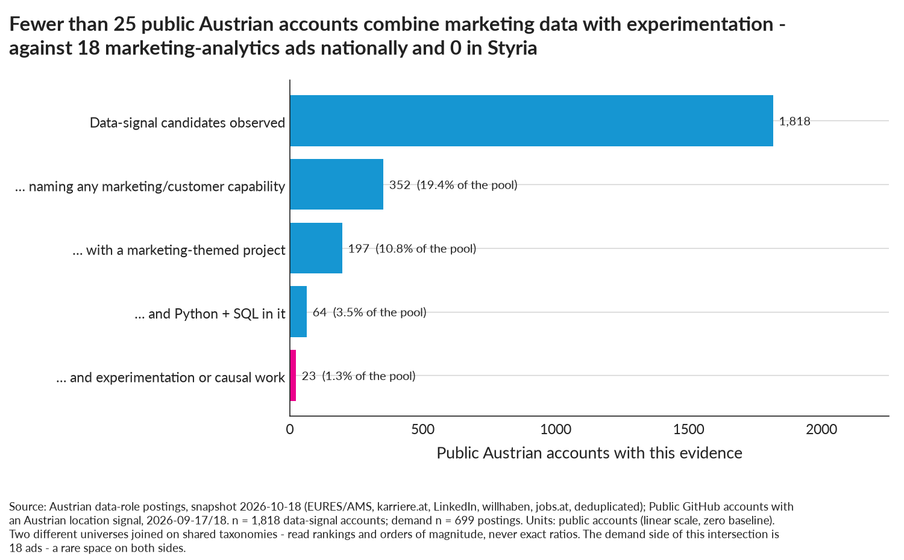](outputs/figures/BQ26_marketing_x_data.png)

**Figure BQ26** · ranking shown as `horizontal_bar` (bivariate-simple) · built from `DS12_marketing_x_data_intersection.csv`, `C24_marketing_data_intersection.csv` · units: accounts. **Read with:** Each step is a subset of the one above it. Public GitHub does not narrate career changes (3.4 % explicit, marketing 0), so transitioners are invisible here rather than absent.
<!-- BQ26_marketing_x_data:end -->

5. **Data engineering.** Styria's largest family (<!--m:family_styria_n__data_engineering-->28<!--/m--> of <!--m:styria_core_flag-->68<!--/m-->) with the best floors and hybrid share, rank 1 under default/geography/equal weights, but the largest structural gap (<!--m:structural_gap_n_of15__data_engineering-->7<!--/m--> of 15); only via the SQL/modelling (analytics-engineer) end, which is <!--m:title_n__analytics_engineer-->7<!--/m--> titles nationally.
6. Data governance: <!--m:family_n__data_governance-->60<!--/m--> AT (half operational master-data roles), <!--m:family_styria_n__data_governance-->1<!--/m--> Styria; senior/lateral option, thin locally.
No path is "robust" by the framework's rule because every Styrian family count is below 30 (D01). The *ordering* of the top three under the default weights (<!--m:decision_top3_default_text-->data science 1st, data engineering 2nd, data analytics 3rd<!--/m-->) is <!--m:decision_top3_stability_text-->unchanged under 3 of 4 weightings (equal weights: business analysis replaces data analytics)<!--/m-->; the ranking measures market size, English openness and salary floors, not ease of entry — which is why analytics, not engineering, is the evidence-derived entry family for this profile.

<!-- BQ07_ranking_sensitivity:start (figure generated by src/analysis/make_visual_layer.py - do not edit by hand) -->
**Q. Is my family ranking a real signal, or an artefact of how I weighted the criteria?**

Data analytics ranks 3rd (default), 3rd (geography first), 3rd (language first), 4th (equal weights) under the four weightings; the set of the top three families changes under equal weights (business analysis replaces data analytics), so the ordering partly depends on the weighting.

[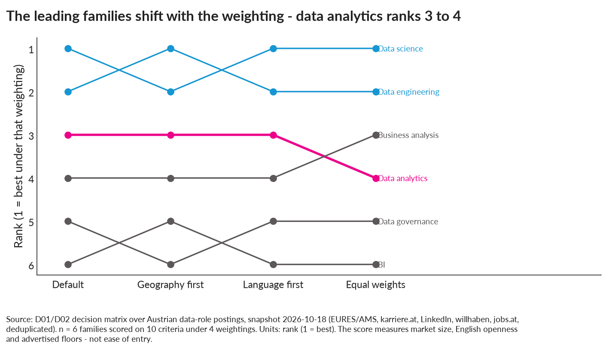](outputs/figures/BQ07_ranking_sensitivity.png)

**Figure BQ07** · ranking shown as `bump` (categorical-multi) · built from `D02_sensitivity.csv`, `D01_decision_matrix.csv` · units: rank. **Read with:** The matrix ranks market attractiveness, not probability of being hired; no Styrian family cell reaches n = 30, so no path is 'robust' under the project's own rule.
<!-- BQ07_ranking_sensitivity:end -->

<!-- BQ05_family_choice:start (figure generated by src/analysis/make_visual_layer.py - do not edit by hand) -->
**Q. Which role family gives me the most openings for the smallest structural gap?**

Data analytics has 87% of its top-15 skills inside my profile with 107 Austrian and 9 Styrian postings, while Data science offers 176 postings at only 53% overlap.

[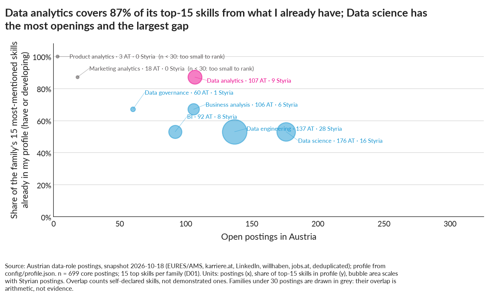](outputs/figures/BQ05_family_choice.png)

**Figure BQ05** · correlation shown as `bubble` (trivariate) · built from `D01_decision_matrix.csv` · units: postings / share of top-15 skills. **Read with:** Overlap is computed against self-declared profile lists, and measures market size and fit, not ease of being hired. Families below 30 Austrian postings (product and marketing analytics) are shown but not ranked; every Styrian family count is below 30.
<!-- BQ05_family_choice:end -->

## INTERN VS JUNIOR VS THE REST (T17, T04d, T05f, D04b)

Added 2026-09-18 (D-023). Intern titles (`intern_student`, n = <!--m:entry_track_titles_n__intern_student-->24<!--/m-->) vs junior/trainee titles (`trainee_junior`, n = <!--m:entry_track_titles_n__trainee_junior-->27<!--/m-->) vs the rest (n = <!--m:entry_track_titles_n__rest-->648<!--/m--> of <!--m:core_n-->699<!--/m-->; <!--m:entry_track_desc_n__rest-->648<!--/m--> with description). Denominators against the n = 30 rule: <!--m:entry_track_denominators_vs_30-->intern 24 (below), junior 27 (below)<!--/m--> — directional, not a second market. Senior and unlabelled ads stay in the 720-core study.

* Skills (T17, description n intern <!--m:entry_track_desc_n__intern_student-->24<!--/m--> / junior <!--m:entry_track_desc_n__trainee_junior-->27<!--/m--> / rest <!--m:entry_track_desc_n__rest-->648<!--/m-->): intern ads mention **Power BI <!--m:skill_entry_share__intern_student__power_bi:pct1-->8.3 %<!--/m--> vs junior <!--m:skill_entry_share__trainee_junior__power_bi:pct1-->22.2 %<!--/m-->** (−28 pp), **Excel <!--m:skill_entry_share__intern_student__excel-->17 %<!--/m--> vs <!--m:skill_entry_share__trainee_junior__excel-->26 %<!--/m-->** (−20 pp), visualisation <!--m:skill_entry_share__intern_student__data_visualization-->29 %<!--/m--> vs <!--m:skill_entry_share__trainee_junior__data_visualization-->44 %<!--/m-->. Junior ads mention **data-quality/governance <!--m:skill_entry_share__trainee_junior__data_governance_quality-->19 %<!--/m--> vs intern <!--m:skill_entry_share__intern_student__data_governance_quality-->21 %<!--/m-->** (+19 pp), **ETL <!--m:skill_entry_share__trainee_junior__etl_elt-->11 %<!--/m--> vs <!--m:skill_entry_share__intern_student__etl_elt-->13 %<!--/m-->** (+18 pp), generic AI wording <!--m:skill_entry_share__trainee_junior__ai_generic-->56 %<!--/m--> vs <!--m:skill_entry_share__intern_student__ai_generic-->42 %<!--/m-->, cloud <!--m:skill_entry_share__trainee_junior__cloud_generic-->26 %<!--/m--> vs <!--m:skill_entry_share__intern_student__cloud_generic-->25 %<!--/m-->. SQL is high in both (intern <!--m:skill_entry_share__intern_student__sql-->54 %<!--/m-->, junior <!--m:skill_entry_share__trainee_junior__sql-->41 %<!--/m-->).
* German required-or-level-stated (T17b): intern <!--m:german_stated_entry_n__intern_student-->10<!--/m--> of <!--m:entry_track_desc_n__intern_student-->24<!--/m--> (<!--m:german_stated_entry_share__intern_student-->42 %<!--/m-->), junior <!--m:german_stated_entry_n__trainee_junior-->12<!--/m--> of <!--m:entry_track_desc_n__trainee_junior-->27<!--/m--> (<!--m:german_stated_entry_share__trainee_junior-->44 %<!--/m-->), rest <!--m:german_stated_entry_n__rest-->273<!--/m--> of <!--m:entry_track_desc_n__rest-->648<!--/m--> (<!--m:german_stated_entry_share__rest-->42 %<!--/m-->).
* Family mix (T17c): intern titles are **one-third data analytics** (<!--m:entry_family_n__intern_student__data_analytics-->6<!--/m-->/<!--m:entry_track_titles_n__intern_student-->24<!--/m-->) and almost no data engineering (<!--m:entry_family_n__intern_student__data_engineering-->1<!--/m-->/<!--m:entry_track_titles_n__intern_student-->24<!--/m-->). Junior titles are mixed: engineering <!--m:entry_family_n__trainee_junior__data_engineering-->4<!--/m-->, science <!--m:entry_family_n__trainee_junior__data_science-->6<!--/m-->, BI <!--m:entry_family_n__trainee_junior__bi-->5<!--/m-->, analytics <!--m:entry_family_n__trainee_junior__data_analytics-->7<!--/m-->, marketing analytics <!--m:entry_family_n__trainee_junior__marketing_analytics-->1<!--/m--> of <!--m:entry_track_titles_n__trainee_junior-->27<!--/m-->.
* Dual-track named employers (T04d): **<!--m:entry_track__dual_track_employers-->2<!--/m--> of <!--m:entry_track__named_employers_core-->371<!--/m-->** named core employers has both intern and junior ads in this snapshot — **Red Bull** (<!--m:dual_track_intern_n__red_bull-->2<!--/m--> intern + <!--m:dual_track_junior_n__red_bull-->1<!--/m--> junior, Salzburg). Not a Styrian pattern here.
* Topic slices under the existing `Generative AI / LLM` umbrella (T05f, n <!--m:core_n_text_basis-->699<!--/m-->): umbrella <!--m:topic_share__generative_ai_llm-->18 %<!--/m-->; **AI agents / tool-calling <!--m:topic_share__ai_agents_tool_calling:pct1-->8.7 %<!--/m-->; RAG <!--m:topic_share__rag:pct1-->7.0 %<!--/m-->**; LangChain <!--m:topic_share__langchain_llm_frameworks:pct1-->2.3 %<!--/m-->; prompt engineering <!--m:topic_share__prompt_engineering:pct1-->2.4 %<!--/m-->; EU AI Act <!--m:topic_share__eu_ai_act_ai_governance:pct1-->4.6 %<!--/m-->; vector DBs <!--m:topic_share__vector_dbs:pct1-->1.7 %<!--/m-->; LoRA/PEFT <!--m:topic_share__fine_tuning_lora_peft:pct1-->2.4 %<!--/m-->; local LLM serving 0; ROS 0 (small-n). Industry 4.0 / MES / OPC UA 1.8 %.
* D04b learn-priority (demand heat + junior share + profile): SQL, Python, data-quality, ETL remain **NOW** (developing). Power BI, modelling, GenAI umbrella, REST **NEXT**. Azure, CI/CD, Databricks, warehouse wording **HIGH** because they are structural for this profile. RAG and agents sit below the 8 % evidence line — treat them as slices of applied GenAI, not a new NOW list.
* T19 hunter 2026-09-18 (`published_aggregates`; not merged into 720): **<!--m:t19__core_data_role_rows-->109<!--/m--> Austrian core titles**, <!--m:t19__core_with_description-->0<!--/m--> with JD text, <!--m:t19_source_share__jobspy_linkedin:pctn0-->100<!--/m--> % python-jobspy LinkedIn jobs. Family mix (title taxonomy): data science <!--m:t19_family_n__data_science-->34<!--/m-->/<!--m:t19__core_data_role_rows-->109<!--/m--> (<!--m:t19_family_share__data_science-->31 %<!--/m-->), engineering <!--m:t19_family_n__data_engineering-->27<!--/m--> (<!--m:t19_family_share__data_engineering-->25 %<!--/m-->), analytics <!--m:t19_family_n__data_analytics-->20<!--/m--> (<!--m:t19_family_share__data_analytics-->18 %<!--/m-->), BI <!--m:t19_family_n__bi-->13<!--/m--> (<!--m:t19_family_share__bi-->12 %<!--/m-->). States: Wien <!--m:t19_state_n__wien-->42<!--/m-->, Oberösterreich <!--m:t19_state_n__oberoesterreich-->24<!--/m-->, Steiermark <!--m:t19_state_n__steiermark-->16<!--/m-->, Salzburg <!--m:t19_state_n__salzburg-->15<!--/m-->, Tirol <!--m:t19_state_n__tirol-->11<!--/m-->. StepStone.at and Indeed.at live harvests stopped on HTTP 403. Arbeitnow remains <!--m:t19__arbeitnow_austria_rows-->1<!--/m--> Austria location / 0 core. Query-driven hunter mix — do not compare family shares to the 720 census; skill rows are title tokens only.

<!-- BQ11_intern_vs_junior:start (figure generated by src/analysis/make_visual_layer.py - do not edit by hand) -->
**Q. The two entry doors are intern and junior - do they ask for different things?**

Yes: junior ads lean to Data Visualization (+15 pp) and ETL, intern ads to Python and Excel; SQL is high in both, so it is the one skill that opens either door.

[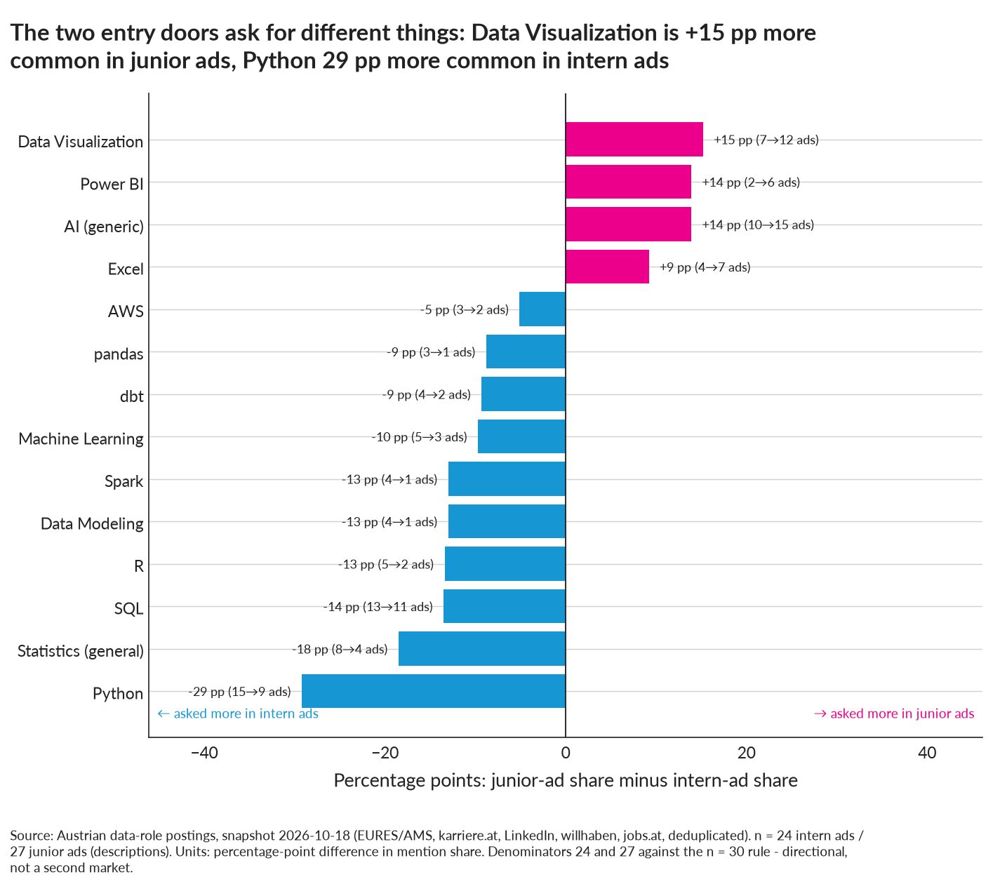](outputs/figures/BQ11_intern_vs_junior.png)

**Figure BQ11** · deviation from target shown as `diverging_bar` (categorical-value) · built from `T17_skill_divergence_intern_vs_junior.csv` · units: percentage points. **Read with:** n = 24 and n = 27: differences under roughly 15 pp are inside the noise of these cell sizes.
<!-- BQ11_intern_vs_junior:end -->

## WHAT SHOULD I LEARN?

Now: SQL; Python for data work; data-quality/validation practice; ETL/ELT basics; statistics applied in projects. Next: Power BI + dimensional modelling (+ DAX basics); applied GenAI/LLM; REST/API basics; Git. Later: Azure fundamentals and one Databricks/Fabric project; CI/CD basics. Do not prioritise: Tableau, Looker, Qlik, GCP/BigQuery, Spark/Kafka, Java/Scala, Kubernetes/MLOps, deep-learning frameworks, vendor certifications, PhD (D04; career-map §7).

<!-- BQ09_learning_priorities:start (figure generated by src/analysis/make_visual_layer.py - do not edit by hand) -->
**Q. If I can only learn a few more things this year, which ones open the most doors?**

SQL, Python, Data Governance/Quality, ETL/ELT are the NOW set - each named in 20%-40% of ads and each a top-15 skill in several families; Power BI, data modelling, GenAI and REST follow as NEXT.

[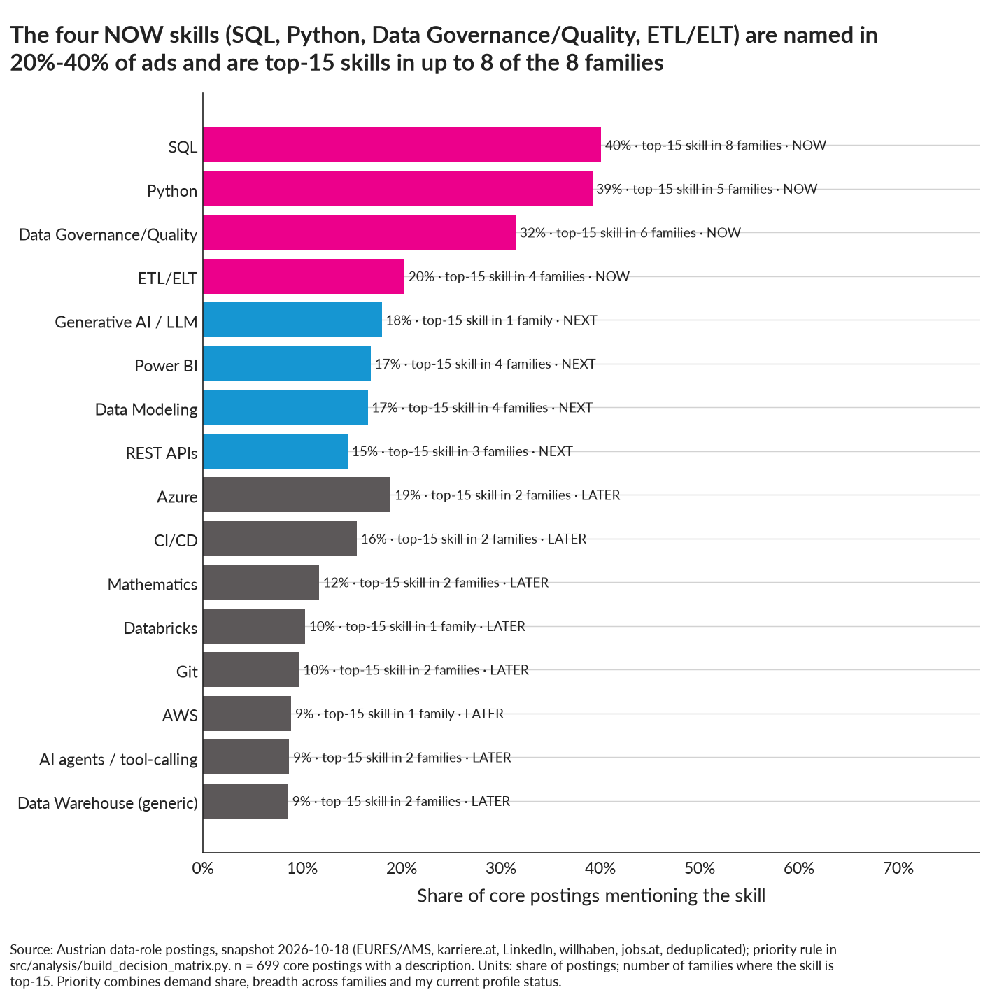](outputs/figures/BQ09_learning_priorities.png)

**Figure BQ09** · ranking shown as `horizontal_bar` (bivariate-simple) · built from `D04_learning_priorities.csv` · units: share of postings. **Read with:** Priority is a demand-and-breadth heuristic, not evidence that learning the skill changes a hiring outcome.
<!-- BQ09_learning_priorities:end -->

<!-- BQ45_skill_premium_controlled:start (figure generated by src/analysis/make_visual_layer.py - do not edit by hand) -->
**Q. Do the better-paying skills actually pay better, or am I just looking at which family names them?**

Mostly the latter: after controlling for role family, seniority and state, 14 of 16 skills have intervals straddling zero - Python's raw +4 % becomes -2 % - and only Excel (-10 %) and Cloud (generic) (+8 %) still separate from zero. After a Holm correction over all 16 skills none clears zero (Excel and Cloud (generic) do not); Benjamini-Hochberg keeps 0 of 2. The floor is set by the family and the seniority label, not by the tool named in the advertisement.

[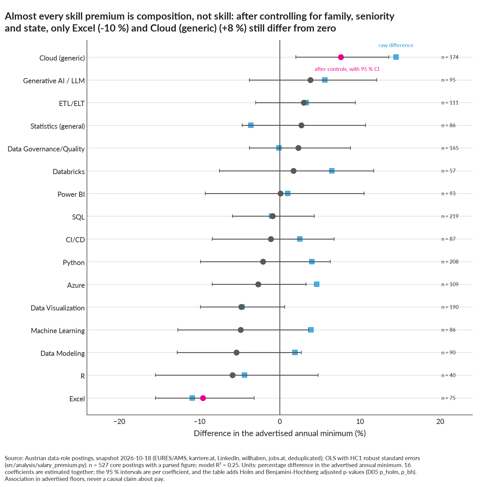](outputs/figures/BQ45_skill_premium_controlled.png)

**Figure BQ45** · uncertainty shown as `error_bars` (interval-range) · built from `D05_skill_salary_premium.csv` · units: percent. **Read with:** Advertised minimums, not pay. Employer size, industry and hours basis are not controlled, the intervals shown are uncorrected (the adjusted p-values are in D05), and R² is low - this bounds how much of the raw gap is composition, it does not price a skill.
<!-- BQ45_skill_premium_controlled:end -->

## WHAT SHOULD I BUILD?

(1) A SQL + Power BI dashboard on a properly modelled star schema over marketing/e-commerce data (covers the single most requested analyst combination). (2) A Python ETL pipeline into a warehouse with tests and Git/CI (covers the Styrian engineering flavour). (3) An experimentation/causal analysis of a marketing or product change (rare differentiator). (4) A forecasting or churn/CLV model on business data (bridges domain and ML wording). (5) An applied RAG/LLM assistant over business reports (fastest-growing wording). Not: Tableau, streaming demos, deep-learning showcases, certification labs (career-map §8).

<!-- BQ21_evidence_gap:start (figure generated by src/analysis/make_visual_layer.py - do not edit by hand) -->
**Q. Where is a month of portfolio work worth most - what is demanded often and demonstrated rarely?**

SQL (40% of ads vs 10% of candidates with project evidence), data quality/validation, dimensional modelling and Azure pipelines sit furthest below the diagonal among the capabilities GitHub can actually see - and business framing sits with them. Power BI, Excel and SAP are equally demanded but cannot be closed with public code.

[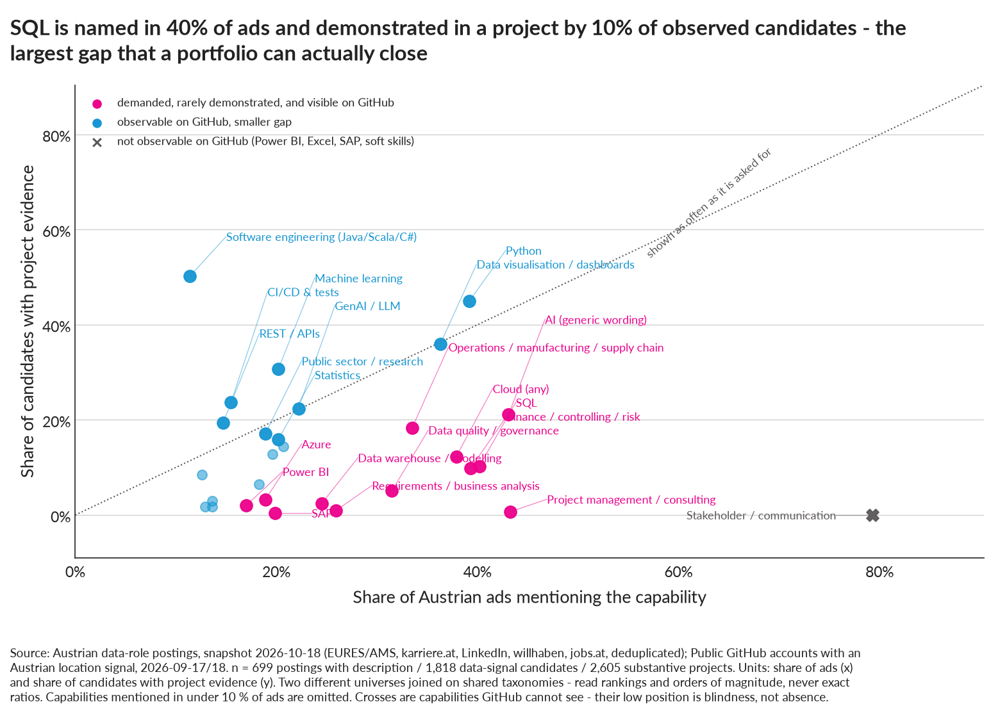](outputs/figures/BQ21_evidence_gap.png)

**Figure BQ21** · correlation shown as `scatter` (bivariate-simple) · built from `DS10_demand_supply_capability_evidence.csv` · units: share of ads / share of candidates. **Read with:** Two universes, one taxonomy: the axes are not the same denominator and the diagonal is a reading aid, not an identity. A capability marked not-observable is invisible to this measurement.
<!-- BQ21_evidence_gap:end -->

## WHAT SHOULD I PUT ON MY CV?

Employer vocabulary in order of frequency: SQL · Python · Power BI · Excel · Datenanalyse/Data Analytics · Dashboard/Reporting · Datenqualität/Data Governance · ETL · Azure · Machine Learning · KI/AI · Statistik · Datenmodellierung · Stakeholder/Fachbereich · Kommunikationsstärke · analytisches Denken · selbstständig. Domain words: Controlling, KPIs/Kennzahlen, Forecast, Vertrieb, CRM, E-Commerce, Kundendaten, Segmentierung, Kampagnen. State the German level with CEFR. Title lines that exist in the market: Data Analyst, Business Analyst, BI Analyst, Data Scientist; "Marketing Data Scientist" is 2 postings.

<!-- BQ35_tools_vs_libraries:start (figure generated by src/analysis/make_visual_layer.py - do not edit by hand) -->
**Q. Do employers ask for frameworks and libraries, or only for languages and tools?**

Only for languages and tools: Python is named in 39% of ads while the most-mentioned Python library (PyTorch) reaches 3.4% and pandas 3.1% - a CV built on library lists speaks a vocabulary employers do not use, while the language, the BI tool and the cloud platform are the words they do use.

[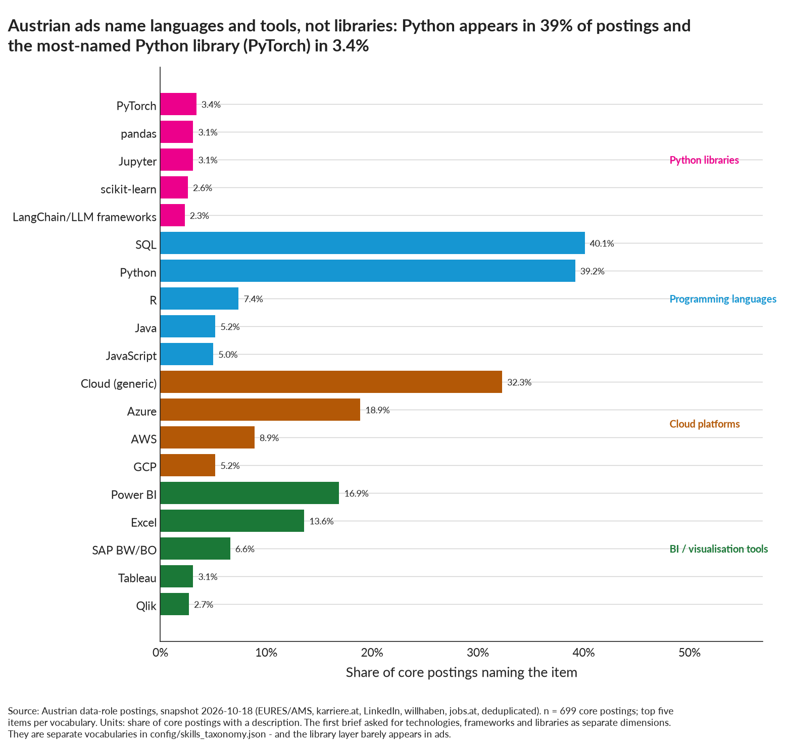](outputs/figures/BQ35_tools_vs_libraries.png)

**Figure BQ35** · ranking shown as `horizontal_bar` (bivariate-simple) · built from `T05_skills_programming_languages.csv`, `T05_skills_python_ecosystem.csv`, `T05_skills_bi_tools.csv`, `T05_skills_cloud_platforms.csv` · units: share of postings. **Read with:** Absence of a library in an advertisement is not absence in the job: ads compress a stack to its headline names. This measures advertising vocabulary, not the work.
<!-- BQ35_tools_vs_libraries:end -->

## WHAT SHOULD I EMPHASIZE ON LINKEDIN?

LinkedIn is the English/multinational side of the market (<!--m:english_posting_share-->26 %<!--/m--> of ads English; data science <!--m:posting_language_family_share__data_science__en-->41 %<!--/m-->): headline with "Data Analyst | Marketing & Customer Analytics | SQL · Python · Power BI"; senior business ownership (stakeholder wording <!--m:skill_share__stakeholder_management-->54 %<!--/m-->); experimentation and causal work as differentiators; hybrid/Graz-Vienna availability. LinkedIn ads carried the most seniority words after jobs.at (40 % with a seniority word in the title) and 41 % omit salary.

## WHAT SHOULD MY GITHUB DEMONSTRATE?

Two to three finished, documented projects from "What should I build", each showing SQL, Python, a modelled dataset, data-quality checks and a dashboard or decision output; the README should use the employer vocabulary above. Ads name tools, not libraries — library lists do not move the needle.

<!-- BQ24_readme_anatomy:start (figure generated by src/analysis/make_visual_layer.py - do not edit by hand) -->
**Q. If a hiring manager opens one of my repositories, what does the average one give them - and what is missing?**

Public READMEs are software READMEs: 66% say how to run the code, but only 25% state a result, 12% state limitations and 11% state a business question - question → data → method → result → limitation → decision is the rarest structure in the pool and the one my 20 years of marketing work can write without learning anything new.

[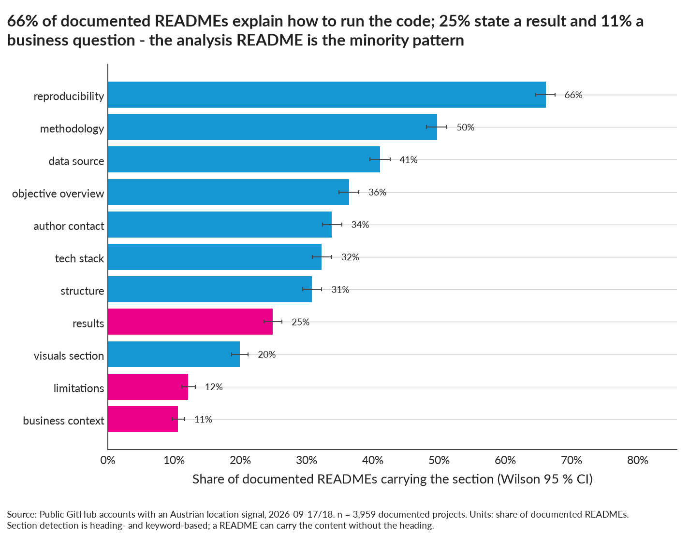](outputs/figures/BQ24_readme_anatomy.png)

**Figure BQ24** · ranking shown as `horizontal_bar` (bivariate-simple) · built from `C19_readme_patterns.csv` · units: share of documented READMEs. **Read with:** Detects headings and keywords, not quality; a README with the section can still be empty of substance.
<!-- BQ24_readme_anatomy:end -->

## WHAT SHOULD I STOP SPENDING TIME ON?

Tableau/Looker/Qlik (≤ <!--m:tableau_share-->3 %<!--/m-->); GCP/BigQuery (6 % / <!--m:skill_share__bigquery:tpct0-->3 %<!--/m-->); Spark/Kafka/streaming (6–7 %); Java/Scala; Kubernetes/MLOps/deep-learning frameworks (4–6 %); collecting certifications (specific certs ≤ <!--m:cert_max_share-->2 %<!--/m--> of ads, vendor data certs ≤ 0.3 %); positioning as "Marketing Data Scientist" or "Product Analyst" as a local Graz title (<!--m:title_n__marketing_data_scientist-->2<!--/m--> and <!--m:title_n__product_analyst-->3<!--/m--> postings nationally); chasing fully-remote roles (<!--m:remote_full_share-->2 %<!--/m-->).

<!-- BQ22_crowded_vs_scarce:start (figure generated by src/analysis/make_visual_layer.py - do not edit by hand) -->
**Q. Which skills is everyone already showing, and which ones would actually distinguish me?**

Jupyter, notebooks and deep-learning frameworks run far ahead of demand (+51 pp), while SQL, Power BI, Azure and data modelling run far behind it - a portfolio built only of notebooks competes in the densest part of the pool.

[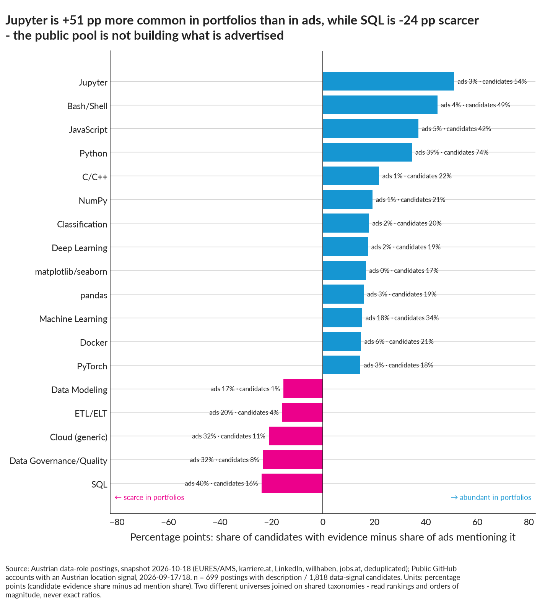](outputs/figures/BQ22_crowded_vs_scarce.png)

**Figure BQ22** · deviation from target shown as `diverging_bar` (categorical-value) · built from `DS03_demand_supply_skills.csv` · units: percentage points. **Read with:** Supply shares come from public code and profiles; tools that leave no code trace are understated by construction.
<!-- BQ22_crowded_vs_scarce:end -->

## WHAT WOULD CHANGE THIS MAP?

For every recommendation above the supporting table, denominator and assumption are named in `docs/market-guide.md`. The observations that would change the conclusions:

| Observation | Would change |
|---|---|
| A larger Styrian sample (monthly re-collection through permitted channels, or company career pages) moving any Styrian family count above 30 | the "tentative" label on all Styrian statements; possibly the entry-family ranking if analytics postings in Graz turn out rarer or commoner than <!--m:family_styria_n__data_analytics-->9<!--/m--> of <!--m:styria_core_flag-->68<!--/m--> |
| StepStone.at / Indeed data (largest coverage gap) with a different family, language or salary mix | family shares, the German-requirement share (StepStone is corporate/white-collar), advertised floors |
| Longitudinal data (first-seen/last-seen per posting) | the stock-based view; would reveal hard-to-fill roles and true monthly flow |
| A change in stated German requirements (e.g. English-written share in Styria rising above ~25 %, or C1 wording falling) | the "German is the largest stated barrier" conclusion and the addressable-set counts |
| Evidence on negotiability (interview outcomes for ads that stated "sehr gute Deutschkenntnisse") | the weight given to stated language levels |
| Technology demand shifts (Fabric/Databricks share, GenAI wording, Tableau/Looker reappearing, Analytics-Engineer titles growing beyond <!--m:title_n__analytics_engineer-->7<!--/m-->) | the learning roadmap and project list |
| Advertised floors moving (e.g. analyst floors converging with engineering floors) or third-party survey data with methodology | the salary section and the V7 weight |
| New role categories in Austrian titles (e.g. "Analytics Engineer", "AI Product Analyst") | the taxonomy and the family ranking |
| A quarterly re-run of the Eurostat vacancy series showing Austrian vacancies turning back up after the 2022–2025 decline, or falling further | the urgency of applying now versus building first; the cycle moves <!--m:cycle_ratio_min-->19<!--/m-->–<!--m:cycle_ratio_max-->49<!--/m-->× more than the season (docs/seasonality.md §5) |
| Actual interview/hiring outcomes for this profile (applications sent, responses, offers by family and language) | everything above — this is the only observation that can turn requirement patterns into evidence about hiring |
| JobBarometer 2026 reversing Styria's relative resilience | the geographic conclusion |
| A manual extraction audit showing precision below ~90 % for language or salary fields | the language and salary sections |
