# CAREER_SUPPLY_DEMAND_MAP

**Purpose.** The decision document for Layer 3: what the combination of employer demand (Layer 1, `CAREER_DECISION_MAP.md`) and observed candidate supply (Layer 2, `docs/supply-findings.md`) says that neither side says alone. Every statement is traced to a table in `outputs/tables/` (C*, DS*, SQ*, O*, T*). It is market analysis; the profile-specific reading is separate (`docs/profile-specific-demand-supply-analysis.md`).

**Vintages.** Demand: open core data postings, Austria, <!--m:_meta.demand_vintage-->2026-10-18<!--/m--> (<!--m:core_n-->699<!--/m-->; <!--m:core_n_text_basis-->699<!--/m--> with description; Styria <!--m:styria_core_flag-->68<!--/m--> incl. multi-site ads, <!--m:styria_core_primary_state-->62<!--/m--> by primary state). Supply: public GitHub accounts with an Austrian location signal, <!--m:_meta.supply_vintage_span-->2026-09-17/18<!--/m--> (<!--m:supply_p_all_n-->9,409<!--/m--> accounts; <!--m:supply_p_data_n-->1,818<!--/m--> with a data signal = P_data; <!--m:supply_p_t1_n-->872<!--/m--> with a bio-declared core data role = P_T1; <!--m:supply_projects_n-->6,677<!--/m--> projects, <!--m:supply_documented_projects_n-->3,959<!--/m--> documented, <!--m:supply_substantive_projects_n-->2,605<!--/m--> substantive); Stack Overflow 2025 (<!--m:so_at_respondents_n-->410<!--/m--> Austrian respondents); Eurostat graduates/occupations. **LinkedIn members were not collected** (terms; private slot for hand-coded or licensed records, D-026, still empty; LinkedIn job listings are Layer 1).

**Reading rules.** "Demand share" = share of ads that *mention* an item. "Supply share" = share of observed GitHub data-signal candidates with evidence; "project-demonstrated" = evidence in a documented, non-educational project. The two are different universes: compare rankings and orders of magnitude, never exact percentages. A low supply share for a tool that leaves no code trace (Power BI, Excel, SAP) mostly measures GitHub's blindness. Styria is the only complete supply frame; Vienna figures are lower bounds. Nothing here measures hiring. Tools are quoted at two levels: **skill level** (one vocabulary item; `T05`/`DS03`; §2, §4) and **capability bucket** (union of member skills; `DS10`; §3, §5, §6) — hence cloud <!--m:cloud_share-->32 %<!--/m--> vs <!--m:cap_demand_share__cloud_any-->38 %<!--/m--> and SQL <!--m:sql_share:pct1-->40.1 %<!--/m--> vs <!--m:cap_demand_share__sql-->40 %<!--/m--> of ads. Styrian counts follow D-027: location-resolved (<!--m:supply_geo__p_t1__styria-->56<!--/m--> bio-declared, <!--m:supply_geo__p_data__styria-->248<!--/m--> data-signal) unless labelled frame-B complete-Styria subset (<!--m:supply_styria_frame_b_t1_n-->52<!--/m-->, <!--m:supply_styria_frame_b_data_signal_n-->247<!--/m-->).

---

## 1. Where is observable candidate supply concentrated? (C04, C05, C10, C23)

In **self-described data scientists** (<!--m:supply_family_share__data_science-->73 %<!--/m--> of bio-declared accounts; <!--m:supply_title_n__data_scientist-->486<!--/m--> "Data Scientist" + <!--m:supply_title_n__machine_learning_ai_engineer-->140<!--/m--> "ML/AI Engineer" bios) doing **Python-notebook work** (Python <!--m:supply_tech_any_share__python-->74 %<!--/m-->, Jupyter <!--m:supply_tech_any_share__jupyter-->54 %<!--/m--> of P_data), in **Vienna** (<!--m:supply_geo__p_data__vienna-->802<!--/m--> of <!--m:supply_p_data_n-->1,818<!--/m--> data-signal accounts; Styria <!--m:supply_geo__p_data__styria-->248<!--/m--> by resolved location, <!--m:supply_styria_frame_b_data_signal_n-->247<!--/m--> in the frame-B complete-Styria subset), among **students and unlabelled profiles** (<!--m:supply_seniority_share__student-->17 %<!--/m--> students, <!--m:supply_seniority_share__unlabelled-->68 %<!--/m--> no seniority word), and in **ML/NLP/LLM/CV project topics** (NLP 14 %, classification 12.5 %, LLM apps 10 %, CV 8 % of projects). Three of eight positioning clusters are pure ML/AI builders (LLM apps <!--m:supply_cluster_size__6-->175<!--/m-->, deep-learning/CV <!--m:supply_cluster_size__7-->191<!--/m-->, classification pipelines <!--m:supply_cluster_size__3-->133<!--/m-->).

<!-- BQ39_title_fragmentation:start (figure generated by src/analysis/make_visual_layer.py - do not edit by hand) -->
**Q. How fragmented is the candidate market - does a title even mean anything here?**

Self-description is fragmented (574 distinct raw bio titles) but the underlying positioning is not: it collapses into 13 normalised titles, and 'Data Scientist' alone holds 56% of bio-declared accounts - so a differentiated title is cheap to claim and crowded to hold, which is why the evidence behind it matters more than the label.

[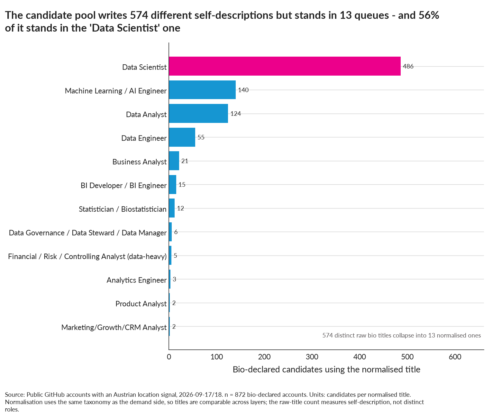](outputs/figures/BQ39_title_fragmentation.png)

**Figure BQ39** · ranking shown as `horizontal_bar` (bivariate-simple) · built from `C04b_title_concentration.csv`, `C03_normalized_title_distribution.csv` · units: candidates. **Read with:** Titles come from GitHub bios, which are written for a developer audience rather than a recruiter; this is self-presentation, not employment.
<!-- BQ39_title_fragmentation:end -->

## 2. Where is employer demand concentrated? (T02, T03, T05)

In **data engineering (<!--m:family_share__data_engineering-->20 %<!--/m-->), data science (<!--m:family_share__data_science-->25 %<!--/m-->), business analysis (<!--m:family_share__business_analysis-->15 %<!--/m-->), data analytics (<!--m:family_share__data_analytics-->15 %<!--/m-->), BI (<!--m:family_share__bi-->13 %<!--/m-->)**, in **Vienna (<!--m:vienna_share_core-->45 %<!--/m-->) and Upper Austria (<!--m:upper_austria_share_core-->17 %<!--/m-->)**, around **SQL (<!--m:sql_share-->40 %<!--/m-->), visualisation/dashboards (<!--m:visualisation_share-->36 %<!--/m-->), Python (<!--m:python_share-->39 %<!--/m-->), data quality/governance (<!--m:data_quality_share-->31 %<!--/m-->), cloud (<!--m:cloud_share-->32 %<!--/m-->), ETL (<!--m:etl_share-->20 %<!--/m-->), Azure (<!--m:azure_share-->19 %<!--/m-->), Power BI (<!--m:power_bi_share-->17 %<!--/m-->), Excel (<!--m:excel_share-->14 %<!--/m-->), data modelling (<!--m:data_modelling_share-->17 %<!--/m-->)** (skill level, T05), with stakeholder/communication wording in <!--m:skill_share__stakeholder_management:pctn0-->54<!--/m-->–<!--m:skill_share__communication-->60 %<!--/m--> of ads and German requirements stated in <!--m:german_stated_share-->42 %<!--/m-->.

## 3. Where do they overlap? (DS01, DS03, DS10 quadrant A)

Python, data visualisation, machine learning, GenAI/LLM, statistics, ETL, CI/CD & tests, cloud (any), marketing/finance/operations domain wording: demanded by ≥ <!--m:cap_threshold_demand:pct0-->13 %<!--/m--> of ads and evidenced by ≥ <!--m:cap_threshold_supply:pct0-->10 %<!--/m--> of candidates (DS10 quadrant A, medians as thresholds). SQL (capability bucket) is in this quadrant by "any evidence" (<!--m:cap_supply_any_share__sql-->19 %<!--/m-->) but not by project evidence (<!--m:cap_supply_project_share__sql-->10 %<!--/m-->). Family-level overlap: **data analytics** is the one family where bio-declared supply and advertised demand are of the same order (<!--m:supply_family_n__data_analytics-->129<!--/m--> bios vs <!--m:family_n__data_analytics-->107<!--/m--> ads, relative representation <!--m:ds_family__data_analytics__relative_representation:f1-->1.0<!--/m-->); data science overlaps in kind but not in proportion.

## 4. Where do they diverge? (DS01, DS02, DS03)

* **Data science: <!--m:ds_family__data_science__relative_representation:x1-->2.9×<!--/m--> over-represented on the supply side** as a ratio of shares (<!--m:supply_family_share__data_science-->73 %<!--/m--> of bios vs <!--m:family_share__data_science-->25 %<!--/m--> of ads; in counts <!--m:supply_family_n__data_science-->638<!--/m--> bios vs <!--m:family_n__data_science-->176<!--/m--> ads = <!--m:ds_family__data_science__per_posting:f1-->3.6<!--/m--> declared candidates per posting, the BQ20 measure; Styria <!--m:supply_family__data_science__styria_n-->38<!--/m--> bios vs <!--m:family_styria_n__data_science-->16<!--/m--> ads = <!--m:ds_family__data_science__per_posting_styria-->2.4<!--/m--> per posting; Vienna ≥ <!--m:ds_family__data_science__per_posting_vienna:f1-->4.0<!--/m--> per posting). "Data Scientist" alone: <!--m:supply_title_n__data_scientist-->486<!--/m--> bios vs <!--m:title_n__data_scientist-->85<!--/m--> ads (<!--m:ds_title__data_scientist__relative_representation:int0-->5<!--/m-->×).
* **Data engineering, BI, business analysis, governance, marketing analytics: <!--m:ds_family_underrepresented5_min-->0.09<!--/m-->–<!--m:ds_family_underrepresented5_max-->0.34<!--/m-->× represented** on GitHub (engineering <!--m:supply_family_n__data_engineering-->58<!--/m--> bios vs <!--m:family_n__data_engineering-->137<!--/m--> ads; BI <!--m:supply_family_n__bi-->15<!--/m--> vs <!--m:family_n__bi-->92<!--/m-->; business analysis <!--m:supply_family_n__business_analysis-->21<!--/m--> vs <!--m:family_n__business_analysis-->106<!--/m-->; governance <!--m:supply_family_n__data_governance-->7<!--/m--> vs <!--m:family_n__data_governance-->60<!--/m-->; marketing analytics <!--m:supply_family_n__marketing_analytics-->2<!--/m--> vs <!--m:family_n__marketing_analytics-->18<!--/m-->). Titles with zero GitHub bios: BI Analyst (<!--m:title_n__bi_analyst-->30<!--/m--> ads), BI Consultant (<!--m:title_n__bi_consultant_analytics_consultant-->22<!--/m-->), Data Architect (<!--m:title_n__data_architect_data_platform-->29<!--/m-->), Marketing Data Scientist (<!--m:title_n__marketing_data_scientist-->2<!--/m-->).
* Tools (skill level, DS03): SQL <!--m:sql_share:pct1-->40.1 %<!--/m--> of ads vs <!--m:supply_tech_any_share__sql-->16 %<!--/m--> of candidates (<!--m:supply_tech_project_share__sql-->9 %<!--/m--> project-demonstrated); Power BI <!--m:power_bi_share-->17 %<!--/m--> vs <!--m:supply_tech_any_share__power_bi-->3 %<!--/m-->; Excel <!--m:excel_share-->14 %<!--/m--> vs <!--m:supply_tech_any_share__excel-->4 %<!--/m-->; Azure <!--m:azure_share-->19 %<!--/m--> vs <!--m:supply_tech_any_share__azure-->5 %<!--/m-->; data modelling <!--m:data_modelling_share-->17 %<!--/m--> vs <!--m:supply_tech_any_share__data_modeling-->1 %<!--/m-->; Databricks <!--m:databricks_share-->10 %<!--/m--> vs <!--m:supply_tech_any_share__databricks-->1 %<!--/m-->. The reverse divergence: Jupyter <!--m:skill_share__jupyter-->3 %<!--/m--> of ads vs <!--m:supply_tech_any_share__jupyter-->54 %<!--/m--> of candidates; JavaScript <!--m:skill_share__javascript-->5 %<!--/m--> vs <!--m:supply_tech_any_share__javascript-->42 %<!--/m-->; PyTorch <!--m:pytorch_share:pct1-->3.4 %<!--/m--> vs <!--m:supply_tech_any_share__pytorch-->18 %<!--/m-->; Docker <!--m:docker_share-->6 %<!--/m--> vs <!--m:supply_tech_any_share__docker-->21 %<!--/m-->; R <!--m:r_share-->7 %<!--/m--> vs <!--m:supply_tech_any_share__r-->19 %<!--/m-->.

<!-- BQ20_competition_density:start (figure generated by src/analysis/make_visual_layer.py - do not edit by hand) -->
**Q. How many visible candidates am I standing next to per opening, depending on the label I choose?**

Data science shows 3.6 declared candidates per posting (2.4 in Styria) against 0.42 for engineering and 1.21 for analytics - calling myself a data scientist puts me in the densest queue on the board.

[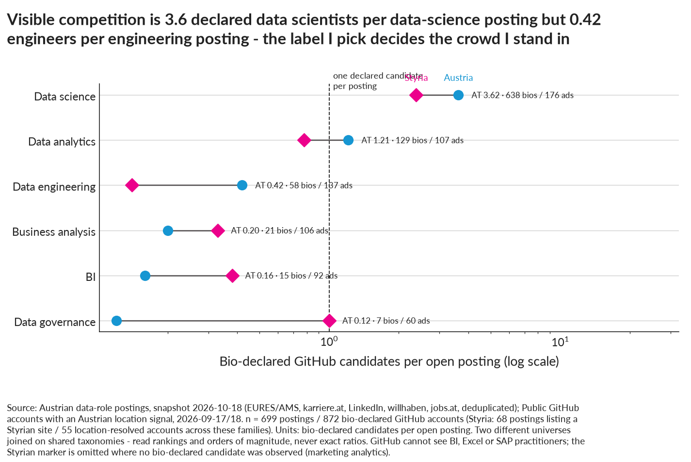](outputs/figures/BQ20_competition_density.png)

**Figure BQ20** · ranking shown as `dot_plot` (categorical-value) · built from `DS01_demand_supply_role_families.csv` · units: candidates per posting. **Read with:** GitHub over-represents engineers, researchers and students and is blind to BI/Excel/SAP work, so a low density is partly real scarcity and partly invisibility. Vienna counts are lower bounds.
<!-- BQ20_competition_density:end -->

## 5. Which capabilities are common on both sides? (DS10 quadrant A)

Capability buckets (ads % / candidates any % / project %): Python (<!--m:cap_demand_share__python-->39 %<!--/m--> of ads / <!--m:cap_supply_any_share__python-->74 %<!--/m--> of candidates any / <!--m:cap_supply_project_share__python-->45 %<!--/m--> project); data visualisation/dashboards (<!--m:cap_demand_share__data_visualisation_dashboards:pctn0-->36<!--/m--> / <!--m:cap_supply_any_share__data_visualisation_dashboards:pctn0-->54<!--/m--> / <!--m:cap_supply_project_share__data_visualisation_dashboards:pctn0-->36<!--/m-->); machine learning (<!--m:cap_demand_share__machine_learning:pctn0-->20<!--/m--> / <!--m:cap_supply_any_share__machine_learning:pctn0-->54<!--/m--> / <!--m:cap_supply_project_share__machine_learning:pctn0-->31<!--/m-->); GenAI/LLM (<!--m:cap_demand_share__genai_llm:pctn0-->22<!--/m--> / <!--m:cap_supply_any_share__genai_llm:pctn0-->34<!--/m--> / <!--m:cap_supply_project_share__genai_llm:pctn0-->22<!--/m-->); statistics (<!--m:cap_demand_share__statistics:pctn0-->20<!--/m--> / <!--m:cap_supply_any_share__statistics:pctn0-->28<!--/m--> / <!--m:cap_supply_project_share__statistics:pctn0-->16<!--/m-->); ETL (<!--m:cap_demand_share__etl_data_pipelines:pctn0-->21<!--/m--> / <!--m:cap_supply_any_share__etl_data_pipelines:pctn0-->23<!--/m--> / <!--m:cap_supply_project_share__etl_data_pipelines:pctn0-->14<!--/m-->); CI/CD & tests (<!--m:cap_demand_share__ci_cd_and_tests:pctn0-->16<!--/m--> / <!--m:cap_supply_any_share__ci_cd_and_tests:pctn0-->34<!--/m--> / <!--m:cap_supply_project_share__ci_cd_and_tests:pctn0-->24<!--/m-->); cloud (<!--m:cap_demand_share__cloud_any:pctn0-->38<!--/m--> / <!--m:cap_supply_any_share__cloud_any:pctn0-->21<!--/m--> / <!--m:cap_supply_project_share__cloud_any:pctn0-->12<!--/m-->); marketing/CRM/web-analytics wording (<!--m:cap_demand_share__marketing_crm_web_analytics:pctn0-->20<!--/m--> / <!--m:cap_supply_any_share__marketing_crm_web_analytics:pctn0-->24<!--/m--> / <!--m:cap_supply_project_share__marketing_crm_web_analytics:pctn0-->13<!--/m-->); finance/controlling (<!--m:cap_demand_share__finance_controlling_risk:pctn0-->39<!--/m--> / <!--m:cap_supply_any_share__finance_controlling_risk:pctn0-->19<!--/m--> / <!--m:cap_supply_project_share__finance_controlling_risk:pctn0-->10<!--/m-->); operations/manufacturing (<!--m:cap_demand_share__operations_manufacturing_supply_chain:pctn0-->34<!--/m--> / 31 / <!--m:cap_supply_project_share__operations_manufacturing_supply_chain:pctn0-->18<!--/m-->); research/academic context (<!--m:cap_demand_share__public_sector_research:pctn0-->19<!--/m--> / <!--m:cap_supply_any_share__public_sector_research:pctn0-->32<!--/m--> / <!--m:cap_supply_project_share__public_sector_research:pctn0-->17<!--/m-->).

## 6. Which capabilities are demanded but less publicly demonstrated? (DS10 label "demanded, rarely project-demonstrated": demand ≥ median and project-demonstrated share < ½ demand share)

| Capability (bucket, DS10) | Ads mention | Candidates any evidence | Project-demonstrated | Reading |
|---|---:|---:|---:|---|
| SQL | <!--m:cap_demand_share__sql-->40 %<!--/m--> | <!--m:cap_supply_any_share__sql-->19 %<!--/m--> | <!--m:cap_supply_project_share__sql-->10 %<!--/m--> | real evidence gap: SQL work is rarely shown as a project |
| Data quality / governance | <!--m:cap_demand_share__data_quality_governance-->32 %<!--/m--> | <!--m:cap_supply_any_share__data_quality_governance-->8 %<!--/m--> | <!--m:cap_supply_project_share__data_quality_governance-->5 %<!--/m--> | real gap; almost no public validation/lineage work |
| Requirements / business analysis | <!--m:cap_demand_share__requirements_business_analysis-->26 %<!--/m--> | <!--m:cap_supply_any_share__requirements_business_analysis-->3 %<!--/m--> | <!--m:cap_supply_project_share__requirements_business_analysis-->1 %<!--/m--> | not a code artefact; gap by nature |
| Data warehouse / modelling | <!--m:cap_demand_share__data_warehouse_modelling-->25 %<!--/m--> | <!--m:cap_supply_any_share__data_warehouse_modelling-->4 %<!--/m--> | <!--m:cap_supply_project_share__data_warehouse_modelling-->2 %<!--/m--> | real gap; star schemas/dbt are rare on Austrian GitHub |
| Cloud (any) | <!--m:cap_demand_share__cloud_any-->38 %<!--/m--> | <!--m:cap_supply_any_share__cloud_any-->21 %<!--/m--> | <!--m:cap_supply_project_share__cloud_any-->12 %<!--/m--> | partly invisible, partly real: cloud components are rarely public |
| Finance / controlling context | <!--m:cap_demand_share__finance_controlling_risk-->39 %<!--/m--> | <!--m:cap_supply_any_share__finance_controlling_risk-->19 %<!--/m--> | <!--m:cap_supply_project_share__finance_controlling_risk-->10 %<!--/m--> | domain framing rarely written into projects |
| Sales / commercial context | <!--m:cap_demand_share__sales_commercial-->18 %<!--/m--> | <!--m:cap_supply_any_share__sales_commercial-->9 %<!--/m--> | <!--m:cap_supply_project_share__sales_commercial-->7 %<!--/m--> | same |
| SAP | <!--m:cap_demand_share__sap-->20 %<!--/m--> | <!--m:cap_supply_any_share__sap:pct1-->0.6 %<!--/m--> | <!--m:cap_supply_project_share__sap:pct1-->0.4 %<!--/m--> | invisible by nature |
| Azure | <!--m:cap_demand_share__azure-->19 %<!--/m--> | <!--m:cap_supply_any_share__azure-->5 %<!--/m--> | <!--m:cap_supply_project_share__azure-->3 %<!--/m--> | partly invisible (cloud work rarely public), partly real |
| Power BI | <!--m:cap_demand_share__power_bi:pct1-->17.0 %<!--/m--> | <!--m:cap_supply_any_share__power_bi-->3 %<!--/m--> | <!--m:cap_supply_project_share__power_bi-->2 %<!--/m--> | invisible by nature (pbix files, no code) |
| Excel | <!--m:cap_demand_share__excel-->14 %<!--/m--> | <!--m:cap_supply_any_share__excel-->4 %<!--/m--> | <!--m:cap_supply_project_share__excel-->2 %<!--/m--> | invisible by nature |
| Databricks/Spark | <!--m:cap_demand_share__databricks_spark-->14 %<!--/m--> | <!--m:cap_supply_any_share__databricks_spark-->6 %<!--/m--> | <!--m:cap_supply_project_share__databricks_spark-->3 %<!--/m--> | partly real |
| Project management / consulting; stakeholder / communication | <!--m:cap_demand_share__project_management_consulting-->43 %<!--/m--> / <!--m:cap_demand_share__stakeholder_communication-->79 %<!--/m--> | ≤ <!--m:cap_supply_any_share__project_management_consulting:pctn0-->5<!--/m--> % / — | ≤ <!--m:cap_supply_project_share__project_management_consulting:pctn0-->1<!--/m--> % / — | not observable on GitHub |

Validate before acting: the demand behind SQL, data quality, modelling and Azure is broad (each ≥ 100 ads); the demand behind SAP/Excel is real but those tools do not become portfolio evidence.

<!-- BQ21_evidence_gap:start (figure generated by src/analysis/make_visual_layer.py - do not edit by hand) -->
**Q. Where is a month of portfolio work worth most - what is demanded often and demonstrated rarely?**

SQL (40% of ads vs 10% of candidates with project evidence), data quality/validation, dimensional modelling and Azure pipelines sit furthest below the diagonal among the capabilities GitHub can actually see - and business framing sits with them. Power BI, Excel and SAP are equally demanded but cannot be closed with public code.

**Figure BQ21** · correlation shown as `scatter` (bivariate-simple) · built from `DS10_demand_supply_capability_evidence.csv` · units: share of ads / share of candidates. **Read with:** Two universes, one taxonomy: the axes are not the same denominator and the diagonal is a reading aid, not an identity. A capability marked not-observable is invisible to this measurement.
<!-- BQ21_evidence_gap:end -->

## 7. Which technologies are common but not differentiating? (DS10 quadrant C)

General software-engineering languages (<!--m:cap_supply_any_share__software_engineering_java_scala_c_sharp-->77 %<!--/m--> of candidates; ads <!--m:cap_demand_share__software_engineering_java_scala_c_sharp-->11 %<!--/m-->), exploratory analysis in notebooks (<!--m:cap_supply_any_share__exploratory_analysis-->61 %<!--/m--> / <!--m:cap_demand_share__exploratory_analysis-->8 %<!--/m-->), deep learning/NLP/CV (<!--m:cap_supply_any_share__deep_learning_nlp_cv-->49 %<!--/m--> / <!--m:cap_demand_share__deep_learning_nlp_cv-->7 %<!--/m-->), regression/predictive modelling (<!--m:cap_supply_any_share__regression_predictive_modelling-->41 %<!--/m--> / <!--m:cap_demand_share__regression_predictive_modelling-->8 %<!--/m-->), REST/APIs (<!--m:cap_supply_any_share__rest_apis-->36 %<!--/m--> / <!--m:cap_demand_share__rest_apis-->15 %<!--/m-->), MLOps wording (<!--m:cap_supply_any_share__mlops_deployment-->25 %<!--/m--> / <!--m:cap_demand_share__mlops_deployment-->9 %<!--/m-->), Docker (<!--m:cap_supply_any_share__docker-->24 %<!--/m--> / <!--m:cap_demand_share__docker-->6 %<!--/m-->), R (<!--m:cap_supply_any_share__r-->20 %<!--/m--> / <!--m:cap_demand_share__r-->7 %<!--/m-->), forecasting (<!--m:cap_supply_any_share__forecasting_time_series-->11 %<!--/m--> / <!--m:cap_demand_share__forecasting_time_series-->6 %<!--/m-->), clustering (<!--m:cap_supply_any_share__segmentation_clustering-->20 %<!--/m--> / <!--m:cap_demand_share__segmentation_clustering-->7 %<!--/m-->), Kafka/streaming (<!--m:cap_supply_any_share__kafka_streaming-->10 %<!--/m--> / <!--m:cap_demand_share__kafka_streaming-->6 %<!--/m-->), healthcare context (<!--m:cap_supply_any_share__healthcare_life_sciences-->18 %<!--/m--> / <!--m:cap_demand_share__healthcare_life_sciences-->13 %<!--/m-->). A notebook with a classifier is the modal Austrian data repository (ML projects <!--m:repo_archetype__ml_project__share-->23 %<!--/m--> of data repos; notebook-only the most common packaging) — it is table stakes, not a signal.

<!-- BQ22_crowded_vs_scarce:start (figure generated by src/analysis/make_visual_layer.py - do not edit by hand) -->
**Q. Which skills is everyone already showing, and which ones would actually distinguish me?**

Jupyter, notebooks and deep-learning frameworks run far ahead of demand (+51 pp), while SQL, Power BI, Azure and data modelling run far behind it - a portfolio built only of notebooks competes in the densest part of the pool.

**Figure BQ22** · deviation from target shown as `diverging_bar` (categorical-value) · built from `DS03_demand_supply_skills.csv` · units: percentage points. **Read with:** Supply shares come from public code and profiles; tools that leave no code trace are understated by construction.
<!-- BQ22_crowded_vs_scarce:end -->

## 8. Which capabilities are rare but relevant? (DS10 quadrant D with non-trivial demand; C18)

Experimentation/A-B testing (ads <!--m:cap_demand_share__experimentation_a_b_testing:pct1-->4.0 %<!--/m-->, <!--m:ab_testing_n-->28<!--/m--> ads; candidates <!--m:cap_supply_any_share__experimentation_a_b_testing:pct1-->8.5 %<!--/m--> any, **<!--m:cap_supply_project_share__experimentation_a_b_testing-->2 %<!--/m--> project**; 12 marketing projects show it), causal inference (<!--m:cap_demand_share__causal_inference:pct1-->0.6 %<!--/m--> / <!--m:cap_supply_any_share__causal_inference:pct1-->2.6 %<!--/m--> / <!--m:cap_supply_project_share__causal_inference:pct1-->1.4 %<!--/m-->), forecasting with a business decision (<!--m:cap_demand_share__forecasting_time_series-->6 %<!--/m--> / <!--m:cap_supply_any_share__forecasting_time_series-->11 %<!--/m--> / <!--m:cap_supply_project_share__forecasting_time_series-->7 %<!--/m-->), product analytics (<!--m:cap_demand_share__product_analytics:pct1-->3.6 %<!--/m--> / <!--m:cap_supply_any_share__product_analytics-->5 %<!--/m--> / <!--m:cap_supply_project_share__product_analytics-->3 %<!--/m-->), dbt/analytics engineering (<!--m:cap_demand_share__dbt:pct1-->3.3 %<!--/m--> / <!--m:cap_supply_any_share__dbt-->1 %<!--/m-->; <!--m:title_n__analytics_engineer-->7<!--/m--> ads, <!--m:supply_title_n__analytics_engineer-->3<!--/m--> bios), Airflow/orchestration (<!--m:cap_demand_share__airflow_orchestration:pct1-->2.3 %<!--/m--> / <!--m:cap_supply_any_share__airflow_orchestration:pct1-->2.6 %<!--/m--> / <!--m:cap_supply_project_share__airflow_orchestration:pct1-->1.8 %<!--/m-->). Small demand, small supply: relevant as *combination* evidence (with SQL, modelling, business framing), not as a stand-alone bet.

## 9. Where does language materially change the addressable market? (T07e, DS06, DS06b)

On the demand side only: Styria <!--m:english_no_german_n_styria-->8<!--/m--> of <!--m:addressable_scope_n_styria-->68<!--/m--> ads English-written without a stated German requirement (Graz area <!--m:english_no_german_n_graz_area-->6<!--/m--> of <!--m:addressable_scope_n_graz_area-->60<!--/m-->), Vienna <!--m:english_no_german_n_vienna-->78<!--/m--> of <!--m:addressable_scope_n_vienna-->321<!--/m-->, Austria <!--m:english_no_german_n_national-->147<!--/m--> of <!--m:addressable_scope_n_national-->699<!--/m-->; by family, data science <!--m:english_no_german_n__family_data_science-->59<!--/m--> of <!--m:addressable_scope_n__family_data_science-->176<!--/m-->, engineering <!--m:english_no_german_n__family_data_engineering-->23<!--/m--> of <!--m:addressable_scope_n__family_data_engineering-->137<!--/m-->, analytics <!--m:english_no_german_n__family_data_analytics-->22<!--/m--> of <!--m:addressable_scope_n__family_data_analytics-->107<!--/m-->, BI <!--m:english_no_german_n__family_bi-->11<!--/m--> of <!--m:addressable_scope_n__family_bi-->92<!--/m-->. On the supply side GitHub is silent: <!--m:supply_language_share__p_data__bio_language_bios_gt_40_chars__en-->99 %<!--/m--> of bios and <!--m:supply_language_share__p_data__readme_language_candidates_with_ge_1_classified_readme__english_only_readmes-->96 %<!--/m--> of README sets are English regardless of the author's German. The intersection "English-only candidates competing for English-only Styrian ads" cannot be computed from public code; the manual LinkedIn slot (languages with stated levels) is the only way to fill it.

## 10. Where does geography materially change the market? (DS05, DS05b, DS13)

Styria: <!--m:styria_core_primary_state-->62<!--/m--> open core ads by primary state (<!--m:styria_core_flag-->68<!--/m--> incl. multi-site; yearly flow ≈ <!--m:jb_data_scientist_ads_latest__styria-->300<!--/m-->) against <!--m:supply_geo__p_data__styria-->248<!--/m--> data-signal and <!--m:supply_geo__p_t1__styria-->56<!--/m--> bio-declared GitHub accounts by resolved location, <!--m:supply_geo__p_t1__graz_area-->54<!--/m--> of them in the Graz area = <!--m:ds_geo__steiermark__data_per_posting:f1-->4.0<!--/m--> data-signal and <!--m:ds_geo__steiermark__declared_per_posting:f2-->0.90<!--/m--> declared per posting (DS05; over the <!--m:styria_core_flag-->68<!--/m--> ads listing a Styrian site: <!--m:supply_data_signal_per_posting_styria_flag-->3.65<!--/m--> / <!--m:supply_t1_per_posting_styria_flag-->0.82<!--/m-->, DS13); the Styrian supply is **data-science-heavy (<!--m:supply_family__data_science__styria_n-->38<!--/m--> of <!--m:supply_geo__p_t1__styria-->56<!--/m-->) while Styrian demand is engineering-heavy (<!--m:family_styria_n__data_engineering-->28<!--/m--> of <!--m:styria_core_flag-->68<!--/m-->)**: <!--m:ds_family__data_science__per_posting_styria-->2.4<!--/m--> declared data scientists per data-science posting but <!--m:ds_family__data_engineering__per_posting_styria-->0.1<!--/m--> declared engineers per engineering posting, <!--m:ds_family__data_analytics__per_posting_styria:f2-->0.78<!--/m--> analysts per analytics posting, <!--m:ds_family__bi__per_posting_styria-->0.4<!--/m--> BI per BI posting. Vienna: ≥ <!--m:supply_geo__p_t1__vienna-->478<!--/m--> bio-declared accounts against <!--m:vienna_core_primary_state-->315<!--/m--> ads, with the same shape (data science ≥ <!--m:ds_family__data_science__per_posting_vienna:f1-->4.0<!--/m--> per posting, engineering <!--m:ds_family__data_engineering__per_posting_vienna:f1-->0.4<!--/m-->, BI <!--m:ds_family__bi__per_posting_vienna:f2-->0.13<!--/m-->, business analysis <!--m:ds_family__business_analysis__per_posting_vienna:f2-->0.14<!--/m-->). Upper Austria: <!--m:upper_austria_n-->119<!--/m--> ads vs <!--m:ds_geo__oberoesterreich__supply_t1_n-->53<!--/m--> bio-declared (<!--m:ds_geo__oberoesterreich__declared_per_posting:f2-->0.45<!--/m-->). The structural picture is the same everywhere; Styria differs by being smaller and more industrial on both sides (Python/C++/research-flavoured supply; Azure/ETL/Databricks-flavoured demand).

<!-- BQ37_geography_demand_supply:start (figure generated by src/analysis/make_visual_layer.py - do not edit by hand) -->
**Q. Is the candidate pool distributed across Austria the way the jobs are?**

Roughly, and both sides pile into Vienna: 315 Viennese ads (by primary state) against at least 478 declared candidates, and in Styria - the only region where the candidate frame is complete - 62 ads by primary state against 56 declared candidates (location-resolved). The structural shape is the same everywhere; Styria differs by being smaller and more industrial on both sides.

[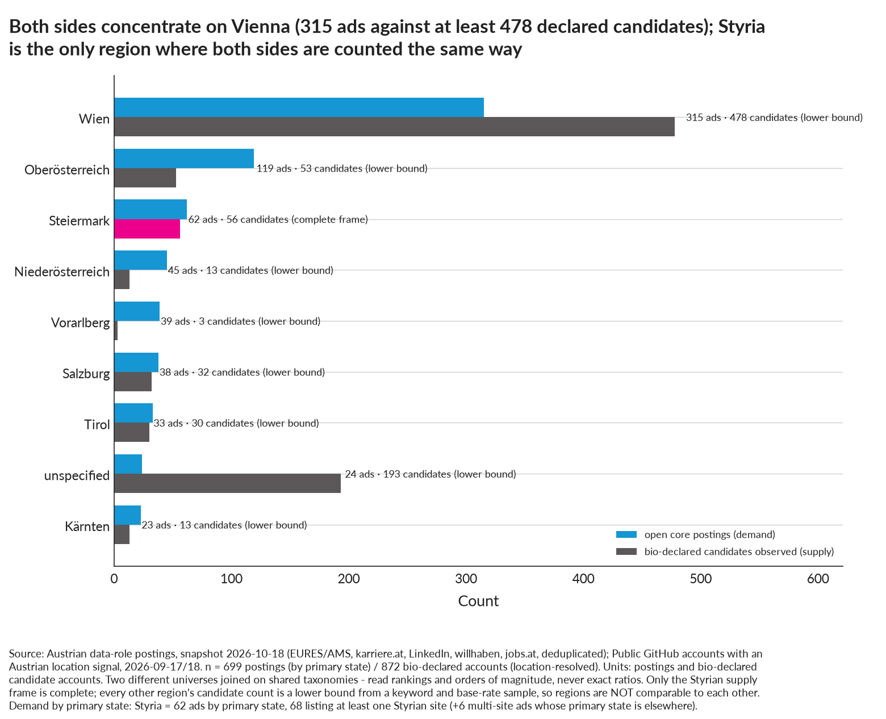](outputs/figures/BQ37_geography_demand_supply.png)

**Figure BQ37** · comparison across categories shown as `grouped_bar` (bivariate-dual) · built from `DS05_demand_supply_geography.csv` · units: counts. **Read with:** Supply frames differ by region by construction: Styria is a complete GitHub frame, every other state is a keyword plus base-rate sample and therefore a lower bound. Cross-region supply comparison is not valid. Demand is by primary state (T03a); counting every ad that lists a Styrian site gives 68.
<!-- BQ37_geography_demand_supply:end -->

## 11. How does seniority alter the picture? (DS07, DS07b)

Ads: <!--m:seniority_senior_or_lead_share-->35 %<!--/m--> senior or lead wording, <!--m:seniority_share__unspecified:pct1-->57.4 %<!--/m--> unlabelled, <!--m:seniority_intern_or_junior_share-->7 %<!--/m--> intern/junior. Bios: <!--m:supply_seniority_senior_or_lead_share-->10 %<!--/m--> senior or lead, <!--m:supply_seniority_share__unlabelled-->68 %<!--/m--> unlabelled, **<!--m:supply_seniority_share__student-->17 %<!--/m--> students**, <!--m:supply_seniority_share__junior:pct1-->4.5 %<!--/m--> junior. The visible GitHub supply is junior-skewed relative to advertised seniority, and the senior supply that exists rarely publishes (leads: median 0.5 projects). Experience years are not observable, so a title-to-experience mismatch cannot be tested. Implication: public evidence competes mostly with student and early-career portfolios, while ads ask for seniors — an experienced profile with documented, business-framed projects is unusual in the observable pool.

<!-- BQ25_seniority_mismatch:start (figure generated by src/analysis/make_visual_layer.py - do not edit by hand) -->
**Q. Ads keep asking for seniors - am I actually competing with seniors?**

Not in the visible pool: 35% of ads carry senior or lead wording (senior alone 21%) against 10% of public profiles, and 17% of profiles are students - so twenty years of business experience plus documented projects is an unusual combination where the portfolios are, even though the ads ask for it.

[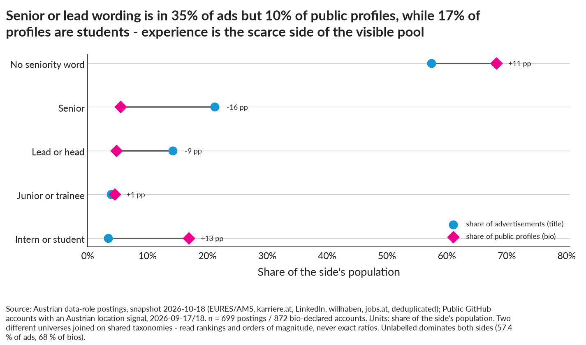](outputs/figures/BQ25_seniority_mismatch.png)

**Figure BQ25** · deviation from target shown as `dumbbell` (categorical-multi) · built from `DS07_demand_supply_seniority.csv` · units: share of population. **Read with:** Seniority read from ad titles and bio wording; years of experience are not observable on either side, and senior practitioners publish less.
<!-- BQ25_seniority_mismatch:end -->

## 12. How does education alter the picture? (DS08, O01)

Ads name a degree level in <!--m:degree_level_share__master-->13 %<!--/m--> (Master) / <!--m:degree_level_share__phd-->3 %<!--/m--> (PhD) and require degree wording in <!--m:degree_required_share-->30 %<!--/m-->, with informatics/engineering fields dominant. Candidates who write about education (<!--m:supply_education_wording_share_p_data-->31 %<!--/m--> of P_data) name Master's <!--m:supply_education_share__p_data__master-->14 %<!--/m-->, PhD <!--m:supply_education_share__p_data__phd-->9 %<!--/m-->, and **data-science degrees <!--m:supply_education_field_share__data_science-->57 %<!--/m--> of P_T1 field mentions** (ads <!--m:degree_field_share__data_science:pct1-->19.3 %<!--/m-->). Austria graduates ≈ <!--m:graduates_latest__f06_master:int100-->1,500<!--/m--> ICT masters and ≈ <!--m:graduates_latest__f0414_master-->620<!--/m--> marketing masters a year; statistics masters are <!--m:graduates_latest__f0542_master-->16<!--/m-->. The observable data supply is credential-heavy in data-science degrees and thin in the informatics/engineering credentials ads name most — but on both sides silence dominates, so this is a wording comparison, not a qualification census.

<!-- BQ38_education_both_sides:start (figure generated by src/analysis/make_visual_layer.py - do not edit by hand) -->
**Q. Is the pool I am competing with more credentialled than employers actually ask for?**

In its own direction, yes: candidates over-represent data-science degrees and Master's/PhD wording relative to the ads, while the ads name informatics, engineering and business fields more often than candidates do (data-science wording: ads 19% vs candidates 57%) - the credential gap is a mismatch of field, not a simple deficit of level.

[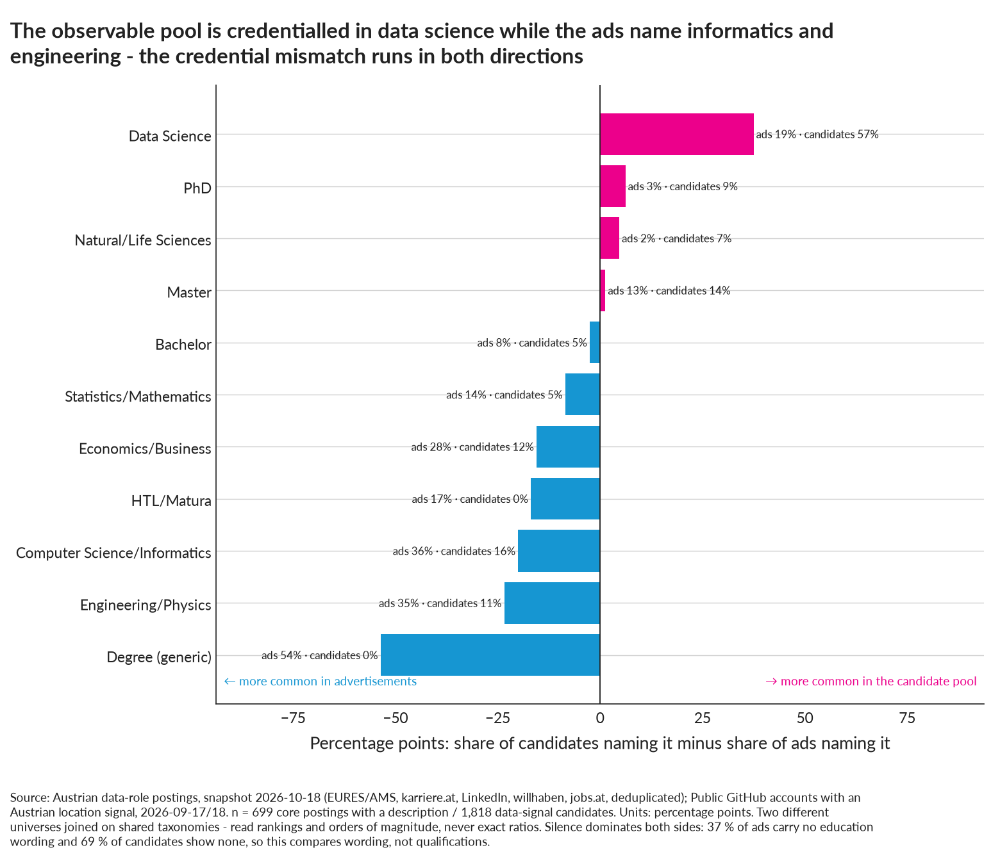](outputs/figures/BQ38_education_both_sides.png)

**Figure BQ38** · deviation from target shown as `diverging_bar` (categorical-value) · built from `DS08_demand_supply_education.csv` · units: percentage points. **Read with:** Absence of education wording is not absence of a degree on either side; 69 % of candidates write nothing about education at all, so these shares are lower bounds of very different kinds.
<!-- BQ38_education_both_sides:end -->

## 13. How common are certifications? (DS08, C09)

Rare on both sides: ads <!--m:cert_any_share-->13 %<!--/m--> any wording, ≤ <!--m:cert_max_share-->2 %<!--/m--> specific; candidates <!--m:supply_cert_share__p_data__certification_any_mention:pct1-->3.8 %<!--/m--> any, MOOC certificates <!--m:supply_cert_share__p_data__coursera_edx_udemy_any-->6 %<!--/m-->, vendor data certificates ≤ 0.1 %. Google Data Analytics/IBM capstone repositories exist (10) but are a rounding error. No evidence that certifications differentiate in either direction.

<!-- BQ36_certifications_both_sides:start (figure generated by src/analysis/make_visual_layer.py - do not edit by hand) -->
**Q. Is a certification worth the money and the weeks - does either side of this market care?**

No evidence that it is: 13% of ads mention any certification at all and each specific one stays at or under 2 %, while 3.8% of observed candidates show one and MOOC certificates outnumber vendor ones - certifications differentiate in neither direction here, which makes them the cheapest item to drop from a learning plan.

[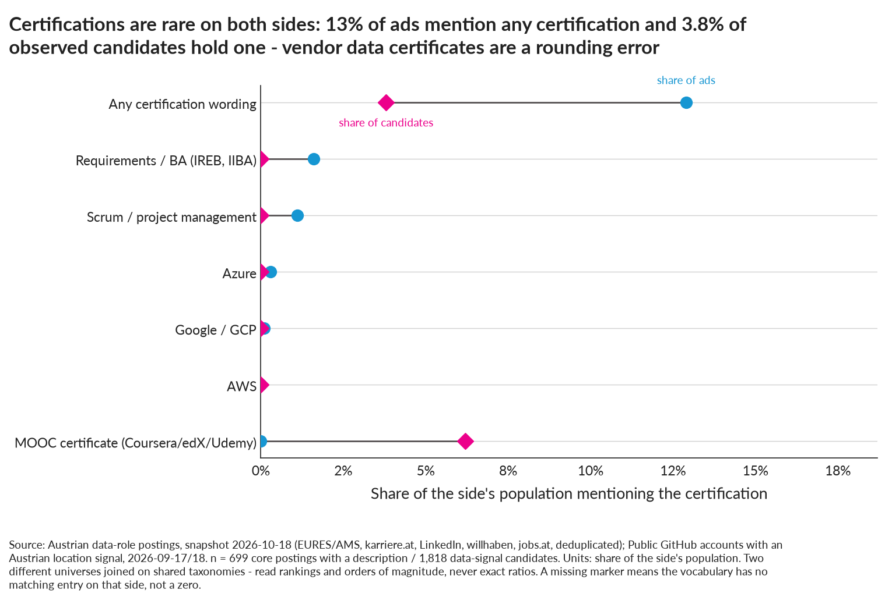](outputs/figures/BQ36_certifications_both_sides.png)

**Figure BQ36** · deviation from target shown as `dumbbell` (categorical-multi) · built from `T11d_certifications.csv`, `C09_certifications.csv` · units: share of population. **Read with:** Both sides are wording-derived: an employer may still value a certificate it does not advertise, and a candidate may hold one they never mention in a bio or README.
<!-- BQ36_certifications_both_sides:end -->

## 14. How common are public portfolios? (C14, C16, C15)

Of data-signal accounts, <!--m:github_evidence_share__p_data__ge_1_project_definition-->83 %<!--/m--> have at least one project, <!--m:github_evidence_share__p_data__ge_1_documented_project_readme_ge_1k-->76 %<!--/m--> a documented one, <!--m:github_evidence_share__p_data__ge_1_substantive_project_documented_not_educational-->62 %<!--/m--> a substantive one; median <!--m:github_median__p_data__projects:int0-->2<!--/m--> projects (p90 <!--m:github_median__p_data__p90_projects:int0-->8<!--/m-->); bio-declared accounts median <!--m:github_median__p_t1__projects:int0-->1<!--/m--> (<!--m:project_count_share__p_t1__n_projects__0-->36 %<!--/m--> none). Cross-platform: <!--m:portfolio_share__p_data__linkedin_link_on_profile_readmes-->36 %<!--/m--> link LinkedIn from GitHub, <!--m:portfolio_share__p_data__personal_website_custom_domain-->36 %<!--/m--> a custom website, <!--m:portfolio_share__p_data__github_pages_site-->19 %<!--/m--> a GitHub Pages site, <!--m:portfolio_share__p_data__kaggle_link-->9 %<!--/m--> Kaggle, <!--m:portfolio_share__p_data__tableau_public_link:pct1-->0.6 %<!--/m--> Tableau Public. The public portfolio is normal in this population; a *documented and business-framed* one is not (see 16).

<!-- BQ40_project_counts:start (figure generated by src/analysis/make_visual_layer.py - do not edit by hand) -->
**Q. How many projects does a candidate actually show - what would put me above the pool?**

Not many: 17% of observed candidates show no project at all, 63% hold three or fewer, and the median is two - so two or three finished, documented projects is not a modest portfolio in this pool, it is an above-median one, and the differentiator is documentation rather than count.

[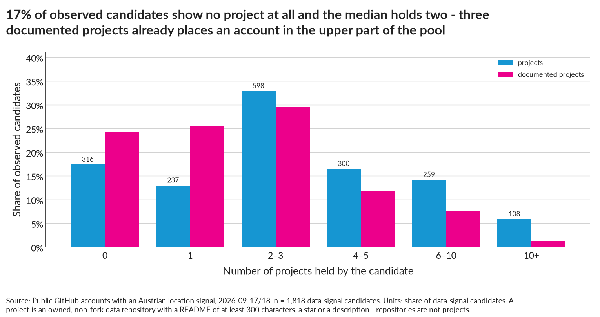](outputs/figures/BQ40_project_counts.png)

**Figure BQ40** · comparison across categories shown as `grouped_bar` (bivariate-dual) · built from `C16_project_count_distribution.csv` · units: share of candidates. **Read with:** Counts only public, non-fork repositories: private, client and employer work is invisible, so this is a floor on what candidates have built, not a measure of their experience.
<!-- BQ40_project_counts:end -->

## 15. What do candidate projects look like? (C14c, C18, C18c, C19d)

ML project <!--m:repo_archetype__ml_project__share-->23 %<!--/m--> of data repos, educational/tutorial <!--m:repo_archetype__educational_tutorial__share-->21 %<!--/m-->, inactive archive <!--m:repo_archetype__inactive_archive__share-->28 %<!--/m-->, notebook portfolio <!--m:repo_archetype__notebook_portfolio__share-->9 %<!--/m-->, production-style app <!--m:repo_archetype__production_style_application__share-->5 %<!--/m-->, analytics <!--m:repo_archetype__analytics_project__share:pct1-->2.7 %<!--/m-->, data-engineering <!--m:repo_archetype__data_engineering_project__share:pct1-->1.9 %<!--/m-->, dashboard <!--m:repo_archetype__dashboard_project__share:pct1-->1.7 %<!--/m-->. Topics: NLP, classification, LLM apps, CV lead; business domains appear in <!--m:project_theme__share_with_business_domain-->26 %<!--/m--> of projects (healthcare <!--m:project_topic_share__projects__analytics_domain__healthcare-->6 %<!--/m-->, finance <!--m:project_topic_share__projects__analytics_domain__finance-->3 %<!--/m-->, customer <!--m:project_topic_share__projects__analytics_domain__customer-->2 %<!--/m-->, marketing <!--m:project_topic_share__projects__analytics_domain__marketing:pct1-->1.6 %<!--/m-->, sales <!--m:project_topic_share__projects__analytics_domain__sales:pct1-->1.2 %<!--/m-->); experimentation, causal inference and product analytics < 1 %. Analytics projects are the smallest archetype (180) and carry the least business context (7 % section).

<!-- BQ41_project_topics:start (figure generated by src/analysis/make_visual_layer.py - do not edit by hand) -->
**Q. What is the pool actually building - and is it what Austrian employers pay for?**

Methods rather than businesses: NLP, classification, LLM apps and computer vision lead, with the listed method and AI themes covering 65% of projects against 18% for business domains - while the ads are dominated by finance/controlling, operations and marketing context, so a domain-framed project is scarce exactly where demand is thick.

[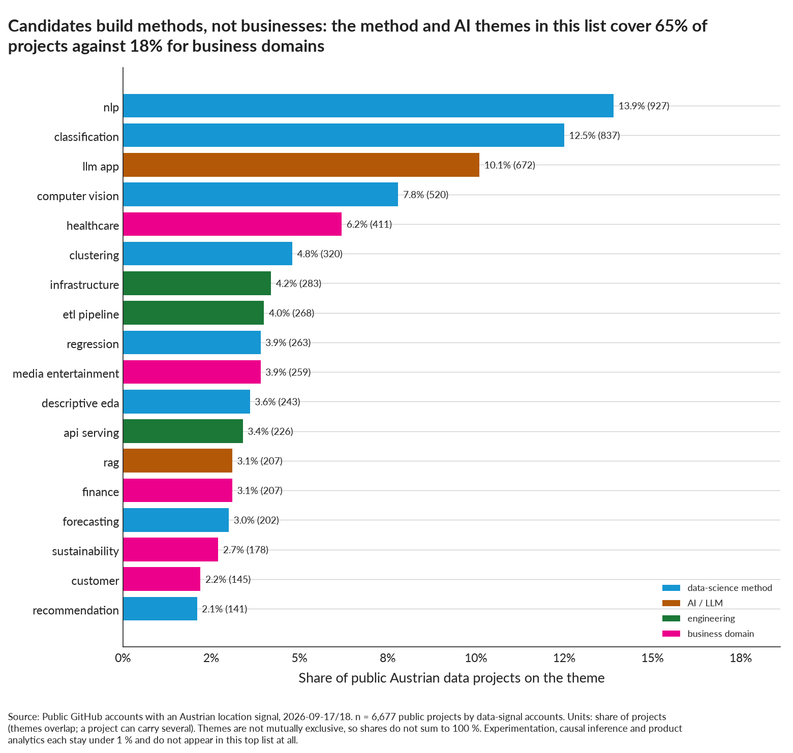](outputs/figures/BQ41_project_topics.png)

**Figure BQ41** · ranking shown as `horizontal_bar` (bivariate-simple) · built from `C18_project_topics.csv`, `C18c_project_theme_coverage.csv` · units: share of projects. **Read with:** Themes are rule-based over repository names, descriptions, topics and READMEs and can overlap; a project with no README text is under-classified rather than absent.
<!-- BQ41_project_topics:end -->

## 16. What do candidate READMEs look like? (C19, C19c, C19e)

Documented READMEs are **software READMEs**: how-to-run <!--m:readme_share__documented_projects__section_reproducibility-->66 %<!--/m-->, methodology 51 %, data 42 %, overview 37 %, stack 33 %, structure <!--m:readme_share__documented_projects__section_structure-->31 %<!--/m-->; **results 26 %, business context <!--m:readme_share__documented_projects__section_business_context-->11 %<!--/m-->, limitations <!--m:readme_share__documented_projects__section_limitations-->12 %<!--/m-->**; results-and-method together 20 %, results-and-limitations 5.6 %; metrics words <!--m:readme_share__documented_projects__content_mentions_metrics-->21 %<!--/m-->, business terms <!--m:readme_share__documented_projects__content_mentions_business_terms-->22 %<!--/m-->; German text <!--m:readme_share__documented_projects__content_german_text-->5 %<!--/m-->. Common headings: installation, license, usage, features, overview, prerequisites, requirements, project structure, getting started. The analysis-style README (question → data → method → result → limitation → decision) is the minority pattern.

<!-- BQ24_readme_anatomy:start (figure generated by src/analysis/make_visual_layer.py - do not edit by hand) -->
**Q. If a hiring manager opens one of my repositories, what does the average one give them - and what is missing?**

Public READMEs are software READMEs: 66% say how to run the code, but only 25% state a result, 12% state limitations and 11% state a business question - question → data → method → result → limitation → decision is the rarest structure in the pool and the one my 20 years of marketing work can write without learning anything new.

**Figure BQ24** · ranking shown as `horizontal_bar` (bivariate-simple) · built from `C19_readme_patterns.csv` · units: share of documented READMEs. **Read with:** Detects headings and keywords, not quality; a README with the section can still be empty of substance.
<!-- BQ24_readme_anatomy:end -->

## 17. Which project formats are common? (C17, C17b)

Notebook (<!--m:format_share__projects__notebook-->43 %<!--/m--> of projects) and Python source/package layouts (<!--m:format_share__projects__python_package_or_src-->41 %<!--/m-->) dominate; licence <!--m:format_share__projects__license-->34 %<!--/m-->, included data <!--m:format_share__projects__data_included-->30 %<!--/m-->, environment files <!--m:format_share__projects__reproducible_env-->29 %<!--/m-->; tests <!--m:format_share__projects__tests-->12 %<!--/m-->, CI <!--m:format_share__projects__ci-->11 %<!--/m-->, API <!--m:format_share__projects__api-->9 %<!--/m-->, Docker <!--m:format_share__projects__docker-->9 %<!--/m-->, dashboard/BI <!--m:format_share__projects__dashboard_bi-->8 %<!--/m-->, pipeline (ETL/dbt/Airflow) <!--m:format_share__projects__pipeline_project-->7 %<!--/m-->, deployed app 6.5 %, SQL files 1.2 %; "notebook only" is the single most common packaging (<!--m:format_combo_share__notebook:pct1-->22.5 %<!--/m-->) and "no packaging format" the second (18.5 %); CI + tests + package together <!--m:format_combo_share__ci_plus_python_package_or_src_plus_tests:pct1-->1.8 %<!--/m--> (`C17`, `C17b`).

<!-- BQ23_project_formats:start (figure generated by src/analysis/make_visual_layer.py - do not edit by hand) -->
**Q. What does a normal public portfolio in Austria actually contain - and what would stand out?**

Notebooks (43%) and Python packages dominate, while SQL files (1.2%), dashboards, pipelines, tests and CI are rare - the packaging that maps onto advertised work is precisely the packaging almost nobody publishes.

[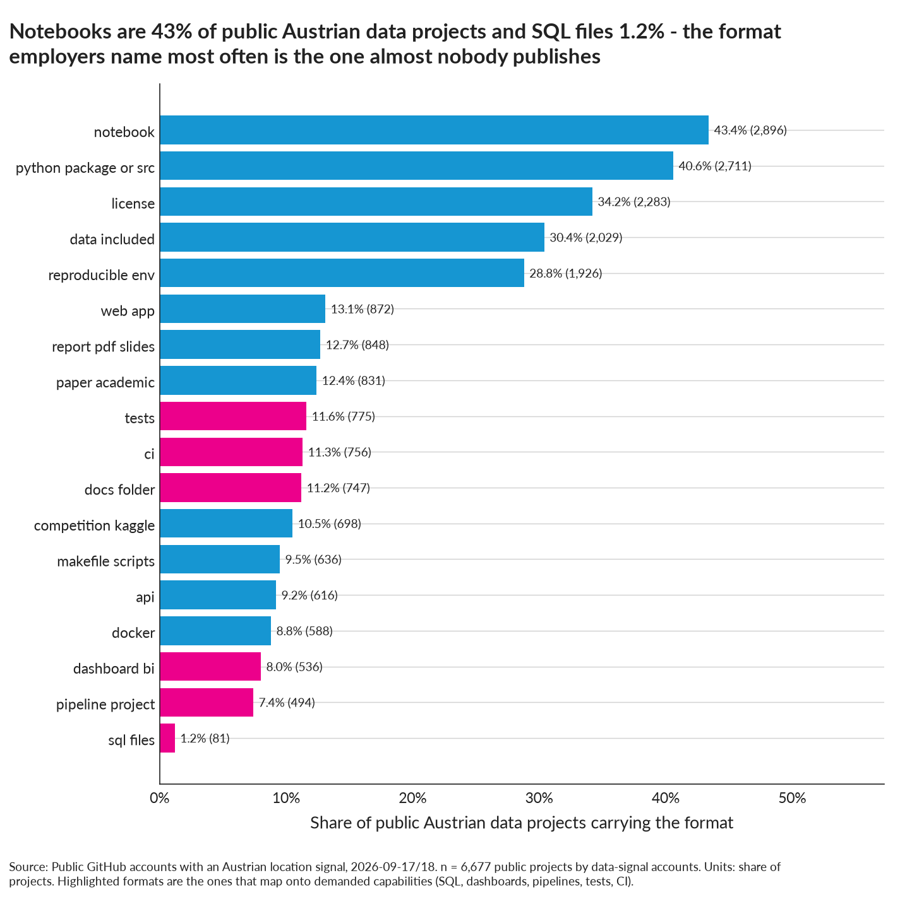](outputs/figures/BQ23_project_formats.png)

**Figure BQ23** · ranking shown as `horizontal_bar` (bivariate-simple) · built from `C17_project_formats.csv` · units: share of projects. **Read with:** Format detection is rule-based over repository file trees; a private or client project leaves no trace here.
<!-- BQ23_project_formats:end -->

## 18. Which evidence types are uncommon? (C15, C17, C19)

SQL files in a repository (1.2 % of projects); dashboard links (1.7 % of documented READMEs); Tableau Public links (0.6 % of candidates); data-modelling artefacts (dbt/star schemas: warehouse-modelling theme 1.7 % of projects, 2.4 % of candidates project-demonstrated); data-quality tests (5 %); A/B or causal readouts (< 1 % of projects; 2 % / 1.4 % of candidates); limitations sections (12 %); business-context sections (11 %); deployed apps (6.5 % of projects, 15 % of candidates); CI + tests + package together (1.8 %). These are the formats that map to demanded capabilities *and* are rare in the observable pool.

## 19. What does the marketing + data intersection look like? (C22d, C24, DS12)

Demand: <!--m:family_n__marketing_analytics-->18<!--/m--> marketing-analytics ads (<!--m:family_styria_n__marketing_analytics-->0<!--/m--> in Styria), "marketing" wording in <!--m:skill_share__marketing-->9 %<!--/m--> of core ads, A/B testing <!--m:ab_testing_share-->4 %<!--/m-->, causal inference <!--m:causal_inference_share:pct1-->0.6 %<!--/m-->. Supply: <!--m:supply_family_n__marketing_analytics-->2<!--/m--> bio-declared marketing-analytics accounts, 10 bios naming marketing at all (none with explicit transition wording), <!--m:marketing_projects_n-->273<!--/m--> marketing/customer/e-commerce projects by <!--m:marketing_project_candidates_n-->192<!--/m--> candidates (<!--m:marketing_project_candidates_share-->11 %<!--/m--> of P_data; 25 in Styria), of which 17 combine the domain with experimentation or causal methods, 29 show SQL and Python, 25 show Power BI or Tableau. The intersection exists in projects (mostly clustering/classification on customer data by data-science-labelled accounts), not in titles; marketing-plus-experimentation-plus-SQL is shown by fewer than 20 public accounts in Austria.

<!-- BQ26_marketing_x_data:start (figure generated by src/analysis/make_visual_layer.py - do not edit by hand) -->
**Q. My 20 years are in marketing - does the marketing × data intersection actually exist as a space I can own?**

It exists in projects, not in titles: 197 of 1,818 observed candidates have a marketing-themed project, 64 pair it with Python and SQL and only 23 add experimentation or causal work - but demand is only 18 marketing-analytics ads nationally and 0 in Styria, so it is a differentiator inside analyst applications, not a local job title.

**Figure BQ26** · ranking shown as `horizontal_bar` (bivariate-simple) · built from `DS12_marketing_x_data_intersection.csv`, `C24_marketing_data_intersection.csv` · units: accounts. **Read with:** Each step is a subset of the one above it. Public GitHub does not narrate career changes (3.4 % explicit, marketing 0), so transitioners are invisible here rather than absent.
<!-- BQ26_marketing_x_data:end -->

## 20. What does this imply for future career decisions? (the "so what", brief §68)

<!-- BQ43_positioning_clusters:start (figure generated by src/analysis/make_visual_layer.py - do not edit by hand) -->
**Q. Which positioning spaces actually exist in the pool, and which of them is least crowded?**

Eight descriptive clusters, of which the largest holds 457 of 1,818 candidates with a median of 0 projects; the notebook-ML and deep-learning clusters are the dense ones, while clusters defined by pipelines, dashboards or business domains are both smaller and better evidenced - the space is chosen by what the projects show, not by the title claimed.

[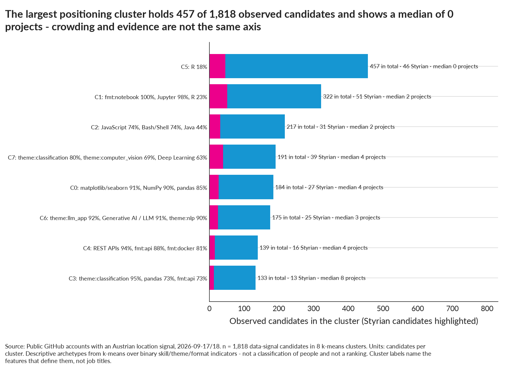](outputs/figures/BQ43_positioning_clusters.png)

**Figure BQ43** · ranking shown as `horizontal_bar` (bivariate-simple) · built from `C23_positioning_clusters.csv`, `DS11_demand_supply_positioning_clusters.csv` · units: candidates. **Read with:** k-means on binary indicators with weak separation: these are readable groupings, not natural kinds, and a candidate near a boundary could sit in either cluster.
<!-- BQ43_positioning_clusters:end -->

* **Market convergence.** Python, visualisation, ML and GenAI are the shared language of ads and public portfolios; they establish membership, not distinction.
* **Market concentration.** Both sides concentrate on Vienna; supply concentrates on the *data scientist* label and notebook ML, demand on *data engineer / business analyst / BI* titles and on SQL-centred tooling — the largest structural mismatch in the data.
* **Candidate evidence gaps.** SQL, data quality/validation, dimensional modelling/warehousing, Azure/Databricks pipelines, and business-framed analysis (context, result, limitation) are demanded far more often than they are publicly demonstrated. Power BI/Excel/SAP are also demanded and invisible, but they cannot be shown as code — screenshots, models and DAX in a repo are the workaround.
* **Candidate concentration.** Deep learning, NLP/CV, LLM demos, generic classification notebooks and course repositories are abundant relative to demand; a portfolio built only of these competes with the densest part of the pool.
* **Positioning spaces.** The combinations the data supports as *rare-but-demanded*: SQL + modelled warehouse + Power BI/dashboard with a business question (analytics/BI space; 0.6 candidates per Styrian posting); Python ETL with tests/CI into a warehouse (engineering space; 0.2 per Styrian posting); domain-framed decision analysis (experimentation, forecasting, causal) on customer/marketing/finance data (fewer than 20 public accounts show marketing + experimentation). Seniority wording and business vocabulary are themselves rare in the pool.
* **Demonstration opportunities.** In order of demand and rarity: a SQL-first project with a documented data model; a data-quality/validation layer with tests; an Azure or Databricks pipeline (even small); a README with question, business context, result and limitations; a dashboard with screenshots and the model behind it; an experimentation/causal readout on business data.
* **Transition patterns.** Public GitHub does not narrate career changes (3.4 % explicit; marketing 0). Transitioners are invisible here; the LinkedIn slot is where that evidence would live.

<!-- BQ44_transition_domains:start (figure generated by src/analysis/make_visual_layer.py - do not edit by hand) -->
**Q. How common is a career transition into data - and does anyone arrive from marketing?**

Rare in public evidence and almost absent from marketing: 12.2% of bio-declared accounts name a business background, while marketing is named by 10 of 872 - but GitHub does not narrate careers (3.4 % state a transition at all), so this is evidence of silence, not evidence of absence, and the transition story is one the CV and LinkedIn must carry because the code cannot.

[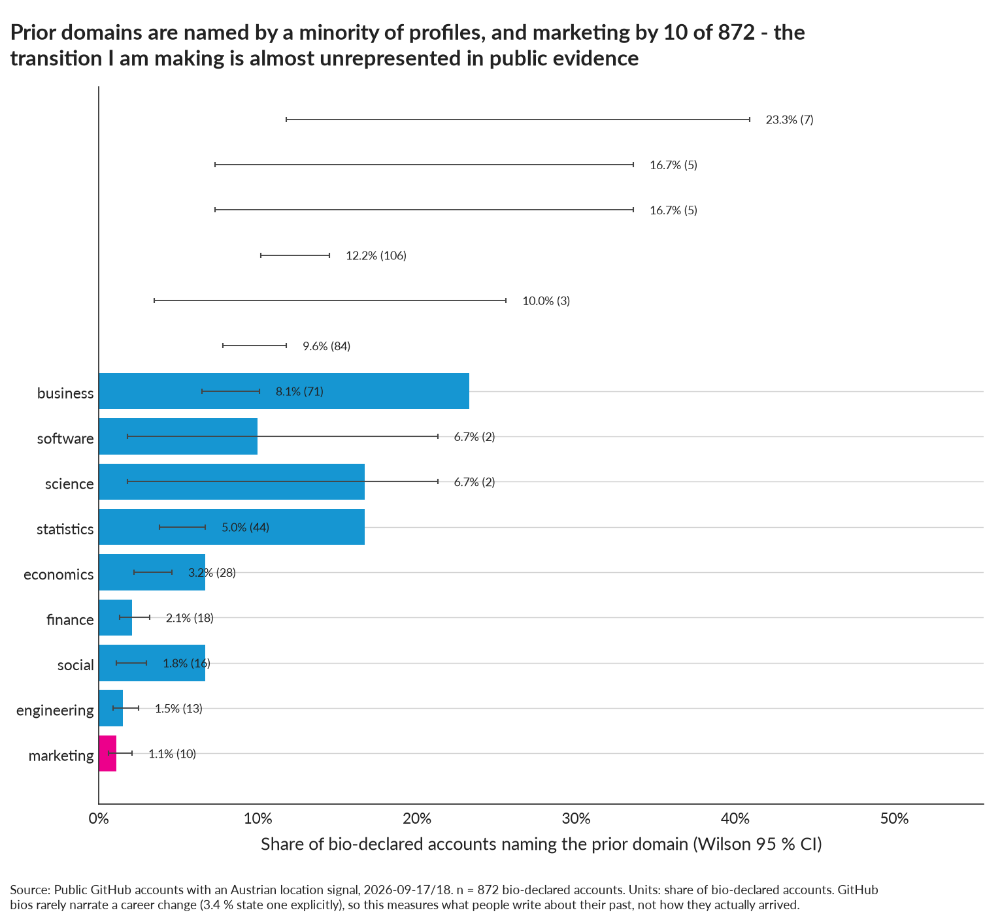](outputs/figures/BQ44_transition_domains.png)

**Figure BQ44** · ranking shown as `horizontal_bar` (bivariate-simple) · built from `C22b_prior_domains.csv`, `C22_transition_signals.csv`, `C22d_marketing_named_bios.csv` · units: share of accounts. **Read with:** Prior domain is detected from bio wording only. Transitioners who do not write about their past are invisible here, which is the most likely explanation for the low counts.
<!-- BQ44_transition_domains:end -->

* **Geographic implications.** Styria has the same supply shape as Vienna at one-fifth the size; its demand is engineering/industrial, its public supply is academic/data-science; Graz is where the engineering-flavoured analytics evidence is scarcest relative to ads.
* **Language implications.** Unresolved on the supply side; the demand side alone says German-required ads are the majority in Styria (<!--m:german_stated_n_styria-->33<!--/m--> of <!--m:styria_n_text_basis-->68<!--/m--> state a requirement).
* **Portfolio implications.** Common: notebooks, ML classifiers, tutorials, install/usage READMEs. Uncommon and demand-mapped: SQL, modelling, pipelines with tests, dashboards, business-framed results. Two or three substantive, documented projects already place an account above the median (median <!--m:github_median__p_t1__projects:int0-->1<!--/m--> for bio-declared accounts, <!--m:github_evidence_share__p_data__ge_1_substantive_project_documented_not_educational-->62 %<!--/m--> with ≥ 1 substantive).
* **Career-system implications.** Monitor over time (docs/supply-methodology.md §8): T1 family mix (does data engineering/BI appear on GitHub?), the SQL/modelling evidence share, LLM-project saturation (<!--m:project_topic_share__projects__ai__llm_app-->10 %<!--/m--> of projects now), Styrian data-signal count (<!--m:supply_geo__p_data__styria-->248<!--/m--> by resolved location; <!--m:supply_styria_frame_b_data_signal_n-->247<!--/m--> in the frame-B complete-Styria subset), English-only Styrian ads (<!--m:english_no_german_n_styria-->8<!--/m--> of <!--m:addressable_scope_n_styria-->68<!--/m-->), and, once filled, the LinkedIn slot's language-level distribution.

## What would change this map?

| Observation | Would change |
|---|---|
| Filled LinkedIn slot showing many German-capable, senior BI/engineering candidates in Graz | the "supply thin in engineering/BI" reading (GitHub blindness vs real scarcity) and §9–§11 |
| A repeat GitHub collection with a rising engineering/BI share or falling data-science share | §1, §4, §10 |
| Larger Vienna base-rate slices | Vienna lower bounds → estimates |
| Layer 1 re-collection with StepStone/company pages | demand shares in every DS table |
| Evidence that SQL/modelling work is shown elsewhere (Kaggle, private) | §6 evidence-gap reading |
| Interview/hiring outcomes for documented vs undocumented portfolios | everything in §20 |
