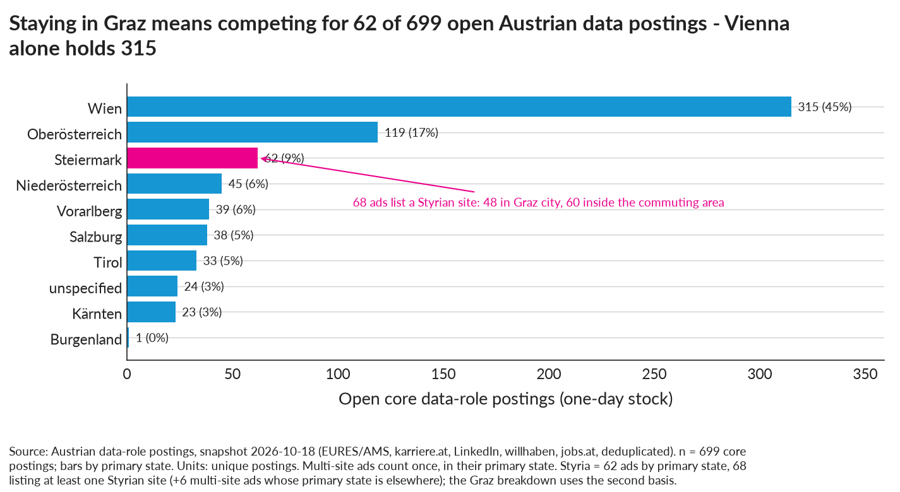
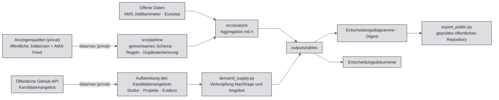

[🇧🇷 PT-BR](README.pt-BR.md) · [🇬🇧 EN-UK](README.md) · [🇦🇹 DE-AT](README.de-AT.md)

<!-- Metric markers use outputs/metrics.json; their display locale follows the README filename. -->

# Arbeitsmarkt-Intelligenz für Datenberufe in Österreich


[](https://github.com/RafaelBraga-Kribitz/austria-data-job-market-intelligence/actions/workflows/tests.yml)
[](https://github.com/RafaelBraga-Kribitz/austria-data-job-market-intelligence/actions/workflows/readme-quality.yml)
[](LICENSE)
[](LICENSE)
[](requirements.txt)
[](#status)

**Status:** Abgeschlossen · Nachfragesnapshot <!--m:_meta.demand_vintage-->2026-10-18<!--/m--> · Angebotssnapshot <!--m:_meta.supply_vintage-->2026-09-17<!--/m--> · Nachfragedaten sind ab <!--m:_meta.stale_after_demand-->2027-01-17<!--/m--> veraltet

> **Wer entscheidet:** eine Person in Graz, die eine Stelle im Datenbereich sucht.\
> **Was entschieden wird:** welche Berufe, Fähigkeiten und Städte priorisiert werden, basierend auf <!--m:core_n-->699<!--/m--> offenen Kernanzeigen für Datenberufe in Österreich.\
> **Ergebnis:** Auf Wien entfallen <!--m:vienna_share_core-->45 %<!--/m--> der Kernanzeigen, auf die Steiermark <!--m:styria_core_primary_state-->62<!--/m-->. SQL wird in <!--m:sql_share-->40 %<!--/m--> der Anzeigen genannt, aber nur <!--m:cap_supply_project_share__sql-->10 %<!--/m--> der beobachteten GitHub-Kandidatinnen und -Kandidaten zeigen es in einem Projekt. Data Science hat die meisten Kernanzeigen (<!--m:family_n__data_science-->176<!--/m-->).\
> **Wichtigster Vorbehalt:** Alle Anzeigen stammen aus einem einzigen Tages-Snapshot (<!--m:_meta.demand_vintage-->2026-10-18<!--/m-->); die steirischen Fallzahlen sind zu klein, um Anteile auszuweisen.\
> **Das eine Diagramm:** die Skills-Gap-Grafik, an erster Stelle unter [Entscheidungsübersicht](#entscheidungsübersicht).

## Entscheidungsübersicht

> **Ergebnis.** Abgesehen von der allgemeinen Formulierung „KI“ nennen die Anzeigen am häufigsten SQL, Python und Datenvisualisierung. Der genannte Technologie-Stack ist Microsoft-zentriert. SQL, Datenqualität und Data-Warehouse-Modellierung werden in Anzeigen deutlich häufiger genannt, als öffentliche Projekte sie zeigen. Wien hat den größten Anteil der Kernanzeigen. Auf Englisch formulierte Anzeigen ohne ausdrücklich genannte Deutschanforderung bilden eine kleine Gruppe. Die meisten veröffentlichten Gehaltsangaben sind kollektivvertragliche Mindestgehälter, also die gesetzlichen Mindestentgelte der Branche.


*Skills-Gap-Grafik: Welche in Anzeigen geforderten Fähigkeiten zeigen Portfolios selten? Jeder Punkt steht für eine Fähigkeit. Je weiter er unter der gepunkteten Linie liegt, desto häufiger wird die Fähigkeit in Anzeigen genannt als in öffentlichen Portfolios belegt. SQL steht in <!--m:cap_demand_share__sql-->40 %<!--/m--> der Anzeigen. Nur <!--m:cap_supply_project_share__sql-->10 %<!--/m--> der <!--m:supply_p_data_n-->1.818<!--/m--> beobachteten österreichischen GitHub-Konten mit Datensignal zeigen es in einem Projekt. Datenqualität (<!--m:cap_supply_project_share__data_quality_governance-->5 %<!--/m-->) und Data-Warehouse-Modellierung (<!--m:cap_supply_project_share__data_warehouse_modelling-->2 %<!--/m-->) liegen noch niedriger. Schlussfolgerung: Ein Portfolio-Projekt mit SQL auf einem modellierten Schema und Datenqualitätsprüfungen deckt Fähigkeiten ab, die Anzeigen nennen und Portfolios selten belegen (Skills-Gap-Tabelle, `CALIBRATED`). Beide Seiten bilden unterschiedliche Populationen ab; daher Größenordnungen und Rangfolge betrachten, nicht das exakte Verhältnis.*

**So sind die Zahlen zu lesen.** „Anteil“ bezeichnet den Anteil der Anzeigen (oder Konten), in denen ein Merkmal *genannt* wird. Eine Nennung bedeutet nicht, dass es eine Anforderung ist. Für jeden Anteil zählt eine Regel passende Textstellen; n und ein Vorbehalt werden mitangegeben. [`outputs/tables/`](outputs/tables/) enthält alle folgenden Zahlen. Die [Legende](#legende-quellen-tabellen-und-diagrammdateien) unter Daten nennt die Datei zu jedem ausgeschriebenen Tabellennamen. [`src/reporting/digest.py`](src/reporting/digest.py) druckt die Zahlen erneut in [`outputs/reports/digest.txt`](outputs/reports/digest.txt). Niemand trägt die Zahlen in dieser Datei manuell ein. Bei einem neuen Snapshot füllt ein Skript jede Zahl aus dem Kennzahlenregister aus. Verborgene HTML-Kommentare um jede Zahl nennen ihren Registerschlüssel; GitHub zeigt sie nicht an.

### 1. SQL wird in <!--m:sql_share-->40 %<!--/m--> der Anzeigen genannt, Python in <!--m:python_share-->39 %<!--/m-->

Nur die allgemeine Formulierung „KI“ ist häufiger (<!--m:generic_ai_share-->43 %<!--/m-->). Das 95-%-Konfidenzintervall für SQL beträgt <!--m:skill_ci_low__sql-->37 %<!--/m-->–<!--m:skill_ci_high__sql-->44 %<!--/m-->. Auf SQL und Python folgen Datenvisualisierung (<!--m:visualisation_share-->36 %<!--/m-->), Cloud (<!--m:cloud_share-->32 %<!--/m-->), Datenqualität (<!--m:data_quality_share-->31 %<!--/m-->), ETL (Extract, Transform, Load; Extrahieren, Transformieren, Laden) (<!--m:etl_share-->20 %<!--/m-->), generative KI (<!--m:genai_share-->18 %<!--/m-->) und Statistik (<!--m:statistics_share-->16 %<!--/m-->).
*Grundlage:* n = <!--m:core_n_text_basis-->699<!--/m--> Kernanzeigen mit Beschreibung. Einheit: Anteil der Anzeigen. Quelle: österreichische öffentliche Jobbörsen und AMS-Feed (Arbeitsmarktservice, der öffentliche Arbeitsvermittlungsdienst Österreichs), Tabelle zu Skill-Nennungen. *Vorbehalt:* Die Zuordnung erfolgt regelbasiert. Das Projekt misst die Präzision der Titelklassifikation (Anteil der zugewiesenen Labels, die eine Person als korrekt bestätigt). Es misst nicht den Recall der Skills (Anteil der tatsächlichen Nennungen, den die Regeln finden). Eine Nennung ist keine Anforderung. Allgemeine „KI“-Nennungen umfassen AI, KI oder artificial intelligence und benennen daher keine bestimmte Fähigkeit.

### 2. Azure wird in <!--m:azure_share-->19 %<!--/m--> der Anzeigen genannt, AWS in <!--m:aws_share-->9 %<!--/m-->: der Stack ist Microsoft-zentriert

Azure ist Microsofts Cloud-Plattform, AWS steht für Amazon Web Services. Power BI wird in <!--m:power_bi_share-->17 %<!--/m--> der Anzeigen genannt, Tableau in <!--m:tableau_share-->3 %<!--/m-->. Excel steht in <!--m:excel_share-->14 %<!--/m--> der Anzeigen.
*Grundlage:* dieselben <!--m:core_n_text_basis-->699<!--/m--> Anzeigen. Einheit: Anteil der Anzeigen. Quelle: Tabelle zu Skill-Nennungen. *Vorbehalt:* Anzeigen nennen Tools, keine Bibliotheken. Die Nennung eines Tools sagt nichts darüber aus, wie tief die Arbeit damit geht.

### 3. SQL wird in <!--m:cap_demand_share__sql-->40 %<!--/m--> der Anzeigen genannt und in Projekten von <!--m:cap_supply_project_share__sql-->10 %<!--/m--> der beobachteten Kandidatinnen und Kandidaten gezeigt

Öffentliche Projekte zeigen manche in Anzeigen genannten Fähigkeiten selten. Datenqualität und Governance: <!--m:cap_demand_share__data_quality_governance-->32 %<!--/m--> der Anzeigen gegenüber <!--m:cap_supply_project_share__data_quality_governance-->5 %<!--/m--> der Kandidatinnen und Kandidaten. Data-Warehouse-Modellierung: <!--m:cap_demand_share__data_warehouse_modelling-->25 %<!--/m--> gegenüber <!--m:cap_supply_project_share__data_warehouse_modelling-->2 %<!--/m-->.
*Grundlage:* Anzeigen n = <!--m:core_n-->699<!--/m-->. Kandidaten n = <!--m:supply_p_data_n-->1.818<!--/m--> öffentliche österreichische GitHub-Konten mit Datensignal (Snapshot <!--m:_meta.supply_vintage_span-->2026-09-17/18<!--/m-->). Einheit: Anteil der Anzeigen und der Kandidaten. Quelle: Skills-Gap-Tabelle. Die Fähigkeits-Taxonomie gruppiert Datenqualität und Governance zusammen. Daher ist ihr Anteil etwas breiter als der Keyword-Anteil in Befund 1. *Vorbehalt:* GitHub bildet Engineers, Forschende und Studierende überproportional ab. Power-BI-, Excel- und SAP-Arbeit sowie private Repositories sind nicht sichtbar. Ein fehlender öffentlicher Nachweis bedeutet nicht, dass die Fähigkeit fehlt.

### 4. Auf Wien entfallen <!--m:vienna_share_core-->45 %<!--/m--> der Kernanzeigen; die Steiermark hat <!--m:styria_core_primary_state-->62<!--/m--> von <!--m:core_n-->699<!--/m-->

In Wien gibt es <!--m:vienna_core_primary_state-->315<!--/m--> der <!--m:core_n-->699<!--/m--> Anzeigen. Auf die Steiermark entfallen <!--m:styria_core_primary_state-->62<!--/m--> nach Hauptbundesland oder <!--m:styria_core_flag-->68<!--/m-->, wenn jeder angeführte Arbeitsort zählt. Von diesen 68 liegen <!--m:graz_area_core_flag-->60<!--/m--> im Grazer Einzugsgebiet. Die Steiermark ist klein. Ihre amtliche Zeitreihe seit <!--m:jobbarometer_year_first-->2020<!--/m--> ist unsicher. Quelle ist die jährliche AMS-Reihe zur Berufsgruppe Data Scientist. Laut AMS lassen sich manche Anzeigen keinem Bundesland zuordnen. Diese Anzeigen machten <!--m:jb_data_scientist_unplaced_share__2020-->37,9 %<!--/m--> der Gesamtzahl für Österreich im Jahr <!--m:jobbarometer_year_first-->2020<!--/m--> aus und <!--m:jb_data_scientist_unplaced_share__2025-->9,0 %<!--/m--> im Jahr <!--m:jobbarometer_year_last-->2025<!--/m-->. Die Steiermark liegt daher bei <!--m:jb_data_scientist_change__styria-->+34 %<!--/m--> roh und bei <!--m:jb_data_scientist_change_allocated__styria-->−9 %<!--/m-->, wenn diese Anzeigen proportional auf die Bundesländer verteilt werden. Österreich insgesamt liegt bei <!--m:jb_data_scientist_change__austria-->−28 %<!--/m-->. Seit dem Höhepunkt <!--m:jb_data_scientist_peak_year__austria-->2022<!--/m--> liegt die Steiermark bei <!--m:jb_data_scientist_change_from_austria_peak__styria-->−29 %<!--/m--> und Österreich bei <!--m:jb_data_scientist_change_from_peak__austria-->−56 %<!--/m-->.
*Grundlage:* Einheit: Anzahl der Anzeigen (Tabellen nach Bundesland und steirischer Stadt) sowie Anzeigenzahl einer Berufsgruppe (offizielle JobBarometer-Reihe). *Vorbehalt:* Die AMS-Berufsgruppe ist gröber als die Titel dieses Projekts und verwendet eine andere Einheit. Die Verteilung nicht zugeordneter Anzeigen ist eine Sensitivitätsrechnung, keine Messung. Der Grund für den Rückgang ihres Anteils ist nicht geklärt. Die größte steirische Zelle nach Berufsfamilie umfasst <!--m:styria_largest_family_n-->28<!--/m--> Anzeigen. Aussagen zur Steiermark betreffen daher Fallzahlen und Richtungen, keine Anteile.

### 5. <!--m:english_no_german_n_national-->147<!--/m--> von <!--m:core_n-->699<!--/m--> Anzeigen sind auf Englisch und nennen keine Deutschanforderung

<!--m:german_stated_share-->42 %<!--/m--> der Anzeigen nennen Deutsch als Anforderung; <!--m:english_posting_share-->26 %<!--/m--> sind auf Englisch verfasst. Nur wenige englischsprachige Anzeigen nennen keine Deutschanforderung: <!--m:english_no_german_n_vienna-->78<!--/m--> in Wien, <!--m:english_no_german_n_styria-->8<!--/m--> von <!--m:addressable_scope_n_styria-->68<!--/m--> in der Steiermark und <!--m:english_no_german_n_graz_area-->6<!--/m--> im Grazer Gebiet. Nur <!--m:german_b1_or_below_n-->6<!--/m--> Anzeigen geben B1 (Mittelstufe) oder darunter als ausreichend an. B1 ist eine Stufe des GER, des Gemeinsamen Europäischen Referenzrahmens für Sprachen.
*Grundlage:* n = <!--m:core_n-->699<!--/m--> Anzeigen. Einheit: Anzeigen. Quelle: Tabellen zu Sprachanforderungen. *Vorbehalt:* Die Anforderung wird aus dem Anzeigentext entnommen. Auch ohne ausdrückliche Angabe kann Deutsch im Arbeitsalltag erwartet werden.

### 6. <!--m:salary_minimum_only_n-->424<!--/m--> von <!--m:salary_with_salary_figure_n-->527<!--/m--> veröffentlichten Gehaltsangaben sind ein einzelner kollektivvertraglicher Mindestwert

<!--m:salary_with_salary_figure_n-->527<!--/m--> der <!--m:core_n-->699<!--/m--> Anzeigen nennen einen Betrag; veröffentlichte Gehälter entsprechen daher überwiegend dem gesetzlichen Mindestwert. Der Median des angegebenen Mindestgehalts beträgt <!--m:floor_analytics_eur-->€50,0 Tsd.<!--/m--> in Datenanalyse, <!--m:floor_data_science_eur-->€55,4 Tsd.<!--/m--> in Data Science und <!--m:floor_data_engineering_eur-->€55,0 Tsd.<!--/m--> im Data Engineering.
*Grundlage:* Einheit: jährliches Bruttomindestgehalt in Euro (Monatswert × 14). Quelle: Tabellen zu veröffentlichten Gehältern. *Vorbehalt:* Ein Mindestwert ist kein tatsächliches Gehalt. Das kontrollierte Gehaltsmodell hält Berufsfamilie, Seniorität und Bundesland konstant. Nach diesen Kontrollen unterscheiden sich die meisten rohen „Skill-Prämien“ nicht von null (Zusammenhang, keine Kausalität).



*Wo liegen die Anzeigen? Auf Wien entfallen <!--m:vienna_core_primary_state-->315<!--/m--> der <!--m:core_n-->699<!--/m--> Kernanzeigen, auf Oberösterreich <!--m:upper_austria_n-->119<!--/m--> und auf die Steiermark <!--m:styria_core_primary_state-->62<!--/m-->. Schlussfolgerung: Außerhalb Wiens wird der Markt schnell kleiner. Eine Suche nur in der Steiermark schöpft daher aus einem kleinen Pool. Snapshot <!--m:_meta.demand_vintage-->2026-10-18<!--/m-->, Tabelle nach Bundesland; `VERIFIED`-Fallzahlen einer regelbasierten Auswahl.*


*Erhöht ein genannter Skill das veröffentlichte Mindestgehalt? Quadrate zeigen die rohe Differenz beim veröffentlichten Mindestgehalt. Punkte zeigen die Differenz nach Kontrolle von Berufsfamilie, Seniorität und Bundesland. Bei den meisten Skills umfasst das Intervall nach den Kontrollen null. Nach Korrektur für gleichzeitige Tests vieler Skills überschreitet kein Skill die Null. Schlussfolgerung: Berufsfamilie und Senioritätsangabe bestimmen das veröffentlichte Mindestgehalt, nicht das Tool in der Anzeige. Modell: Regression auf den Logarithmus des veröffentlichten Mindestgehalts; Zusammenhang, keine Kausalität.*

## Warum es dieses Projekt gibt

Eine Person in Graz, die eine Stelle im Datenbereich suchte, konnte nicht erkennen, welche Berufe, Regionen und Fähigkeiten österreichische Anzeigen verlangen. Eine Vorbereitung auf den falschen Weg kann Beschäftigungsmonate kosten, bis hin zu einem verlorenen Jahr. Die Bewertung vor dem Projekt schätzte die Kosten fehlender Information auf etwa €15.000. Für das vollständige System wurden €11.200 Nutzen bei Kosten von €10.800 erwartet. Das entspricht Faktor 1,0 und verfehlt die finanzielle Hürde; eine gezielte Studie mit 40 Stunden erreicht Faktor 4,2. Beobachtetes Ergebnis: noch nicht gemessen. Details: [wirtschaftliche Bewertung](docs/economic-evaluation.md).

## Hier starten

| Zielgruppe | Einstieg |
|---|---|
| Recruiter (2 Min.) | Diagramme und sechs Befunde oben, danach [Entscheidungsdiagramm-Übersicht](docs/visual-decision-board.md) (<!--m:visual_questions_n-->45<!--/m--> Fragen, je ein Diagramm) |
| Hiring Manager (10 Min.) | [Entscheidungsübersicht](#entscheidungsübersicht), [Entscheidungskarte zur Arbeitgebernachfrage](CAREER_DECISION_MAP.md), [Entscheidungskarte zur Nachfrage-Angebots-Lücke](CAREER_SUPPLY_DEMAND_MAP.md), [Bekannte Einschränkungen](#bekannte-einschränkungen) |
| Technische Reviewer | [So funktioniert es](#so-funktioniert-es), [So greifen die Teile ineinander](#so-greifen-die-teile-ineinander), [Reproduzieren](#reproduzieren), Regelwerk [src/pipeline/normalize.py](src/pipeline/normalize.py), [Tests](tests/) |
| Auditoren | [Daten](#daten), [Validierung](#validierung), [Datenqualität](docs/data-quality.md), [Rechts- und Publikationsprüfung](docs/legal-and-publication-audit.md), [Publikationsentscheidung](PUBLICATION_DECISION.md), Export-Schranke [src/publish/export_public.py](src/publish/export_public.py) |
| KI-Assistenten | [Hinweise für KI-Assistenten](AGENT_CONTEXT.md), danach [die Diagrammfragen als JSON](outputs/visual_questions.json) |

## Dashboard

[`dashboards/`](dashboards/README.md) enthält ein Dashboard mit fünf Seiten. Eine Seitenspezifikation erstellt zwei Versionen:

- ein Power-BI-Projekt in Textform ([`JobMarket.pbip`](dashboards/JobMarket.pbip): semantisches TMDL-Modell, PBIR-Bericht, Braga-Theme);
- einen statischen HTML-Zwilling ([`dashboards/html/index.html`](dashboards/html/index.html)), der keine Netzwerkverbindung benötigt und einen hellen und dunklen Modus hat.

TMDL und PBIR sind die Textformate des Power-BI-Modells und -Berichts. Die Seiten zeigen Marktüberblick, Skills und Stacks, veröffentlichte Gehaltsuntergrenzen, Nachfrage und Angebot sowie Datenqualität und Abdeckung. Jede Seite hat einen deutschen Untertitel und zeigt die Vorbehalte neben den Zahlen. Beide Versionen lesen ausschließlich aus `outputs/`. Ein Test prüft, ob jedes von einer Visualisierung verwendete Feld im Modell existiert. Außerdem wird geprüft, ob das HTML die Quellwerte anzeigt. Bisher hat niemand die Power-BI-Datei in Power BI Desktop geöffnet. Die Checkliste für diesen Schritt steht in [dashboards/README.md](dashboards/README.md).

## Warum dieses Projekt

Ich wollte Datenberufe ausgehend von Graz anhand von Evidenz vergleichen. Die öffentlichen Quellen, die ich geprüft habe, konnten das nicht leisten ([docs/research-landscape.md](docs/research-landscape.md)). Die offiziellen Reihen (AMS JobBarometer, Eurostat) zählen Anzeigen oder offene Stellen pro Jahr oder Quartal. Sie verwenden grobe Berufsklassen oder enthalten gar keine Berufsangabe. Öffentliche Gehaltsreferenzen sind kollektivvertragliche Mindestwerte oder selbst gemeldete Umfragen. Kein öffentlicher Datensatz führt österreichische Anzeigen für Datenberufe samt Fähigkeiten, Region, Sprachanforderung und Gehaltsangabe auf. Dieses Repository erstellt einen solchen Datensatz aus einem Tages-Snapshot von Anzeigen. Es ergänzt auch die andere Marktseite: was öffentliche Portfolios in Österreich tatsächlich zeigen. So kann eine Lern- oder Portfolioentscheidung auf Bereiche zielen, in denen die Nachfrage hoch und der sichtbare Nachweis selten ist. Jedes der <!--m:visual_questions_n-->45<!--/m--> Entscheidungsdiagramme beantwortet eine Frage hinter dieser Wahl. Zum Beispiel: „Wenn ich Graz nicht verlasse, auf welchen Teil des österreichischen Datenmarkts bewerbe ich mich dann tatsächlich?“ ([docs/visual-decision-board.md](docs/visual-decision-board.md)). Das persönliche Profil hinter den Diagrammen bleibt privat. Im öffentlichen Repository liegt ein neutrales Beispielprofil ([config/profile.json](config/profile.json)). Die Vergleichsmethode steht in [docs/decision-framework.md](docs/decision-framework.md).

## Daten

| Evidenz | Quelle | Zeitraum | Granularität | Öffentlich? | Kennzeichnung |
|---|---|---|---|---|---|
| Arbeitgebernachfrage | Österreichische öffentliche Jobbörsen und AMS-Feed | <!--m:_meta.demand_vintage-->2026-10-18<!--/m--> | offene Anzeige; <!--m:raw_rows_n-->11.997<!--/m--> Rohzeilen → <!--m:unique_postings_n-->10.655<!--/m--> eindeutige Anzeigen → <!--m:core_n-->699<!--/m--> Kernanzeigen für Datenberufe | Nur Aggregate | Zählungen `VERIFIED`, Felder `CALIBRATED` |
| Offizielle Reihen | AMS JobBarometer, offene Stellen bei Eurostat | <!--m:jobbarometer_year_first-->2020<!--/m-->–<!--m:jobbarometer_year_last-->2025<!--/m--> (AMS), <!--m:eurostat_year_first-->2009<!--/m-->–<!--m:eurostat_year_last-->2025<!--/m--> (Eurostat) | jährliche oder vierteljährliche Reihen | Ja (Eurostat-Rohdaten mit offener Lizenz) | `VERIFIED` |
| Kandidatenangebot | Öffentliche GitHub-Konten mit Standort in Österreich (dokumentierte GitHub-REST-API; Namen und E-Mail-Adressen wurden nicht angefragt) | <!--m:_meta.supply_vintage_span-->2026-09-17/18<!--/m--> | <!--m:supply_p_all_n-->9.409<!--/m--> Konten mit österreichischem Standort → <!--m:supply_p_data_n-->1.818<!--/m--> mit Datensignal | Nur Aggregate | `CALIBRATED` |
| Kontext zum Angebot | Eurostat-Reihen zu Absolventen, Beschäftigung und IKT-Fachkräften in Österreich; Stack Overflow Developer Survey 2025 (österreichische Befragte) | Jahresreihen bis 2024/2025; Umfrage 2025 | nationale Reihen; Umfrageteilnehmende | Ja (Aggregate; Umfrageauszug privat) | `VERIFIED` |
| Nachfrage-Angebots-Lücke | Arbeitgebernachfrage und Kandidatenangebot, anhand derselben Listen von Berufen und Fähigkeiten verknüpft | wie oben | Ebene von Fähigkeiten und Berufsfamilien | Ja | `CALIBRATED` |

Nach Berufsfamilie entfallen auf Data Science <!--m:family_share__data_science-->25 %<!--/m--> der Kernanzeigen (<!--m:family_n__data_science-->176<!--/m-->), auf Data Engineering <!--m:family_share__data_engineering-->20 %<!--/m--> (<!--m:family_n__data_engineering-->137<!--/m-->) und auf Datenanalyse <!--m:family_share__data_analytics-->15 %<!--/m--> (<!--m:family_n__data_analytics-->107<!--/m-->). Quelle: Tabelle der Berufsfamilien.

Die Anzeigen sind Texte Dritter, und die Nutzungsbedingungen der Jobbörsen beschränken automatisierte Extraktion. Daher bleiben die Crawler dieser Börsen, Rohdatensätze, Anzeigentexte, Links und personenbezogenen Angebotsdaten privat. Das öffentliche Repository enthält nur Code, Regeln, Dokumentation und aggregierte Tabellen. [docs/legal-and-publication-audit.md](docs/legal-and-publication-audit.md) und [PUBLICATION_DECISION.md](PUBLICATION_DECISION.md) erläutern die Gründe. Dies ist eine Analyse der Publikationsreife, keine Rechtsberatung. [docs/data-sources.md](docs/data-sources.md) und [docs/supply-methodology.md](docs/supply-methodology.md) listen alle Quellen, Zugangswege, Bedingungen und Datenstände auf.

| Kennzeichnung | Bedeutung |
|---|---|
| `VERIFIED` | Direkt durch externe oder Quelldaten gestützt; nur Umrechnung und Aggregation |
| `CALIBRATED` | Mit dokumentierten, an realen Daten verankerten Regeln abgeleitet |
| `SIMULATED` | Ergebnis eines stochastischen oder generativen Verfahrens mit festem Seed (keines in diesem Repository) |
| `ILLUSTRATIVE` | Nur ein Beispiel, kein Nachweis (keines in diesem Repository) |

### Legende: Quellentabellen und Diagrammdateien

Dateien unter `outputs/` verwenden Kurzkennungen. Der Text oben verwendet die ausgeschriebenen Namen dieser Tabelle.

| Klartextname | Dateikennung | Inhalt |
|---|---|---|
| Tabelle der Skill-Nennungen | T05 | Anteil der Anzeigen, in denen ein Skill oder Tool genannt wird |
| Tabelle der Berufsfamilien | T02 | Kernanzeigen je Berufsfamilie |
| Anzeigen nach Bundesland und Städte der Steiermark | T03a, T03c | Anzeigen je Bundesland; steirische Anzeigen je Stadt |
| Offizielle JobBarometer-Reihen | JB01, JB05 | Jährliche AMS-Anzeigenzahlen; Steiermark im Vergleich mit Österreich |
| Tabellen zu Sprachanforderungen | T07, T07a, T07c, T07e | Deutschanforderung, Deutschniveau, Anzeigensprache, Szenarien für Englisch ohne Deutsch |
| Tabellen zu veröffentlichten Gehältern | T09, T09a, T09b | Gehaltsabdeckung, Gehaltsbasis, veröffentlichte Mindestwerte je Gruppe |
| Roher Gehaltsunterschied je Skill | T09d | Mindestgehalt nach Skill, ohne Kontrollen |
| Kontrolliertes Gehaltsmodell | D05 | Skill-Prämie nach Kontrolle von Berufsfamilie, Seniorität und Bundesland |
| Skills-Gap-Tabelle | DS10 | Anteil einer Fähigkeit in Anzeigen gegenüber Kandidatenanteil mit Projektbeleg |
| Präzisionsprüfung der Titel | Q03c | Manuelle Prüfung der Titelklassifikation |
| Präzisionsprüfungen des Kandidatenangebots | SQ10, SQ11 | Manuelle Prüfung der Klassifikation von Biografien und Projekten |
| Tabellenfamilien | T, JB, S, D, Q / C, O, SQ / DS | Arbeitgebernachfrage / Kandidatenangebot / Nachfrage-Angebots-Lücke |
| Entscheidungsdiagramme | BQ01–BQ45 | Ein Diagramm je Frage; F*, SF* und DSF* sind frühere explorative Grafiken |
| Diagramme in diesem README | BQ21, BQ01, BQ45 | Skills-Gap; wo Anzeigen liegen; ob ein genannter Skill das Mindestgehalt erhöht |

## Bekannte Einschränkungen

- **Die Nachfrage ist ein Tagesbestand offener Anzeigen.** Sie ist kein Jahresfluss und zählt weder offene Stellen noch Einstellungen. Große Unternehmens-Karriereseiten sind in den Quellen nicht enthalten ([docs/limitations.md](docs/limitations.md)).
- **Die Extraktion ist regelbasiert.** Das Projekt misst Titelpräzision, aber keinen Skill-Recall. Gehaltsangaben sind gesetzliche Mindestwerte.
- **Das Angebot ist eine Stichprobe öffentlicher Profile.** GitHub sieht keine Arbeit mit Power BI, Excel oder SAP, keine privaten Repositories, Kompetenzniveaus oder Einstellungen. Die Wiener Angebotszahlen sind Untergrenzen ([docs/supply-research-audit.md](docs/supply-research-audit.md)).
- **Die Nachfrage-Angebots-Lücke verknüpft zwei unterschiedliche Populationen.** Rangfolgen und Größenordnungen betrachten, keine exakten Verhältnisse.
- **Die steirischen Zellen sind klein.** Die größte Zelle einer Berufsfamilie umfasst <!--m:styria_largest_family_n-->28<!--/m--> Anzeigen. Das liegt unter der projektspezifischen Robustheitsschwelle von 30.
- **Keine Kausalaussagen** zu Skills, Sprache oder Gehalt.

**Was diese Befunde ändern würde.** Jede Schlussfolgerung bleibt überprüfbar.

- **Skills-Gap (Befund 3).** Neu bewerten, wenn ein zweiter Angebotssnapshot zeigt, dass sich die Lücke zwischen Anzeigen und öffentlichen Projektbelegen schließt. Ebenfalls neu bewerten, wenn eine Quelle für Business-Intelligence-Arbeit (BI) zeigt, dass viele Kandidatinnen und Kandidaten diese Fähigkeiten nachweisen.
- **Steiermark (Befund 4).** Neu bewerten, wenn eine größere steirische Stichprobe eine Zelle einer Berufsfamilie über die Robustheitsschwelle hebt. Ebenfalls neu bewerten, falls die AMS-Reihe 2026 die steirische Zahl nach dem Höhepunkt 2022 verändert.
- **Sprache (Befund 5).** Neu bewerten, wenn eine größere Anzeigenquelle den Anteil englischsprachiger Anzeigen ohne genannte Deutschanforderung verändert.
- **Gehalt (Befund 6).** Neu bewerten, wenn Anzeigen mit tatsächlich ausgewiesenem Gehalt statt kollektivvertraglichem Mindestwert häufig werden.

Das Register offener Fragen steht unter [docs/open-questions.md](docs/open-questions.md).

## Was ich mit Produktionsdaten tun würde

- Tagesbestände durch eine Zeitreihe datierter Snapshots ersetzen. Snapshots Tabelle für Tabelle vergleichen.
- Unternehmens-Karriereseiten und weitere Jobquellen über zulässige Wege ergänzen. Den Recall der Skill-Regeln anhand manuell gelabelter Anzeigen messen.
- Die öffentliche GitHub-Stichprobe durch mit Einwilligung erhobene Kandidatendaten ersetzen. Diese sollten BI- und Tabellenkalkulationsarbeit sowie angegebene Sprachniveaus umfassen.
- Tatsächliche Bewerbungsergebnisse erfassen. Erst diese Ergebnisse machen aus Anforderungsmustern Evidenz zu Einstellungen.

## So funktioniert es

Das Projekt zeigt folgende Methoden: eine Python-Datenpipeline, regelbasierte Textextraktion aus Stellenanzeigen und Duplikaterkennung. Außerdem verwendet es Wilson-Konfidenzintervalle, eine kontrollierte Gehaltsregression mit Korrektur für Mehrfachtests und manuelle Präzisionsprüfungen. Eine getestete Export-Schranke hält private Daten aus dem öffentlichen Repository heraus.

```text
Erheben → Gemeinsames Schema → Regelbasierte Felder → Duplikate erkennen → Mit n aggregieren → Nachfrage × Angebot verknüpfen → Diagramme → Entscheidungsdokumente
```

- **Regeln statt Modell.** `normalize.py` ordnet Berufsfamilie, Seniorität, Geografie, Arbeitsmodell, Gehalt und Skills zu. Es nutzt geordnete Regeln unter `config/` und Kontextfenster um jeden Treffer. Jede Zuordnung behält ein Evidenzfeld. Die Tittelnormalisierung entscheidet, welche Anzeigen zum Umfang gehören, nicht die Suchanfrage.
- **Duplikaterkennung.** Ein Union-Find-Schritt (ein gängiger Gruppierungsalgorithmus) fasst Anzeigen anhand dokumentierter Schlüssel zusammen. Die Duplikatrate im Anwendungsbereich beträgt <!--m:dedupe_duplicate_rate_in_scope-->24 %<!--/m-->.
- **Aggregation.** Der Kernbestand umfasst die kanonischen Anzeigen aus acht Berufsfamilien im Datenbereich. Jede Tabelle speichert n. Für entscheidungsrelevante Anteile werden Wilson-Intervalle von 95 % angegeben. Offizielle Reihen behalten ihre eigenen Einheiten. Die Pipeline vermischt sie nie mit Anzeigenstatistiken.
- **Verknüpfung.** `demand_supply.py` verknüpft beide Seiten anhand derselben Taxonomien (feste Listen von Berufen und Fähigkeiten). Es berichtet Verhältnisse und Quadranten. Es berechnet weder einen zusammengesetzten Score noch Ranglisten einzelner Personen.
- **Diagramme.** Jedes der <!--m:visual_questions_n-->45<!--/m--> Entscheidungsdiagramme beantwortet eine geschäftliche Frage. SHA-256-Hashes unter [`outputs/figures/FIGURE-MANIFEST.yaml`](outputs/figures/FIGURE-MANIFEST.yaml) versiegeln die Vektordateien (SVG).

Vollständige Beschreibungen: [docs/methodology.md](docs/methodology.md), [docs/supply-methodology.md](docs/supply-methodology.md), [docs/demand-supply-methodology.md](docs/demand-supply-methodology.md).

## Validierung

- **Manuelle Stichprobenprüfungen.** Die Titelklassifikation erreicht bei <!--m:title_audit_sample_n-->177<!--/m--> manuell gelabelten Titeln eine strenge Präzision von <!--m:title_precision_strict_after-->83 %<!--/m--> und eine großzügige Präzision von <!--m:title_precision_lenient_after-->95 %<!--/m--> (Präzisionsprüfung der Titel). Beim Kandidatenangebot erreicht Biografie → Berufsfamilie <!--m:supply_precision_bio_family_strict-->78 %<!--/m--> / <!--m:supply_precision_bio_family_lenient-->90 %<!--/m-->. Repository → Projekt erreicht <!--m:supply_precision_project_strict-->75 %<!--/m--> / <!--m:supply_precision_project_lenient-->92,5 %<!--/m-->. Beide Prüfungen verwenden Zufallsstichproben von 40 Elementen (Präzisionsprüfungen des Kandidatenangebots). Das Projekt misst keinen Recall.
- **Tests.** `python -m pytest -q` führt Unit-Tests der Regelmodule aus. Wertetests vergleichen außerdem den Satz unter jedem Diagramm mit den zitierten Tabellen. Integritätstests, die private Daten benötigen, werden im öffentlichen Repository übersprungen und weisen darauf hin.
- **Digest.** `src/reporting/digest.py` gibt jede zitierte Zahl aus `outputs/` erneut aus. Der letzte Abschnitt meldet fehlende Eingaben.
- **Baseline für das Gehaltsergebnis.** Die rohe Skill-Prämie (roher Gehaltsunterschied je Skill) dient als Baseline. Das kontrollierte Gehaltsmodell verwendet gewöhnliche kleinste Quadrate auf dem logarithmierten Mindestgehalt und heteroskedastizitätsrobuste HC1-Standardfehler. Holm- und Benjamini-Hochberg-Korrekturen berücksichtigen Tests vieler Skills. Das rohe Ergebnis besteht die Kontrollen nicht; dieses README berichtet das.
- **Exportschranke.** `src/publish/export_public.py` erstellt das öffentliche Repository in einem Staging-Ordner. Der Build wird bei E-Mail-Adressen, Telefonnummern, Anzeigenlinks, geheimnisähnlichen Tokens oder Quell-Anzeigen-IDs blockiert. Ebenso blockiert werden überlange Freitextzellen, Verletzungen von Unterdrückungsschwellen, private Pfade und Formulierungen mit persönlichen Fakten zur Eigentümerperson.

## So greifen die Teile ineinander

Das Diagramm zeigt, wie private Eingaben zu öffentlichen aggregierten Ergebnissen werden.



## Reproduzieren

Umgebung: Python 3.12 mit fixierter `requirements.txt`. Für eine erneute Erhebung des Kandidatenangebots wird ein GitHub-Token benötigt (`GH_TOKEN` oder eine angemeldete `gh`-Sitzung).

```bash
git clone https://github.com/RafaelBraga-Kribitz/austria-data-job-market-intelligence.git && cd austria-data-job-market-intelligence
pip install -r requirements.txt
python -m pytest -q                 # Unit- und Wertetests; Integritätstests werden ohne private Daten übersprungen
python src/reporting/digest.py      # gibt alle zitierten Zahlen aus outputs/ erneut aus
python run_all.py --list            # Ziele, Schritte, Eingaben
python run_all.py all --dry-run     # Vorprüfung und exakte Befehle; es wird nichts ausgeführt
```

Externe Leserinnen und Leser können Folgendes reproduzieren:

- jede Regel (Tests) und jeden Aggregationsschritt (Code);
- die Übereinstimmung jeder zitierten Zahl mit den Tabellen (Digest, Tests);
- die AMS- und Eurostat-Reihen durchgängig;
- mit GitHub-Token die vollständige Erhebung des Kandidatenangebots (bei den API-Ratenlimits etwa 5–7 Stunden).

Zwei Schritte benötigen private Daten: den Aufbau der Arbeitgebernachfrage und den Aufbau des Kandidatenangebots aus der gespeicherten Erhebung. Die Vorprüfung von `run_all.py` nennt sofort den fehlenden Ordner. Die Ziele `layer1`, `layer2` und `layer3` stehen für Arbeitgebernachfrage, Kandidatenangebot und Nachfrage-Angebots-Lücke. Snapshots verschiedener Datenstände müssen Tabelle für Tabelle verglichen und dürfen nie zusammengeführt werden.

## Repository-Struktur

```text
CAREER_DECISION_MAP.md          Entscheidungsdokument zur Arbeitgebernachfrage
CAREER_SUPPLY_DEMAND_MAP.md     Entscheidungsdokument zur Nachfrage-Angebots-Lücke
AGENT_CONTEXT.md                Hinweise für KI-Assistenten
DECISION_LOG.md                 datiertes Entscheidungsprotokoll (öffentliche Einträge)
PUBLICATION_DECISION.md         Schlussfolgerungen zur Publikationsreife, öffentliche/private Grenze
run_all.py                      zentraler Einstieg: layer1 (Nachfrage), layer2 (Angebot), layer3 (Lücke), visuelles Dashboard, Digest, Tests
docs/                           Methodik, Datenqualität, Einschränkungen, Rechtsprüfung, Entscheidungsdiagramm-Übersicht
config/                         Berufstaxonomie, Skill-Wörterbuch, Geografie, Fähigkeitskarte, Beispielprofil
schemas/                        Schemas für Anzeigen, Angebot und Bewerbungsprotokoll
src/acquisition/                nur Sammler für dokumentierte öffentliche APIs und offene Daten
src/pipeline/                   gemeinsames Schema, Regeln, Duplikaterkennung, Angebotsaufbereitung, Redaktion
src/analysis/                   Nachfrage-, Angebots- und Lückenanalysen; Generatoren der Entscheidungsdiagramme
src/viz/                        Diagramm-Engine auf bk-viz (Braga Design System v2.1), mitgelieferter DSX-Helfer und Lato (SIL OFL 1.1)
src/reporting/                  Digest und Kennzahlenregister samt Renderer
src/publish/                    geprüftes öffentliches Exportpaket
outputs/tables/                 aggregierte Tabellen; Dateikürzel stehen in der Legende unter Daten
outputs/figures/                Entscheidungsdiagramme BQ01–BQ45 als PNG und versiegeltes SVG; F*, SF*, DSF* sind frühere explorative PNGs
dashboards/                     Power-BI-Projekt (PBIP: TMDL + PBIR) und statischer HTML-Zwilling; beide lesen outputs/
tests/                          pytest-Suite, eine Datei je Modulgruppe
```

## Technologie-Stack

| Bereich | Technologie | Grund |
|---|---|---|
| Sprache | Python 3.12 | Ein einfaches Skript je Schritt, feste Ausführungsreihenfolge über `run_all.py` |
| Datenverarbeitung | pandas, numpy, pyarrow | Anzeigen- und Angebotstabellen, Aggregation, Parquet-Zwischenstände |
| Statistik | numpy, scipy, scikit-learn | Wilson-Intervalle und kontrollierte Gehaltsregression in numpy; scipy für saisonale Konfidenzintervalle; scikit-learn für Anforderungscluster als Lesehilfe |
| Diagramme | matplotlib + `src/viz` auf bk-viz (Braga Design System v2.1, Schrift BKribitz) | Einheitlicher Stil für alle <!--m:visual_questions_n-->45<!--/m--> Diagramme, SVG-Dateien per Hash versiegelt |
| Erhebung | requests | Nur öffentliche Sammler: AMS-JobBarometer-Seiten und Eurostat- sowie GitHub-APIs; Sammler für Jobbörsen bleiben privat |
| Dashboard | Power BI (PBIP: TMDL + PBIR), statisches HTML | Modell und Bericht als prüfbarer Text, per Test gegeneinander abgeglichen; der HTML-Zwilling benötigt weder Power BI noch Netzwerk |
| Tests | pytest | Regeltests, Werteprüfungen der Diagrammsätze, Integritätsprüfungen |
| Veröffentlichung | `export_public.py` | Staging-Build mit Leckprüfungen, bevor Dateien in das öffentliche Repository gelangen |

## Governance

Tests sichern die Befunde ab: Sie vergleichen jeden Diagrammsatz mit seiner Quelltabelle. Ein Digest gibt jede zitierte Zahl erneut aus. Zahlen in fortgeschriebenen Dokumenten verweisen auf Kennzahlenschlüssel. Ein neuer Snapshot rendert sie erneut und lässt keine alten Werte stehen. KI-unterstützte Änderungen durchlaufen dieselben Tests und Exportschranken. [DECISION_LOG.md](DECISION_LOG.md) hält Entscheidungen mit Datum fest. [docs/open-questions.md](docs/open-questions.md) listet Fragen auf, die die Daten nicht beantworten können.

## Status

**Status:** Abgeschlossen · Stand: <!--m:_meta.demand_vintage-->2026-10-18<!--/m-->

Alle drei Evidenzteile (Arbeitgebernachfrage, Kandidatenangebot und die Lücke dazwischen) sowie die <!--m:visual_questions_n-->45<!--/m--> Diagramme sind vorhanden und bestehen ihre Tests. Nachfragesnapshot <!--m:_meta.demand_vintage-->2026-10-18<!--/m-->, Angebotssnapshot <!--m:_meta.supply_vintage-->2026-09-17<!--/m-->. Nächster Meilenstein: ein zweiter Angebotssnapshot, damit die Kandidatendaten eine Zeitachse erhalten.

## Lizenz

Code (`src/`, `tests/`, `config/`): MIT. Dokumentation und aggregierte Ergebnisse (Tabellen, JSON-Zusammenfassungen, Abbildungen, Digest): CC BY 4.0. Eurostat-Rohdaten: Wiederverwendungsrichtlinie der Europäischen Kommission, Quellenangabe erforderlich. Tabellen auf Basis der Stack-Overflow-Umfrage: abgeleitete Werke aus Daten unter Open Database License (ODbL). Mitgelieferte Lato-Schriften: SIL OFL 1.1. Für Inhalte Dritter wird keine Lizenz erteilt. Die genaue Aufteilung steht unter [LICENSE](LICENSE). Zitierweise: [CITATION.cff](CITATION.cff); es gibt keinen DOI (Digital Object Identifier).

## Autor

<table>
  <tr>
    <td width="110">
      
    </td>
    <td>
      <strong>Rafael Braga-Kribitz</strong><br />
      Seiersberg-Pirka, Österreich · Portfolio-Projekt, 2026<br />
      <a href="https://www.linkedin.com/in/rafaelbragakribitz/">LinkedIn</a>
    </td>
  </tr>
</table>
