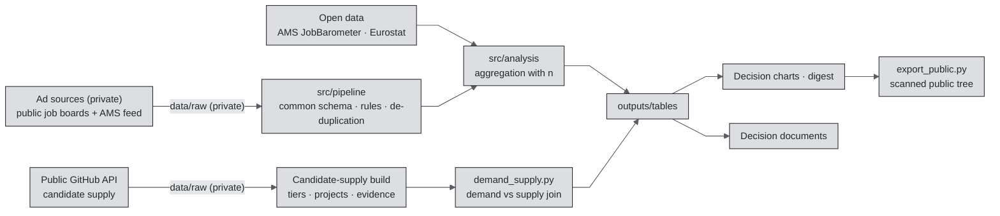

# Austria Data-Job Market Intelligence


[](https://github.com/RafaelBraga-Kribitz/austria-data-job-market-intelligence/actions/workflows/tests.yml)
[](https://github.com/RafaelBraga-Kribitz/austria-data-job-market-intelligence/actions/workflows/readme-quality.yml)
[](LICENSE)
[](LICENSE)
[](requirements.txt)
[](#status)

**Status:** Complete · Demand snapshot <!--m:_meta.demand_vintage-->2026-10-18<!--/m--> · Supply snapshot <!--m:_meta.supply_vintage-->2026-09-17<!--/m--> · Demand numbers go stale after <!--m:_meta.stale_after_demand-->2027-01-17<!--/m-->

> **Who decides:** a data-job seeker in Graz.\
> **What they choose:** which roles, skills and cities to target, based on <!--m:core_n-->699<!--/m--> open core data-role ads in Austria.\
> **Answer:** Vienna holds <!--m:vienna_share_core-->45 %<!--/m--> of the core ads, and Styria holds <!--m:styria_core_primary_state-->62<!--/m-->. SQL is in <!--m:sql_share-->40 %<!--/m--> of ads, but only <!--m:cap_supply_project_share__sql-->10 %<!--/m--> of observed GitHub candidates show it in a project. Data science has the most core ads (<!--m:family_n__data_science-->176<!--/m-->).\
> **Main caveat:** all ads come from a single one-day snapshot (<!--m:_meta.demand_vintage-->2026-10-18<!--/m-->), and the Styrian counts are too small for shares.\
> **The one chart:** the skills-gap chart, first under [Decision summary](#decision-summary).

## Decision summary

> **Answer.** Apart from generic "AI" wording, the ads name SQL, Python and data visualisation most. The stack that the ads name is Microsoft-centred. Ads name SQL, data quality and data modelling far more often than public projects show them. Vienna holds the largest share of core ads. English-written ads without a stated German requirement are a small group. Most advertised pay figures are collective-agreement floors, that is, the legal minimum pay for the sector.


*Skills-gap chart: which skills do ads ask for that portfolios rarely show? Each dot is a capability. The further below the dotted line a dot sits, the more often ads name it compared with public portfolios. SQL appears in <!--m:cap_demand_share__sql-->40 %<!--/m--> of ads. Only <!--m:cap_supply_project_share__sql-->10 %<!--/m--> of the <!--m:supply_p_data_n-->1,818<!--/m--> observed Austrian GitHub accounts with a data signal show it in a project. Data quality (<!--m:cap_supply_project_share__data_quality_governance-->5 %<!--/m-->) and data warehouse modelling (<!--m:cap_supply_project_share__data_warehouse_modelling-->2 %<!--/m-->) sit even lower. Takeaway: a portfolio project with SQL over a modelled schema and data-quality checks covers what the ads mention and portfolios rarely show (skills-gap table, `CALIBRATED`). The two sides are different populations, so read the order of magnitude, not the exact ratio.*

**How to read the numbers.** "Share" means the share of ads (or accounts) that *mention* an item. A mention does not make the item a requirement. Each share counts the text that a rule matched, and it comes with n and a caveat. [`outputs/tables/`](outputs/tables/) holds every number below. The [Legend](#legend-source-tables-and-chart-files) under Data gives the file for each plain table name. [`src/reporting/digest.py`](src/reporting/digest.py) reprints the numbers into [`outputs/reports/digest.txt`](outputs/reports/digest.txt). Nobody types the numbers in this file by hand. A script fills in each number from the metrics registry when a new snapshot arrives. Hidden HTML comments around each number name its registry key, and GitHub does not show them.

### 1. SQL is named in <!--m:sql_share-->40 %<!--/m--> of ads and Python in <!--m:python_share-->39 %<!--/m-->

Only generic "AI" wording is more frequent (<!--m:generic_ai_share-->43 %<!--/m-->). The 95 % confidence interval for SQL is <!--m:skill_ci_low__sql-->37 %<!--/m-->–<!--m:skill_ci_high__sql-->44 %<!--/m-->. After SQL and Python come data visualisation <!--m:visualisation_share-->36 %<!--/m-->, cloud <!--m:cloud_share-->32 %<!--/m-->, data quality <!--m:data_quality_share-->31 %<!--/m-->, ETL (extract, transform, load) <!--m:etl_share-->20 %<!--/m-->, generative AI <!--m:genai_share-->18 %<!--/m--> and statistics <!--m:statistics_share-->16 %<!--/m-->.
*Basis:* n = <!--m:core_n_text_basis-->699<!--/m--> core ads with a description. Unit: share of ads. Source: Austrian public job boards and the AMS feed (Arbeitsmarktservice, Austria's public employment service), skill-mentions table. *Caveat:* the matching is rule-based. The project measures title precision (the share of assigned labels that a person confirms as correct). It does not measure skill recall (the share of real mentions that the rules find). A mention is not a requirement. Generic "AI" counts any mention of AI, KI (the German abbreviation) or artificial intelligence, so it names no specific skill.

### 2. Azure is named in <!--m:azure_share-->19 %<!--/m--> of ads, AWS in <!--m:aws_share-->9 %<!--/m-->: the stack is Microsoft-centred

Azure is Microsoft's cloud platform, and AWS is Amazon Web Services. Power BI is in <!--m:power_bi_share-->17 %<!--/m--> of ads and Tableau in <!--m:tableau_share-->3 %<!--/m-->. Excel is in <!--m:excel_share-->14 %<!--/m-->.
*Basis:* the same <!--m:core_n_text_basis-->699<!--/m--> ads. Unit: share of ads. Source: skill-mentions table. *Caveat:* ads name tools, not libraries. A tool in an ad does not show how deep the work with it is.

### 3. SQL is named in <!--m:cap_demand_share__sql-->40 %<!--/m--> of ads and shown in a project by <!--m:cap_supply_project_share__sql-->10 %<!--/m--> of observed candidates

Public projects rarely show some capabilities that ads name. Data quality and governance: <!--m:cap_demand_share__data_quality_governance-->32 %<!--/m--> of ads against <!--m:cap_supply_project_share__data_quality_governance-->5 %<!--/m--> of candidates. Data warehouse modelling: <!--m:cap_demand_share__data_warehouse_modelling-->25 %<!--/m--> against <!--m:cap_supply_project_share__data_warehouse_modelling-->2 %<!--/m-->.
*Basis:* ads n = <!--m:core_n-->699<!--/m-->. Candidates n = <!--m:supply_p_data_n-->1,818<!--/m--> Austrian public GitHub accounts with a data signal (snapshot <!--m:_meta.supply_vintage_span-->2026-09-17/18<!--/m-->). Unit: share of ads and share of candidates. Source: skills-gap table. The capability map puts data quality and governance in one group. So its share is a little wider than the keyword share in finding 1. *Caveat:* GitHub over-represents engineers, researchers and students. It cannot see Power BI, Excel or SAP work or private repositories. A missing public trace is not a missing skill.

### 4. Vienna holds <!--m:vienna_share_core-->45 %<!--/m--> of core ads; Styria holds <!--m:styria_core_primary_state-->62<!--/m--> of <!--m:core_n-->699<!--/m-->

Vienna holds <!--m:vienna_core_primary_state-->315<!--/m--> of <!--m:core_n-->699<!--/m--> ads. Styria holds <!--m:styria_core_primary_state-->62<!--/m--> by primary state, or <!--m:styria_core_flag-->68<!--/m--> if every listed site counts. Of those 68, <!--m:graz_area_core_flag-->60<!--/m--> are in the Graz commuting area. Styria is small, but its official series is above its starting level. The source is the AMS yearly series for the data scientist occupation class. On it, the large regions above their <!--m:jobbarometer_year_first-->2020<!--/m--> level are <!--m:jb_growing_regions-->Styria (+34 %) and Vienna (+15 %)<!--/m-->. Austria as a whole is at <!--m:jb_data_scientist_change__austria-->−28 %<!--/m-->.
*Basis:* unit: count of ads (ads-by-state and Styrian-city tables) and the ad count of an occupation class (official JobBarometer series). *Caveat:* the AMS class is coarser than this project's titles, and it is a different unit. The largest Styrian role-family cell has <!--m:styria_largest_family_n-->28<!--/m--> ads. So Styrian statements are counts and directions, not shares.

### 5. <!--m:english_no_german_n_national-->147<!--/m--> of <!--m:core_n-->699<!--/m--> ads are in English with no stated German requirement

<!--m:german_stated_share-->42 %<!--/m--> of ads state a German requirement, and <!--m:english_posting_share-->26 %<!--/m--> use English. Few English-written ads state no German requirement: <!--m:english_no_german_n_vienna-->78<!--/m--> in Vienna, <!--m:english_no_german_n_styria-->8<!--/m--> of <!--m:addressable_scope_n_styria-->68<!--/m--> in Styria and <!--m:english_no_german_n_graz_area-->6<!--/m--> in the Graz area. Only <!--m:german_b1_or_below_n-->6<!--/m--> ads name B1 (intermediate) or below as enough. B1 is a level of the CEFR, the Common European Framework of Reference for Languages.
*Basis:* n = <!--m:core_n-->699<!--/m--> ads. Unit: ads. Source: language-requirement tables. *Caveat:* the requirement comes from the ad text. An ad with no statement can still expect German at work.

### 6. <!--m:salary_minimum_only_n-->424<!--/m--> of <!--m:salary_with_salary_figure_n-->527<!--/m--> advertised pay figures are a single collective-agreement minimum

<!--m:salary_with_salary_figure_n-->527<!--/m--> of <!--m:core_n-->699<!--/m--> ads state a figure, so advertised pay is mostly the legal floor. The median advertised floor is <!--m:floor_analytics_eur-->€50.0k<!--/m--> in data analytics, <!--m:floor_data_science_eur-->€55.4k<!--/m--> in data science and <!--m:floor_data_engineering_eur-->€55.0k<!--/m--> in data engineering.
*Basis:* unit: annual gross floor in euro (monthly × 14). Source: advertised-pay tables. *Caveat:* a floor is not a salary. The controlled pay model holds role family, seniority and state constant. After these controls, most raw skill "premiums" are not distinguishable from zero (association, not causation).


*Where are the ads? Vienna has <!--m:vienna_core_primary_state-->315<!--/m--> of <!--m:core_n-->699<!--/m--> core ads, Upper Austria <!--m:upper_austria_n-->119<!--/m--> and Styria <!--m:styria_core_primary_state-->62<!--/m-->. Takeaway: outside Vienna the market thins quickly, so a search only in Styria draws on a small pool. Snapshot <!--m:_meta.demand_vintage-->2026-10-18<!--/m-->, ads-by-state table, `VERIFIED` counts of a rule-based selection.*


*Does a named skill raise the advertised pay floor? Squares show the raw difference in the advertised minimum. Dots show the difference after controls for role family, seniority and state. For most skills, the interval after controls crosses zero. After a correction for testing many skills at once, no skill clears zero. Takeaway: the role family and the seniority label set the advertised floor, not the tool in the ad. Model: a regression on the log of the advertised minimum; association, not causation.*

## Why this project exists

A data-job seeker in Graz could not see which data roles, regions and skills Austrian ads ask for. Portfolio hours risked going to the wrong skills. The intended value is avoided rework: project hours aimed at skills the ads name. The pre-build evaluation expected €738 of avoided rework against a total cost of €1,323, at the market cost of the role this work needs. It fails the financial hurdle (0.56×, against 4×). Observed result: Not yet measured. Details: [economic evaluation](docs/economic-evaluation.md).

## Start here

| Audience | Start here |
|---|---|
| Recruiter (2 min) | The charts and the six findings above, then [the decision-chart board](docs/visual-decision-board.md) (<!--m:visual_questions_n-->45<!--/m--> questions, one chart each) |
| Hiring manager (10 min) | [Decision summary](#decision-summary), [employer-demand decision map](CAREER_DECISION_MAP.md), [demand vs supply decision map](CAREER_SUPPLY_DEMAND_MAP.md), [Known limits](#known-limits) |
| Technical reviewer | [How it works](#how-it-works), [How it fits together](#how-it-fits-together), [Reproduce](#reproduce), the rule engine [src/pipeline/normalize.py](src/pipeline/normalize.py), the [tests](tests/) |
| Auditor | [Data](#data), [Validation](#validation), [data quality](docs/data-quality.md), [legal and publication audit](docs/legal-and-publication-audit.md), [publication decision](PUBLICATION_DECISION.md), the export guard [src/publish/export_public.py](src/publish/export_public.py) |
| AI assistant | [Notes for AI assistants](AGENT_CONTEXT.md), then [the chart questions as JSON](outputs/visual_questions.json) |

## Dashboard

[`dashboards/`](dashboards/README.md) holds a five-page dashboard. One page spec builds it twice:

- a Power BI project in text form ([`JobMarket.pbip`](dashboards/JobMarket.pbip): TMDL semantic model, PBIR report, Braga theme);
- a static HTML twin ([`dashboards/html/index.html`](dashboards/html/index.html)) that needs no network and has light and dark modes.

TMDL and PBIR are the text formats of the Power BI model and report. The pages are market overview, skills and stacks, advertised pay floors, demand vs supply, and data quality and coverage. Each page has a German subtitle and shows the caveats next to its numbers. Both versions read only `outputs/`. A test checks that every field a visual uses exists in the model. It also checks that the HTML shows the source values. Nobody has opened the Power BI file in Power BI Desktop yet. The checklist for that step is in [dashboards/README.md](dashboards/README.md).

## Why this project

I wanted to compare data-role paths from Graz with evidence. The public sources I surveyed could not do that ([docs/research-landscape.md](docs/research-landscape.md)). The official series (AMS JobBarometer, Eurostat) count ads or vacancies by year or quarter. They use coarse occupation classes, or no occupation at all. Public salary references are collective-agreement floors or self-reported surveys. No public dataset lists Austrian data-role ads with their skills, region, language requirement and advertised pay. This repository builds that dataset from a one-day snapshot of ads. It also adds the other side of the market: what public portfolios in Austria actually show. With both sides, a learning or portfolio choice can go where demand is high and visible evidence is rare. Each of the <!--m:visual_questions_n-->45<!--/m--> decision charts asks one question behind that choice. An example: "If I do not move from Graz, how much of the Austrian data market am I actually applying to?" ([docs/visual-decision-board.md](docs/visual-decision-board.md)). The personal profile behind these charts stays private. The public tree ships a neutral example profile ([config/profile.json](config/profile.json)). The comparison method is in [docs/decision-framework.md](docs/decision-framework.md).

## Data

| Evidence | Source | Period | Grain | Public? | Tag |
|---|---|---|---|---|---|
| Employer demand | Austrian public job boards and the AMS feed | <!--m:_meta.demand_vintage-->2026-10-18<!--/m--> | open ad; <!--m:raw_rows_n-->11,997<!--/m--> raw rows → <!--m:unique_postings_n-->10,655<!--/m--> unique ads → <!--m:core_n-->699<!--/m--> core data-role ads | Aggregates only | `VERIFIED` counts, `CALIBRATED` fields |
| Official series | AMS JobBarometer, Eurostat job vacancies | <!--m:jobbarometer_year_first-->2020<!--/m-->–<!--m:jobbarometer_year_last-->2025<!--/m--> (AMS), <!--m:eurostat_year_first-->2009<!--/m-->–<!--m:eurostat_year_last-->2025<!--/m--> (Eurostat) | yearly or quarterly series | Yes (Eurostat raw data is openly licensed) | `VERIFIED` |
| Candidate supply | Public GitHub accounts located in Austria (GitHub's documented REST API, no names or e-mail addresses requested) | <!--m:_meta.supply_vintage_span-->2026-09-17/18<!--/m--> | <!--m:supply_p_all_n-->9,409<!--/m--> accounts with an Austrian location → <!--m:supply_p_data_n-->1,818<!--/m--> with a data signal | Aggregates only | `CALIBRATED` |
| Supply context | Eurostat graduates, employment and ICT-specialist series for Austria; Stack Overflow Developer Survey 2025 (Austrian respondents) | yearly to 2024/2025; survey 2025 | national series; survey respondents | Yes (aggregates; survey extract private) | `VERIFIED` |
| Demand vs supply gap | Employer demand and candidate supply, joined on the same lists of roles and capabilities | as above | capability and role-family level | Yes | `CALIBRATED` |

By role family, core ads are data science <!--m:family_share__data_science-->25 %<!--/m--> (<!--m:family_n__data_science-->176<!--/m-->), data engineering <!--m:family_share__data_engineering-->20 %<!--/m--> (<!--m:family_n__data_engineering-->137<!--/m-->) and data analytics <!--m:family_share__data_analytics-->15 %<!--/m--> (<!--m:family_n__data_analytics-->107<!--/m-->). Source: role-family counts table.

The ads are third-party text, and the job boards restrict automated extraction in their terms. So the collectors for these boards, the raw records, the ad text, the links and the individual-level supply records stay private. The public tree carries only code, rules, documentation and aggregated tables. [docs/legal-and-publication-audit.md](docs/legal-and-publication-audit.md) and [PUBLICATION_DECISION.md](PUBLICATION_DECISION.md) give the reasoning. This is a publication-readiness analysis, not legal advice. [docs/data-sources.md](docs/data-sources.md) and [docs/supply-methodology.md](docs/supply-methodology.md) list every source with its access route, terms and data date.

| Tag | Meaning |
|---|---|
| `VERIFIED` | Directly supported by external or source data; unit conversion and aggregation only |
| `CALIBRATED` | Derived through documented rules anchored to real data |
| `SIMULATED` | Output of a seeded stochastic or generative procedure (none in this repository) |
| `ILLUSTRATIVE` | Example only, not evidence (none in this repository) |

### Legend: source tables and chart files

Files in `outputs/` carry short codes. The text above uses the plain names in this table.

| Plain name | File code | What it holds |
|---|---|---|
| Skill-mentions table | T05 | Share of ads that mention each skill or tool |
| Role-family counts table | T02 | Core ads per role family |
| Ads-by-state and Styrian-city tables | T03a, T03c | Ads per federal state; Styrian ads per city |
| Official JobBarometer series | JB01, JB05 | AMS yearly ad counts; Styria against Austria |
| Language-requirement tables | T07, T07a, T07c, T07e | German requirement, German level, ad language, English-without-German scenarios |
| Advertised-pay tables | T09, T09a, T09b | Pay coverage, pay basis, advertised floors by group |
| Raw pay difference by skill | T09d | Advertised floor by skill, no controls |
| Controlled pay model | D05 | Skill premium after controls for role family, seniority and state |
| Skills-gap table | DS10 | Capability share in ads against share of candidates with project evidence |
| Title precision audit | Q03c | Hand-labelled check of title classification |
| Candidate-supply precision audits | SQ10, SQ11 | Hand-labelled checks of bio and project classification |
| Table families | T, JB, S, D, Q / C, O, SQ / DS | Employer demand / candidate supply / demand vs supply gap |
| Decision charts | BQ01–BQ45 | One chart per question; F, SF and DSF files are earlier exploratory charts |
| Charts in this README | BQ21, BQ01, BQ45 | Skills-gap chart; where are the ads; does a named skill raise the pay floor |

## Known limits

- **Demand is a one-day stock** of open ads. It is not a yearly flow, and it does not count vacancies or hires. The sources do not include large corporate career pages ([docs/limitations.md](docs/limitations.md)).
- **Extraction is rule-based.** The project measures title precision but not skill recall. Salary figures are legal floors.
- **Supply is a sample of public profiles.** GitHub cannot see Power BI, Excel or SAP work, private repositories, proficiency or hiring. The Vienna supply figures are lower bounds ([docs/supply-research-audit.md](docs/supply-research-audit.md)).
- **The demand vs supply gap joins two different populations.** Read rankings and orders of magnitude, not exact ratios.
- **Styrian cells are small.** The largest role-family cell has <!--m:styria_largest_family_n-->28<!--/m--> ads. That is below this project's own robustness threshold of 30.
- **No causal claims** about any skill, language or salary.

**What would change these findings.** Read each conclusion as open to revision.

- **Skills gap (finding 3).** Reconsider it if a second supply snapshot shows the gap between ads and public project evidence closing. Also reconsider it if a source that sees business intelligence (BI) work shows that many candidates demonstrate these skills.
- **Styria (finding 4).** Reconsider it if a larger Styrian sample moves a role-family cell above the robustness threshold. Also reconsider it if the 2026 AMS series reverses Styria's trend.
- **Language (finding 5).** Reconsider it if a larger source of ads changes the share of English-written ads without a stated German requirement.
- **Pay (finding 6).** Reconsider it if ads with a stated actual salary, not a collective-agreement floor, become common.

The register of open questions is [docs/open-questions.md](docs/open-questions.md).

## What I would do with production data

- Replace one-day stocks with a time series of dated snapshots. Compare the snapshots table to table.
- Add career pages and more job sources through permitted channels. Measure the recall of the skill rules against hand labels.
- Replace the public GitHub sample with candidate data collected with consent. This data should include BI and spreadsheet work and stated language levels.
- Record actual application outcomes. Only these outcomes turn requirement patterns into evidence about hiring.

## How it works

The project shows these methods: a Python data pipeline, rule-based text extraction from job ads and de-duplication. It also uses Wilson confidence intervals, a controlled salary regression with multiple-testing correction and hand-labelled precision audits. A tested export guard keeps private data out of this public tree.

```text
Collect → Common schema → Rule-based fields → De-duplicate → Aggregate with n → Join demand × supply → Chart → Decision documents
```

- **Rules, not a model.** `normalize.py` assigns role family, seniority, geography, work model, salary and skills. It uses ordered rules in `config/` and context windows around each match. Each assignment keeps an evidence field. Title normalisation decides which ads are in scope, not the search query.
- **De-duplication.** A union-find step (a standard grouping algorithm) groups duplicate ads over documented keys. The in-scope duplicate rate is <!--m:dedupe_duplicate_rate_in_scope-->24 %<!--/m-->.
- **Aggregation.** The core set is the canonical ads in eight data role families. Every table stores n. Proportions that feed decisions carry Wilson 95 % intervals. The official series stay in their own units. The pipeline never merges them with ad-level statistics.
- **Join.** `demand_supply.py` joins both sides on the same taxonomies (fixed lists of roles and capabilities). It reports ratios and quadrants. It never computes a composite score, and it never ranks individuals.
- **Charts.** Each of the <!--m:visual_questions_n-->45<!--/m--> decision charts answers one business question. SHA-256 hashes in [`outputs/figures/FIGURE-MANIFEST.yaml`](outputs/figures/FIGURE-MANIFEST.yaml) seal the vector (SVG) files.

Full descriptions: [docs/methodology.md](docs/methodology.md), [docs/supply-methodology.md](docs/supply-methodology.md), [docs/demand-supply-methodology.md](docs/demand-supply-methodology.md).

## Validation

- **Hand-labelled audits.** Title classification reaches <!--m:title_precision_strict_after-->83 %<!--/m--> strict and <!--m:title_precision_lenient_after-->95 %<!--/m--> lenient precision on <!--m:title_audit_sample_n-->177<!--/m--> hand-labelled titles (title precision audit). For candidate supply, bio → role family reaches <!--m:supply_precision_bio_family_strict-->78 %<!--/m--> / <!--m:supply_precision_bio_family_lenient-->90 %<!--/m-->. Repository → project reaches <!--m:supply_precision_project_strict-->75 %<!--/m--> / <!--m:supply_precision_project_lenient-->92.5 %<!--/m-->. Both use random samples of 40 items (candidate-supply precision audits). The project does not measure recall.
- **Tests.** `python -m pytest -q` runs unit tests of the rule modules. It also runs value checks that compare the sentence under each chart with the cited tables. Integrity tests that need private data skip in the public tree and say so.
- **Digest.** `src/reporting/digest.py` reprints every quoted number from `outputs/`. Its last section reports missing inputs.
- **Baseline for the pay result.** The raw skill premium (raw pay difference by skill) is the baseline. The controlled pay model uses ordinary least squares on the log minimum, with heteroskedasticity-robust HC1 standard errors. Holm and Benjamini-Hochberg corrections adjust for testing many skills. The raw result does not survive the controls, and this README reports that.
- **Export guard.** `src/publish/export_public.py` builds this public tree in a staging folder. It blocks the build on any e-mail address, phone number, job-ad link, secret-like token or source posting id. It also blocks over-long free-text cells, suppression-threshold breaches, private paths and owner-fact phrases.

## How it fits together

The diagram shows how the private inputs become public, aggregated outputs.



## Reproduce

Environment: Python 3.12 with the pinned `requirements.txt`. To collect the candidate-supply data again, you need a GitHub token (`GH_TOKEN` or a logged-in `gh`).

```bash
git clone https://github.com/RafaelBraga-Kribitz/austria-data-job-market-intelligence.git && cd austria-data-job-market-intelligence
pip install -r requirements.txt
python -m pytest -q                 # unit and value checks; integrity checks skip without private data
python src/reporting/digest.py      # reprints every quoted number from outputs/
python run_all.py --list            # targets, steps, inputs
python run_all.py all --dry-run     # preflight and the exact commands, nothing is run
```

An outside reader can reproduce these parts:

- every rule (tests) and every aggregation step (code);
- the match between each quoted number and the tables (digest, tests);
- the AMS and Eurostat series, end to end;
- with a GitHub token, the full candidate-supply collection (about 5–7 hours at the API rate limits).

Two steps need private data: the employer-demand build, and the candidate-supply build from the stored collection. The preflight of `run_all.py` names the missing folder at once. Its targets `layer1`, `layer2` and `layer3` are employer demand, candidate supply and the demand vs supply gap. Compare snapshots of different dates table to table, and never merge them.

## Repository structure

```text
CAREER_DECISION_MAP.md          employer-demand decision document
CAREER_SUPPLY_DEMAND_MAP.md     demand vs supply decision document
AGENT_CONTEXT.md                notes for AI assistants
DECISION_LOG.md                 dated decision record (public entries)
PUBLICATION_DECISION.md         publication-readiness conclusions, public/private boundary
run_all.py                      single entry point: layer1 (demand) layer2 (supply) layer3 (gap) visual dashboard digest tests
docs/                           methodology, data quality, limitations, legal audit, decision-chart board
config/                         role taxonomy, skill vocabulary, geography, capability map, example profile
schemas/                        posting, supply and application-log schemas
src/acquisition/                collectors for documented public APIs and open data only
src/pipeline/                   common schema, rules, de-duplication, supply build, redaction
src/analysis/                   demand, supply and gap analysis; decision-chart builders
src/viz/                        figure engine on bk-viz (Braga design system v2.1), vendored DSX helper and Lato (SIL OFL 1.1)
src/reporting/                  digest and the metrics registry with its renderer
src/publish/                    scanned public export
outputs/tables/                 aggregated tables; file codes in the Legend under Data
outputs/figures/                decision charts BQ01–BQ45 as PNG plus sealed SVG; F*, SF*, DSF* are earlier exploratory PNGs
dashboards/                     Power BI project (PBIP: TMDL + PBIR) and its static HTML twin, both read outputs/
tests/                          pytest suite, one file per module family
```

## Stack

| Part | Technology | Why |
|---|---|---|
| Language | Python 3.12 | One plain script per step, run in fixed order by `run_all.py` |
| Data handling | pandas, numpy, pyarrow | Posting and supply tables, aggregation, Parquet intermediates |
| Statistics | numpy, scipy, scikit-learn | Wilson intervals and the controlled pay regression written out in numpy; scipy for seasonal confidence intervals; scikit-learn for the requirement clusters used as reading aids |
| Charts | matplotlib + `src/viz` on bk-viz (Braga design system v2.1, BKribitz type) | One house style for all <!--m:visual_questions_n-->45<!--/m--> charts, SVG sealed by hash |
| Collection | requests | Public collectors only: AMS JobBarometer pages and the Eurostat and GitHub APIs; the job-board collectors stay private |
| Dashboard | Power BI (PBIP: TMDL + PBIR), static HTML | Model and report as reviewable text, checked against each other by a test; the HTML twin needs no Power BI and no network |
| Tests | pytest | Rule tests, value checks of chart sentences, integrity checks |
| Publication | `export_public.py` | Staging build with leak scans before any file reaches the public tree |

## Governance

Tests gate the findings: they compare each chart sentence with its source table. A digest reprints every quoted number. Numbers in the living documents link to registry keys. So a new snapshot re-renders them and leaves no old values behind. Changes made with AI assistance pass the same tests and the same export guard. [DECISION_LOG.md](DECISION_LOG.md) records decisions with dates. [docs/open-questions.md](docs/open-questions.md) lists what the data cannot answer.

## Status

**Status:** Complete · Date: <!--m:_meta.demand_vintage-->2026-10-18<!--/m-->

All three evidence parts (employer demand, candidate supply and the gap between them) and the <!--m:visual_questions_n-->45<!--/m--> charts exist and pass their tests. Demand snapshot <!--m:_meta.demand_vintage-->2026-10-18<!--/m-->, supply snapshot <!--m:_meta.supply_vintage-->2026-09-17<!--/m-->. Next milestone: a second supply snapshot, to give the candidate-supply data a time axis.

## License

Code (`src/`, `tests/`, `config/`): MIT. Documents and aggregated outputs (tables, JSON summaries, figures, digest): CC BY 4.0. Eurostat raw data: Commission reuse policy, attribution required. Tables derived from the Stack Overflow survey: produced works of Open Database License (ODbL) data. Vendored Lato fonts: SIL OFL 1.1. No licence is granted for third-party content. The exact split is in [LICENSE](LICENSE). Cite as in [CITATION.cff](CITATION.cff); there is no DOI (digital object identifier).

## Author

<table>
  <tr>
    <td width="110">
      
    </td>
    <td>
      <strong>Rafael Braga-Kribitz</strong><br />
      Seiersberg-Pirka, Austria · Portfolio project, 2026<br />
      <a href="https://www.linkedin.com/in/rafaelbragakribitz/">LinkedIn</a>
    </td>
  </tr>
</table>
