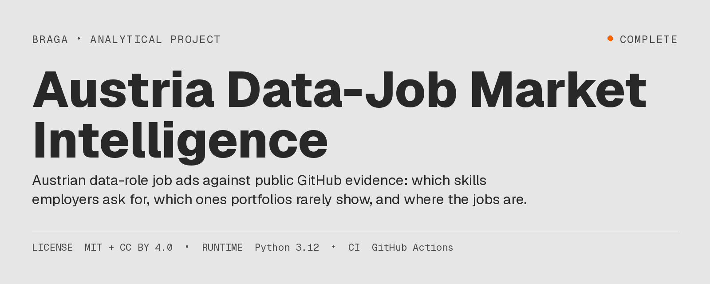
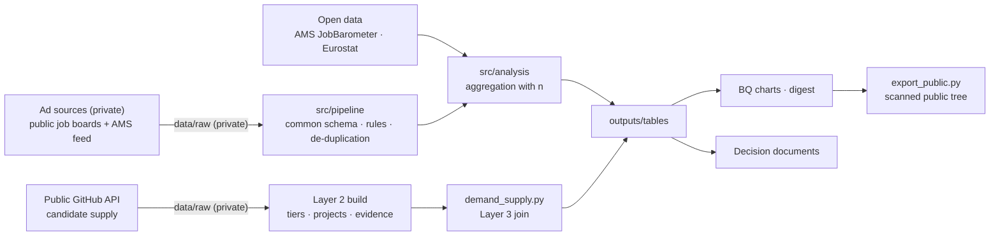

# Austria Data-Job Market Intelligence



[](https://github.com/RafaelBraga-Kribitz/austria-data-job-market-intelligence/actions/workflows/tests.yml)
[](https://github.com/RafaelBraga-Kribitz/austria-data-job-market-intelligence/actions/workflows/readme-quality.yml)
[](LICENSE)
[](LICENSE)
[](requirements.txt)
[](#status)

**Status:** Complete · Demand snapshot <!--m:_meta.demand_vintage-->2026-10-18<!--/m--> · Supply snapshot <!--m:_meta.supply_vintage-->2026-09-17<!--/m--> · Demand numbers go stale after <!--m:_meta.stale_after_demand-->2027-01-17<!--/m-->

> **Which data skills do Austrian job ads mention most, which of them do public portfolios rarely show, and where in Austria (with a Styria/Graz focus) are the ads? This repository answers it for data-career decisions, from <!--m:core_n-->699<!--/m--> open core data-role ads.**

*Methods shown: a Python data pipeline, rule-based text extraction from job ads, de-duplication, Wilson confidence intervals, a controlled salary regression with multiple-testing correction, hand-labelled precision audits and a tested export guard that keeps private data out of this public tree.*

## Decision summary

> **Answer.** Apart from generic "AI" wording, the ads name SQL, Python and data visualisation most. The stack they name is Microsoft-centred. SQL, data quality and data modelling are asked for far more often than public projects show them. Vienna holds the largest share of core ads. English-written ads without a stated German requirement are a small group. The advertised pay figures are mostly collective-agreement floors.


*How to read it: each dot is a capability; the further below the dotted line, the more often ads ask for it than public portfolios show it. SQL is named in <!--m:cap_demand_share__sql-->40 %<!--/m--> of ads, but only <!--m:cap_supply_project_share__sql-->10 %<!--/m--> of the <!--m:supply_p_data_n-->1,818<!--/m--> observed Austrian GitHub accounts with a data signal show it in a project; data quality (<!--m:cap_supply_project_share__data_quality_governance-->5 %<!--/m-->) and data warehouse modelling (<!--m:cap_supply_project_share__data_warehouse_modelling-->2 %<!--/m-->) sit even lower. Takeaway: a portfolio project built on SQL over a modelled schema, with data-quality checks, covers what the market asks for and rarely sees (DS10, `CALIBRATED`). Two different universes, so read the order of magnitude, not the exact ratio.*

"Share" means the share of ads (or accounts) that *mention* an item. It does not mean the item is required. Every share is a count of rule-matched text, with n and a caveat. Single source of truth: [`outputs/tables/`](outputs/tables/) holds every number below with its table id in brackets. [`src/reporting/digest.py`](src/reporting/digest.py) reprints them into [`outputs/reports/digest.txt`](outputs/reports/digest.txt). The numbers in this file are not typed by hand: each one is bound to a metrics registry key and re-rendered from it when a snapshot changes.

### 1. SQL is named in <!--m:sql_share-->40 %<!--/m--> of ads and Python in <!--m:python_share-->39 %<!--/m-->

Only generic "AI" wording is more frequent (<!--m:generic_ai_share-->43 %<!--/m-->). After SQL (95 % confidence interval <!--m:skill_ci_low__sql-->37 %<!--/m-->–<!--m:skill_ci_high__sql-->44 %<!--/m-->) and Python come data visualisation <!--m:visualisation_share-->36 %<!--/m-->, cloud <!--m:cloud_share-->32 %<!--/m-->, data quality <!--m:data_quality_share-->31 %<!--/m-->, ETL (extract, transform, load) <!--m:etl_share-->20 %<!--/m-->, generative AI <!--m:genai_share-->18 %<!--/m--> and statistics <!--m:statistics_share-->16 %<!--/m-->.
*Basis:* n = <!--m:core_n_text_basis-->699<!--/m--> core ads with a description; unit = share of ads; source = Austrian public job boards and the AMS (Arbeitsmarktservice, Austria's public employment service) feed, table T05. *Caveat:* rule-based text matching. Title precision is measured, skill recall is not. A mention is not a requirement. Generic "AI" counts any mention of AI, KI (the German abbreviation) or artificial intelligence, so it names no specific skill.

### 2. Azure is named in <!--m:azure_share-->19 %<!--/m--> of ads, AWS in <!--m:aws_share-->9 %<!--/m-->: the stack is Microsoft-centred

Azure is Microsoft's cloud platform and AWS is Amazon Web Services. Power BI <!--m:power_bi_share-->17 %<!--/m--> against Tableau <!--m:tableau_share-->3 %<!--/m-->; Excel <!--m:excel_share-->14 %<!--/m-->.
*Basis:* same <!--m:core_n_text_basis-->699<!--/m--> ads, unit = share of ads, table T05. *Caveat:* ads name tools, not libraries. A tool named in an ad does not show how deep the work with it is.

### 3. SQL is asked for in <!--m:cap_demand_share__sql-->40 %<!--/m--> of ads and shown in a project by <!--m:cap_supply_project_share__sql-->10 %<!--/m--> of observed candidates

Some demanded capabilities are rarely shown in public projects. Data quality and governance: <!--m:cap_demand_share__data_quality_governance-->32 %<!--/m--> of ads against <!--m:cap_supply_project_share__data_quality_governance-->5 %<!--/m--> of candidates. Data warehouse modelling: <!--m:cap_demand_share__data_warehouse_modelling-->25 %<!--/m--> against <!--m:cap_supply_project_share__data_warehouse_modelling-->2 %<!--/m-->.
*Basis:* ads n = <!--m:core_n-->699<!--/m-->; candidates n = <!--m:supply_p_data_n-->1,818<!--/m--> Austrian public GitHub accounts with a data signal (snapshot <!--m:_meta.supply_vintage_span-->2026-09-17/18<!--/m-->); unit = share of ads and share of candidates; table DS10. The capability map groups data quality with governance, so its share is a little wider than the keyword share in finding 1. *Caveat:* GitHub over-represents engineers, researchers and students. It cannot see Power BI, Excel or SAP work or private repositories. A missing public trace is not a missing skill.

### 4. Vienna holds <!--m:vienna_share_core-->45 %<!--/m--> of core ads; Styria holds <!--m:styria_core_primary_state-->62<!--/m--> of <!--m:core_n-->699<!--/m-->

Vienna <!--m:vienna_core_primary_state-->315<!--/m--> of <!--m:core_n-->699<!--/m-->; Styria <!--m:styria_core_primary_state-->62<!--/m--> by primary state, or <!--m:styria_core_flag-->68<!--/m--> if every listed site counts, and <!--m:graz_area_core_flag-->60<!--/m--> of those 68 are in the Graz commuting area. Styria is small, but its official series is above its starting level: on the AMS yearly series for the data scientist occupation class, the large regions above their <!--m:jobbarometer_year_first-->2020<!--/m--> level are <!--m:jb_growing_regions-->Styria (+34 %) and Vienna (+15 %)<!--/m-->, while Austria is <!--m:jb_data_scientist_change__austria-->−28 %<!--/m-->.
*Basis:* unit = count of ads (T03a, T03c) and ad count of an occupation class (JB01, JB05). *Caveat:* the AMS class is coarser than this project's titles and is a different unit. The largest Styrian family cell has <!--m:styria_largest_family_n-->28<!--/m--> ads, so Styrian statements are counts and directions, not shares.

### 5. <!--m:english_no_german_n_national-->147<!--/m--> of <!--m:core_n-->699<!--/m--> ads are in English with no stated German requirement

<!--m:german_stated_share-->42 %<!--/m--> of ads state a German requirement and <!--m:english_posting_share-->26 %<!--/m--> are written in English. The English-written ads that state none are a small group: <!--m:english_no_german_n_vienna-->78<!--/m--> in Vienna, <!--m:english_no_german_n_styria-->8<!--/m--> of <!--m:addressable_scope_n_styria-->68<!--/m--> in Styria, <!--m:english_no_german_n_graz_area-->6<!--/m--> in the Graz area. Ads that name B1 (intermediate) or below as enough: <!--m:german_b1_or_below_n-->6<!--/m-->.
*Basis:* n = <!--m:core_n-->699<!--/m--> ads, unit = ads (T07, T07a, T07c, T07e). *Caveat:* a stated requirement is read from the ad text. An ad with no statement may still expect German at work.

### 6. <!--m:salary_minimum_only_n-->424<!--/m--> of <!--m:salary_with_salary_figure_n-->527<!--/m--> advertised pay figures are a single collective-agreement minimum

<!--m:salary_with_salary_figure_n-->527<!--/m--> of <!--m:core_n-->699<!--/m--> ads state a figure, so advertised pay is mostly the legal floor. The median advertised floor is <!--m:floor_analytics_eur-->€50.0k<!--/m--> in data analytics, <!--m:floor_data_science_eur-->€55.4k<!--/m--> in data science and <!--m:floor_data_engineering_eur-->€55.0k<!--/m--> in data engineering.
*Basis:* unit = annual gross floor in euro (monthly × 14), tables T09, T09a, T09b. *Caveat:* a floor is not a salary. After controls for role family, seniority and state, most raw skill "premiums" are not distinguishable from zero (D05, BQ45, association not causation).


*Where the ads are: Vienna <!--m:vienna_core_primary_state-->315<!--/m--> of <!--m:core_n-->699<!--/m--> core ads, Upper Austria <!--m:upper_austria_n-->119<!--/m-->, Styria <!--m:styria_core_primary_state-->62<!--/m-->. Takeaway: outside Vienna the market thins quickly, so a search limited to Styria draws on a small pool (snapshot <!--m:_meta.demand_vintage-->2026-10-18<!--/m-->, T03a, `VERIFIED` counts of a rule-based selection).*


*Do the better-paying skills pay better? Squares are the raw difference in the advertised minimum; dots are the difference after controlling for role family, seniority and state. For most skills the interval after controls crosses zero, and after a correction for testing many skills at once none clears zero. Takeaway: the role family and the seniority label set the advertised floor, not the tool named in the ad (D05, a regression on the log of the advertised minimum; association, not causation).*

## Explore this project

| Audience | Start here |
|---|---|
| Recruiter (2 min) | The charts and the six findings above, then [docs/visual-decision-board.md](docs/visual-decision-board.md) (<!--m:visual_questions_n-->45<!--/m--> questions, one chart each) |
| Hiring manager (10 min) | [Decision summary](#decision-summary), [CAREER_DECISION_MAP.md](CAREER_DECISION_MAP.md) (demand), [CAREER_SUPPLY_DEMAND_MAP.md](CAREER_SUPPLY_DEMAND_MAP.md) (demand × supply), [Limitations](#limitations) |
| Technical reviewer | [Method](#method), [Architecture](#architecture), [Reproduce](#reproduce), the rule engine [src/pipeline/normalize.py](src/pipeline/normalize.py), the [tests](tests/) |
| Auditor | [Data](#data), [Validation](#validation), [docs/data-quality.md](docs/data-quality.md), [docs/legal-and-publication-audit.md](docs/legal-and-publication-audit.md), [PUBLICATION_DECISION.md](PUBLICATION_DECISION.md), the export guard [src/publish/export_public.py](src/publish/export_public.py) |
| AI agent | [AGENT_CONTEXT.md](AGENT_CONTEXT.md), then [outputs/visual_questions.json](outputs/visual_questions.json) |

## Data

| Layer | Source | Period | Grain | Public? | Tag |
|---|---|---|---|---|---|
| 1 Demand | Austrian public job boards and the AMS feed | <!--m:_meta.demand_vintage-->2026-10-18<!--/m--> | open ad; <!--m:raw_rows_n-->11,997<!--/m--> raw rows → <!--m:unique_postings_n-->10,655<!--/m--> unique ads → <!--m:core_n-->699<!--/m--> core data-role ads | Aggregates only | `VERIFIED` counts, `CALIBRATED` fields |
| 1 Official | AMS JobBarometer, Eurostat job vacancies | <!--m:jobbarometer_year_first-->2020<!--/m-->–<!--m:jobbarometer_year_last-->2025<!--/m--> (AMS), <!--m:eurostat_year_first-->2009<!--/m-->–<!--m:eurostat_year_last-->2025<!--/m--> (Eurostat) | yearly or quarterly series | Yes (Eurostat raw data is openly licensed) | `VERIFIED` |
| 2 Supply | Public GitHub accounts located in Austria (documented REST API, no names or e-mail addresses requested) | <!--m:_meta.supply_vintage_span-->2026-09-17/18<!--/m--> | <!--m:supply_p_all_n-->9,409<!--/m--> accounts with an Austrian location → <!--m:supply_p_data_n-->1,818<!--/m--> with a data signal | Aggregates only | `CALIBRATED` |
| 3 Join | Layers 1 and 2 on shared taxonomies | as above | capability and family level | Yes | `CALIBRATED` |

By role family (T02), core ads are data science <!--m:family_share__data_science-->25 %<!--/m--> (<!--m:family_n__data_science-->176<!--/m-->), data engineering <!--m:family_share__data_engineering-->20 %<!--/m--> (<!--m:family_n__data_engineering-->137<!--/m-->) and data analytics <!--m:family_share__data_analytics-->15 %<!--/m--> (<!--m:family_n__data_analytics-->107<!--/m-->).

The ads are third-party text and the job boards restrict automated extraction in their terms. Collectors for them, raw records, ad text, links and individual-level supply records stay private. The public tree carries code, rules, documentation and aggregated tables only. The reasoning is in [docs/legal-and-publication-audit.md](docs/legal-and-publication-audit.md) and [PUBLICATION_DECISION.md](PUBLICATION_DECISION.md). This is a publication-readiness analysis, not legal advice.

| Tag | Meaning |
|---|---|
| `VERIFIED` | Directly supported by external or source data; unit conversion and aggregation only |
| `CALIBRATED` | Derived through documented rules anchored to real data |
| `SIMULATED` | Output of a seeded stochastic or generative procedure (none in this repository) |
| `ILLUSTRATIVE` | Example only, not evidence (none in this repository) |

## Method

```text
Collect → Common schema → Rule-based fields → De-duplicate → Aggregate with n → Join demand × supply → Chart → Decision documents
```

- **Rules, not a model.** `normalize.py` assigns role family, seniority, geography, work model, salary and skills from ordered rules in `config/` and context windows around each match, each with an evidence field. Inclusion is decided by title normalisation, not by the search query.
- **De-duplication.** Union-find groups over documented keys; the in-scope duplicate rate is <!--m:dedupe_duplicate_rate_in_scope-->24 %<!--/m-->.
- **Aggregation.** The core set is the canonical ads in eight data role families. Every table stores n. Proportions that feed decisions carry Wilson 95 % intervals. Official series are analysed as their own units and never merged with ad-level statistics.
- **Join.** `demand_supply.py` joins both sides on the same taxonomies and reports ratios and quadrants. It never computes a composite score or ranks individuals.
- **Charts.** <!--m:visual_questions_n-->45<!--/m--> decision charts, each answering one business question; SVG files are sealed with SHA-256 hashes in `FIGURE-MANIFEST.yaml`.

Full descriptions: [docs/methodology.md](docs/methodology.md), [docs/supply-methodology.md](docs/supply-methodology.md), [docs/demand-supply-methodology.md](docs/demand-supply-methodology.md).

## Validation

- **Hand-labelled audits.** Title classification: <!--m:title_precision_strict_after-->83 %<!--/m--> strict and <!--m:title_precision_lenient_after-->95 %<!--/m--> lenient precision on <!--m:title_audit_sample_n-->177<!--/m--> hand-labelled titles (Q03c). Bio → role family <!--m:supply_precision_bio_family_strict-->78 %<!--/m--> / <!--m:supply_precision_bio_family_lenient-->90 %<!--/m--> and repository → project <!--m:supply_precision_project_strict-->75 %<!--/m--> / <!--m:supply_precision_project_lenient-->92.5 %<!--/m--> on 40-item random samples (SQ10, SQ11). Recall is not measured.
- **Tests.** `python -m pytest -q` runs unit tests of the rule modules and value checks that compare the sentences under each chart with the cited tables. Integrity tests that need private data skip in the public tree and say so.
- **Digest.** `src/reporting/digest.py` reprints every quoted number from `outputs/`; its last section reports missing inputs.
- **Baseline for the pay result.** The raw skill premium (T09d) is compared with the controlled premium (D05, OLS on log minimum, HC1 errors, Holm and Benjamini-Hochberg corrections). The raw result does not survive the controls, and the README reports that.
- **Export guard.** `src/publish/export_public.py` builds this public tree in a staging folder and blocks it on any e-mail address, phone number, job-ad link, secret-like token, source posting id, over-long free-text cell, suppression-threshold breach, private path or owner-fact phrase.

## Architecture



## Reproduce

Environment: Python 3.12; pinned `requirements.txt`. A Layer 2 re-collection needs a GitHub token (`GH_TOKEN` or a logged-in `gh`).

```bash
git clone https://github.com/RafaelBraga-Kribitz/austria-data-job-market-intelligence.git && cd austria-data-job-market-intelligence
pip install -r requirements.txt
python -m pytest -q                 # unit and value checks; integrity checks skip without private data
python src/reporting/digest.py      # reprints every quoted number from outputs/
python run_all.py --list            # targets, steps, inputs
python run_all.py all --dry-run     # preflight and the exact commands, nothing is run
```

What an outside reader can reproduce: every rule (tests), every aggregation step (code), the consistency of each quoted number with the tables (digest, tests), the AMS and Eurostat layers end to end, and with a GitHub token the whole Layer 2 collection (about 5–7 hours at the API rate limits). What needs private data: the Layer 1 build and the Layer 2 build from the stored collection. The preflight of `run_all.py` names the missing folder at once. Snapshots of different dates are compared table to table, never merged.

## Limitations

- **Demand is a one-day stock** of open ads, not a yearly flow, vacancies or hires. Large corporate career pages are not in the sources ([docs/limitations.md](docs/limitations.md)).
- **Extraction is rule-based.** Title precision is measured and skill recall is not. Salary figures are legal floors.
- **Supply is a public-profile sample.** GitHub cannot see Power BI, Excel or SAP work, private repositories, proficiency or hiring. Vienna is a lower bound ([docs/supply-research-audit.md](docs/supply-research-audit.md)).
- **Layer 3 joins two universes.** Read rankings and orders of magnitude, not exact ratios.
- **Styrian cells are small.** The largest family cell is <!--m:styria_largest_family_n-->28<!--/m--> ads, below this project's own robustness threshold of 30.
- **No causal claims** about any skill, language or salary.

**What would change these findings.** Read each conclusion as open to revision. The supply-gap result (finding 3) should be reconsidered if a second supply snapshot shows the gap between ads and public project evidence closing, or if a source that sees BI work shows these skills are widely demonstrated. The Styria result (finding 4) should be reconsidered if a larger Styrian sample moves a family cell above the robustness threshold or if the 2026 AMS series reverses Styria's trend. The language result (finding 5) should be reconsidered if a larger source of ads changes the share of English-written ads without a stated German requirement. The pay result (finding 6) should be reconsidered if ads with a stated actual salary, not a collective-agreement floor, become common. The open-question register is [docs/open-questions.md](docs/open-questions.md).

## What I would do with production data

- Replace one-day stocks with a time series of dated snapshots, and compare snapshots table to table.
- Add career pages and further job sources through permitted channels, and measure the recall of the skill rules against hand labels.
- Replace the public GitHub sample with candidate data that includes BI and spreadsheet work and stated language levels, collected with consent.
- Record actual application outcomes. They are the only observation that turns requirement patterns into evidence about hiring.

## Repository structure

```text
CAREER_DECISION_MAP.md          Layer 1 decision document
CAREER_SUPPLY_DEMAND_MAP.md     Layer 3 decision document
AGENT_CONTEXT.md                context file for AI agents
DECISION_LOG.md                 dated decision record (public entries)
PUBLICATION_DECISION.md         publication-readiness conclusions, public/private boundary
run_all.py                      single entry point: layer1 layer2 layer3 visual digest tests
docs/                           methodology, data quality, limitations, legal audit, decision board
config/                         role taxonomy, skill vocabulary, geography, capability map, example profile
schemas/                        posting, supply and application-log schemas
src/acquisition/                collectors for documented public APIs and open data only
src/pipeline/                   common schema, rules, de-duplication, supply build, redaction
src/analysis/                   Layer 1, 2 and 3 analysis, visual-layer builders
src/viz/                        house style, vendored Lato font (SIL OFL 1.1), figure engine
src/reporting/                  digest and the metrics registry with its renderer
src/publish/                    scanned public export
outputs/tables/                 aggregated tables: T* JB* S* D* Q* (Layer 1), C* O* SQ* (Layer 2), DS* (Layer 3)
outputs/figures/                BQ01–BQ45 as PNG plus sealed SVG
tests/                          pytest suite, one file per module family
```

## Stack

| Layer | Technology | Why |
|---|---|---|
| Language | Python 3.12 | One plain script per step, run in fixed order by `run_all.py` |
| Data handling | pandas, numpy, pyarrow | Posting and supply tables, aggregation, Parquet intermediates |
| Statistics | scikit-learn, scipy | Wilson intervals, the D05 regression, requirement clusters used as reading aids |
| Charts | matplotlib + `src/viz` (Lato) | One house style for all <!--m:visual_questions_n-->45<!--/m--> charts, SVG sealed by hash |
| Collection | requests | Documented public APIs only (AMS, Eurostat, GitHub) |
| Tests | pytest | Rule tests, value checks of chart sentences, integrity checks |
| Publication | `export_public.py` | Staging build with leak scans before any file reaches the public tree |

## Governance

Findings are gated by tests that compare each chart sentence with its source table and by a digest that reprints every quoted number. Numbers in the living documents are bound to registry keys, so a new snapshot re-renders them instead of leaving old values behind. Changes made with AI assistance pass the same tests and the same export guard. Decisions are recorded with dates in [DECISION_LOG.md](DECISION_LOG.md); the register of what the data cannot answer is [docs/open-questions.md](docs/open-questions.md).

## Status

**Status:** Complete · Date: <!--m:_meta.demand_vintage-->2026-10-18<!--/m-->

Three evidence layers and <!--m:visual_questions_n-->45<!--/m--> charts are built and tested. Demand snapshot <!--m:_meta.demand_vintage-->2026-10-18<!--/m-->, supply snapshot <!--m:_meta.supply_vintage-->2026-09-17<!--/m-->. Next milestone: a second supply snapshot to give Layer 2 a time axis.

## License

Code (`src/`, `tests/`, `config/`): MIT. Documents and aggregated outputs (tables, JSON summaries, figures, digest): CC BY 4.0. Eurostat raw data: Commission reuse policy, attribution required. Tables derived from the Stack Overflow survey: produced works of ODbL data. Vendored Lato fonts: SIL OFL 1.1. No licence is granted for third-party content. The exact split is in [LICENSE](LICENSE). Cite as in [CITATION.cff](CITATION.cff); there is no DOI.

## Author

<table>
  <tr>
    <td width="110">
      
    </td>
    <td>
      <strong>Rafael Braga-Kribitz</strong><br />
      Seiersberg-Pirka, Austria · Portfolio project, 2026<br />
      <a href="https://www.linkedin.com/in/rafaelbragakribitz/">LinkedIn</a>
    </td>
  </tr>
</table>
