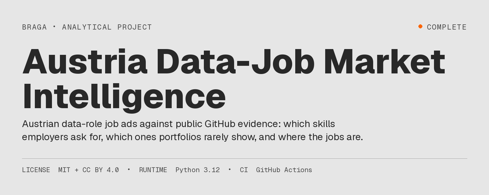
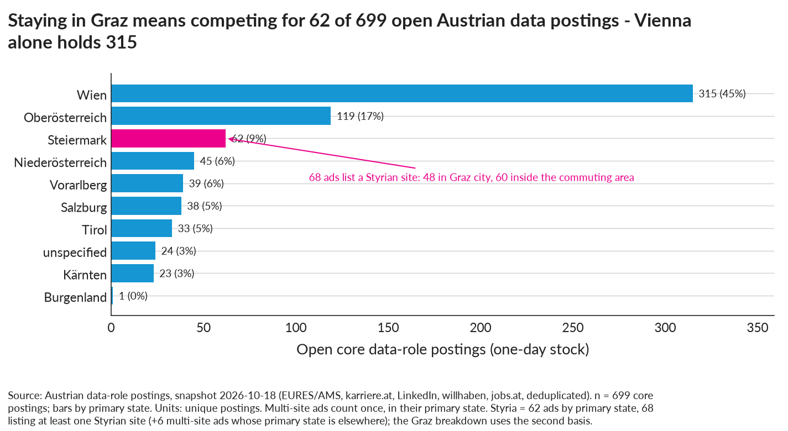
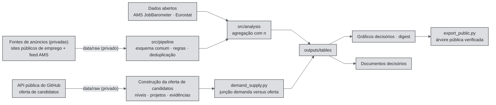

[🇧🇷 PT-BR](README.pt-BR.md) · [🇬🇧 EN-UK](README.md) · [🇦🇹 DE-AT](README.de-AT.md)

<!-- Metric markers use outputs/metrics.json; their display locale follows the README filename. -->

# Inteligência do mercado austríaco de empregos em dados



[](https://github.com/RafaelBraga-Kribitz/austria-data-job-market-intelligence/actions/workflows/tests.yml)
[](https://github.com/RafaelBraga-Kribitz/austria-data-job-market-intelligence/actions/workflows/readme-quality.yml)
[](LICENSE)
[](LICENSE)
[](requirements.txt)
[](#status)

**Status:** Concluído · Snapshot de demanda <!--m:_meta.demand_vintage-->2026-10-18<!--/m--> · Snapshot de oferta <!--m:_meta.supply_vintage-->2026-09-17<!--/m--> · Os números da demanda ficam desatualizados após <!--m:_meta.stale_after_demand-->2027-01-17<!--/m-->

> **Quem decide:** uma pessoa à procura de emprego em dados em Graz.\
> **O que escolhe:** quais funções, competências e cidades priorizar, com base em <!--m:core_n-->699<!--/m--> anúncios abertos de funções centrais de dados na Áustria.\
> **Resposta:** Viena concentra <!--m:vienna_share_core-->45 %<!--/m--> dos anúncios centrais e a Estíria concentra <!--m:styria_core_primary_state-->62<!--/m-->. SQL aparece em <!--m:sql_share-->40 %<!--/m--> dos anúncios, mas apenas <!--m:cap_supply_project_share__sql-->10 %<!--/m--> das pessoas candidatas observadas no GitHub o demonstram em um projeto. Ciência de dados tem o maior número de anúncios centrais (<!--m:family_n__data_science-->176<!--/m-->).\
> **Principal ressalva:** todos os anúncios vêm de um único snapshot de um dia (<!--m:_meta.demand_vintage-->2026-10-18<!--/m-->), e as contagens da Estíria são pequenas demais para calcular participações.\
> **O único gráfico:** o gráfico de lacunas de competências, primeiro em [Resumo da decisão](#resumo-da-decisão).

## Resumo da decisão

> **Resposta.** Além da menção genérica a “IA”, os anúncios citam mais SQL, Python e visualização de dados. A pilha tecnológica mencionada é centrada na Microsoft. Os anúncios citam SQL, qualidade de dados e modelagem de data warehouse com muito mais frequência do que os projetos públicos demonstram. Viena concentra a maior participação dos anúncios centrais. Anúncios escritos em inglês sem requisito explícito de alemão formam um grupo pequeno. A maioria dos valores salariais anunciados corresponde a pisos de convenções coletivas, isto é, ao salário mínimo legal do setor.


*Gráfico de lacunas de competências: quais competências os anúncios pedem e raramente aparecem nos portfólios? Cada ponto representa uma competência. Quanto mais abaixo da linha pontilhada, mais frequentemente os anúncios a mencionam em comparação com portfólios públicos. SQL aparece em <!--m:cap_demand_share__sql-->40 %<!--/m--> dos anúncios. Apenas <!--m:cap_supply_project_share__sql-->10 %<!--/m--> das <!--m:supply_p_data_n-->1.818<!--/m--> contas austríacas observadas no GitHub com sinal de dados o demonstram em um projeto. Qualidade de dados (<!--m:cap_supply_project_share__data_quality_governance-->5 %<!--/m-->) e modelagem de data warehouse (<!--m:cap_supply_project_share__data_warehouse_modelling-->2 %<!--/m-->) ficam ainda mais abaixo. Conclusão: um projeto de portfólio com SQL sobre um esquema modelado e verificações de qualidade de dados cobre o que os anúncios mencionam e os portfólios raramente demonstram (tabela de lacunas de competências, `CALIBRATED`). Os dois lados representam populações diferentes; portanto, interprete a ordem de grandeza, não a razão exata.*

**Como ler os números.** “Participação” significa a proporção de anúncios (ou contas) que *mencionam* um item. Uma menção não transforma o item em requisito. Cada participação conta o texto encontrado por uma regra e vem acompanhada de n e uma ressalva. [`outputs/tables/`](outputs/tables/) contém todos os números abaixo. A [Legenda](#legenda-tabelas-de-origem-e-arquivos-de-gráficos) em Dados identifica o arquivo de cada nome descritivo de tabela. [`src/reporting/digest.py`](src/reporting/digest.py) reproduz os números em [`outputs/reports/digest.txt`](outputs/reports/digest.txt). Ninguém digita esses números neste arquivo manualmente. Quando chega um novo snapshot, um script preenche cada número a partir do registro de métricas. Comentários HTML ocultos ao redor de cada número identificam sua chave no registro; o GitHub não os exibe.

### 1. SQL aparece em <!--m:sql_share-->40 %<!--/m--> dos anúncios e Python em <!--m:python_share-->39 %<!--/m-->

Só a menção genérica a “IA” é mais frequente (<!--m:generic_ai_share-->43 %<!--/m-->). O intervalo de confiança de 95% para SQL é <!--m:skill_ci_low__sql-->37 %<!--/m-->–<!--m:skill_ci_high__sql-->44 %<!--/m-->. Depois de SQL e Python vêm visualização de dados (<!--m:visualisation_share-->36 %<!--/m-->), nuvem (<!--m:cloud_share-->32 %<!--/m-->), qualidade de dados (<!--m:data_quality_share-->31 %<!--/m-->), ETL (extrair, transformar, carregar) (<!--m:etl_share-->20 %<!--/m-->), IA generativa (<!--m:genai_share-->18 %<!--/m-->) e estatística (<!--m:statistics_share-->16 %<!--/m-->).
*Base:* n = <!--m:core_n_text_basis-->699<!--/m--> anúncios centrais com descrição. Unidade: participação dos anúncios. Fonte: sites públicos austríacos de emprego e feed do AMS (Arbeitsmarktservice, serviço público austríaco de emprego), tabela de menções de competências. *Ressalva:* a correspondência é baseada em regras. O projeto mede a precisão dos títulos (proporção dos rótulos atribuídos que uma pessoa confirma como corretos). Não mede a cobertura de competências (proporção das menções reais encontradas pelas regras). Uma menção não é um requisito. “IA” genérica conta qualquer menção a AI, KI (abreviação alemã) ou inteligência artificial; portanto, não identifica uma competência específica.

### 2. Azure aparece em <!--m:azure_share-->19 %<!--/m--> dos anúncios e AWS em <!--m:aws_share-->9 %<!--/m-->: a pilha é centrada na Microsoft

Azure é a plataforma de nuvem da Microsoft, e AWS é Amazon Web Services. Power BI aparece em <!--m:power_bi_share-->17 %<!--/m--> dos anúncios e Tableau em <!--m:tableau_share-->3 %<!--/m-->. Excel aparece em <!--m:excel_share-->14 %<!--/m-->.
*Base:* os mesmos <!--m:core_n_text_basis-->699<!--/m--> anúncios. Unidade: participação dos anúncios. Fonte: tabela de menções de competências. *Ressalva:* anúncios mencionam ferramentas, não bibliotecas. A presença de uma ferramenta no anúncio não indica a profundidade do trabalho com ela.

### 3. SQL aparece em <!--m:cap_demand_share__sql-->40 %<!--/m--> dos anúncios e em projetos de <!--m:cap_supply_project_share__sql-->10 %<!--/m--> das pessoas candidatas observadas

Projetos públicos raramente demonstram algumas competências mencionadas nos anúncios. Qualidade de dados e governança: <!--m:cap_demand_share__data_quality_governance-->32 %<!--/m--> dos anúncios contra <!--m:cap_supply_project_share__data_quality_governance-->5 %<!--/m--> das pessoas candidatas. Modelagem de data warehouse: <!--m:cap_demand_share__data_warehouse_modelling-->25 %<!--/m--> contra <!--m:cap_supply_project_share__data_warehouse_modelling-->2 %<!--/m-->.
*Base:* anúncios n = <!--m:core_n-->699<!--/m-->. Pessoas candidatas n = <!--m:supply_p_data_n-->1.818<!--/m--> contas públicas austríacas do GitHub com sinal de dados (snapshot <!--m:_meta.supply_vintage_span-->2026-09-17/18<!--/m-->). Unidade: participação dos anúncios e das pessoas candidatas. Fonte: tabela de lacunas de competências. O mapa de competências agrupa qualidade de dados e governança. Por isso, sua participação é um pouco mais ampla que a participação da palavra-chave no achado 1. *Ressalva:* o GitHub representa em excesso engenheiros, pesquisadores e estudantes. Não mostra trabalho em Power BI, Excel ou SAP nem repositórios privados. A ausência de evidência pública não significa ausência da competência.

### 4. Viena concentra <!--m:vienna_share_core-->45 %<!--/m--> dos anúncios centrais; a Estíria tem <!--m:styria_core_primary_state-->62<!--/m--> de <!--m:core_n-->699<!--/m-->

Viena tem <!--m:vienna_core_primary_state-->315<!--/m--> dos <!--m:core_n-->699<!--/m--> anúncios. A Estíria tem <!--m:styria_core_primary_state-->62<!--/m--> quando se considera o estado principal ou <!--m:styria_core_flag-->68<!--/m--> se cada local de trabalho mencionado for contado. Desses 68, <!--m:graz_area_core_flag-->60<!--/m--> ficam na área de deslocamento diário de Graz. A Estíria é pequena, mas sua série oficial está acima do nível inicial. A fonte é a série anual do AMS para a classe ocupacional de cientista de dados. Nela, as grandes regiões acima do nível de <!--m:jobbarometer_year_first-->2020<!--/m--> são <!--m:jb_growing_regions-->Estíria (+34 %) e Viena (+15 %)<!--/m-->. A Áustria como um todo está em <!--m:jb_data_scientist_change__austria-->−28 %<!--/m-->.
*Base:* unidade: número de anúncios (tabelas por estado e por cidade estíria) e contagem de anúncios de uma classe ocupacional (série oficial JobBarometer). *Ressalva:* a classe do AMS é mais ampla que os títulos deste projeto e usa outra unidade. A maior célula estíria por família ocupacional tem <!--m:styria_largest_family_n-->28<!--/m--> anúncios. Portanto, as afirmações sobre a Estíria são contagens e direções, não participações.

### 5. <!--m:english_no_german_n_national-->147<!--/m--> de <!--m:core_n-->699<!--/m--> anúncios estão em inglês sem requisito explícito de alemão

<!--m:german_stated_share-->42 %<!--/m--> dos anúncios declaram um requisito de alemão e <!--m:english_posting_share-->26 %<!--/m--> são escritos em inglês. Poucos anúncios em inglês declaram que não exigem alemão: <!--m:english_no_german_n_vienna-->78<!--/m--> em Viena, <!--m:english_no_german_n_styria-->8<!--/m--> dos <!--m:addressable_scope_n_styria-->68<!--/m--> na Estíria e <!--m:english_no_german_n_graz_area-->6<!--/m--> na área de Graz. Apenas <!--m:german_b1_or_below_n-->6<!--/m--> anúncios indicam que B1 (intermediário) ou abaixo é suficiente. B1 é um nível do QECR, Quadro Europeu Comum de Referência para as Línguas.
*Base:* n = <!--m:core_n-->699<!--/m--> anúncios. Unidade: anúncios. Fonte: tabelas de requisitos de idioma. *Ressalva:* o requisito é extraído do texto do anúncio. Um anúncio sem declaração ainda pode pressupor alemão no trabalho.

### 6. <!--m:salary_minimum_only_n-->424<!--/m--> de <!--m:salary_with_salary_figure_n-->527<!--/m--> valores salariais anunciados são um único piso de convenção coletiva

<!--m:salary_with_salary_figure_n-->527<!--/m--> dos <!--m:core_n-->699<!--/m--> anúncios apresentam um valor, portanto a remuneração anunciada é, em geral, o piso legal. A mediana do piso anunciado é <!--m:floor_analytics_eur-->€50,0 mil<!--/m--> em análise de dados, <!--m:floor_data_science_eur-->€55,4 mil<!--/m--> em ciência de dados e <!--m:floor_data_engineering_eur-->€55,0 mil<!--/m--> em engenharia de dados.
*Base:* unidade: piso bruto anual em euros (valor mensal × 14). Fonte: tabelas de remuneração anunciada. *Ressalva:* piso não é salário efetivo. O modelo salarial controlado mantém constantes família ocupacional, senioridade e estado. Depois desses controles, a maioria dos “prêmios” brutos por competência não se distingue de zero (associação, não causalidade).



*Onde estão os anúncios? Viena tem <!--m:vienna_core_primary_state-->315<!--/m--> dos <!--m:core_n-->699<!--/m--> anúncios centrais, a Alta Áustria <!--m:upper_austria_n-->119<!--/m--> e a Estíria <!--m:styria_core_primary_state-->62<!--/m-->. Conclusão: fora de Viena o mercado diminui rapidamente; uma busca apenas na Estíria se restringe a um grupo pequeno. Snapshot <!--m:_meta.demand_vintage-->2026-10-18<!--/m-->, tabela por estado; contagens `VERIFIED` de uma seleção baseada em regras.*


*Uma competência mencionada aumenta o piso salarial anunciado? Os quadrados mostram a diferença bruta no piso anunciado. Os pontos mostram a diferença após controles por família ocupacional, senioridade e estado. Para a maioria das competências, o intervalo após controles cruza zero. Depois de corrigir os testes de várias competências simultâneas, nenhuma se distingue de zero. Conclusão: família ocupacional e senioridade definem o piso anunciado, não a ferramenta citada. Modelo: regressão do log do piso anunciado; associação, não causalidade.*

## Por que este projeto existe

Uma pessoa à procura de emprego em dados em Graz não conseguia ver quais funções, regiões e competências os anúncios austríacos pedem. Preparar-se para o caminho errado pode custar meses de emprego — até um ano perdido. A avaliação anterior à construção estimou esse custo da falta de informação em cerca de €15 mil e esperava que o sistema completo recuperasse €11,2 mil diante de um custo de €10.800. Isso equivale a 1,0× e não atinge o requisito financeiro; um estudo focado de 40 horas passa com 4,2×. Resultado observado: ainda não medido. Detalhes: [avaliação econômica](docs/economic-evaluation.md).

## Comece por aqui

| Público | Comece por |
|---|---|
| Recrutador (2 min) | Os gráficos e os seis achados acima, depois [o painel de gráficos decisórios](docs/visual-decision-board.md) (<!--m:visual_questions_n-->45<!--/m--> perguntas, um gráfico para cada uma) |
| Gestor de contratação (10 min) | [Resumo da decisão](#resumo-da-decisão), [mapa decisório da demanda dos empregadores](CAREER_DECISION_MAP.md), [mapa decisório da lacuna entre demanda e oferta](CAREER_SUPPLY_DEMAND_MAP.md), [Limitações conhecidas](#limitações-conhecidas) |
| Revisor técnico | [Como funciona](#como-funciona), [Como as partes se conectam](#como-as-partes-se-conectam), [Reproduza](#reproduza), motor de regras [src/pipeline/normalize.py](src/pipeline/normalize.py), [testes](tests/) |
| Auditor | [Dados](#dados), [Validação](#validação), [qualidade de dados](docs/data-quality.md), [auditoria jurídica e de publicação](docs/legal-and-publication-audit.md), [decisão de publicação](PUBLICATION_DECISION.md), controle de exportação [src/publish/export_public.py](src/publish/export_public.py) |
| Assistente de IA | [Notas para assistentes de IA](AGENT_CONTEXT.md), depois [as perguntas dos gráficos em JSON](outputs/visual_questions.json) |

## Dashboard

[`dashboards/`](dashboards/README.md) contém um dashboard de cinco páginas. Uma especificação de página o gera de duas formas:

- um projeto Power BI em formato textual ([`JobMarket.pbip`](dashboards/JobMarket.pbip): modelo semântico TMDL, relatório PBIR, tema Braga);
- uma versão HTML estática equivalente ([`dashboards/html/index.html`](dashboards/html/index.html)), sem necessidade de rede e com modos claro e escuro.

TMDL e PBIR são formatos textuais do modelo e do relatório Power BI. As páginas são: visão geral do mercado, competências e pilhas, pisos salariais anunciados, demanda versus oferta e qualidade/cobertura dos dados. Cada página tem subtítulo em alemão e apresenta as ressalvas junto aos números. As duas versões leem apenas `outputs/`. Um teste verifica se todos os campos usados por uma visualização existem no modelo. Também verifica se o HTML exibe os valores de origem. Ninguém abriu o arquivo Power BI no Power BI Desktop ainda. A lista de verificação dessa etapa está em [dashboards/README.md](dashboards/README.md).

## Por que este projeto

Eu queria comparar caminhos profissionais em dados a partir de Graz com base em evidências. As fontes públicas que pesquisei não permitiam fazer isso ([docs/research-landscape.md](docs/research-landscape.md)). As séries oficiais (AMS JobBarometer, Eurostat) contam anúncios ou vagas por ano ou trimestre. Usam classes ocupacionais amplas ou não classificam a ocupação. Referências salariais públicas são pisos de convenções coletivas ou pesquisas autodeclaradas. Nenhuma base pública lista anúncios austríacos de funções de dados com competências, região, requisito de idioma e remuneração anunciada. Este repositório constrói esse conjunto a partir de um snapshot de anúncios de um dia. Também acrescenta o outro lado do mercado: o que portfólios públicos na Áustria demonstram de fato. Com os dois lados, uma escolha de estudo ou portfólio pode priorizar onde a demanda é alta e as evidências visíveis são escassas. Cada um dos <!--m:visual_questions_n-->45<!--/m--> gráficos decisórios responde a uma pergunta por trás dessa escolha. Por exemplo: “Se eu não sair de Graz, a que parte do mercado austríaco de dados estou realmente me candidatando?” ([docs/visual-decision-board.md](docs/visual-decision-board.md)). O perfil pessoal por trás desses gráficos permanece privado. A árvore pública inclui um perfil neutro de exemplo ([config/profile.json](config/profile.json)). O método de comparação está em [docs/decision-framework.md](docs/decision-framework.md).

## Dados

| Evidência | Fonte | Período | Granularidade | Pública? | Classificação |
|---|---|---|---|---|---|
| Demanda dos empregadores | Sites públicos austríacos de emprego e feed do AMS | <!--m:_meta.demand_vintage-->2026-10-18<!--/m--> | anúncio aberto; <!--m:raw_rows_n-->11.997<!--/m--> linhas brutas → <!--m:unique_postings_n-->10.655<!--/m--> anúncios únicos → <!--m:core_n-->699<!--/m--> anúncios centrais de dados | Apenas agregados | Contagens `VERIFIED`, campos `CALIBRATED` |
| Séries oficiais | AMS JobBarometer, vagas Eurostat | <!--m:jobbarometer_year_first-->2020<!--/m-->–<!--m:jobbarometer_year_last-->2025<!--/m--> (AMS), <!--m:eurostat_year_first-->2009<!--/m-->–<!--m:eurostat_year_last-->2025<!--/m--> (Eurostat) | séries anuais ou trimestrais | Sim (dados brutos Eurostat com licença aberta) | `VERIFIED` |
| Oferta de pessoas candidatas | Contas públicas do GitHub com localização na Áustria (API REST documentada do GitHub, sem solicitar nomes ou e-mails) | <!--m:_meta.supply_vintage_span-->2026-09-17/18<!--/m--> | <!--m:supply_p_all_n-->9.409<!--/m--> contas com localização austríaca → <!--m:supply_p_data_n-->1.818<!--/m--> com sinal de dados | Apenas agregados | `CALIBRATED` |
| Contexto da oferta | Séries Eurostat de formados, emprego e especialistas em TIC na Áustria; Stack Overflow Developer Survey 2025 (respondentes austríacos) | séries anuais até 2024/2025; pesquisa de 2025 | séries nacionais; respondentes da pesquisa | Sim (agregados; extração da pesquisa privada) | `VERIFIED` |
| Lacuna entre demanda e oferta | Demanda dos empregadores e oferta de pessoas candidatas, associadas às mesmas listas de funções e competências | conforme acima | nível de competência e família ocupacional | Sim | `CALIBRATED` |

Por família ocupacional, os anúncios centrais são ciência de dados <!--m:family_share__data_science-->25 %<!--/m--> (<!--m:family_n__data_science-->176<!--/m-->), engenharia de dados <!--m:family_share__data_engineering-->20 %<!--/m--> (<!--m:family_n__data_engineering-->137<!--/m-->) e análise de dados <!--m:family_share__data_analytics-->15 %<!--/m--> (<!--m:family_n__data_analytics-->107<!--/m-->). Fonte: tabela de contagens por família ocupacional.

Os anúncios são textos de terceiros, e os termos dos sites de emprego restringem a extração automatizada. Por isso, os coletores desses sites, os registros brutos, o texto dos anúncios, os links e os registros individuais da oferta ficam privados. A árvore pública contém apenas código, regras, documentação e tabelas agregadas. [docs/legal-and-publication-audit.md](docs/legal-and-publication-audit.md) e [PUBLICATION_DECISION.md](PUBLICATION_DECISION.md) apresentam a justificativa. Trata-se de uma análise de prontidão para publicação, não de aconselhamento jurídico. [docs/data-sources.md](docs/data-sources.md) e [docs/supply-methodology.md](docs/supply-methodology.md) listam cada fonte, forma de acesso, termos e data dos dados.

| Classificação | Significado |
|---|---|
| `VERIFIED` | Apoiada diretamente por dados externos ou de origem; apenas conversão de unidades e agregação |
| `CALIBRATED` | Derivada por regras documentadas, ancoradas em dados reais |
| `SIMULATED` | Resultado de procedimento estocástico ou generativo com seed fixa (nenhum neste repositório) |
| `ILLUSTRATIVE` | Apenas exemplo, não evidência (nenhum neste repositório) |

### Legenda: tabelas de origem e arquivos de gráficos

Os arquivos em `outputs/` usam códigos curtos. O texto acima usa os nomes descritivos desta tabela.

| Nome descritivo | Código do arquivo | Conteúdo |
|---|---|---|
| Tabela de menções de competências | T05 | Participação dos anúncios que mencionam cada competência ou ferramenta |
| Tabela de contagem por família ocupacional | T02 | Anúncios centrais por família ocupacional |
| Tabelas de anúncios por estado e cidades da Estíria | T03a, T03c | Anúncios por estado federado; anúncios estírios por cidade |
| Séries oficiais do JobBarometer | JB01, JB05 | Contagens anuais do AMS; Estíria comparada à Áustria |
| Tabelas de requisitos de idioma | T07, T07a, T07c, T07e | Requisito de alemão, nível de alemão, idioma do anúncio, cenários de inglês sem alemão |
| Tabelas de remuneração anunciada | T09, T09a, T09b | Cobertura salarial, base de remuneração, pisos anunciados por grupo |
| Diferença salarial bruta por competência | T09d | Piso anunciado por competência, sem controles |
| Modelo salarial controlado | D05 | Prêmio de competência após controles por família ocupacional, senioridade e estado |
| Tabela de lacunas de competências | DS10 | Participação da competência nos anúncios comparada à participação das pessoas candidatas com evidência em projetos |
| Auditoria de precisão dos títulos | Q03c | Verificação manual da classificação dos títulos |
| Auditorias de precisão da oferta de candidatos | SQ10, SQ11 | Verificações manuais da classificação de biografias e projetos |
| Famílias de tabelas | T, JB, S, D, Q / C, O, SQ / DS | Demanda dos empregadores / oferta de candidatos / lacuna entre demanda e oferta |
| Gráficos decisórios | BQ01–BQ45 | Um gráfico por pergunta; arquivos F*, SF* e DSF* são gráficos exploratórios anteriores |
| Gráficos neste README | BQ21, BQ01, BQ45 | Lacuna de competências; localização dos anúncios; se uma competência mencionada aumenta o piso salarial |

## Limitações conhecidas

- **A demanda é um estoque de anúncios abertos em um único dia.** Não é um fluxo anual e não conta vagas ou contratações. As fontes não incluem páginas de carreira de grandes empresas ([docs/limitations.md](docs/limitations.md)).
- **A extração é baseada em regras.** O projeto mede a precisão da classificação dos títulos, mas não a cobertura da identificação de competências. Valores salariais são pisos legais.
- **A oferta é uma amostra de perfis públicos.** O GitHub não mostra trabalho em Power BI, Excel ou SAP, repositórios privados, proficiência ou contratações. Os valores de oferta para Viena são limites inferiores ([docs/supply-research-audit.md](docs/supply-research-audit.md)).
- **A lacuna entre demanda e oferta associa duas populações diferentes.** Interprete ordenações e ordens de grandeza, não razões exatas.
- **As células da Estíria são pequenas.** A maior célula por família ocupacional tem <!--m:styria_largest_family_n-->28<!--/m--> anúncios. Isso fica abaixo do próprio limiar de robustez do projeto, de 30.
- **Não há alegações causais** sobre competências, idioma ou salário.

**O que mudaria estes achados.** Considere cada conclusão aberta a revisão.

- **Lacuna de competências (achado 3).** Reavalie-a se um segundo snapshot de oferta mostrar que a diferença entre anúncios e evidências em projetos públicos está diminuindo. Reavalie-a também se uma fonte que capture o trabalho de business intelligence (BI) mostrar que muitas pessoas candidatas demonstram essas competências.
- **Estíria (achado 4).** Reavalie-o se uma amostra estíria maior levar uma célula de família ocupacional acima do limiar de robustez. Reavalie-o também se a série AMS de 2026 inverter a tendência da Estíria.
- **Idioma (achado 5).** Reavalie-o se uma fonte maior de anúncios alterar a participação de anúncios em inglês sem requisito declarado de alemão.
- **Remuneração (achado 6).** Reavalie-o se anúncios com salário efetivo declarado, em vez de piso de convenção coletiva, se tornarem comuns.

O registro de perguntas abertas está em [docs/open-questions.md](docs/open-questions.md).

## O que eu faria com dados de produção

- Substituir os estoques de um dia por uma série temporal de snapshots datados. Comparar cada tabela entre snapshots.
- Adicionar páginas de carreira e mais fontes de emprego por meios permitidos. Medir a cobertura das regras de competências usando rótulos manuais.
- Substituir a amostra pública do GitHub por dados de candidatos coletados com consentimento. Os dados devem incluir trabalho em BI e planilhas, além dos níveis de idioma declarados.
- Registrar resultados reais de candidaturas. Só esses resultados transformam padrões de requisitos em evidência sobre contratações.

## Como funciona

O projeto demonstra estes métodos: pipeline Python de dados, extração de texto de anúncios baseada em regras e deduplicação. Também usa intervalos de confiança de Wilson, regressão salarial controlada com correção para testes múltiplos e auditorias de precisão com classificação manual. Um controle de exportação testado impede que dados privados entrem na árvore pública.

```text
Coletar → Esquema comum → Campos baseados em regras → Deduplicar → Agregar com n → Associar demanda × oferta → Criar gráficos → Documentos decisórios
```

- **Regras, não um modelo.** `normalize.py` atribui família ocupacional, senioridade, localização, modelo de trabalho, salário e competências. Usa regras ordenadas em `config/` e janelas de contexto ao redor de cada correspondência. Cada atribuição mantém um campo de evidência. A normalização do título decide quais anúncios entram no escopo, não a consulta de busca.
- **Deduplicação.** Uma etapa union-find (algoritmo padrão de agrupamento) agrupa anúncios duplicados por chaves documentadas. A taxa de duplicação dentro do escopo é <!--m:dedupe_duplicate_rate_in_scope-->24 %<!--/m-->.
- **Agregação.** O conjunto central contém os anúncios canônicos de oito famílias de funções de dados. Cada tabela armazena n. Proporções que alimentam decisões têm intervalos de Wilson de 95%. As séries oficiais mantêm suas próprias unidades. A pipeline nunca as mistura com estatísticas no nível do anúncio.
- **Junção.** `demand_supply.py` associa os dois lados pelas mesmas taxonomias (listas fixas de funções e competências). Informa razões e quadrantes. Nunca calcula uma pontuação composta nem classifica indivíduos.
- **Gráficos.** Cada um dos <!--m:visual_questions_n-->45<!--/m--> gráficos decisórios responde a uma pergunta de negócio. Os hashes SHA-256 em [`outputs/figures/FIGURE-MANIFEST.yaml`](outputs/figures/FIGURE-MANIFEST.yaml) selam os arquivos vetoriais (SVG).

Descrições completas: [docs/methodology.md](docs/methodology.md), [docs/supply-methodology.md](docs/supply-methodology.md), [docs/demand-supply-methodology.md](docs/demand-supply-methodology.md).

## Validação

- **Auditorias com rótulos manuais.** A classificação dos títulos alcança <!--m:title_precision_strict_after-->83 %<!--/m--> de precisão estrita e <!--m:title_precision_lenient_after-->95 %<!--/m--> de precisão permissiva em <!--m:title_audit_sample_n-->177<!--/m--> títulos classificados manualmente (auditoria de precisão dos títulos). Para a oferta de candidatos, biografia → família ocupacional alcança <!--m:supply_precision_bio_family_strict-->78 %<!--/m--> / <!--m:supply_precision_bio_family_lenient-->90 %<!--/m-->. Repositório → projeto alcança <!--m:supply_precision_project_strict-->75 %<!--/m--> / <!--m:supply_precision_project_lenient-->92,5 %<!--/m-->. Ambas usam amostras aleatórias de 40 itens (auditorias de precisão da oferta). O projeto não mede cobertura.
- **Testes.** `python -m pytest -q` executa testes unitários dos módulos de regras. Também executa verificações de valores que comparam a frase sob cada gráfico às tabelas citadas. Testes de integridade que precisam de dados privados são ignorados na árvore pública e informam isso.
- **Digest.** `src/reporting/digest.py` reimprime todos os números citados a partir de `outputs/`. A última seção informa as entradas ausentes.
- **Referência do resultado salarial.** O prêmio bruto por competência (diferença salarial bruta por competência) é a referência. O modelo salarial controlado usa mínimos quadrados ordinários sobre o log do piso, com erros-padrão HC1 robustos à heterocedasticidade. As correções de Holm e Benjamini-Hochberg ajustam os testes de muitas competências. O resultado bruto não resiste aos controles, e este README informa isso.
- **Controle de exportação.** `src/publish/export_public.py` constrói a árvore pública em uma pasta de staging. A construção é bloqueada se encontrar endereço de e-mail, telefone, link de anúncio de emprego, token semelhante a segredo ou ID de anúncio de origem. Também bloqueia células de texto livre longas demais, violações do limiar de supressão, caminhos privados e frases com fatos sobre a pessoa proprietária.

## Como as partes se conectam

O diagrama mostra como as entradas privadas se tornam saídas públicas e agregadas.



## Reproduza

Ambiente: Python 3.12 com `requirements.txt` fixado. Para coletar novamente os dados da oferta de candidatos, é necessário um token do GitHub (`GH_TOKEN` ou sessão autenticada no `gh`).

```bash
git clone https://github.com/RafaelBraga-Kribitz/austria-data-job-market-intelligence.git && cd austria-data-job-market-intelligence
pip install -r requirements.txt
python -m pytest -q                 # testes unitários e de valores; testes de integridade são ignorados sem dados privados
python src/reporting/digest.py      # reimprime a partir de outputs/ todos os números citados
python run_all.py --list            # alvos, etapas, entradas
python run_all.py all --dry-run     # pré-verificação e comandos exatos; nada é executado
```

Uma pessoa externa consegue reproduzir estas partes:

- cada regra (testes) e cada etapa de agregação (código);
- a correspondência entre cada número citado e as tabelas (digest, testes);
- as séries AMS e Eurostat de ponta a ponta;
- com um token do GitHub, a coleta completa da oferta de candidatos (cerca de 5–7 horas nos limites de taxa da API).

Duas etapas precisam de dados privados: a construção da demanda dos empregadores e a construção da oferta de candidatos a partir da coleta armazenada. A pré-verificação de `run_all.py` identifica imediatamente a pasta ausente. Os alvos `layer1`, `layer2` e `layer3` são demanda dos empregadores, oferta de candidatos e lacuna entre demanda e oferta. Compare lado a lado os snapshots de datas diferentes e nunca os misture.

## Estrutura do repositório

```text
CAREER_DECISION_MAP.md          documento decisório da demanda dos empregadores
CAREER_SUPPLY_DEMAND_MAP.md     documento decisório da lacuna entre demanda e oferta
AGENT_CONTEXT.md                notas para assistentes de IA
DECISION_LOG.md                 registro de decisões datadas (entradas públicas)
PUBLICATION_DECISION.md         conclusões sobre prontidão para publicação e limite público/privado
run_all.py                      ponto único de entrada: layer1 (demanda), layer2 (oferta), layer3 (lacuna), dashboard visual, digest, testes
docs/                           metodologia, qualidade de dados, limitações, auditoria jurídica, painel de gráficos decisórios
config/                         taxonomia de funções, vocabulário de competências, geografia, mapa de capacidades, perfil de exemplo
schemas/                        esquemas de anúncios, oferta e registro de candidaturas
src/acquisition/                coletores apenas para APIs públicas documentadas e dados abertos
src/pipeline/                   esquema comum, regras, deduplicação, construção da oferta, redação de dados
src/analysis/                   análises de demanda, oferta e lacuna; construtores de gráficos decisórios
src/viz/                        motor de figuras com bk-viz (Braga design system v2.1), utilitário DSX integrado e Lato (SIL OFL 1.1)
src/reporting/                  digest e registro de métricas com renderizador
src/publish/                    exportação pública verificada
outputs/tables/                 tabelas agregadas; códigos de arquivos na Legenda em Dados
outputs/figures/                gráficos BQ01–BQ45 em PNG e SVG selados; F*, SF*, DSF* são PNGs exploratórios anteriores
dashboards/                     projeto Power BI (PBIP: TMDL + PBIR) e versão HTML estática; ambos leem outputs/
tests/                          conjunto pytest, um arquivo por família de módulos
```

## Stack

| Parte | Tecnologia | Motivo |
|---|---|---|
| Linguagem | Python 3.12 | Um script simples por etapa, executado em ordem fixa por `run_all.py` |
| Manipulação de dados | pandas, numpy, pyarrow | Tabelas de anúncios e oferta, agregação, intermediários Parquet |
| Estatística | numpy, scipy, scikit-learn | Intervalos de Wilson e regressão salarial controlada implementados em numpy; scipy para intervalos sazonais; scikit-learn para os agrupamentos de requisitos usados como apoio à leitura |
| Gráficos | matplotlib + `src/viz` sobre bk-viz (Braga design system v2.1, tipo BKribitz) | Um estilo visual para todos os <!--m:visual_questions_n-->45<!--/m--> gráficos, SVG selados por hash |
| Coleta | requests | Apenas coletores públicos: páginas AMS JobBarometer e APIs Eurostat e GitHub; coletores dos sites de emprego permanecem privados |
| Dashboard | Power BI (PBIP: TMDL + PBIR), HTML estático | Modelo e relatório em texto revisável, verificados entre si por teste; a versão HTML não precisa de Power BI nem de rede |
| Testes | pytest | Testes das regras, verificações de valores das frases dos gráficos e verificações de integridade |
| Publicação | `export_public.py` | Construção em staging com varredura de vazamentos antes de qualquer arquivo chegar à árvore pública |

## Governança

Os testes controlam os achados: comparam cada frase de gráfico à tabela de origem. Um digest reimprime cada número citado. Os números em documentos dinâmicos apontam para chaves do registro. Assim, um novo snapshot os renderiza novamente e não deixa valores antigos. Alterações feitas com ajuda de IA passam pelos mesmos testes e pelo mesmo controle de exportação. [DECISION_LOG.md](DECISION_LOG.md) registra decisões com datas. [docs/open-questions.md](docs/open-questions.md) lista o que os dados não conseguem responder.

## Status

**Status:** Concluído · Data: <!--m:_meta.demand_vintage-->2026-10-18<!--/m-->

As três partes de evidência (demanda dos empregadores, oferta de candidatos e lacuna entre elas) e os <!--m:visual_questions_n-->45<!--/m--> gráficos existem e passam nos testes. Snapshot de demanda <!--m:_meta.demand_vintage-->2026-10-18<!--/m-->, snapshot de oferta <!--m:_meta.supply_vintage-->2026-09-17<!--/m-->. Próximo marco: um segundo snapshot de oferta, para dar dimensão temporal aos dados de candidatos.

## Licença

Código (`src/`, `tests/`, `config/`): MIT. Documentos e saídas agregadas (tabelas, resumos JSON, figuras, digest): CC BY 4.0. Dados brutos Eurostat: política de reutilização da Comissão Europeia, com atribuição obrigatória. Tabelas derivadas da pesquisa Stack Overflow: obras produzidas com dados sujeitos à Open Database License (ODbL). Fontes Lato integradas: SIL OFL 1.1. Não é concedida licença para conteúdo de terceiros. A divisão exata está em [LICENSE](LICENSE). Cite conforme [CITATION.cff](CITATION.cff); não há DOI (identificador de objeto digital).

## Autor

<table>
  <tr>
    <td width="110">
      
    </td>
    <td>
      <strong>Rafael Braga-Kribitz</strong><br />
      Seiersberg-Pirka, Áustria · Projeto de portfólio, 2026<br />
      <a href="https://www.linkedin.com/in/rafaelbragakribitz/">LinkedIn</a>
    </td>
  </tr>
</table>
