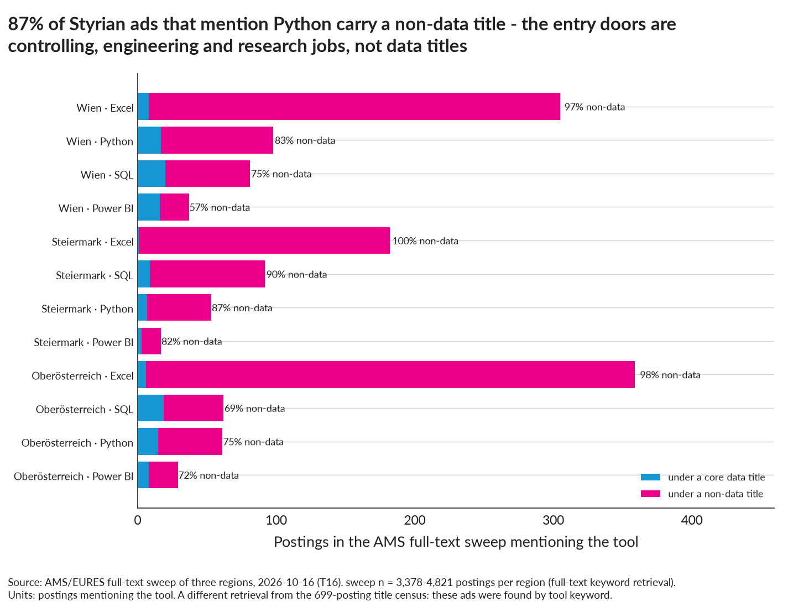

# Career map: from the observed market to this profile

Profile (config/profile.json): ~20 years marketing/growth/performance marketing/CRO/experimentation/analytics/automation; English fluent; German A2–B1; Greater Graz; developing Python, SQL, R, statistics, ML, visualisation. This page derives pathways from the tables in `docs/market-guide.md`; the scoring is in `docs/decision-framework.md` and `outputs/tables/D01–D04`. Nothing here is a hiring forecast; "share" means share of ads that mention an item (n = <!--m:core_n_text_basis-->699<!--/m--> unless stated). Numbers are from the post-audit run (<!--m:core_n-->699<!--/m--> core postings, <!--m:styria_core_flag-->68<!--/m--> Styria).

## 1. Already-have advantages (what ads repeatedly ask for and the profile already carries)

| Market signal | Evidence | Profile fit |
|---|---|---|
| Business/stakeholder orientation is in more than half of all ads | stakeholder/business-partner wording <!--m:skill_share__stakeholder_management-->54 %<!--/m-->, communication <!--m:skill_share__communication-->60 %<!--/m-->, analytical thinking <!--m:skill_share__analytical_thinking-->52 %<!--/m--> (T05_soft) | 20 years of stakeholder-facing marketing work |
| Finance/controlling, sales and consulting contexts dominate analyst ads | finance/controlling, sales and consulting are the top business contexts in data_analytics ads (T14) | commercial/growth background maps onto "business analytics" wording |
| Marketing/CRM/web-analytics wording exists but is scarce as a title | marketing <!--m:skill_share__marketing-->9 %<!--/m--> (<!--m:skill_n__marketing-->60<!--/m--> ads), CRM/customer/web analytics ≤ 7 % of all core ads; cluster 6 (marketing/CRM/customer/web analytics) = <!--m:cluster_share__c6:pct1-->11.9 %<!--/m--> of postings (T15) | direct domain match for a ~10 % niche, mostly Vienna and hybrid-friendly |
| Excel and dashboards are still the analyst baseline | Excel <!--m:skill_family_share__data_analytics__excel-->39 %<!--/m--> and visualisation <!--m:skill_family_share__data_analytics__data_visualization-->55 %<!--/m--> of data_analytics ads | present |
| Experimentation is rarely named but is a differentiator | A/B testing <!--m:ab_testing_share-->4 %<!--/m--> of ads overall, <!--m:skill_family_n__marketing_analytics__a_b_testing_experimentation-->2<!--/m--> of <!--m:family_desc_n__marketing_analytics-->18<!--/m--> marketing_analytics ads | rare on the supply side too; a credible edge in product/marketing analytics |
| Seniority is expected, not penalised | <!--m:seniority_share__unspecified:pct1-->57.4 %<!--/m--> of ads unlabelled (median <!--m:experience_years_median__unspecified-->3<!--/m--> years stated), senior ≈ <!--m:experience_years_median__senior-->5<!--/m--> years; junior labels only <!--m:seniority_share__trainee_junior-->4 %<!--/m--> | senior business experience is usable, technical years are what is missing |

## 2. Near-term gaps (frequent in ads, realistically acquirable, already in progress)

| Skill | Share of core ads | In the target families | Status |
|---|---|---|---|
| **SQL** | <!--m:sql_share-->40 %<!--/m--> (Styria <!--m:sql_n_styria-->28<!--/m--> of <!--m:styria_core_flag-->68<!--/m-->) | data_analytics <!--m:skill_family_share__data_analytics__sql-->36 %<!--/m-->, bi <!--m:skill_family_share__bi__sql-->49 %<!--/m-->, data_engineering <!--m:skill_family_share__data_engineering__sql-->72 %<!--/m-->, marketing_analytics <!--m:skill_family_share__marketing_analytics__sql-->56 %<!--/m--> | NOW – ranks <!--m:tech_skill_rank__sql-->2nd<!--/m--> of <!--m:tech_skill_rank_set_n-->14<!--/m--> headline skills by share of ads |
| **Python** | <!--m:python_share-->39 %<!--/m--> (Styria <!--m:python_n_styria-->30<!--/m--> of <!--m:styria_core_flag-->68<!--/m-->) | data_science <!--m:skill_family_share__data_science__python-->76 %<!--/m-->, data_engineering <!--m:skill_family_share__data_engineering__python-->61 %<!--/m-->, data_analytics <!--m:skill_family_share__data_analytics__python-->33 %<!--/m--> | NOW – mandatory for data science/engineering, optional for analyst/BI |
| Data quality / governance wording | <!--m:data_quality_share-->31 %<!--/m--> | present in every family (<!--m:skill_family_share__data_engineering__data_governance_quality-->50 %<!--/m--> in engineering) | NOW – vocabulary and practice (validation, definitions, lineage) |
| ETL/ELT & data modelling | <!--m:etl_share-->20 %<!--/m--> / <!--m:data_modelling_share-->17 %<!--/m--> | data_engineering <!--m:skill_family_share__data_engineering__etl_elt-->53 %<!--/m--> / <!--m:skill_family_share__data_engineering__data_modeling-->36 %<!--/m-->, bi <!--m:skill_family_share__bi__data_modeling-->34 %<!--/m--> (modelling) | NOW/NEXT – dimensional modelling + SQL pipelines; not full data engineering |
| **Power BI** | <!--m:power_bi_share-->17 %<!--/m--> (Styria <!--m:power_bi_n_styria-->4<!--/m--> of <!--m:styria_core_flag-->68<!--/m-->) | data_analytics <!--m:skill_family_share__data_analytics__power_bi-->30 %<!--/m-->, bi <!--m:skill_family_share__bi__power_bi-->43 %<!--/m-->, marketing_analytics <!--m:skill_family_share__marketing_analytics__power_bi-->28 %<!--/m--> | NEXT – the BI tool of the Austrian market; Tableau is <!--m:tableau_share-->3 %<!--/m--> |
| Generative AI / LLM wording | <!--m:genai_share-->18 %<!--/m--> | data_science <!--m:skill_family_share__data_science__generative_ai_llm-->60 %<!--/m-->, marketing <!--m:skill_family_share__marketing_analytics__generative_ai_llm-->11 %<!--/m--> | NEXT – applied use (RAG, prompt-based analysis), not model training |
| Statistics named explicitly | <!--m:statistics_share-->16 %<!--/m--> (regression <!--m:regression_share-->1 %<!--/m-->, causal <!--m:causal_inference_share-->1 %<!--/m-->) | data_science <!--m:skill_family_share__data_science__statistics_general-->31 %<!--/m-->, data_analytics <!--m:skill_family_share__data_analytics__statistics_general-->17 %<!--/m--> | continue; ads rarely spell methods out, so demonstrate them in projects |
| Git, REST/APIs | <!--m:git_share-->10 %<!--/m-->, <!--m:rest_share-->15 %<!--/m--> | data_engineering, data_science | NEXT – baseline engineering hygiene |

## 3. Structural gaps (frequent in some families; substantial time or formal background)

| Requirement | Evidence | Which paths it affects |
|---|---|---|
| **German at a demonstrable B2/C1** | <!--m:german_stated_share-->42 %<!--/m--> of ads state a German requirement; C1-equivalent wording (mostly "sehr gut") in <!--m:german_c1_bucket_share-->41 %<!--/m--> of all ads, B2 in <!--m:german_b2_share-->13 %<!--/m-->; BI <!--m:german_stated_share__bi-->52 %<!--/m-->, data_analytics <!--m:german_stated_share__data_analytics-->40 %<!--/m-->; Styria <!--m:german_stated_n_styria-->33<!--/m--> of <!--m:styria_n_text_basis-->68<!--/m--> vs <!--m:german_stated_share_elsewhere-->42 %<!--/m--> elsewhere; only <!--m:english_no_german_n_styria-->8<!--/m--> of <!--m:addressable_scope_n_styria-->68<!--/m--> Styrian ads are English-written without a stated requirement | Stated requirements exclude the profile from most Styrian analyst/BI ads as advertised; English-written ads are <!--m:english_posting_share-->26 %<!--/m--> overall (Styria <!--m:english_posting_n_styria-->12<!--/m--> of <!--m:styria_n_text_basis-->68<!--/m-->, data science <!--m:posting_language_family_share__data_science__en-->41 %<!--/m-->). Negotiability is not measured. |
| Azure/Databricks/Fabric platform engineering | Azure <!--m:azure_share-->19 %<!--/m--> (Styria <!--m:azure_n_styria-->27<!--/m--> of <!--m:styria_core_flag-->68<!--/m-->), Databricks <!--m:databricks_share-->10 %<!--/m--> (Styria <!--m:databricks_n_styria-->20<!--/m--> of <!--m:styria_core_flag-->68<!--/m-->), CI/CD <!--m:ci_cd_share-->15 %<!--/m-->, Fabric <!--m:fabric_share-->5 %<!--/m--> | data_engineering as a primary target (<!--m:structural_gap_n_of15__data_engineering-->7<!--/m--> of its 15 top skills structural for this profile) |
| ML engineering depth (Docker/Kubernetes/MLOps/PyTorch) | each 4–6 % overall, concentrated in data_science/ML-engineer ads (cluster 5) | ML/AI-engineer titles (<!--m:title_n__machine_learning_ai_engineer-->91<!--/m--> postings) |
| CS/engineering degree wording | computer science <!--m:degree_field_share__computer_science_informatics-->36 %<!--/m-->, engineering/physics <!--m:degree_field_share__engineering_physics-->35 %<!--/m--> of ads; degree-required wording <!--m:degree_required_share-->30 %<!--/m--> (data_analytics <!--m:degree_strength_family_share__data_analytics__required-->36 %<!--/m-->) but "or equivalent" in <!--m:degree_or_equivalent_share-->31 %<!--/m--> | a soft barrier; PhD is <!--m:degree_level_share__phd-->3 %<!--/m-->, Master <!--m:degree_level_share__master-->13 %<!--/m--> |
| Industrial domain knowledge (manufacturing, automotive, semiconductors) | operations/manufacturing <!--m:skill_share__operations_manufacturing:tpct0-->20 %<!--/m--> of ads; Styrian employers are KNAPP, Magna, Anton Paar, ams OSRAM-type industry | Styrian data engineering/science postings |

## 4. Low-value learning (attractive, weak Austrian evidence)

Tableau (<!--m:tableau_share-->3 %<!--/m-->), Looker (<!--m:looker_share-->1 %<!--/m-->), Qlik (<!--m:qlik_share-->3 %<!--/m-->), GCP/BigQuery (<!--m:gcp_share-->5 %<!--/m--> / <!--m:skill_share__bigquery:tpct0-->3 %<!--/m-->), Spark (<!--m:spark_share:pct1-->6.3 %<!--/m-->), Kafka/streaming (<!--m:streaming_share-->6 %<!--/m-->), Java/Scala (<!--m:java_share-->5 %<!--/m--> / <1 %), individual Python libraries as CV items (pandas <!--m:pandas_share-->3 %<!--/m-->, scikit-learn <!--m:scikit_learn_share:tpct0-->3 %<!--/m-->), vendor certifications of any kind (specific ones ≤ <!--m:cert_max_share-->2 %<!--/m-->; data-vendor certificates ≤ 0.3 %), R as a primary language (<!--m:r_share-->7 %<!--/m-->; <!--m:skill_family_share__data_analytics__r-->11 %<!--/m--> of data_analytics ads), PhD-level credentials (<!--m:degree_level_share__phd-->3 %<!--/m-->). "Do not prioritise" in D04 means low evidence of Austrian demand, not that the skill is useless.

## 5. Pathways supported by the evidence

```text
Current profile (senior marketing/growth + developing Python/SQL/stats)
 │
 ├─► A. Data Analyst / Business-Analytics (data_analytics, 107 AT / 11 Styria)
 │      fit: highest profile overlap (13 of 15 top skills have/developing), smallest structural gap (2 of 15)
 │      cost: German required/level-stated in 42 %; Excel/Power BI/SQL baseline; advertised floors lowest (median €47.8k)
 │      entry channel: finance/controlling, sales and e-commerce analyst variants (30 of 107 are data-heavy business analysts)
 │
 ├─► B. Marketing / CRM / Web Analytics (24 AT / 0 Styria)  — the domain fit is strong but the market is tiny and Vienna/hybrid
 │      tools named: SQL 54 %, Google Analytics 46 %, Power BI 33 %, BigQuery 25 %, Matomo 25 %; 80 % hybrid mentions; median floor €42k
 │      realistic as: remote/hybrid Vienna roles, or the analytics side of marketing titles (adjacent demand, T16)
 │
 ├─► C. BI Analyst / BI Consultant / BI Developer (85 AT / 5 Styria)
 │      fit: 9 of 15 overlap; German is the highest of all families (51 %) and English ads the rarest (8 %); Power BI + SQL + data modelling
 │
 ├─► D. Data Scientist (158 AT / 13 Styria)
 │      fit: most English-friendly family (44 % English ads; 55 of 157 English without stated German requirement); Python 73 %, ML 55 %, GenAI 53 %
 │      cost: 8 of 15 top skills structural (cloud, CI/CD, MLOps, AWS); degree-required wording 34 %; statistics 29 %
 │      realistic as: "applied/business data scientist" in marketing-, customer- or pricing-heavy teams, not ML engineering
 │
 ├─► E. Data Engineer / Analytics Engineer (160 AT / 20 Styria = Styria's largest family)
 │      fit: 7 of 15 overlap; 8 of 15 structural (Azure, Databricks, CI/CD, ETL tooling); German 36 %; best floors (€55.4k) and hybrid share (62 %)
 │      realistic only via the Analytics-Engineer end (SQL + dbt-style modelling) — but see the national "Analytics Engineer" count below
 │
 └─► F. Data Governance / Data Manager (65 AT / 5 Styria; half are operational master-data roles) — a possible senior lateral move, thin in Styria
```

"Analytics Engineer" titles: <!--m:title_n__analytics_engineer-->7<!--/m--> postings nationally (T02b).

Decision-matrix ranking (D01/D02; unranked below n = 20: <!--m:decision_unranked_text-->marketing analytics (n = 18) and product analytics (n = 3)<!--/m-->): <!--m:decision_ranking_default_text-->data science 1st, data engineering 2nd, data analytics 3rd, business analysis 4th, data governance 5th, BI 6th<!--/m--> under default weights; first place by weighting: <!--m:decision_leaders_text-->data engineering under geography-first weights; data science under default, language-first and equal weights<!--/m-->; data_analytics ranks <!--m:analytics_decision_ranks_text-->3rd (default), 3rd (geography-first), 3rd (language-first) and 4th (equal)<!--/m-->. **No family is "robust" by the framework's rule because Styrian counts are all below 30.** The ranking says: engineering scores on Styrian volume, floors and hybrid share, data science on English openness and salary, data analytics on fit; it does not say engineering or science is easiest to enter.

Read together with the evidence: the most defensible sequence is **A (data/business analytics) as the entry family, using B (marketing analytics) as the domain angle and C (BI/Power BI) as the tool angle, with D (applied data science) as the second step once Python/statistics are demonstrable**, and E as an option only through the SQL/modelling end. This is derived, not assumed: A has the smallest gap, D has the largest English-language market, E has the largest Styrian market but the largest structural gap.


<!-- BQ19_side_doors:start (figure generated by src/analysis/make_visual_layer.py - do not edit by hand) -->
**Q. Can I get into data work through a non-data title - do those jobs use the same tools?**

Yes, and it is the larger channel: 87% of Styrian ads mentioning Python and 90% of those mentioning SQL sit under non-data titles (controlling, engineering, research), so data skills are demanded far more widely than data titles are advertised.

[](../outputs/figures/BQ19_side_doors.png)

<sub>**Figure BQ19** · part to whole shown as `stacked_bar` (categorical-multi) · built from `T16_adjacent_demand_by_region.csv` · units: postings. **Read with:** Covers only the AMS feed of three regions and retrieves by full-text keyword, so it is not comparable to the 699-posting title census.</sub>
<!-- BQ19_side_doors:end -->

## 6. Geography and language decisions

* Graz alone holds <!--m:graz_city_n-->50<!--/m--> open core postings (Graz city; <!--m:graz_area_core_flag-->60<!--/m--> in the commuting area) on <!--m:_meta.demand_vintage-->2026-10-18<!--/m-->; Vienna holds about <!--m:vienna_to_graz_core_ratio-->5.4×<!--/m--> the commuting-area count. Styria's official yearly flow is ~<!--m:jb_data_scientist_ads_latest__styria-->300<!--/m--> "Data Scientist"-class ads (<!--m:jb_data_scientist_change__styria-->+34 %<!--/m--> vs 2020) while Austria as a whole is <!--m:jb_data_scientist_change__austria-->−28 %<!--/m-->.
* Stated German requirements: <!--m:english_no_german_n_styria-->8<!--/m--> of <!--m:addressable_scope_n_styria-->68<!--/m--> Styrian ads are English-written with no stated requirement; <!--m:no_explicit_german_n_styria-->35<!--/m--> of <!--m:addressable_scope_n_styria-->68<!--/m--> state none; <!--m:not_c1_n_styria-->42<!--/m--> of <!--m:addressable_scope_n_styria-->68<!--/m--> do not state C1-equivalent (T07e). Nationally <!--m:english_no_german_n_national-->147<!--/m--> / <!--m:no_explicit_german_n_national-->404<!--/m--> / <!--m:not_c1_n_national-->488<!--/m--> of <!--m:addressable_scope_n_national-->699<!--/m-->. A demonstrable B2/C1 therefore removes the most frequently stated non-technical barrier in Styrian ads — larger than any tool — but the data cannot say how often stated levels are negotiable or how German changes hiring odds.
* Hybrid is the norm in the ads that say anything (<!--m:remote_hybrid_any_share-->55 %<!--/m--> mention hybrid/home office); fully remote is <!--m:remote_full_share-->2 %<!--/m-->. A Graz base with a Vienna employer is plausible only for hybrid roles with occasional presence; the ads rarely state days.

## 7. Learning roadmap (D04, evidence-derived)

| Bucket | Items | Evidence rule |
|---|---|---|
| **Now** | SQL; Python (pandas-level data work); data-quality/governance practice; ETL/ELT basics; statistics applied in projects | share ≥ 20 % and already developing |
| **Next** | Power BI (incl. data modelling, DAX basics); applied GenAI/LLM use; REST/API basics; Git | share 10–20 %, developing |
| **Later** | Azure fundamentals + one Databricks/Fabric project; CI/CD basics; cloud data-warehouse concepts | share ≥ 10 % but structural for the profile; matters for Styrian engineering-flavoured ads |
| **Do not prioritise** | Tableau, Looker, Qlik, GCP/BigQuery, Spark/Kafka, Java/Scala, Kubernetes/MLOps, deep learning frameworks, vendor certifications, PhD | share < 8 % or certification demand ≤ 3 % |


<!-- BQ09_learning_priorities:start (figure generated by src/analysis/make_visual_layer.py - do not edit by hand) -->
**Q. If I can only learn a few more things this year, which ones open the most doors?**

SQL, Python, Data Governance/Quality, ETL/ELT are the NOW set - each named in 20%-40% of ads and each a top-15 skill in several families; Power BI, data modelling, GenAI and REST follow as NEXT.

[](../outputs/figures/BQ09_learning_priorities.png)

<sub>**Figure BQ09** · ranking shown as `horizontal_bar` (bivariate-simple) · built from `D04_learning_priorities.csv` · units: share of postings. **Read with:** Priority is a demand-and-breadth heuristic, not evidence that learning the skill changes a hiring outcome.</sub>
<!-- BQ09_learning_priorities:end -->

## 8. Project-selection intelligence (what ads actually ask for)

| Project type | Requirements it demonstrates (share of core ads) | Families it supports | Gap it fills |
|---|---|---|---|
| **SQL + Power BI business dashboard on a modelled star schema** (e.g. marketing/e-commerce funnel) | SQL <!--m:sql_share-->40 %<!--/m-->, visualisation <!--m:visualisation_share-->36 %<!--/m-->, Power BI <!--m:power_bi_share-->17 %<!--/m-->, data modelling <!--m:data_modelling_share-->17 %<!--/m-->, data quality <!--m:data_quality_share-->31 %<!--/m--> | data_analytics, bi, marketing_analytics | the most frequently requested analyst combination (stack "Visualisation + Power BI + SQL", <!--m:stack_share__data_visualization_plus_power_bi_plus_sql-->10 %<!--/m-->) |
| **Python ETL/ELT pipeline into a warehouse (DuckDB/Postgres → Azure or Databricks community)** | ETL <!--m:etl_share-->20 %<!--/m-->, Python <!--m:python_share-->39 %<!--/m-->, SQL <!--m:sql_share-->40 %<!--/m-->, Azure <!--m:azure_share-->19 %<!--/m-->, Git <!--m:git_share-->10 %<!--/m-->, CI/CD <!--m:ci_cd_share-->15 %<!--/m--> | data_engineering, data_science | the Styrian engineering flavour (Python <!--m:python_n_styria-->30<!--/m-->, Azure <!--m:azure_n_styria-->27<!--/m-->, ETL <!--m:etl_n_styria-->28<!--/m--> of 58 Styrian ads) |
| **Experimentation/causal analysis of a marketing or product change** (A/B test design, uplift, incrementality) | statistics <!--m:statistics_share-->16 %<!--/m-->, A/B <!--m:ab_testing_share-->4 %<!--/m-->, causal <!--m:causal_inference_share-->1 %<!--/m-->, customer analytics ≤ 7 % | marketing_analytics, applied data science | rare in ads *and* in candidate pools — differentiator, not volume play |
| **Forecasting/segmentation on business data** (demand, churn, CLV) | forecasting <!--m:skill_share__forecasting-->6 %<!--/m-->, segmentation <!--m:skill_share__segmentation_clustering-->7 %<!--/m-->, ML <!--m:ml_share-->18 %<!--/m-->, Python <!--m:python_share-->39 %<!--/m--> | data_science (applied), data_analytics | bridges marketing domain and ML wording |
| **Applied GenAI/LLM assistant over business data (RAG on reports)** | GenAI/LLM <!--m:genai_share-->18 %<!--/m-->, Python <!--m:python_share-->39 %<!--/m-->, REST <!--m:rest_share-->15 %<!--/m--> | data_science, bi | fastest-growing wording; demonstrates modern tooling without ML-engineering depth |
| This repository itself (acquisition, normalisation, analysis, audit) | Python, SQL-like transformations, data quality, documentation, methodology | data_analytics, data_engineering | already exists; the public version is citable |

Do not build: Tableau dashboards, Spark/Kafka streaming demos, deep-learning image models, certification-driven cloud labs without a data product.


<!-- BQ21_evidence_gap:start (figure generated by src/analysis/make_visual_layer.py - do not edit by hand) -->
**Q. Where is a month of portfolio work worth most - what is demanded often and demonstrated rarely?**

SQL (40% of ads vs 10% of candidates with project evidence), data quality/validation, dimensional modelling and Azure pipelines sit furthest below the diagonal among the capabilities GitHub can actually see - and business framing sits with them. Power BI, Excel and SAP are equally demanded but cannot be closed with public code.

[](../outputs/figures/BQ21_evidence_gap.png)

<sub>**Figure BQ21** · correlation shown as `scatter` (bivariate-simple) · built from `DS10_demand_supply_capability_evidence.csv` · units: share of ads / share of candidates. **Read with:** Two universes, one taxonomy: the axes are not the same denominator and the diagonal is a reading aid, not an identity. A capability marked not-observable is invisible to this measurement.</sub>
<!-- BQ21_evidence_gap:end -->

## 9. CV / LinkedIn / GitHub implications (terminology employers use)

* Titles to search and to use as headline vocabulary: "Data Analyst", "Business Analyst", "BI Analyst / Business Intelligence", "Data Scientist", "Analytics", "Reporting", "Controlling" (data-heavy), "Marketing Analytics/CRM Analytics" (rare, Vienna). Avoid "Marketing Data Scientist" as a search term (<!--m:title_n__marketing_data_scientist-->2<!--/m--> postings).
* Keywords with the highest frequency in ads, in employer wording: SQL, Python, Power BI, Excel, Datenanalyse/Data Analytics, Dashboard/Reporting, Datenqualität/Data Governance, ETL, Azure, Machine Learning, KI/AI, Statistik, Datenmodellierung, Stakeholder, Fachbereich, Kommunikationsstärke, analytisches Denken, selbstständig, Teamplayer.
* Domain wording that the analyst market uses: Controlling, Kennzahlen/KPIs, Forecast, Vertrieb, CRM, E-Commerce, Kundendaten, Segmentierung, Kampagnen.
* Language line: state German level honestly with CEFR; ads read levels, and <!--m:german_c1_bucket_share-->41 %<!--/m--> of all ads use C1-equivalent wording. English-only positioning addresses ~<!--m:english_no_german_share_national-->21 %<!--/m--> of the national ads and <!--m:english_no_german_n_styria-->8<!--/m--> of <!--m:addressable_scope_n_styria-->68<!--/m--> in Styria as advertised.
* GitHub: two to three finished, documented projects matching the table above beat many notebooks; ads name tools, not libraries.

## 10. What would change these conclusions

See `CAREER_DECISION_MAP.md` → "What would change this map?" (larger Styrian sample, StepStone/Indeed data, longitudinal data, changes in stated German requirements, technology or salary shifts, new title categories, actual interview/hiring outcomes, JobBarometer 2026, a measured extraction audit).
