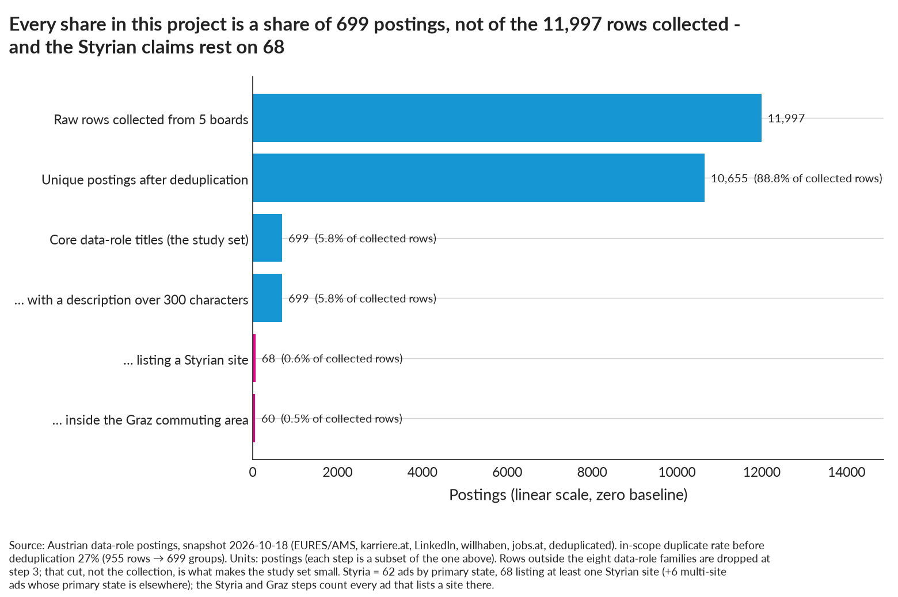
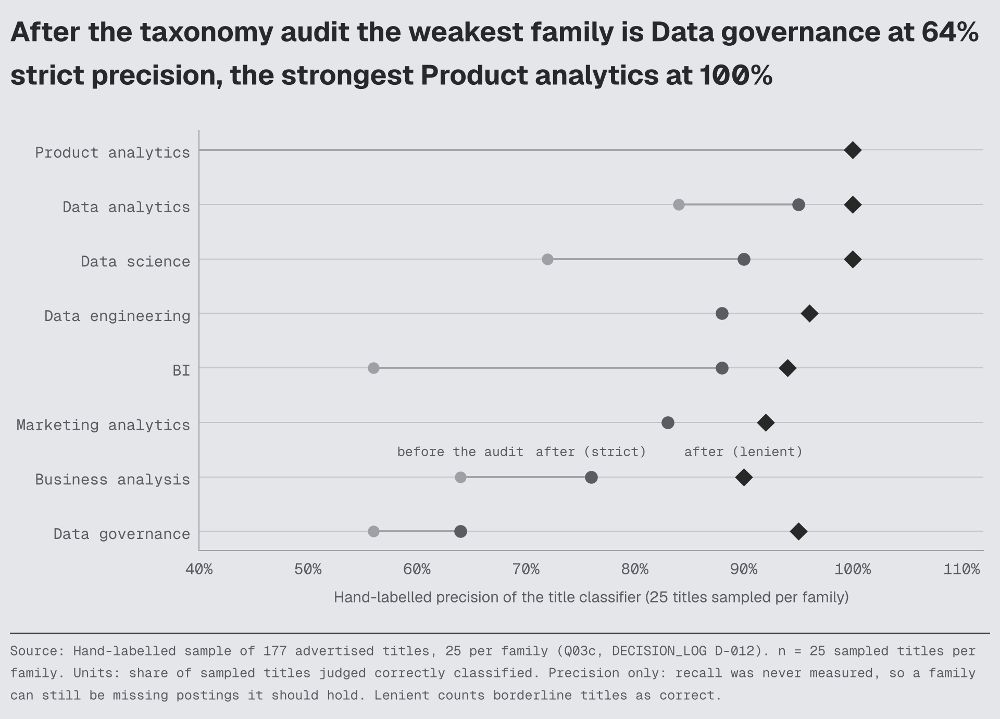
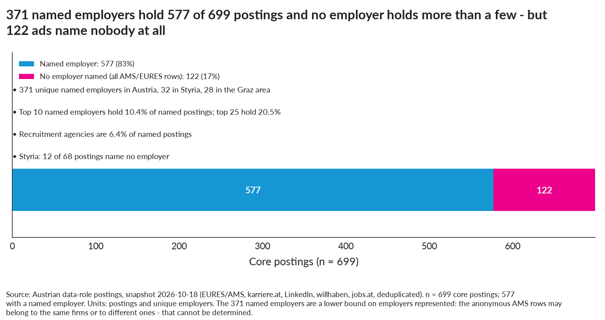
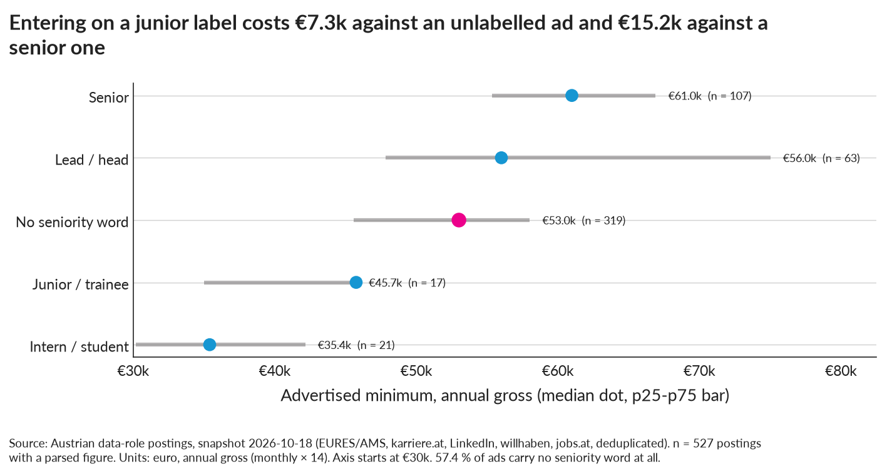
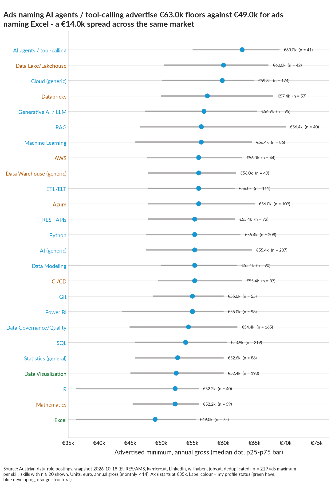
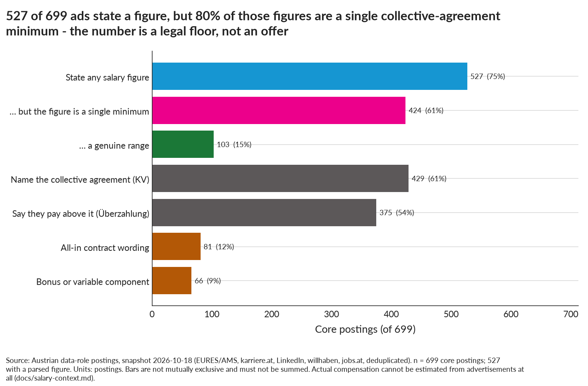
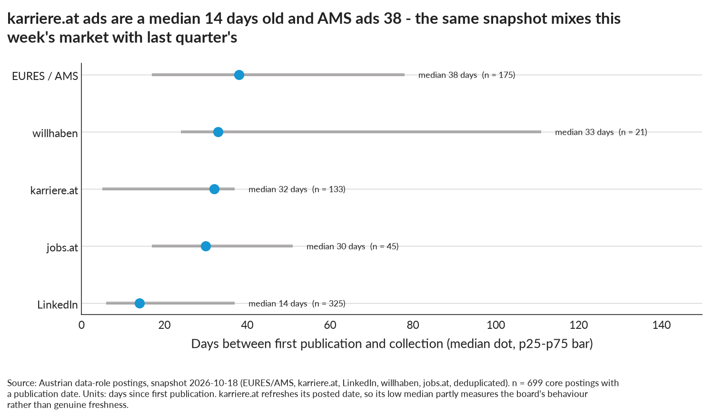

# Market guide: the Austrian data-job market as observed on <!--m:_meta.demand_vintage-->2026-10-18<!--/m-->

Evidence layer for `CAREER_DECISION_MAP.md`. Every number names its table in `outputs/tables/` (T = posting snapshot, JB = AMS JobBarometer, Q = quality, D = decision matrix). Numbers are from the run after the 2026-09-16 audit (DECISION_LOG D-012); the pre-audit run counted 824 core postings and is superseded.

**Denominators used throughout.** "Core postings" = **<!--m:core_n-->699<!--/m-->** deduplicated canonical postings whose *title* falls into one of eight data role families (T02). Text-derived shares (skills, languages, education, remote, experience) use the **<!--m:core_n_text_basis-->699<!--/m-->** core postings with a description > 300 characters (T05 header). Family-level and Styria-level shares carry their own n. A "share" is the share of postings that *mention* an item, never the share that *requires* it. Percentages are rounded; Wilson 95 % intervals are in the tables. Read `docs/limitations.md` before quoting anything as "the market".

**Snapshot, not flow.** Everything in T-tables is the *stock* of advertisements open on one day. It is not a number of jobs per year, not a number of vacancies (one ad may cover several posts, one vacancy may be posted on several boards) and not a number of hires. Yearly *flow* comes only from the AMS JobBarometer (§12).

## 1. Size and sources (T01, T01b, dedupe_summary, market_summary.json)

| Quantity | Value |
|---|---|
| Raw rows collected (5 sources, 45 title keywords, one day) | <!--m:raw_rows_n-->11,997<!--/m--> |
| Unique postings after within- and cross-source dedupe | <!--m:unique_postings_n-->10,655<!--/m--> |
| Core data-role postings (canonical) | **<!--m:core_n-->699<!--/m-->** (<!--m:core_n_text_basis-->699<!--/m--> with description) |
| Adjacent: AI-software-engineering titles / other data-ish titles | <!--m:adjacent_n__ai_software_engineering-->299<!--/m--> / <!--m:adjacent_n__other_data-->234<!--/m--> |
| Core postings located in Styria / Graz commuting area / Graz city | **<!--m:styria_core_flag-->68<!--/m--> / <!--m:graz_area_core_flag-->60<!--/m--> / <!--m:graz_city_n-->50<!--/m-->** (<!--m:styria_core_primary_state-->62<!--/m--> by primary state; <!--m:styria_core_flag-->68<!--/m--> incl. multi-site ads) |
| Core postings in Vienna | <!--m:vienna_core_flag-->321<!--/m--> (<!--m:vienna_core_primary_state-->315<!--/m--> by primary state) |
| Named employers, Austria / Styria / Graz area | <!--m:employers_named_n-->371<!--/m--> / <!--m:employers_styria_n-->32<!--/m--> / <!--m:employer__unique_named_employers_graz_area-->28<!--/m--> |
| Core postings without a named employer (AMS/EURES "siehe Beschreibung") | <!--m:employer__postings_without_named_employer-->122<!--/m--> of <!--m:core_n-->699<!--/m--> (<!--m:employer_unnamed_share_core-->17 %<!--/m-->); Styria <!--m:employer__styria_postings_without_named_employer-->12<!--/m--> of <!--m:styria_core_flag-->68<!--/m--> |
| In-scope duplicate rate before dedupe | <!--m:dedupe_duplicate_rate_in_scope:pct1-->23.7 %<!--/m--> (<!--m:dedupe_rows_in_scope-->1,614<!--/m--> rows → <!--m:dedupe_groups_in_scope-->1,232<!--/m--> groups) |

Per source (core canonical after dedupe): LinkedIn <!--m:source_core_n__linkedin-->325<!--/m-->, EURES/AMS <!--m:source_core_n__eures-->175<!--/m-->, karriere.at <!--m:source_core_n__karriere-->133<!--/m-->, jobs.at <!--m:source_core_n__jobsat-->45<!--/m-->, willhaben <!--m:source_core_n__willhaben-->21<!--/m-->. <!--m:core_multi_source_groups_n-->125<!--/m--> of the <!--m:core_n-->699<!--/m--> core groups (<!--m:core_multi_source_groups_share-->18 %<!--/m-->) were seen on more than one of our sources; the dominant single-source groups are LinkedIn-only (<!--m:source_overlap_groups__linkedin-->312<!--/m-->) and AMS-only (<!--m:source_overlap_groups__eures-->161<!--/m-->), i.e. the professional-network side and the public-employment-service side of the market barely overlap. jobs.at is largely a karriere.at mirror (<!--m:source_overlap_groups__jobsat_karriere-->27<!--/m--> jobs.at+karriere groups). StepStone.at and Indeed.at are absent (blocked), so the corporate white-collar segment is under-covered (docs/limitations.md).

<!-- BQ27_population_funnel:start (figure generated by src/analysis/make_visual_layer.py - do not edit by hand) -->
**Q. When I read '42 % of ads', 42 % of what exactly - and how did 11,997 rows become that denominator?**

11,997 raw rows deduplicate to 10,655 unique postings, of which 699 carry a core data-role title - that is the denominator behind almost every share in the project, and only 68 of them list a Styrian site (60 of those in the Graz commuting area).

**Figure BQ27** · part to whole shown as `horizontal_bar` (bivariate-simple) · built from `outputs/market_summary.json`, `Q04_duplicates.csv`, `T01_source_coverage.csv` · units: postings. **Read with:** Each bar is a subset of the one above it, so the bars must never be summed. Text-derived shares use the 699 postings with a description, not all 699. The Styria steps count every ad that lists a Styrian site; by primary state Styria has 62.
<!-- BQ27_population_funnel:end -->

## 2. Role families and titles (T02, T02b, T02c, Q03c)

| Family | Postings | Share of <!--m:core_n-->699<!--/m--> | Styria | Vienna |
|---|---|---|---|---|
| data_engineering (Data Engineer <!--m:title_n__data_engineer-->101<!--/m-->, Data Architect/Platform <!--m:title_n__data_architect_data_platform-->29<!--/m-->, Analytics Engineer <!--m:title_n__analytics_engineer-->7<!--/m-->) | <!--m:family_n__data_engineering-->137<!--/m--> | <!--m:family_share__data_engineering-->20 %<!--/m--> | <!--m:family_styria_n__data_engineering-->28<!--/m--> | <!--m:family_vienna_n__data_engineering-->59<!--/m--> |
| data_science (Data Scientist <!--m:title_n__data_scientist-->85<!--/m-->, Machine Learning / AI Engineer <!--m:title_n__machine_learning_ai_engineer-->91<!--/m-->, Statistician <!--m:title_n__statistician_biostatistician-->0<!--/m-->) | <!--m:family_n__data_science-->176<!--/m--> | <!--m:family_share__data_science-->25 %<!--/m--> | <!--m:family_styria_n__data_science-->16<!--/m--> | <!--m:family_vienna_n__data_science-->90<!--/m--> |
| business_analysis (Business Analyst / requirements <!--m:title_n__business_analyst-->106<!--/m-->) | <!--m:family_n__business_analysis-->106<!--/m--> | <!--m:family_share__business_analysis-->15 %<!--/m--> | <!--m:family_styria_n__business_analysis-->6<!--/m--> | <!--m:family_vienna_n__business_analysis-->63<!--/m--> |
| data_analytics (Data Analyst <!--m:title_n__data_analyst-->79<!--/m-->, data-heavy Finance/Risk/Ops Analyst <!--m:title_n__financial_risk_controlling_analyst_data_heavy-->28<!--/m-->) | <!--m:family_n__data_analytics-->107<!--/m--> | <!--m:family_share__data_analytics-->15 %<!--/m--> | <!--m:family_styria_n__data_analytics-->9<!--/m--> | <!--m:family_vienna_n__data_analytics-->40<!--/m--> |
| bi (BI Developer <!--m:title_n__bi_developer_bi_engineer-->40<!--/m-->, BI Analyst <!--m:title_n__bi_analyst-->30<!--/m-->, BI Consultant <!--m:title_n__bi_consultant_analytics_consultant-->22<!--/m-->) | <!--m:family_n__bi-->92<!--/m--> | <!--m:family_share__bi-->13 %<!--/m--> | <!--m:family_styria_n__bi-->8<!--/m--> | <!--m:family_vienna_n__bi-->39<!--/m--> |
| data_governance (Governance/Steward/Data Manager <!--m:title_n__data_governance_data_steward_data_manager-->33<!--/m-->, Master/Product Data Management <!--m:title_n__master_product_data_management_operational-->27<!--/m-->) | <!--m:family_n__data_governance-->60<!--/m--> | <!--m:family_share__data_governance-->9 %<!--/m--> | <!--m:family_styria_n__data_governance-->1<!--/m--> | <!--m:family_vienna_n__data_governance-->18<!--/m--> |
| marketing_analytics (Marketing/Growth/CRM Analyst <!--m:title_n__marketing_growth_crm_analyst-->16<!--/m-->, Marketing Data Scientist <!--m:title_n__marketing_data_scientist-->2<!--/m-->) | <!--m:family_n__marketing_analytics-->18<!--/m--> | <!--m:family_share__marketing_analytics-->3 %<!--/m--> | <!--m:family_styria_n__marketing_analytics-->0<!--/m--> | <!--m:family_vienna_n__marketing_analytics-->9<!--/m--> |
| product_analytics (Product Analyst) | <!--m:family_n__product_analytics-->3<!--/m--> | <!--m:family_share__product_analytics:pct1-->0.4 %<!--/m--> | <!--m:family_styria_n__product_analytics-->0<!--/m--> | <!--m:family_vienna_n__product_analytics-->3<!--/m--> |

Findings. (a) Data engineering and data science are the two largest families and "Data Engineer" (<!--m:title_n__data_engineer-->101<!--/m-->) is the largest single title; "Data Scientist" (<!--m:title_n__data_scientist-->85<!--/m-->) and "Machine Learning / AI Engineer" (<!--m:title_n__machine_learning_ai_engineer-->91<!--/m-->) are nearly equal — note that "AI Engineer" titles are counted in the latter. (b) Marketing-analytics and product-analytics *titles* are rare (<!--m:marketing_and_product_analytics_n-->21<!--/m--> of <!--m:core_n-->699<!--/m-->, none in Styria); marketing-analytical work is advertised inside marketing or CRM titles (T16). (c) Half of the governance family is operational master/product-data management (<!--m:title_n__master_product_data_management_operational-->27<!--/m-->), not governance proper (<!--m:title_n__data_governance_data_steward_data_manager-->33<!--/m-->); the split is visible in T02b. (d) <!--m:adjacent_n__ai_software_engineering-->299<!--/m--> AI-flavoured *software* titles ("AI Engineer / Softwareentwickler", "AI Consultant") are reported as an adjacent family, not as data science.

**Measured precision.** A hand-labelled sample of <!--m:title_audit_sample_n-->177<!--/m--> titles (25 per family, Q03c) gave a strict precision of <!--m:title_precision_strict_before-->71 %<!--/m--> before and <!--m:title_precision_strict_after-->83 %<!--/m--> after the D-012 rule revision (lenient, counting borderline titles as correct: <!--m:title_precision_lenient_before-->84 %<!--/m--> → <!--m:title_precision_lenient_after-->95 %<!--/m-->). Remaining weak spots: business_analysis (<!--m:title_precision_strict__business_analysis-->76 %<!--/m--> strict; IT-analyst and process-owner titles) and data_governance (<!--m:title_precision_strict__data_governance-->64 %<!--/m--> strict; master-data maintenance titles are kept but labelled). Recall is not measured (docs/limitations.md).

<!-- BQ28_classification_precision:start (figure generated by src/analysis/make_visual_layer.py - do not edit by hand) -->
**Q. How much of what I am reading is in the wrong family - can I trust the role labels at all?**

After the D-012 audit, strict precision runs from 64% (Data governance, where IT-analyst and process-owner titles leak in) to 100%, lenient from 90% to 100% - good enough for ranking families, not for quoting a single family's count to the posting.

**Figure BQ28** · deviation from target shown as `dumbbell` (categorical-multi) · built from `Q03c_precision_summary.csv` · units: share of sampled titles. **Read with:** 25 titles per family is a small audit sample, and recall is unmeasured: this bounds false positives only, never false negatives.
<!-- BQ28_classification_precision:end -->

## 3. Geography (T03a–T03e, JB05)

* Vienna holds **<!--m:vienna_share_core-->45 %<!--/m-->** of core postings (<!--m:vienna_core_primary_state-->315<!--/m--> by primary state; <!--m:vienna_core_flag-->321<!--/m--> incl. multi-site), Upper Austria <!--m:upper_austria_share_core-->17 %<!--/m--> (<!--m:upper_austria_n-->119<!--/m-->), **Styria <!--m:styria_share_primary_state:pct1-->8.9 %<!--/m--> (<!--m:styria_core_primary_state-->62<!--/m-->; <!--m:styria_core_flag-->68<!--/m--> incl. multi-site)**, Vorarlberg <!--m:vorarlberg_share_core-->6 %<!--/m-->, Lower Austria <!--m:lower_austria_share_core-->6 %<!--/m-->, Salzburg <!--m:salzburg_share_core-->5 %<!--/m-->, Tyrol <!--m:tyrol_share_core-->5 %<!--/m-->, Carinthia <!--m:carinthia_share_core-->3 %<!--/m-->; <!--m:unspecified_state_share_core-->3 %<!--/m--> (<!--m:unspecified_state_n-->24<!--/m-->) are Austria-wide/unspecified.

<!-- BQ01_reachable_market:start (figure generated by src/analysis/make_visual_layer.py - do not edit by hand) -->
**Q. If I do not move from Graz, how much of the Austrian data market am I actually applying to?**

By primary state, Styria holds 62 of 699 open core postings (8.9%); 54 of them are inside the Graz commuting area, against 315 in Vienna (45%).

**Figure BQ01** · comparison across categories shown as `horizontal_bar` (bivariate-simple) · built from `T03a_state_counts.csv`, `T03c_styria_cities.csv` · units: unique postings. **Read with:** One-day stock of open advertisements, not yearly demand. The official yearly series (JB05) puts Styria higher, at 13.6 % of the national flow. Counting every ad that lists a Styrian site (the location-flag basis of T02/T04a/T07e) Styria has 68 postings, 60 of them in the Graz commuting area, and Vienna 321.
<!-- BQ01_reachable_market:end -->

* Inside Styria: Graz city <!--m:graz_city_n-->50<!--/m-->, Hart bei Graz <!--m:styria_city_n__hart_bei_graz-->4<!--/m-->, Lieboch/Raaba-Grambach <!--m:styria_city_n__lieboch-->0<!--/m--> each (Graz commuting area <!--m:graz_area_core_flag-->60<!--/m--> of <!--m:styria_core_flag-->68<!--/m-->), Weiz <!--m:styria_city_n__weiz-->3<!--/m-->, Liezen <!--m:styria_city_n__liezen-->0<!--/m-->. Styria's data market is Graz.
* The official yearly series gives Styria a larger share: <!--m:jb_data_scientist_ads_latest__styria-->300<!--/m--> of <!--m:jb_data_scientist_ads_latest__austria-->2,207<!--/m--> "Data Scientist"-class ads in <!--m:jobbarometer_year_last-->2025<!--/m--> = **<!--m:jb_data_scientist_styria_share_of_austria:pct1-->13.6 %<!--/m-->** (JB05), against 7–8 % in our snapshot. Both are plausible: AMS counts more SME/industrial ads than LinkedIn and our Styrian sample is small. Treat Styria's true share as roughly 8–14 % of the national data market.
* Family mix in Styria (n = <!--m:styria_core_flag-->68<!--/m-->, indicative): data engineering <!--m:family_styria_n__data_engineering-->28<!--/m--> (<!--m:family_styria_share__data_engineering-->41 %<!--/m-->), data science <!--m:family_styria_n__data_science-->16<!--/m--> (<!--m:family_styria_share__data_science-->24 %<!--/m-->), data analytics <!--m:family_styria_n__data_analytics-->9<!--/m--> (<!--m:family_styria_share__data_analytics-->13 %<!--/m-->), BI <!--m:family_styria_n__bi-->8<!--/m-->, governance <!--m:family_styria_n__data_governance-->1<!--/m-->, business analysis <!--m:family_styria_n__business_analysis-->6<!--/m-->, marketing/product <!--m:family_styria_n__marketing_analytics-->0<!--/m-->. Compared with Austria: engineering over-represented (<!--m:family_styria_share__data_engineering-->41 %<!--/m--> vs <!--m:family_share__data_engineering-->20 %<!--/m-->), business analysis under-represented (<!--m:family_styria_share__business_analysis-->9 %<!--/m--> vs <!--m:family_share__business_analysis-->15 %<!--/m-->).

<!-- BQ06_styria_vs_austria_mix:start (figure generated by src/analysis/make_visual_layer.py - do not edit by hand) -->
**Q. Does Graz want a different kind of data person than Austria as a whole?**

Yes: data engineering is 41% of the 68 postings that list a Styrian site against 20% nationally, business analysis falls from 15% to 9%, and marketing and product analytics are absent from Styria entirely.

**Figure BQ06** · ranking shown as `dumbbell` (categorical-multi) · built from `T02_role_family_counts.csv` · units: share of postings. **Read with:** n = 68 for Styria (ads listing a Styrian site; 62 by primary state); every family cell is below 30, so differences are directional.
<!-- BQ06_styria_vs_austria_mix:end -->

* Platform geography (T03e): LinkedIn and karriere.at are Vienna-heavy; AMS/EURES contributes most Upper-Austrian and Styrian industrial postings.

## 4. Employers (T04, T04a, T04b)

* **Named vs represented.** <!--m:employer__postings_with_named_employer-->577<!--/m--> of <!--m:core_n-->699<!--/m--> core postings name an employer; <!--m:employer__postings_without_named_employer-->122<!--/m--> (all AMS/EURES rows) do not. The <!--m:employers_named_n-->371<!--/m--> unique named employers are therefore a lower bound on employers represented; Styria: <!--m:employers_styria_n-->32<!--/m--> named, <!--m:employer__styria_postings_without_named_employer-->12<!--/m--> postings unnamed.

<!-- BQ33_employer_structure:start (figure generated by src/analysis/make_visual_layer.py - do not edit by hand) -->
**Q. Who is actually behind these postings - is demand concentrated in a few employers I could target?**

No: 371 named employers share 577 postings, the top ten hold only 10.4% of them and agencies 6.4% - the market is fragmented, so a target list is long rather than short; 122 postings (17%) name no employer at all and are invisible to any target list.

**Figure BQ33** · part to whole shown as `stacked_bar` (categorical-multi) · built from `T04b_employer_concentration.csv`, `T04_employers.csv`, `T04a_employers_styria.csv` · units: postings. **Read with:** Employer identity is taken from the advertisement; the same firm advertising under a group name and an agency is counted twice, and the anonymous AMS rows cannot be attributed at all.
<!-- BQ33_employer_structure:end -->

* Concentration is low: the top 10 named employers hold <!--m:employer__top10_share_of_named-->10 %<!--/m--> of named postings, the top 25 hold <!--m:employer__top25_share_of_named-->21 %<!--/m-->. Recruitment agencies account for <!--m:employer__agency_share_of_named_postings:pct1-->6.4 %<!--/m--> of named postings.
* Most frequent nationally: Red Bull <!--m:employer_postings__red_bull-->10<!--/m--> (Salzburg), Qualysoft <!--m:employer_postings__qualysoft-->8<!--/m-->, Liebherr <!--m:employer_postings__liebherr-->4<!--/m-->, KNAPP <!--m:employer_postings__knapp-->5<!--/m--> (Styria), Hirebuddy <!--m:employer_postings__hirebuddy_flexco-->3<!--/m--> (agency-like platform), KERN engineering careers <!--m:employer_postings__kern_engineering_careers-->7<!--/m-->, PwC <!--m:employer_postings__pwc-->4<!--/m-->, ÖBB <!--m:employer_postings__oebb-->2<!--/m--> (+<!--m:employer_postings__oebb_konzern-->2<!--/m--> as ÖBB-Konzern), Accenture <!--m:employer_postings__accenture_dach-->5<!--/m-->, then msg, Tieto, smart Energy Services, TOWA, RHI Magnesita with <!--m:employer_postings__msg-->5<!--/m-->.
* Styria (<!--m:employers_styria_n-->32<!--/m--> named employers, <!--m:styria_core_flag-->68<!--/m--> postings): KNAPP <!--m:employer_styria_postings__knapp-->5<!--/m--> (business analysis, data analytics, engineering, science), adesso Austria <!--m:employer_styria_postings__adesso-->4<!--/m-->, Tieto <!--m:employer_styria_postings__tieto-->3<!--/m-->, CANCOM, niceshops, Anton Paar, Mercedes-Benz G, Magna <!--m:employer_styria_postings__cancom-->2<!--/m--> each, and single postings from Netconomy, KERN, ÖGK, ASE, ams OSRAM, All for One, EPIG, Easelink, Kapsch, Maco, OMNINET, Merkur Versicherung and others. Archetypes: intralogistics/automotive/semiconductor industry, IT consultancies, e-commerce, insurance/health.

<!-- BQ04_styria_employers:start (figure generated by src/analysis/make_visual_layer.py - do not edit by hand) -->
**Q. Which Styrian employers actually advertise data roles - who is on my realistic target list?**

32 named employers carry 56 of the 68 ads that list a Styrian site; Magna International leads with 5, and 11 of the largest 14 advertise analytics, BI or business-analysis roles rather than only engineering.

**Figure BQ04** · ranking shown as `horizontal_bar` (bivariate-simple) · built from `T04a_employers_styria.csv` · units: open postings. **Read with:** A one-day stock: an employer absent here is not an employer that does not hire. 12 Styrian ads (AMS/EURES) name no employer at all. Counts are on the any-listed-site basis (68), not the primary-state count (62).
<!-- BQ04_styria_employers:end -->

## 5. Skills and technologies (T05, T06, T14)

Share of the <!--m:core_n_text_basis-->699<!--/m--> core postings with description that *mention* the item:

| Tier | Item (share) |
|---|---|
| Core skills | **SQL <!--m:sql_share-->40 %<!--/m-->** (<!--m:tech_skill_rank__sql-->2nd<!--/m--> of <!--m:tech_skill_rank_set_n-->14<!--/m--> headline skills by share; incl. SQL Server mentions; 37 % without) · **Python <!--m:python_share-->39 %<!--/m-->** (<!--m:tech_skill_rank__python-->3rd<!--/m-->) · data visualisation/dashboards/reporting <!--m:visualisation_share-->36 %<!--/m--> (<!--m:tech_skill_rank__visualisation-->4th<!--/m-->); highest three by share: <!--m:tech_skills_top3_text-->generic AI 43 %, SQL 40 % and Python 39 %<!--/m--> |
| Common | generic "AI/KI" wording <!--m:generic_ai_share-->43 %<!--/m--> · data governance/quality wording <!--m:data_quality_share-->31 %<!--/m--> · "cloud" <!--m:cloud_share-->32 %<!--/m--> · ETL/ELT/pipelines <!--m:etl_share-->20 %<!--/m--> · **Azure <!--m:azure_share-->19 %<!--/m-->** · **Power BI <!--m:power_bi_share-->17 %<!--/m-->** · Excel <!--m:excel_share-->14 %<!--/m--> · data modelling <!--m:data_modelling_share-->17 %<!--/m--> · machine learning <!--m:ml_share-->18 %<!--/m--> · generative AI/LLM <!--m:genai_share-->18 %<!--/m--> · CI/CD <!--m:ci_cd_share-->15 %<!--/m--> · statistics <!--m:statistics_share-->16 %<!--/m--> |
| Occasional | Databricks <!--m:databricks_share-->10 %<!--/m--> · REST/APIs <!--m:rest_share-->15 %<!--/m--> · mathematics <!--m:mathematics_share-->12 %<!--/m--> · data warehouse <!--m:data_warehouse_share-->9 %<!--/m--> · Git <!--m:git_share-->10 %<!--/m--> · AWS <!--m:aws_share-->9 %<!--/m--> · **R <!--m:r_share-->7 %<!--/m-->** · Java <!--m:java_share-->5 %<!--/m--> · streaming <!--m:streaming_share-->6 %<!--/m--> · Spark <!--m:spark_share:pct1-->6.3 %<!--/m--> · MLOps <!--m:mlops_share-->6 %<!--/m--> · Docker <!--m:docker_share-->6 %<!--/m--> · GCP <!--m:gcp_share-->5 %<!--/m--> · Snowflake <!--m:snowflake_share-->6 %<!--/m--> · Microsoft Fabric <!--m:fabric_share-->5 %<!--/m--> · Oracle <!--m:oracle_share-->4 %<!--/m--> · Kubernetes <!--m:kubernetes_share-->6 %<!--/m--> · SAP BW/BO <!--m:sap_bw_bo_share-->7 %<!--/m--> · SQL Server <!--m:sql_server_share-->4 %<!--/m--> |
| Rare | scikit-learn <!--m:scikit_learn_share:tpct0-->3 %<!--/m--> · PyTorch <!--m:pytorch_share-->3 %<!--/m--> · **Tableau <!--m:tableau_share-->3 %<!--/m-->** · Qlik <!--m:qlik_share-->3 %<!--/m--> · pandas <!--m:pandas_share-->3 %<!--/m--> · dbt <!--m:dbt_share-->3 %<!--/m--> · A/B testing <!--m:ab_testing_share-->4 %<!--/m--> · Looker <!--m:looker_share-->1 %<!--/m--> · regression <!--m:regression_share-->1 %<!--/m--> · causal inference <!--m:causal_inference_share-->1 %<!--/m--> |

Interpretation. The Austrian data stack is **Microsoft-centred** (Azure <!--m:azure_share-->19 %<!--/m--> vs AWS <!--m:aws_share-->9 %<!--/m--> vs GCP <!--m:gcp_share-->5 %<!--/m-->; Power BI <!--m:power_bi_share-->17 %<!--/m--> vs Tableau <!--m:tableau_share-->3 %<!--/m-->; Databricks <!--m:databricks_share-->10 %<!--/m-->, Fabric <!--m:fabric_share-->5 %<!--/m-->). Python libraries are almost never named; ads name "Python" and "SQL". Statistical methods are rarely spelled out ("Statistik" <!--m:statistics_share-->16 %<!--/m-->, A/B testing <!--m:ab_testing_share-->4 %<!--/m-->).

<!-- BQ35_tools_vs_libraries:start (figure generated by src/analysis/make_visual_layer.py - do not edit by hand) -->
**Q. Do employers ask for frameworks and libraries, or only for languages and tools?**

Only for languages and tools: Python is named in 39% of ads while the most-mentioned Python library (PyTorch) reaches 3.4% and pandas 3.1% - a CV built on library lists speaks a vocabulary employers do not use, while the language, the BI tool and the cloud platform are the words they do use.

**Figure BQ35** · ranking shown as `horizontal_bar` (bivariate-simple) · built from `T05_skills_programming_languages.csv`, `T05_skills_python_ecosystem.csv`, `T05_skills_bi_tools.csv`, `T05_skills_cloud_platforms.csv` · units: share of postings. **Read with:** Absence of a library in an advertisement is not absence in the job: ads compress a stack to its headline names. This measures advertising vocabulary, not the work.
<!-- BQ35_tools_vs_libraries:end -->

<!-- BQ08_demanded_skills:start (figure generated by src/analysis/make_visual_layer.py - do not edit by hand) -->
**Q. Which tools do Austrian employers actually name - and how much of that list do I already hold?**

AI (generic) (43%) and Python lead the list, and 9 of the 10 most-mentioned items are already in my have-or-developing profile; the intervals separate the top tier cleanly from everything under 10 %.

**Figure BQ08** · ranking shown as `error_bars` (interval-range) · built from `T05_skills_all_tech.csv`, `config/profile.json` · units: share of postings. **Read with:** Shares count ads that *mention* an item, never ads that require it; the profile status is self-declared, not demonstrated.
<!-- BQ08_demanded_skills:end -->

**Co-occurrence (T06, T06b).** SQL and Python appear together in <!--m:cooc_share__sql__python-->25 %<!--/m--> of postings (<!--m:cooc_b_given_a__sql__python-->63 %<!--/m--> of SQL ads also mention Python; <!--m:cooc_a_given_b__sql__python-->64 %<!--/m--> of Python ads mention SQL). SQL + Power BI <!--m:cooc_share__sql__power_bi-->12 %<!--/m--> (<!--m:cooc_a_given_b__sql__power_bi-->70 %<!--/m--> of Power BI ads mention SQL); Python + Azure <!--m:cooc_share__python__azure-->14 %<!--/m-->; SQL + data modelling <!--m:cooc_share__sql__data_modeling-->11 %<!--/m-->; Python + machine learning <!--m:cooc_share__python__machine_learning-->15 %<!--/m--> (<!--m:cooc_a_given_b__python__machine_learning-->81 %<!--/m--> of ML ads name Python); Python + GenAI <!--m:cooc_share__python__generative_ai_llm-->14 %<!--/m-->; Azure + Databricks <!--m:cooc_share__azure__databricks-->8 %<!--/m--> (<!--m:cooc_a_given_b__azure__databricks-->79 %<!--/m--> of Databricks ads sit in an Azure context); Power BI + DAX only 3 % (15 % of Power BI ads name DAX); dbt + SQL 3 % (dbt is <!--m:dbt_n-->23<!--/m--> ads). Most frequent three-item stacks: ETL + Python + SQL <!--m:stack_share__etl_elt_plus_python_plus_sql-->10 %<!--/m-->, Cloud + Python + SQL <!--m:stack_share__cloud_generic_plus_python_plus_sql-->12 %<!--/m-->, AI + GenAI + Python <!--m:stack_share__ai_generic_plus_generative_ai_llm_plus_python-->14 %<!--/m-->, AI + ML + Python <!--m:stack_share__ai_generic_plus_machine_learning_plus_python-->13 %<!--/m-->, Visualisation + Power BI + SQL <!--m:stack_share__data_visualization_plus_power_bi_plus_sql-->10 %<!--/m-->, Azure + Python + SQL <!--m:stack_share__azure_plus_python_plus_sql-->9 %<!--/m-->. Power BI's strongest partner is reporting/visualisation wording (lift <!--m:cooc_lift__data_visualization__power_bi-->2.4<!--/m-->), not Python.

<!-- BQ10_skill_cooccurrence:start (figure generated by src/analysis/make_visual_layer.py - do not edit by hand) -->
**Q. What is the minimum credible stack - which skills do employers ask for together?**

SQL is the hub: 62% of SQL ads also name Python and 64% of Python ads name SQL, while Power BI's strongest partner is reporting wording rather than Python - a SQL + Python + dashboard combination covers the densest part of the matrix.

**Figure BQ10** · correlation shown as `heatmap` (trivariate) · built from `T06_cooccurrence_pairs.csv`, `T05_skills_all_tech.csv` · units: conditional probability. **Read with:** Co-mention in an advertisement, not a statement about how the tools are used together in the job.
<!-- BQ10_skill_cooccurrence:end -->

**Per family (T14).** data_analytics (n <!--m:family_desc_n__data_analytics-->107<!--/m-->) = visualisation <!--m:skill_family_share__data_analytics__data_visualization-->55 %<!--/m-->, Excel <!--m:skill_family_share__data_analytics__excel-->39 %<!--/m-->, SQL <!--m:skill_family_share__data_analytics__sql-->36 %<!--/m-->, Power BI <!--m:skill_family_share__data_analytics__power_bi-->30 %<!--/m-->, data quality <!--m:skill_family_share__data_analytics__data_governance_quality-->33 %<!--/m-->, Python <!--m:skill_family_share__data_analytics__python-->33 %<!--/m-->, statistics <!--m:skill_family_share__data_analytics__statistics_general-->17 %<!--/m-->, forecasting <!--m:skill_family_share__data_analytics__forecasting-->19 %<!--/m-->, R <!--m:skill_family_share__data_analytics__r-->11 %<!--/m-->. bi (<!--m:family_desc_n__bi-->92<!--/m-->) = visualisation <!--m:skill_family_share__bi__data_visualization-->87 %<!--/m-->, SQL <!--m:skill_family_share__bi__sql-->49 %<!--/m-->, Power BI <!--m:skill_family_share__bi__power_bi-->43 %<!--/m-->, data modelling <!--m:skill_family_share__bi__data_modeling-->34 %<!--/m-->, SAP BW/BO <!--m:skill_family_share__bi__sap_bw_bo-->37 %<!--/m-->. data_science (<!--m:family_desc_n__data_science-->176<!--/m-->) = Python <!--m:skill_family_share__data_science__python-->76 %<!--/m-->, ML <!--m:skill_family_share__data_science__machine_learning-->60 %<!--/m-->, GenAI/LLM <!--m:skill_family_share__data_science__generative_ai_llm-->60 %<!--/m-->, cloud <!--m:skill_family_share__data_science__cloud_generic-->49 %<!--/m-->, SQL <!--m:skill_family_share__data_science__sql-->34 %<!--/m-->, Azure <!--m:skill_family_share__data_science__azure-->27 %<!--/m-->, CI/CD <!--m:skill_family_share__data_science__ci_cd-->29 %<!--/m-->, statistics <!--m:skill_family_share__data_science__statistics_general-->31 %<!--/m-->, REST <!--m:skill_family_share__data_science__rest_apis-->34 %<!--/m-->, AWS <!--m:skill_family_share__data_science__aws-->23 %<!--/m-->. data_engineering (<!--m:family_desc_n__data_engineering-->137<!--/m-->) = SQL <!--m:skill_family_share__data_engineering__sql-->72 %<!--/m-->, ETL <!--m:skill_family_share__data_engineering__etl_elt-->53 %<!--/m-->, Python <!--m:skill_family_share__data_engineering__python-->61 %<!--/m-->, cloud <!--m:skill_family_share__data_engineering__cloud_generic-->52 %<!--/m-->, data quality <!--m:skill_family_share__data_engineering__data_governance_quality-->50 %<!--/m-->, Azure <!--m:skill_family_share__data_engineering__azure-->46 %<!--/m-->, data modelling <!--m:skill_family_share__data_engineering__data_modeling-->36 %<!--/m-->, CI/CD <!--m:skill_family_share__data_engineering__ci_cd-->37 %<!--/m-->, Databricks <!--m:skill_family_share__data_engineering__databricks-->31 %<!--/m-->. marketing_analytics (n = <!--m:family_desc_n__marketing_analytics-->18<!--/m-->) = SQL <!--m:skill_family_share__marketing_analytics__sql-->56 %<!--/m-->, visualisation <!--m:skill_family_share__marketing_analytics__data_visualization-->67 %<!--/m-->, Google Analytics <!--m:skill_family_share__marketing_analytics__google_analytics-->39 %<!--/m-->, Excel <!--m:skill_family_share__marketing_analytics__excel-->28 %<!--/m-->, Power BI <!--m:skill_family_share__marketing_analytics__power_bi-->28 %<!--/m-->, BigQuery <!--m:skill_family_share__marketing_analytics__bigquery-->28 %<!--/m-->, Matomo <!--m:skill_family_share__marketing_analytics__matomo-->22 %<!--/m-->, A/B testing <!--m:skill_family_n__marketing_analytics__a_b_testing_experimentation-->2<!--/m--> of <!--m:family_desc_n__marketing_analytics-->18<!--/m-->. business_analysis (<!--m:family_desc_n__business_analysis-->106<!--/m-->) = generic AI <!--m:skill_family_share__business_analysis__ai_generic-->32 %<!--/m-->, visualisation <!--m:skill_family_share__business_analysis__data_visualization-->16 %<!--/m-->, Excel <!--m:skill_family_share__business_analysis__excel-->10 %<!--/m-->, SQL <!--m:skill_family_share__business_analysis__sql-->15 %<!--/m--> — a requirements profile, not a tool profile.

**Styria vs rest of Austria (T05_by_styria, n = <!--m:styria_n_text_basis-->68<!--/m--> vs <!--m:rest_n_text_basis-->631<!--/m-->; indicative, intervals overlap).** Styrian ads mention Python (<!--m:python_share_styria-->44 %<!--/m--> vs <!--m:python_share_rest-->39 %<!--/m-->), SQL (<!--m:sql_share_styria-->41 %<!--/m--> vs <!--m:sql_share_rest-->40 %<!--/m-->), cloud (<!--m:cloud_share_styria-->65 %<!--/m--> vs <!--m:cloud_share_rest-->29 %<!--/m-->), Azure (<!--m:azure_share_styria-->40 %<!--/m--> vs <!--m:azure_share_rest-->17 %<!--/m-->), ETL (<!--m:etl_share_styria-->41 %<!--/m--> vs <!--m:etl_share_rest-->18 %<!--/m-->), Databricks (<!--m:databricks_share_styria-->29 %<!--/m--> vs <!--m:databricks_share_rest-->8 %<!--/m-->), Git (<!--m:git_share_styria-->15 %<!--/m--> vs <!--m:git_share_rest-->9 %<!--/m-->), CI/CD (<!--m:ci_cd_share_styria-->31 %<!--/m--> vs <!--m:ci_cd_share_rest:tpct0-->14 %<!--/m-->) and GCP (<!--m:gcp_share_styria-->16 %<!--/m--> vs 6 %) *more* often, and Excel (<!--m:excel_share_styria-->3 %<!--/m--> vs <!--m:excel_share_rest-->15 %<!--/m-->), Power BI (<!--m:power_bi_share_styria-->6 %<!--/m--> vs <!--m:power_bi_share_rest-->18 %<!--/m-->), GenAI (<!--m:genai_share_styria-->19 %<!--/m--> vs <!--m:genai_share_rest-->18 %<!--/m-->) and statistics (<!--m:statistics_share_styria-->9 %<!--/m--> vs <!--m:statistics_share_rest-->17 %<!--/m-->) *less* often. Consistent with the family mix: Styria's visible demand is engineering-flavoured.

**Business context (T05_business_domain).** consulting wording <!--m:skill_share__consulting-->32 %<!--/m-->, requirements/business analysis <!--m:skill_share__requirements_business_analysis-->26 %<!--/m-->, finance/controlling <!--m:skill_share__finance_controlling-->24 %<!--/m-->, project management <!--m:skill_share__project_management-->18 %<!--/m-->, manufacturing/operations <!--m:skill_share__operations_manufacturing:tpct0-->20 %<!--/m-->, public sector/research <!--m:skill_share__public_sector_research-->19 %<!--/m-->, SAP <!--m:skill_share__sap_erp-->19 %<!--/m-->, banking/insurance <!--m:skill_share__banking_insurance-->16 %<!--/m-->, sales <!--m:skill_share__sales_commercial-->18 %<!--/m-->, risk <!--m:skill_share__risk_actuarial-->11 %<!--/m-->, supply chain <!--m:skill_share__supply_chain_logistics-->10 %<!--/m-->, **marketing <!--m:skill_share__marketing-->9 %<!--/m--> (<!--m:skill_n__marketing-->60<!--/m--> postings)**, CRM/customer/web analytics each ≤ 7 %.

**Soft skills (indicative wording counts).** teamwork <!--m:skill_share__teamwork-->68 %<!--/m-->, self-organisation <!--m:skill_share__self_organisation-->57 %<!--/m-->, communication <!--m:skill_share__communication-->60 %<!--/m-->, analytical thinking <!--m:skill_share__analytical_thinking-->52 %<!--/m-->, stakeholder/business-partner wording <!--m:skill_share__stakeholder_management-->54 %<!--/m-->, curiosity/learning <!--m:skill_share__curiosity_learning-->45 %<!--/m-->, leadership <!--m:skill_share__leadership-->17 %<!--/m-->.

## 6. Requirement archetypes (T15, clusters.json)

k-means on the binary skill matrix (k = 7 by silhouette; silhouette 0.075 = weak structure) yields readable but overlapping archetypes: (1) data platform and pipelines — ETL, data modelling, Databricks/lakehouse, Azure, warehouse 23 % (12 % of it in Styria); (5) GenAI/ML engineering — RAG, agents, LLM, Docker, MLOps 17 %; (2) Excel/finance/controlling analytics 15.6 %; (3) requirements/business analysis 14.6 %; (4) Oracle/SQL, public sector 12 % (16 % in Styria); (6) marketing/CRM/customer and web analytics 9.6 %; (0) manufacturing/operations data 8 %. NMF topics agree. These are descriptive groupings, not professions.

## 7. Languages (T07 family, T07e)

* **German requirement (n = <!--m:core_n_text_basis-->699<!--/m-->):** explicit "required" <!--m:german_required_explicit_share:pct1-->10.2 %<!--/m--> + level stated <!--m:german_level_stated_share-->32 %<!--/m--> = **<!--m:german_stated_share-->42 %<!--/m--> state a German requirement**; <!--m:german_preferred_share-->16 %<!--/m--> call it an advantage; <!--m:german_mentioned_share-->5 %<!--/m--> mention it without level; **<!--m:german_not_mentioned_share-->37 %<!--/m--> do not mention German at all**; <!--m:german_not_needed_share:pct1-->0.0 %<!--/m--> say it is not needed.
* **Levels.** <!--m:german_c1_bucket_share-->41 %<!--/m--> of all ads carry wording we bucket as "C1-equivalent": explicit C1 (30 ads), "verhandlungssicher/fließend/fluent" (56), and "sehr gut/very good/excellent" (172). Mapping "sehr gut" to C1 follows common Austrian HR usage but is an assumption; read the bucket as "high level demanded", not as a certified C1. B2/"gut" <!--m:german_b2_share-->13 %<!--/m-->, native <!--m:german_c2_native_share-->1 %<!--/m-->; B1 or below is essentially never accepted explicitly.

<!-- BQ34_german_level_demanded:start (figure generated by src/analysis/make_visual_layer.py - do not edit by hand) -->
**Q. When an advertisement names a German level, which level is it - and is my A2-B1 ever stated as enough?**

Essentially never: C1-equivalent wording appears in 41% of core ads (285 postings) and B2/good in 13%, while B1 or below is named as sufficient in 6 advertisements in the whole corpus - so the realistic route is the 37% of ads that state no level at all, not the ones that state a low one.

**Figure BQ34** · ranking shown as `horizontal_bar` (bivariate-simple) · built from `T07a_german_level_overall.csv`, `T07_german_requirement_by_overall.csv` · units: share of postings. **Read with:** Wording-derived buckets: mapping 'sehr gut' to C1 is an assumption, and silence in a German-written ad usually still implies German (T07d). Whether a stated level is negotiable is not measured.
<!-- BQ34_german_level_demanded:end -->

* **Posting language:** <!--m:german_posting_share-->73 %<!--/m--> German, **<!--m:english_posting_share-->26 %<!--/m--> English** (<!--m:english_posting_n-->184<!--/m--> ads). Data science <!--m:posting_language_family_share__data_science__en-->41 %<!--/m--> English, data analytics <!--m:posting_language_family_share__data_analytics__en-->29 %<!--/m-->, data engineering <!--m:posting_language_family_share__data_engineering__en-->22 %<!--/m-->, governance <!--m:posting_language_family_share__data_governance__en-->17 %<!--/m-->, business analysis <!--m:posting_language_family_share__business_analysis__en-->23 %<!--/m-->, marketing analytics <!--m:posting_language_family_share__marketing_analytics__en-->17 %<!--/m-->, BI <!--m:posting_language_family_share__bi__en-->13 %<!--/m-->.

<!-- BQ13_language_by_family:start (figure generated by src/analysis/make_visual_layer.py - do not edit by hand) -->
**Q. Which role family gives my English the most room and my German the least resistance?**

Data science: 41% of its ads are written in English and 36% state a German requirement, against BI at 13% English and 52% German - the language dimension moves more between families than the skill lists do.

**Figure BQ13** · correlation shown as `bubble` (trivariate) · built from `T07c_posting_language_by_family.csv`, `T07_german_requirement_by_role_family.csv` · units: share of postings. **Read with:** Marketing analytics (n = 18) and product analytics (n = 3) carry cells too small to separate.
<!-- BQ13_language_by_family:end -->

* **English-written ads are not German-free.** Of the <!--m:english_posting_n-->184<!--/m--> English ads, <!--m:english_ads_german_stated_share-->20 %<!--/m--> still require/state a German level, <!--m:english_ads_german_preferred_share-->19 %<!--/m--> call German an advantage and <!--m:english_ads_german_silent_share-->57 %<!--/m--> are silent. Of the <!--m:german_posting_n-->508<!--/m--> German-written ads, <!--m:german_ads_german_stated_share-->50 %<!--/m--> require/state a level; silence in a German-written ad usually implies German (T07d).
* By family, required-or-level-stated German: BI <!--m:german_stated_share__bi-->52 %<!--/m-->, business analysis <!--m:german_stated_share__business_analysis-->43 %<!--/m-->, data analytics <!--m:german_stated_share__data_analytics-->40 %<!--/m-->, governance <!--m:german_stated_share__data_governance-->47 %<!--/m-->, data engineering <!--m:german_stated_share__data_engineering-->42 %<!--/m-->, data science <!--m:german_stated_share__data_science-->36 %<!--/m-->, marketing analytics <!--m:german_stated_share__marketing_analytics-->50 %<!--/m--> (n <!--m:family_desc_n__marketing_analytics-->18<!--/m-->).
* **Styria (n = <!--m:styria_n_text_basis-->68<!--/m-->):** <!--m:german_stated_n_styria-->33<!--/m--> (<!--m:german_stated_share_styria-->49 %<!--/m-->) require/state a level vs <!--m:german_stated_share_elsewhere-->42 %<!--/m--> elsewhere; 21 of those at C1-equivalent; <!--m:english_posting_n_styria-->12<!--/m--> ads (<!--m:english_posting_share_styria-->18 %<!--/m-->) are English-written; <!--m:german_styria_n__styria__not_mentioned-->19<!--/m--> are silent.
* English: <!--m:english_req_share__required_implied-->32 %<!--/m--> state a level, <!--m:english_req_share__required-->9 %<!--/m--> "required", <!--m:english_req_share__preferred-->18 %<!--/m--> preferred — near-universal, rarely the binding constraint.
* **Addressable-market scenarios (T07e)**, three explicit readings, none of which is "the truth":

<!-- BQ12_german_addressable_market:start (figure generated by src/analysis/make_visual_layer.py - do not edit by hand) -->
**Q. With German at A2-B1, how many Graz jobs can I honestly apply to today?**

Between 8 and 42 of the 68 open ads that list a Styrian site, depending on which reading you take; the strictest reading (English-written and silent on German) leaves 8 in Styria and 6 in the Graz area.

**Figure BQ12** · comparison across categories shown as `grouped_bar` (bivariate-dual) · built from `T07e_addressable_market_scenarios.csv` · units: postings / share of scope. **Read with:** 'English-written and silent on German' is not 'English-only': German may still be expected. Whether a stated requirement is negotiable is not measured anywhere in this project.
<!-- BQ12_german_addressable_market:end -->

| Scope | n | English-written **and** no stated German requirement (German may still be "preferred" or expected) | No explicit German requirement (silence included) | German not required at C1-equivalent |
|---|---|---|---|---|
| Austria | <!--m:addressable_scope_n_national-->699<!--/m--> | <!--m:english_no_german_n_national-->147<!--/m--> (<!--m:english_no_german_share_national-->21 %<!--/m-->) | <!--m:no_explicit_german_n_national-->404<!--/m--> (<!--m:no_explicit_german_share__austria-->58 %<!--/m-->) | <!--m:not_c1_n_national-->488<!--/m--> (<!--m:not_c1_share__austria-->70 %<!--/m-->) |
| Styria | <!--m:addressable_scope_n_styria-->68<!--/m--> | **<!--m:english_no_german_n_styria-->8<!--/m-->** | <!--m:no_explicit_german_n_styria-->35<!--/m--> | <!--m:not_c1_n_styria-->42<!--/m--> |
| Graz area | <!--m:addressable_scope_n_graz_area-->60<!--/m--> | <!--m:english_no_german_n_graz_area-->6<!--/m--> | <!--m:no_explicit_german_n_graz_area-->30<!--/m--> | <!--m:not_c1_n_graz_area-->36<!--/m--> |
| Vienna | <!--m:addressable_scope_n_vienna-->321<!--/m--> | <!--m:english_no_german_n_vienna-->78<!--/m--> | <!--m:no_explicit_german_n_vienna-->174<!--/m--> | <!--m:not_c1_n_vienna-->207<!--/m--> |
| data_science | <!--m:addressable_scope_n__family_data_science-->176<!--/m--> | <!--m:english_no_german_n__family_data_science-->59<!--/m--> | <!--m:no_explicit_german_n__family_data_science-->113<!--/m--> | <!--m:not_c1_n__family_data_science-->134<!--/m--> |
| data_analytics | <!--m:addressable_scope_n__family_data_analytics-->107<!--/m--> | <!--m:english_no_german_n__family_data_analytics-->22<!--/m--> | <!--m:no_explicit_german_n__family_data_analytics-->64<!--/m--> | <!--m:not_c1_n__family_data_analytics-->78<!--/m--> |

## 8. Seniority and experience (T08)

* Title labels (n <!--m:core_n-->699<!--/m-->): <!--m:seniority_share__unspecified:pct1-->57.4 %<!--/m--> no seniority word; senior <!--m:seniority_share__senior-->21 %<!--/m-->; lead/head <!--m:seniority_share__lead_head:pct1-->14.2 %<!--/m-->; intern/student <!--m:seniority_share__intern_student-->3 %<!--/m-->; junior/trainee <!--m:seniority_share__trainee_junior-->4 %<!--/m-->. Junior labels are rarest in data engineering (<!--m:seniority_family_share__data_engineering__trainee_junior-->3 %<!--/m-->) and most common in marketing analytics (<!--m:seniority_family_share__marketing_analytics__trainee_junior-->6 %<!--/m-->, n <!--m:family_n__marketing_analytics-->18<!--/m-->); data analytics has <!--m:seniority_family_share__data_analytics__trainee_junior-->7 %<!--/m--> junior + <!--m:seniority_family_share__data_analytics__intern_student-->6 %<!--/m--> intern.
* Only <!--m:experience_explicit_years_stated_share-->19 %<!--/m--> of ads (<!--m:experience_explicit_years_stated_n-->133<!--/m-->) state years. Where stated: "senior" median <!--m:experience_years_median__senior-->5<!--/m--> (IQR <!--m:experience_years_p25__senior-->3.8<!--/m-->–<!--m:experience_years_p75__senior-->5<!--/m-->, n <!--m:experience_years_n__senior-->32<!--/m-->); "lead/head" <!--m:experience_years_median__lead_head-->3<!--/m--> (<!--m:experience_years_p25__lead_head-->2<!--/m-->–<!--m:experience_years_p75__lead_head-->5.5<!--/m-->, n <!--m:experience_years_n__lead_head-->16<!--/m-->); unlabelled <!--m:experience_years_median__unspecified-->3<!--/m--> (<!--m:experience_years_p25__unspecified-->2<!--/m-->–<!--m:experience_years_p75__unspecified-->3<!--/m-->, n <!--m:experience_years_n__unspecified-->79<!--/m-->); junior <!--m:experience_years_median__trainee_junior-->2.5<!--/m--> (n <!--m:experience_years_n__trainee_junior-->4<!--/m-->). "Mehrjährig/several years" wording <!--m:experience_multi_year_phrase_share-->35 %<!--/m-->; explicit entry-level wording <!--m:experience_entry_level_phrase_share:pct1-->10.7 %<!--/m-->. Thresholds of 9+ years: 4 ads.
* Styria (n <!--m:styria_n_text_basis-->68<!--/m-->): unlabelled <!--m:seniority_styria_n__styria__unspecified-->41<!--/m-->, senior <!--m:seniority_styria_n__styria__senior-->18<!--/m-->, junior <!--m:seniority_styria_n__styria__trainee_junior-->3<!--/m-->, intern <!--m:seniority_styria_n__styria__intern_student-->2<!--/m-->, lead <!--m:seniority_styria_n__styria__lead_head-->4<!--/m-->.

## 8b. Intern vs junior vs rest (T17, T04d, T05f, D04b)

D-023 (2026-09-18). Intern n = <!--m:entry_track_titles_n__intern_student-->24<!--/m-->, junior n = <!--m:entry_track_titles_n__trainee_junior-->27<!--/m-->, rest <!--m:entry_track_titles_n__rest-->648<!--/m--> (<!--m:entry_track_desc_n__rest-->648<!--/m--> with description) of <!--m:core_n-->699<!--/m-->. Denominators against the n = 30 rule: <!--m:entry_track_denominators_vs_30-->intern 24 (below), junior 27 (below)<!--/m-->.

* Intern ads: Power BI <!--m:skill_entry_share__intern_student__power_bi:pct1-->8.3 %<!--/m-->, Excel <!--m:skill_entry_share__intern_student__excel-->17 %<!--/m-->, visualisation <!--m:skill_entry_share__intern_student__data_visualization-->29 %<!--/m-->, SQL <!--m:skill_entry_share__intern_student__sql-->54 %<!--/m-->; family mix <!--m:entry_family_n__intern_student__data_analytics-->6<!--/m-->/<!--m:entry_track_titles_n__intern_student-->24<!--/m--> analytics, <!--m:entry_family_n__intern_student__data_engineering-->1<!--/m-->/<!--m:entry_track_titles_n__intern_student-->24<!--/m--> engineering. German required-or-level-stated <!--m:german_stated_entry_n__intern_student-->10<!--/m-->/<!--m:entry_track_titles_n__intern_student-->24<!--/m--> (<!--m:german_stated_entry_share__intern_student-->42 %<!--/m-->).
* Junior ads: data-quality <!--m:skill_entry_share__trainee_junior__data_governance_quality-->19 %<!--/m-->, ETL <!--m:skill_entry_share__trainee_junior__etl_elt-->11 %<!--/m-->, SQL <!--m:skill_entry_share__trainee_junior__sql-->41 %<!--/m-->, Power BI <!--m:skill_entry_share__trainee_junior__power_bi-->22 %<!--/m-->; family mix more even (engineering/science <!--m:entry_family_n__trainee_junior__data_engineering-->4<!--/m--> each of <!--m:entry_track_titles_n__trainee_junior-->27<!--/m-->). German required-or-level-stated <!--m:german_stated_entry_n__trainee_junior-->12<!--/m-->/<!--m:entry_track_titles_n__trainee_junior-->27<!--/m--> (<!--m:german_stated_entry_share__trainee_junior-->44 %<!--/m-->).
* Dual-track named employers: <!--m:entry_track__dual_track_employers-->2<!--/m-->/<!--m:entry_track__named_employers_core-->371<!--/m--> — Red Bull (<!--m:dual_track_intern_n__red_bull-->2<!--/m--> intern + <!--m:dual_track_junior_n__red_bull-->1<!--/m--> junior). T04d.
* Additive topics (T05f): GenAI umbrella <!--m:topic_share__generative_ai_llm-->18 %<!--/m-->; agents <!--m:topic_share__ai_agents_tool_calling:pct1-->8.7 %<!--/m-->; RAG <!--m:topic_share__rag:pct1-->7.0 %<!--/m-->; LangChain <!--m:topic_share__langchain_llm_frameworks:pct1-->2.3 %<!--/m-->; local LLM serving 0; ROS 0. D04b: SQL/Python/ETL/data-quality NOW; Power BI/GenAI/REST NEXT; Azure/CI-CD HIGH (structural).
* T19 hunter 2026-09-18 (`published_aggregates`): 109 Austrian core titles, 0 JD texts, 100 % jobspy LinkedIn; data science 34 / engineering 27 / analytics 20 of 109; Wien 42, Oberösterreich 24, Steiermark 16. StepStone/Indeed live 403; Arbeitnow 1 Austria / 0 core. Separate universe from 720; title-query mix, not a census.

<!-- BQ11_intern_vs_junior:start (figure generated by src/analysis/make_visual_layer.py - do not edit by hand) -->
**Q. The two entry doors are intern and junior - do they ask for different things?**

Yes: junior ads lean to Data Visualization (+15 pp) and ETL, intern ads to Python and Excel; SQL is high in both, so it is the one skill that opens either door.

**Figure BQ11** · deviation from target shown as `diverging_bar` (categorical-value) · built from `T17_skill_divergence_intern_vs_junior.csv` · units: percentage points. **Read with:** n = 24 and n = 27: differences under roughly 15 pp are inside the noise of these cell sizes.
<!-- BQ11_intern_vs_junior:end -->

## 9. Advertised salary (T09, docs/salary-context.md)

What the figures are: Austrian ads must state the collective-agreement (KV) minimum; **<!--m:salary_minimum_only_share_of_parsed-->80 %<!--/m--> of parsed figures are a single minimum** (<!--m:salary_minimum_only_n-->424<!--/m--> of <!--m:salary_with_salary_figure_n-->527<!--/m-->), <!--m:salary_kv_minimum_mention_share-->61 %<!--/m--> of core ads mention the KV explicitly and <!--m:salary_overpay_mention_share-->54 %<!--/m--> say they will pay above it ("Überzahlung"). Only <!--m:salary_with_range_share-->15 %<!--/m--> (<!--m:salary_with_range_n-->103<!--/m-->) state a range. 10 % mention "all-in" contracts and 9 % a bonus/variable component (not separable from the figure). LinkedIn omits a figure in <!--m:salary_linkedin_no_figure_share-->44 %<!--/m--> of its core ads; AMS/karriere/jobs.at almost always state one. **These are advertised floors, not offers and not pay.** Actual compensation cannot be estimated from this data; third-party context is kept separate in docs/salary-context.md.

* Median advertised **minimum** (annual gross, monthly × 14): data engineering <!--m:floor_data_engineering_eur-->€55.0k<!--/m--> (n <!--m:floor_data_engineering_n-->111<!--/m-->), data science <!--m:floor_data_science_eur-->€55.4k<!--/m--> (<!--m:floor_data_science_n-->124<!--/m-->), business analysis <!--m:floor_business_analysis_eur-->€55.0k<!--/m--> (<!--m:floor_business_analysis_n-->85<!--/m-->), BI <!--m:floor_bi_eur-->€56.0k<!--/m--> (<!--m:floor_bi_n-->67<!--/m-->), **data analytics <!--m:floor_analytics_eur-->€50.0k<!--/m--> (<!--m:floor_analytics_n-->82<!--/m-->)**, data governance <!--m:floor_governance_eur-->€47.6k<!--/m--> (<!--m:floor_governance_n-->43<!--/m-->), marketing analytics <!--m:floor_marketing_analytics_eur-->€44.9k<!--/m--> (<!--m:floor_marketing_analytics_n-->13<!--/m-->). By title: Data Architect <!--m:salary_title__data_architect_data_platform__floor_median_eur-->€56.0k<!--/m--> (<!--m:salary_title__data_architect_data_platform__n-->23<!--/m-->), ML/AI Engineer <!--m:salary_title__machine_learning_ai_engineer__floor_median_eur-->€56.9k<!--/m--> (<!--m:salary_title__machine_learning_ai_engineer__n-->63<!--/m-->), BI Developer <!--m:salary_title__bi_developer_bi_engineer__floor_median_eur-->€58.0k<!--/m--> (<!--m:salary_title__bi_developer_bi_engineer__n-->33<!--/m-->), Business Analyst <!--m:salary_title__business_analyst__floor_median_eur-->€55.0k<!--/m-->, Data Engineer <!--m:salary_title__data_engineer__floor_median_eur-->€54.8k<!--/m--> (<!--m:salary_title__data_engineer__n-->83<!--/m-->), Data Scientist <!--m:salary_title__data_scientist__floor_median_eur-->€52.2k<!--/m--> (<!--m:salary_title__data_scientist__n-->61<!--/m-->), Data Analyst <!--m:salary_title__data_analyst__floor_median_eur-->€50.0k<!--/m--> (<!--m:salary_title__data_analyst__n-->63<!--/m-->), BI Analyst <!--m:salary_title__bi_analyst__floor_median_eur-->€50.6k<!--/m--> (<!--m:salary_title__bi_analyst__n-->20<!--/m-->), BI Consultant <!--m:salary_title__bi_consultant_analytics_consultant__floor_median_eur-->€58.0k<!--/m--> (<!--m:salary_title__bi_consultant_analytics_consultant__n-->14<!--/m-->), Marketing/CRM Analyst <!--m:salary_title__marketing_growth_crm_analyst__floor_median_eur-->€44.9k<!--/m--> (<!--m:salary_title__marketing_growth_crm_analyst__n-->11<!--/m-->).

<!-- BQ15_salary_by_family:start (figure generated by src/analysis/make_visual_layer.py - do not edit by hand) -->
**Q. What do the families advertise as a floor, and what does entering through analytics cost me?**

Data analytics advertises a median minimum of €50.0k against data engineering's €55.0k - a €5.0k difference at the entry door, with overlapping interquartile ranges.

**Figure BQ15** · ranking shown as `dot_plot` (categorical-value) · built from `T09b_salary_by_role_family.csv` · units: EUR, annual gross. **Read with:** 80 % of parsed figures are a single collective-agreement minimum; 54 % of ads say they pay above it. These are legal floors, not offers and not pay.
<!-- BQ15_salary_by_family:end -->

* By seniority label: intern <!--m:floor_intern_eur-->€35.4k<!--/m--> (<!--m:floor_intern_n-->21<!--/m-->), junior <!--m:floor_junior_eur-->€45.7k<!--/m--> (<!--m:floor_junior_n-->17<!--/m-->), unlabelled <!--m:floor_unlabelled_eur-->€53.0k<!--/m--> (<!--m:floor_unlabelled_n-->319<!--/m-->), senior <!--m:floor_senior_eur-->€61.0k<!--/m--> (<!--m:floor_senior_n-->107<!--/m-->), lead <!--m:floor_lead_eur-->€56.0k<!--/m--> (<!--m:floor_lead_n-->63<!--/m-->; where ranges exist their upper end reaches a median <!--m:floor_lead_max_median_eur:eur_k0-->€95k<!--/m-->). Data science senior <!--m:salary_family_seniority_floor_median_eur__data_science__senior:eur_k0-->€65k<!--/m--> / lead <!--m:salary_family_seniority_floor_median_eur__data_science__lead_head:eur_k0-->€56k<!--/m-->; data analytics senior <!--m:salary_family_seniority_floor_median_eur__data_analytics__senior:eur_k0-->€56k<!--/m--> (n <!--m:salary_family_seniority_n__data_analytics__senior-->12<!--/m-->) / lead <!--m:salary_family_seniority_floor_median_eur__data_analytics__lead_head-->€58.8k<!--/m--> (n <!--m:salary_family_seniority_n__data_analytics__lead_head-->10<!--/m-->).

<!-- BQ16_salary_by_seniority:start (figure generated by src/analysis/make_visual_layer.py - do not edit by hand) -->
**Q. What does entering on a junior label actually cost me, given 20 years of prior experience?**

The junior median floor is €45.7k against €53.0k for an unlabelled ad and €61.0k for a senior one - a €7.3k penalty for the label, which is why the 57.4 % of ads carrying no seniority word matter more than the junior ones.

**Figure BQ16** · ranking shown as `dot_plot` (categorical-value) · built from `T09b_salary_by_seniority.csv` · units: EUR, annual gross. **Read with:** Seniority is read from the advertisement's title, and the figure is an advertised floor, not an offer. Junior n = 17.
<!-- BQ16_salary_by_seniority:end -->

* By state: Vienna <!--m:floor_vienna_eur-->€56.0k<!--/m--> (<!--m:floor_vienna_n-->242<!--/m-->), Upper Austria <!--m:floor_upper_austria_eur-->€53.2k<!--/m--> (<!--m:floor_upper_austria_n-->95<!--/m-->), **Styria <!--m:floor_styria_eur-->€55.4k<!--/m--> (<!--m:floor_styria_n-->52<!--/m-->)**, Salzburg <!--m:floor_salzburg_eur-->€44.7k<!--/m--> (<!--m:floor_salzburg_n-->35<!--/m-->). English-written ads <!--m:floor_english_ads_eur-->€55.4k<!--/m--> vs German <!--m:floor_german_ads_eur-->€53.9k<!--/m-->.
* By skill mentioned: Databricks / GenAI / lakehouse <!--m:salary_skill_floor_median_eur__databricks:eur_k0-->€57k<!--/m-->, cloud <!--m:salary_skill_floor_median_eur__cloud_generic:eur_k0-->€60k<!--/m-->, ML <!--m:salary_skill_floor_median_eur__machine_learning-->€56.4k<!--/m-->, Azure <!--m:salary_skill_floor_median_eur__azure-->€56.0k<!--/m-->, Python <!--m:salary_skill_floor_median_eur__python-->€55.4k<!--/m-->, SQL <!--m:salary_skill_floor_median_eur__sql-->€53.9k<!--/m-->, Power BI <!--m:salary_skill_floor_median_eur__power_bi-->€55.0k<!--/m-->, Excel <!--m:salary_skill_floor_median_eur__excel-->€49.0k<!--/m--> — engineering/ML wording carries higher floors than reporting wording.

<!-- BQ45_skill_premium_controlled:start (figure generated by src/analysis/make_visual_layer.py - do not edit by hand) -->
**Q. Do the better-paying skills actually pay better, or am I just looking at which family names them?**

Mostly the latter: after controlling for role family, seniority and state, 14 of 16 skills have intervals straddling zero - Python's raw +4 % becomes -2 % - and only Excel (-10 %) and Cloud (generic) (+8 %) still separate from zero. After a Holm correction over all 16 skills none clears zero (Excel and Cloud (generic) do not); Benjamini-Hochberg keeps 0 of 2. The floor is set by the family and the seniority label, not by the tool named in the advertisement.

**Figure BQ45** · uncertainty shown as `error_bars` (interval-range) · built from `D05_skill_salary_premium.csv` · units: percent. **Read with:** Advertised minimums, not pay. Employer size, industry and hours basis are not controlled, the intervals shown are uncorrected (the adjusted p-values are in D05), and R² is low - this bounds how much of the raw gap is composition, it does not price a skill.
<!-- BQ45_skill_premium_controlled:end -->

<!-- BQ17_salary_by_skill:start (figure generated by src/analysis/make_visual_layer.py - do not edit by hand) -->
**Q. Which skills sit in the better-paying ads - is the learning list also the earning list?**

Ads mentioning AI agents / tool-calling carry €63.0k floors against €49.0k for Excel ads - engineering and ML wording sits €14.0k above reporting and spreadsheet wording, so the NOW list and the pay list point the same way.

**Figure BQ17** · ranking shown as `dot_plot` (categorical-value) · built from `T09d_salary_by_skill.csv`, `config/profile.json` · units: EUR, annual gross. **Read with:** This is the floor of the ads that *mention* a skill, confounded with seniority, family and employer size. It is not the price of the skill.
<!-- BQ17_salary_by_skill:end -->

* External anchors: AMS Berufslexikon entry range for Data Scientist €2,800–4,350/month (≈ €39–61k), karriere.at "Analyst" €2,640–4,400/month. Our medians sit inside/above these floors, as expected. Never mix these floors with survey medians.

<!-- BQ32_salary_evidence:start (figure generated by src/analysis/make_visual_layer.py - do not edit by hand) -->
**Q. When an advertisement shows me a salary, what am I actually looking at?**

A legal floor in most cases: 527 of 699 ads state a figure, 424 of those are a single minimum and only 103 are a range; 429 name the collective agreement and 375 say they pay above it - so every salary figure in this project is the bottom of a negotiation, never the market price.

**Figure BQ32** · comparison across categories shown as `horizontal_bar` (bivariate-simple) · built from `T09_salary_coverage.csv`, `T09a_salary_basis_by_source.csv` · units: postings. **Read with:** Categories overlap by construction (an ad can state a minimum, name the KV and mention a bonus). LinkedIn omits a figure in 44 % of its core ads, so coverage is also a source-mix artefact.
<!-- BQ32_salary_evidence:end -->

## 10. Work model (T10)

* <!--m:remote_hybrid_any_share-->55 %<!--/m--> of ads mention some home-office/hybrid arrangement (<!--m:remote_hybrid_explicit_share-->28 %<!--/m--> with an explicit hybrid pattern or day/percentage, <!--m:remote_hybrid_general_share-->26 %<!--/m--> a general home-office mention); <!--m:remote_onsite_share-->4 %<!--/m--> say on-site; **<!--m:remote_full_share-->2 %<!--/m--> fully remote**; <!--m:remote_silent_share-->39 %<!--/m--> say nothing. Data engineering (<!--m:remote_hybrid_any_share__data_engineering:epct0-->59 %<!--/m-->) and marketing analytics (80 %, n <!--m:family_desc_n__marketing_analytics-->18<!--/m-->) mention hybrid most; data governance (<!--m:remote_hybrid_any_share__data_governance-->42 %<!--/m-->) and data analytics (43 %) least. Styria matches the national pattern (<!--m:remote_hybrid_any_n_styria-->42<!--/m--> of <!--m:styria_core_flag-->68<!--/m--> = <!--m:remote_hybrid_any_share_styria-->62 %<!--/m-->). Only <!--m:home_office_days_stated_n-->4<!--/m--> ads state days per week (mostly 2).
* Employment: <!--m:employment_share__full_time-->88 %<!--/m--> full-time, <!--m:employment_share__full_or_part_time-->7 %<!--/m--> full-or-part-time, <!--m:employment_share__part_time-->1 %<!--/m--> part-time; <!--m:flag_internship_or_student_share-->4 %<!--/m--> internships/student jobs (<!--m:flag_internship_or_student_n-->29<!--/m-->); <!--m:flag_temporary_or_contract_share-->8 %<!--/m--> temporary/contract (<!--m:flag_temporary_or_contract_n-->56<!--/m-->).

<!-- BQ18_work_model:start (figure generated by src/analysis/make_visual_layer.py - do not edit by hand) -->
**Q. Is hybrid real, and is chasing fully-remote roles from Graz a trap?**

Fully remote is 2% of ads (15 postings) - a trap as a strategy; hybrid or home-office wording covers about half the market, and Styria matches the national pattern, so commuting distance to Graz stays the binding constraint.

**Figure BQ18** · part to whole shown as `stacked_bar` (categorical-multi) · built from `T10_remote_by_family.csv`, `T10_remote_overall.csv` · units: share of postings. **Read with:** Wording in the advertisement, not the arrangement actually offered; 39 % of ads are silent.
<!-- BQ18_work_model:end -->

## 11. Education and certifications (T11, T11e)

* Strength of the degree wording (T11e, n <!--m:core_n_text_basis-->699<!--/m-->): **required <!--m:degree_required_share-->30 %<!--/m-->** (a "completed degree" / "degree required" phrase), **preferred <!--m:degree_preferred_share:pct1-->2.4 %<!--/m-->** (degree wording next to "von Vorteil/ideally"), mentioned only <!--m:degree_mentioned_only_share-->30 %<!--/m-->, no education wording <!--m:degree_none_share-->37 %<!--/m-->. <!--m:degree_or_equivalent_share-->31 %<!--/m--> add "or equivalent experience". So roughly one ad in three treats a degree as a condition, one in three does not mention one, and explicit "nice to have" wording is rare.
* Levels named: generic degree <!--m:degree_level_share__degree_generic-->54 %<!--/m-->, HTL/Matura <!--m:degree_level_share__htl_matura-->17 %<!--/m-->, Master <!--m:degree_level_share__master-->13 %<!--/m-->, Bachelor <!--m:degree_level_share__bachelor-->8 %<!--/m-->, **PhD <!--m:degree_level_share__phd-->3 %<!--/m-->**. Fields named near education words: computer science/informatics <!--m:degree_field_share__computer_science_informatics-->36 %<!--/m-->, engineering/physics <!--m:degree_field_share__engineering_physics-->35 %<!--/m-->, economics/business <!--m:degree_field_share__economics_business-->28 %<!--/m-->, data science <!--m:degree_field_share__data_science:pct1-->19.3 %<!--/m-->, statistics/mathematics <!--m:degree_field_share__statistics_mathematics:pct1-->13.6 %<!--/m-->, marketing/communication <!--m:degree_field_share__marketing_communication-->1 %<!--/m-->.
* Degree-required wording by family: data analytics <!--m:degree_strength_family_share__data_analytics__required-->36 %<!--/m-->, data science <!--m:degree_strength_family_share__data_science__required-->32 %<!--/m-->, BI <!--m:degree_strength_family_share__bi__required-->29 %<!--/m-->, business analysis <!--m:degree_strength_family_share__business_analysis__required-->29 %<!--/m-->, governance <!--m:degree_strength_family_share__data_governance__required-->28 %<!--/m-->, data engineering <!--m:degree_strength_family_share__data_engineering__required-->28 %<!--/m-->, marketing analytics <!--m:degree_strength_family_share__marketing_analytics__required-->11 %<!--/m-->.
* **Certifications are almost never requested.** Any certification wording <!--m:cert_any_share-->13 %<!--/m-->; specific certifications after extending the vocabulary with exam codes (DP-/AZ-/PL-, Google Professional, CDMP/DAMA, IREB/IIBA/CBAP, Scrum/PMP/IPMA, ITIL): requirements-engineering certificates <!--m:cert_share__requirements_ba_cert_ireb_iiba_cbap-->2 %<!--/m--> (<!--m:cert_n__requirements_ba_cert_ireb_iiba_cbap-->11<!--/m-->, almost all business-analysis ads), Scrum/PM <!--m:cert_share__scrum_pm_cert-->1 %<!--/m-->, ITIL <!--m:cert_share__itil-->1 %<!--/m-->, CDMP/DAMA <!--m:cert_share__data_management_cert_cdmp_dama:pct1-->0.4 %<!--/m-->, Azure <!--m:cert_share__azure_cert:pct1-->0.3 %<!--/m-->, Google <!--m:cert_share__google_cert:pct1-->0.1 %<!--/m-->; Tableau, Databricks, Power BI and AWS certifications 0. The low numbers survive the vocabulary extension.

<!-- BQ36_certifications_both_sides:start (figure generated by src/analysis/make_visual_layer.py - do not edit by hand) -->
**Q. Is a certification worth the money and the weeks - does either side of this market care?**

No evidence that it is: 13% of ads mention any certification at all and each specific one stays at or under 2 %, while 3.8% of observed candidates show one and MOOC certificates outnumber vendor ones - certifications differentiate in neither direction here, which makes them the cheapest item to drop from a learning plan.

**Figure BQ36** · deviation from target shown as `dumbbell` (categorical-multi) · built from `T11d_certifications.csv`, `C09_certifications.csv` · units: share of population. **Read with:** Both sides are wording-derived: an employer may still value a certificate it does not advertise, and a candidate may hold one they never mention in a bio or README.
<!-- BQ36_certifications_both_sides:end -->

<!-- BQ14_degree_requirement:start (figure generated by src/analysis/make_visual_layer.py - do not edit by hand) -->
**Q. Does not holding a data/informatics degree close the door?**

It narrows it rather than closing it: 28%-36% of ads state a degree as a condition depending on the family, 27%-42% never mention education at all, and a third of the conditional ads add 'or equivalent experience'.

**Figure BQ14** · part to whole shown as `stacked_bar` (categorical-multi) · built from `T11e_degree_requirement_strength_by_family.csv` · units: share of postings. **Read with:** Wording strength, not hiring practice: no evidence here on how degree wording is applied in screening.
<!-- BQ14_degree_requirement:end -->

## 12. Time dimension (T13, JB01)

* Snapshot ages: karriere.at ads show a median age of <!--m:posting_age_median_days__karriere-->32<!--/m--> days (the board refreshes dates), LinkedIn <!--m:posting_age_median_days__linkedin-->14<!--/m-->, jobs.at <!--m:posting_age_median_days__jobsat-->30<!--/m-->, willhaben <!--m:posting_age_median_days__willhaben-->33<!--/m-->, AMS/EURES <!--m:posting_age_median_days__eures-->38<!--/m--> days; <!--m:stale__older_than_180d-->40<!--/m--> core rows are older than 180 days, <!--m:stale__older_than_365d-->7<!--/m--> older than a year (evergreen ads). Earliest first-publish date <!--m:core_posted_date_min-->2022-12-05<!--/m-->.
* Official flow (AMS JobBarometer, occupation class "Data Scientist (m/w)" — a coarse AMS class, not our titles): Austria <!--m:jb_data_scientist_ads_first__austria-->3,049<!--/m--> (<!--m:jobbarometer_year_first-->2020<!--/m-->) → <!--m:jb_data_scientist_peak__austria-->5,032<!--/m--> (<!--m:jb_data_scientist_peak_year__austria-->2022<!--/m--> peak) → <!--m:jb_data_scientist_ads__austria__2023-->3,471<!--/m--> → <!--m:jb_data_scientist_ads__austria__2024-->2,680<!--/m--> → **<!--m:jb_data_scientist_ads_latest__austria-->2,207<!--/m--> (<!--m:jobbarometer_year_last-->2025<!--/m-->)**: <!--m:jb_data_scientist_change__austria-->−28 %<!--/m--> vs 2020 and <!--m:jb_data_scientist_change_from_peak__austria-->−56 %<!--/m--> from the 2022 peak. Vienna <!--m:jb_data_scientist_ads_first__vienna-->811<!--/m--> → <!--m:jb_data_scientist_peak__vienna-->1,809<!--/m--> → <!--m:jb_data_scientist_ads_latest__vienna-->935<!--/m--> (<!--m:jb_data_scientist_change_from_peak__vienna-->−48 %<!--/m--> from peak). Upper Austria <!--m:jb_data_scientist_ads_first__upper_austria-->336<!--/m--> → <!--m:jb_data_scientist_peak__upper_austria-->885<!--/m--> → <!--m:jb_data_scientist_ads_latest__upper_austria-->299<!--/m-->. **Styria <!--m:jb_data_scientist_ads_first__styria-->224<!--/m--> → <!--m:jb_data_scientist_peak__styria-->423<!--/m--> → <!--m:jb_data_scientist_ads_latest__styria-->300<!--/m-->: <!--m:jb_data_scientist_change__styria-->+34 %<!--/m--> vs 2020; large regions above their <!--m:jobbarometer_year_first-->2020<!--/m--> level: <!--m:jb_growing_regions-->Styria (+34 %) and Vienna (+15 %)<!--/m-->.** Related classes 2025: Datenbankentwickler <!--m:jb_class_ads_latest__datenbankentwicklerin-->1,198<!--/m--> (<!--m:jb_class_change_vs_first__datenbankentwicklerin-->−40 %<!--/m--> vs 2020), Wirtschaftsinformatiker <!--m:jb_class_ads_latest__wirtschaftsinformatikerin-->1,307<!--/m--> (<!--m:jb_class_change_vs_first__wirtschaftsinformatikerin-->−35 %<!--/m-->), Systemanalytiker <!--m:jb_class_ads_latest__systemanalytikerin-->731<!--/m--> (<!--m:jb_class_change_vs_first__systemanalytikerin-->+84 %<!--/m-->). AMS rates the 2026–2028 outlook for the Data-Scientist class "positiv" in every Bundesland; fastest-growing competencies in these ads: programming languages (<!--m:jb_competency_growth_pp__programmiersprachen_kenntnisse-->+2.1<!--/m--> pp), communication (<!--m:jb_competency_growth_pp__kommunikationsstaerke-->+1.2<!--/m--> pp) (JB03, JB04).
* Our single snapshot cannot measure change; the monthly re-run design in README turns it into a flow.

<!-- BQ02_regional_trend:start (figure generated by src/analysis/make_visual_layer.py - do not edit by hand) -->
**Q. Is the Graz market growing or shrinking while I spend a year preparing?**

On the official yearly series Styria is +34% against 2020 (224 → 300 ads) while Austria is -28% and Vienna is -48% off its 2022 peak; large regions above their 2020 level: Styria (+34%) and Vienna (+15%).

**Figure BQ02** · trend over time shown as `multi_line` (bivariate-dual) · built from `JB01_yearly_counts_long.csv` · units: index, 2020 = 100. **Read with:** A coarse AMS occupation class ('Data Scientist (m/w)'), not this project's title taxonomy; counts advertisements, not hires.
<!-- BQ02_regional_trend:end -->

<!-- BQ31_posting_freshness:start (figure generated by src/analysis/make_visual_layer.py - do not edit by hand) -->
**Q. How fresh is the market I am reading - am I looking at this week or at leftovers?**

It depends entirely on the board: karriere.at shows a median age of 14 days and EURES/AMS 38 days, with 40 core postings older than 180 days - so the snapshot is a mixture of fresh demand and evergreen advertisements, and source mix drives apparent freshness.

**Figure BQ31** · distribution shown as `dot_plot` (categorical-value) · built from `T13b_posting_age_by_source.csv`, `Q05a_stale.csv` · units: days. **Read with:** Publication dates are board-reported and some boards refresh them; age is a lower bound on how long a vacancy has really been open.
<!-- BQ31_posting_freshness:end -->

## 13. Adjacent demand (T16)

In the AMS feed for Styria (<!--m:adjacent_sweep_n__steiermark-->3,756<!--/m--> postings retrieved by full-text keywords, not by title), Python appears in <!--m:adjacent_mentions__steiermark__python-->53<!--/m--> ads, of which <!--m:adjacent_non_data_n__steiermark__python-->46<!--/m--> (<!--m:adjacent_non_data_share__steiermark__python-->87 %<!--/m-->) carry non-data titles (engineering, controlling, research); SQL in <!--m:adjacent_mentions__steiermark__sql-->92<!--/m--> (<!--m:adjacent_non_data_share__steiermark__sql-->90 %<!--/m--> non-data titles); Power BI in <!--m:adjacent_mentions__steiermark__power_bi-->17<!--/m--> (all non-data titles); Excel in <!--m:adjacent_mentions__steiermark__excel-->182<!--/m-->. Vienna and Upper Austria show the same pattern (70–88 % of tool mentions sit under non-data titles). Data skills are demanded far more widely than data titles — the entry channels through controlling, engineering and marketing roles are real, but this sweep covers only the AMS feed of three regions.

<!-- BQ19_side_doors:start (figure generated by src/analysis/make_visual_layer.py - do not edit by hand) -->
**Q. Can I get into data work through a non-data title - do those jobs use the same tools?**

Yes, and it is the larger channel: 87% of Styrian ads mentioning Python and 90% of those mentioning SQL sit under non-data titles (controlling, engineering, research), so data skills are demanded far more widely than data titles are advertised.

**Figure BQ19** · part to whole shown as `stacked_bar` (categorical-multi) · built from `T16_adjacent_demand_by_region.csv` · units: postings. **Read with:** Covers only the AMS feed of three regions and retrieves by full-text keyword, so it is not comparable to the 699-posting title census.
<!-- BQ19_side_doors:end -->

